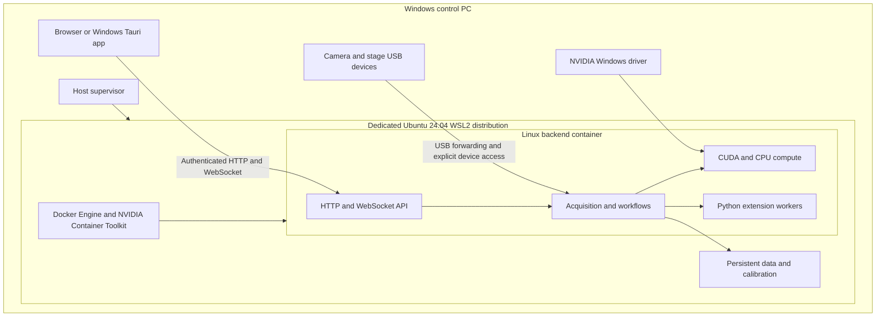

# Linux container architecture

OScope controls a scientific microscope through a layered Rust backend. The
backend is built for Linux x86_64 and distributed as a versioned Docker image.
Windows 11 control PCs provide WSL2, USB forwarding and the NVIDIA host driver.
The frontend remains a separate Vue 3 application, with a Windows Tauri host later.

## Runtime boundaries

The hardware path is subject to qualification on the exact camera, SDK, USB
controller and stage firmware. Simulator success does not establish that path.

## Backend layers

| Layer | Responsibility | Legacy source |
|---|---|---|
| L0 | Frames, pools, clocks, identifiers and units | `oscope-core` |
| L1 | Compute, imaging, stitching, volume algorithms and shared memory | `oscope-compute`, `oscope-imaging`, `oscope-stitch`, `oscope-volume`, `oscope-shm` |
| L2 | Device traits, simulator, real drivers and project/recording storage | `oscope-hal`, `oscope-sim`, `oscope-store`; future real drivers |
| L3 | Jobs, recipes, extensions and reports | `oscope-jobs`, `oscope-pipeline`, `oscope-ext`, `oscope-ext-sdk`, `oscope-report` |
| L4 | Acquisition, preview, autofocus, calibration and scans | `oscope-acquire`, `oscope-workflows` |
| L5 | API, sessions, leases, media and settings | `oscope-api` |
| L6 | Configuration, startup and application composition | `oscope-server` |

Preserve downward dependencies and the legacy same-layer exceptions. Only
`oscope-api` may depend on `teta-wot`. Keep the frame bus's shared buffers, bounded
recording queues and latest-frame delivery.

## CUDA policy

Normal backend builds include CUDA. Supported processing prefers the GPU and
reports CPU fallback with a reason when GPU initialization is unavailable.
Preserve CPU reference kernels and their numerical-equivalence tests. Do not move
isolated host operations to the GPU without measuring total transfer cost.

The initial toolchain remains Rust 1.98.1 and CUDA 13.4.1, matching the legacy
workspace's CUDA 13.4 interface. Pin container inputs and qualify the minimum
Windows NVIDIA driver. WSL uses the Windows driver; no Linux GPU driver is
installed in WSL or baked into the application image.

Container launch and application fallback are different. A required GPU
reservation can prevent Docker from launching at all. Provide a launch mode
without a GPU reservation for CPU-only development and fallback verification.
GPU and factory checks always select the GPU mode and fail if no real kernel ran.

Keep GPU telemetry best-effort: WSL supports fewer NVML queries and limits pinned
host memory. A missing utilization metric is not a failed compute backend.

## Communication and process ownership

- Windows clients use the existing API and binary preview WebSocket. A Windows
  Tauri process cannot directly map the Linux `/dev/shm` preview ring.
- Keep Linux shared memory for backend/Python workers in the same container and
  provision its capacity explicitly. Do not expose host IPC globally.
- The backend runs directly as the container's application process and handles
  termination gracefully. Run Python workers as supervised child processes.
- A host supervisor starts and keeps WSL available under a deliberately provisioned
  account, manages USB attachment and starts Docker. Docker owns container restart;
  avoid two supervisors racing to restart the same container.
- Restarting the backend does not automatically resume physical motion or an
  interrupted acquisition. Surface interrupted jobs and require recovery checks.
- Container restart is supported. Windows reboot/shutdown is unavailable until
  an explicit host integration is implemented; `systemctl` inside the container
  does not reboot the Windows PC.
- Listen on the container interface and publish only the required localhost port,
  initially 8210. Configure authentication, TLS and allowed origins together.

## Persistent state

Keep application images separate from the instrument's configuration, calibration,
accounts, job history and datasets. Use Linux-backed storage for active data and
scratch recordings. Windows exports and backups use explicit interfaces.

An application update must not replace the WSL distribution, erase a volume, reset
calibration or change device identities. Database/configuration migrations declare
compatibility with the previous supported release before rollback is offered.

## Versioned product components

| Component | Versioned contents |
|---|---|
| Host baseline | Windows, WSL/kernel, Ubuntu, Docker/Compose, NVIDIA driver/toolkit, USB forwarding and host supervisor |
| Application release | Backend image identity, frontend compatibility, approved extensions, deployment configuration and acceptance runner |
| Instrument configuration | Microscope/component identities, objective catalogue, calibration revisions and unique credentials |

Maintain a qualified compatibility matrix across all three components. Host
baseline changes receive their own acquisition/recovery qualification.

## Deferred optimization

After behavior parity, measure shared compute ownership, GPU memory admission,
device-resident pipelines and job persistence. The legacy preview, autofocus and
workspace create separate compute instances; volume jobs create more per run.
Consolidation must preserve stream isolation and numerical behavior. Depth and
deconvolution jobs' zero GPU reservations need explicit budgeting. These changes
are separate from the initial port. Frontend optimization is out of scope.

## Sources

- [NVIDIA CUDA on WSL](https://docs.nvidia.com/cuda/wsl-user-guide/index.html)
- [NVIDIA Container Toolkit](https://docs.nvidia.com/datacenter/cloud-native/container-toolkit/latest/install-guide.html)
- [Microsoft USB access in WSL](https://learn.microsoft.com/en-us/windows/wsl/connect-usb)
- [Microsoft WSL production considerations](https://learn.microsoft.com/en-us/windows/wsl/faq#can-i-use-wsl-for-production-scenarios)
- [Docker WSL filesystem guidance](https://docs.docker.com/desktop/features/wsl/best-practices/)
- [Tucsen SDK support](https://www.tucsen.com/sdk-software-support-product/)
