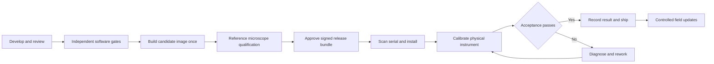
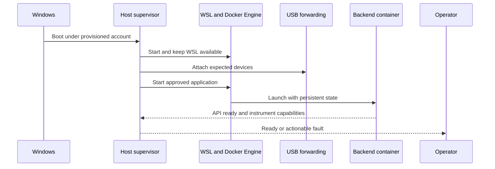

# Factory deployment and field service

OScope production is planned at 300 microscopes per year, about six per week. Each
instrument receives an approved software release and its own configuration and
calibration. Operations installs tested artifacts; compilation belongs to the
development and release pipeline.

## Development to shipment

Keep host baseline, application release and instrument configuration versions
separate. Application updates preserve calibration, identities and customer data.

## Release qualification

Engineering maintains reference instruments for the supported camera/controller,
GPU and optics combinations. Qualify the exact runtime image for actual CUDA
execution, scientific outputs, acquisition/recording, preview under batch load,
stage motion, autofocus, scanning, device reconnects, cold startup, upgrade and
rollback. Long endurance runs belong here; per-unit acceptance is shorter.

Release the backend image, compatible frontend, approved extension identities,
deployment files, installer, acceptance runner, hardware compatibility manifest,
release notes and recovery procedure together. Pin artifacts, verify signatures,
and provide both factory-registry and offline delivery. Retain the previous
qualified release and record who approved promotion.

## Factory operator flow

1. Scan microscope and control-PC serial numbers.
2. Connect the expected devices and place the prescribed calibration target.
3. Select the approved release for this hardware revision.
4. Run the provisioner, which resumes after any required host reboot.
5. Follow objective/fixture prompts for calibration and physical tests.
6. Run acceptance and review measured results.
7. Attach the report to the manufacturing record. Ship only after acceptance.

The [R10 engineering provisioner](host-provisioning.md) now plans pinned host
versions/artifacts, imports an owned clean WSL template, initializes unique
application identity/credentials and defines owner-bound unattended startup.
Its clean-PC/cold-boot qualification is deferred, and R09 physical device access
is unqualified. The final factory flow still needs the approved Windows baseline,
hardware/USB feasibility, physical acceptance and authenticated release bundle.
It must report faults such as missing hardware, GPU failure or out-of-limit
calibration before shipment.

Never copy a configured instrument's credentials or calibration into the next
unit. Match USB devices by stable identity and verified topology; do not assume a
bus number or `/dev/ttyUSB0` identifies the same device after every restart.

## Physical acceptance

| Test | Required evidence |
|---|---|
| Identity | Expected instrument, camera, controller, firmware, GPU and objective configuration |
| GPU | Actual kernel executed and checked; fallback or skipped GPU test fails acceptance |
| Camera | Approved mode/bit-depth combinations, sustained rate, timing gaps, corruption checks and reconnect |
| Stage | Fixture prepared; homing, direction, travel, repeatability, limits and stop behavior |
| Calibration | Per-objective scale, camera/stage mapping, applicable corrections, calibration revision |
| Autofocus | Repeatable focus on the prescribed reference target |
| Scan | Known area acquired, stitched, saved, reopened and compared with the target |
| Load | Acquisition, recording, preview and processing meet the qualified profile together |
| Recovery | Backend/container restart, USB reconnect, cold PC boot and interrupted-job reporting |
| Persistence | Configuration, calibration and saved data survive lifecycle operations |

Engineering sets numerical limits and required modes using reference instruments.
The legacy hardware survey recorded about 7.24 fps and 289 MB/s for mode 0 raw
16-bit capture, and corruption in mode 1 at 8 bits. Repeat those measurements in
WSL/container qualification before setting production limits or enabling that
mode. The stage parameters and the replacement camera remain hardware-specific.

Use a bounded scratch recording ring for endurance. Retain measurements, logs and
selected images rather than the full recording. Reject missing hardware, a
simulated replacement, an incomplete step or a required test that skipped.

## Acceptance record

Every report has an immutable run identifier and records:

- Instrument, PC and component serials; hardware revision and controller firmware.
- Host baseline and actual Windows/WSL/kernel/Docker/driver/SDK versions.
- Application release and image identity; frontend and acceptance-runner versions.
- Calibration revisions, objective configuration and configuration hash.
- Measured results, limits, raw diagnostic references and pass/fail reasons.
- Technician, time and time source, station, disposition and any rework history.

Store reports in the manufacturing inventory, with an offline export path.
Retesting creates another record; it does not overwrite the failed evidence.

## Unattended startup

Qualify cold boot before interactive login, delayed device arrival, power loss
and an unavailable GPU. Systemd services alone do not keep WSL alive. Define one
recovery owner per layer and bounded retries. Docker owns container restart; the
host supervisor owns Windows/WSL/USB readiness. Do not automatically resume motion
or an interrupted acquisition after a restart.

## Field update and rollback

1. Verify the signed release, target hardware and host/application compatibility.
2. Download or import the complete release while the microscope remains available.
3. Wait for idle, take a maintenance lock and stop acquisition cleanly.
4. Back up configuration and database state with a known consistency boundary.
5. Apply declared schema migrations and replace the application image.
6. Run GPU, device, storage and compatibility verification before releasing the lock.
7. Record the outcome and return to service, or perform the validated rollback.

Use internal instruments, then a small pilot, then broader eligible groups. Host
baseline updates receive independent qualification. Updates may be delivered
offline and must not require access to an external package repository at runtime.

Rollback includes image, configuration and schema compatibility. A previous image
is not automatically compatible with a migrated database. Preserve acquisitions
created after an update; never blindly restore an older data snapshot over them.

## Service and inventory

The [R11 acceptance runbook](factory-acceptance.md) describes the implemented
profile/checklist, blocked factory preflight, isolated CUDA engineering runner and
per-attempt evidence/rework. Physical acceptance remains pending qualification;
engineering reports never authorize shipment.

Maintain installed/approved versions, acceptance reports, calibration and service
history for each instrument. A service export includes relevant logs, versions,
device state and diagnostics; customer image data is included only when requested.
Factory and field tools use the same release manifest and validation rules.

## External references

- [WSL production lifecycle](https://learn.microsoft.com/en-us/windows/wsl/faq#can-i-use-wsl-for-production-scenarios)
- [WSL systemd behavior](https://learn.microsoft.com/en-us/windows/wsl/systemd/)
- [USB forwarding](https://learn.microsoft.com/en-us/windows/wsl/connect-usb)
- [Docker image identities](https://docs.docker.com/build/building/best-practices/#pin-base-image-versions)
- [Offline image save](https://docs.docker.com/reference/cli/docker/image/save/) and [load](https://docs.docker.com/reference/cli/docker/image/load/)
