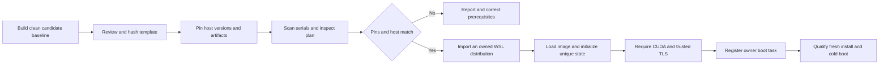

# R10 host provisioning tools

The owner authorized building/testing these tools here and deferred clean-PC
qualification. They are engineering candidate tools, not a qualified factory
installer. R09 physical camera/controller qualification is still pending.
R12 now has a separate [signed engineering bundle/update adapter](release-lifecycle.md).
It refuses R10 roots; transition of the fixed-image Windows startup receipts to
versioned release state remains pending qualification.
The R01 `setup-wsl.sh` remains a developer bootstrap; it is not used on units.

## Baseline, application and instrument identity

Each baseline binds exact Windows build, WSL, NVIDIA driver and usbipd versions;
Linux checks bind Ubuntu 24.04, kernel, Docker, Compose and NVIDIA Container
Toolkit versions. The rootfs archive, its guard report and backend image archive
have SHA-256 pins. The application is selected by immutable Docker image ID.
An installation separately records a random UUID, instrument/PC serials, Windows
owner SID and host fingerprint. Never export a configured instrument as a new
unit's template. Repeating provisioning preserves its identity, TLS and data.

`configs/host-baseline.example.json` deliberately contains missing pins. It must
not be used to manufacture units. The development laptop's observed versions
are diagnostics, not automatically approved production versions. R12 will add
the signed release/distribution/update boundary; hashes alone do not authenticate
a publisher. Every current tool/report retains qualification `pending`.

## Engineering flow



Windows installation receipts advance only after read-back verification. An
interruption retries incomplete steps; completed steps are checked again.
Foreign/nonempty directories, changed identity/baseline/tool revision, another
Windows owner, version drift or bad artifacts cause refusal. No automatic
unregistration, data deletion, password reset or version upgrade is performed.
Concurrent Windows applies are serialized by an installation mutex; Linux state
operations use a file lock. This is first-install/recovery tooling, not R12's
update/rollback system.

Windows version pins are checked by Plan/Apply; ongoing Windows update controls
belong to the managed PC baseline and still require qualification. Linux version
pins are checked on initialization and supervisor startup, so kernel/engine/
toolkit drift blocks startup rather than being silently adopted.

The startup definition uses a boot trigger and password-backed batch logon for
the same dedicated local/domain Windows account that imported WSL. It does not
use interactive login, SYSTEM's separate registration or S4U. WSL distributions
are imported with the documented import interface; keep their account ownership
consistent. [Microsoft custom distributions](https://learn.microsoft.com/en-us/windows/wsl/use-custom-distro),
[task principals](https://learn.microsoft.com/en-us/powershell/module/scheduledtasks/new-scheduledtaskprincipal?view=windowsserver2025-ps).

The task runs a foreground WSL process. The Linux supervisor checks the owned
runtime and trusted TLS; Docker owns backend process restart. Task failure
retries are bounded (three retries one minute apart); there is no competing
infinite container restart loop. A maintenance marker keeps the backend stopped
until explicit resume. No physical motion/acquisition is automatically re-armed.
Windows lifetime handling is needed because WSL manages VM lifetime differently
from a normal server. A systemd unit or task XML is not a cold-boot pass.
[Microsoft production lifecycle](https://learn.microsoft.com/en-us/windows/wsl/faq#can-i-use-wsl-for-production-scenarios).

## Run the tooling checks here

From the Linux checkout:

```sh
bash scripts/check-provisioning.sh
bash scripts/check-gates.sh
python3 scripts/gates.py --all --run provisioning
```

These run standard-library fixtures only, without Rust, Node, devices or GPU.
From PowerShell 7.4+ on Windows:

```powershell
pwsh -NoProfile -File tests/provisioning/host.Tests.ps1
```

The Windows contracts generate task XML, inject interruptions into a fake action
driver, inspect version/hash failures and test DPAPI-protected credentials. They
never import WSL or register tasks. Test-only credentials/state remain under
ignored `artifacts/r10/`; do not publish credential files.

Inspect the unconfigured candidate against this host without creating an install:

```powershell
./scripts/provision-host.ps1 -Mode Plan -BaselinePath configs/host-baseline.example.json -BundleDirectory artifacts/r10 -InstallRoot C:\ProgramData\OScope\review-only -InstrumentSerial R10-SIM -PcSerial ENGINEERING-PC
```

Expect `ready=false` and explicit missing pins/artifacts/version findings. A plan
does not install software, create accounts/tasks, import a distribution or reboot.
It reads host metadata and artifact hashes. `Apply` requires an explicit
`-Engineering` flag, a completely matching candidate and credentials for the
current Windows WSL owner. Source/build operations never run on the unit.

Run the separate simulated Linux bootstrap lab using the existing runtime image:

```sh
sudo python3 tests/provisioning/lab.py --image oscope-backend:r07 \
  --report "artifacts/r10/lab-$(date -u +%Y%m%dT%H%M%SZ).json"
```

This requires an actual NVIDIA GPU/kernel diagnostic. It creates two separate
simulated installations with random identities/credentials, checks trusted TLS,
login, repeat preservation, foreign identity/credential refusal, foreground
supervision, maintenance and explicit resume. It chooses free loopback ports,
then removes only its owned containers and retains all synthetic state. No
Windows task/account/WSL registration changes. It does not run camera/stage
hardware or prove VM lifetime before login. Missing CUDA is a failure, not a skip.
The CPU fallback path is an explicit engineering identity option; it cannot
qualify a CUDA-specified microscope.

## Prepare a clean candidate — engineering build station

Use a disposable builder created from a trusted Ubuntu 24.04 rootfs, not the
development distribution and not an instrument export. Install the exact
candidate package versions, configure NVIDIA Container Toolkit for Docker and
enable Docker on boot. Record package provenance/versions and installer hashes.
Keep vendor SDK redistribution subject to the R09 review; the current application
image still uses simulated devices. No Linux NVIDIA display driver is installed
inside WSL. Windows OS/driver/features/PowerShell/WSL/usbipd belong to the separately
managed candidate PC image; this tool verifies them and does not silently update
them or enable/reboot Windows.

The clean template needs Python 3.11+, systemd, the pinned engine/Compose/toolkit,
locked password accounts, a blank/uninitialized `/etc/machine-id`, no SSH host
keys or user keys/history, no persisted journal identity, no OScope state and no
Docker image/volume/container state. `/etc/wsl.conf` must contain:

```ini
[boot]
systemd=true
[interop]
appendWindowsPath=false
```

Record `{"schema_version":1,"baseline_id":"<candidate-id>"}` in
`/etc/oscope-host-baseline.json`. Configure this only in the disposable builder;
never clear IDs, keys or Docker state on an existing instrument. Export its
clean rootfs using the build station's controlled process. The guard checks
known carried-state risks and does not sanitize an export or certify a complete,
trustworthy, bootable OS. Review the clean build provenance as well.
[Per-distribution WSL settings](https://learn.microsoft.com/en-us/windows/wsl/wsl-config).

```sh
python3 scripts/provision-template.py --archive /staging/host-rootfs.tar \
  --baseline-id YOUR-CANDIDATE-ID --report /staging/rootfs.audit.json
```

Expect zero only if the guard passes; reject any issue and rebuild from clean
inputs. Reports refuse existing paths. Pin both that archive and guard report in
a copy of the example baseline. Produce the tested backend archive on the build
station (`docker image save`), record its hash and exact image ID, and supply it
beside the rootfs. No application compiler is part of the unit's install.
The candidate must match actual Linux command outputs exactly; template labels
alone do not satisfy post-import verification. Keep artifact files read-only and
under the controlled engineering/operations process.

## Clean-PC procedure — deferred qualification

Use a dedicated PC with the candidate Windows image, firmware/driver versions,
WSL2 prerequisites, PowerShell 7.4+, usbipd, sufficient RAM and the manifest's
physical free-space budget (example 64 GiB). Complete R09 hardware feasibility
before treating the combined platform as production-capable. Establish a dedicated
local/domain Windows host account with a unique password and the required task
logon/installation rights. Run the installer as that same account; do not import
under an engineer's account and register the task under another one. Account
provisioning/domain policy belongs to the controlled Windows baseline process.

Copy the candidate artifacts locally. Scan the instrument and PC serials and
choose an empty local drive-letter install directory without junction/reparse
parents (for example `C:\ProgramData\OScope\installations\UNIT001`). Then:

```powershell
$r10Args = @{
  BaselinePath = 'D:\Candidate\baseline.json'
  BundleDirectory = 'D:\Candidate'
  InstallRoot = 'C:\ProgramData\OScope\installations\UNIT001'
  InstrumentSerial = 'UNIT001'
  PcSerial = 'PC001'
}
./scripts/provision-host.ps1 @r10Args -Mode Plan
$r10Owner = Get-Credential -UserName ([Security.Principal.WindowsIdentity]::GetCurrent().Name)
./scripts/provision-host.ps1 @r10Args -Mode Apply -Engineering -HostCredential $r10Owner
```

An engineering install imports its own UUID-named WSL distribution, streams the
image locally, validates installed Linux versions, initializes non-root read-only
runtime state with required CUDA/TLS, and registers/starts its owned boot task.
Installation storage is restricted to that Windows owner, Administrators and
SYSTEM. The initial application `operator` credential is generated randomly and
stored in `operator.credential.xml` using Windows DPAPI for this owner. Windows
task credentials are handed to Task Scheduler; they are not written into the
journal or process arguments. Do not attach credential files to evidence. Use
the approved secure handoff process; rotate application bootstrap credentials
through the existing account tooling as part of operator handoff.
[Windows credential serialization](https://learn.microsoft.com/en-us/powershell/module/microsoft.powershell.utility/export-clixml?view=powershell-7.5).
[Windows task registration](https://learn.microsoft.com/en-us/powershell/module/scheduledtasks/register-scheduledtask?view=windowsserver2025-ps).

Qualification must record these outcomes rather than inferring them from code:

1. Fresh installation succeeds with every pin checked; changed artifacts, wrong
   owner, missing GPU and version drift fail without replacing another install.
2. Repeat and interruption recovery preserve installation UUID, account, TLS,
   configuration and synthetic saved data. A failed partial import may require
   engineer reconciliation; the tool never unregisters/replaces an ambiguous
   distribution or deletes its data to recover.
3. Cold boot the test PC and wait before interactive login. After login, retain
   Task Scheduler history and Linux readiness timestamps proving that the owned
   task/API were running before interactive login. A boot-trigger definition,
   a start-after-login test or a running systemd unit alone is insufficient.
4. Test foreground-process loss, delayed Docker/GPU readiness, maintenance,
   service restart and explicit resume. Confirm bounded task retries, clear
   diagnostics and no automatic physical motion/acquisition. Verify Windows
   localhost access and certificate trust through the approved client procedure.
5. Verify two fresh units have distinct Windows/Linux/application identities,
   certificates and bootstrap secrets. Record baseline/image/installer versions,
   hardware and operator/run IDs, failures and exact recovery actions.

The existing R08 client procedure remains the reference for browser/API behavior;
R10 does not build/optimize the frontend or package a final customer release.
R11 covers physical calibration/acceptance; R12 covers authenticated release
bundles, installation promotion, compatible updates and rollback.

## Stop and retain evidence

For an owned Linux installation, use its root path:

```sh
python3 /opt/oscope-host/provision-runtime.py pause --root /var/lib/oscope-host --engineering
```

The supervisor stays in maintenance. `resume` explicitly restarts this simulated
runtime. On a qualification PC stop only the named task/distribution/probes this
procedure created when required for the next test. Preserve their installation
receipt, encrypted credential handoff, state, TLS, calibration, datasets and run
evidence. Do not use global `wsl --shutdown`, unregister another distribution,
delete volumes or restore an older dataset as cleanup.
