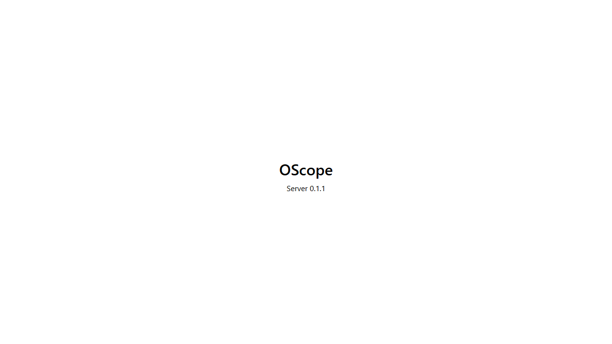
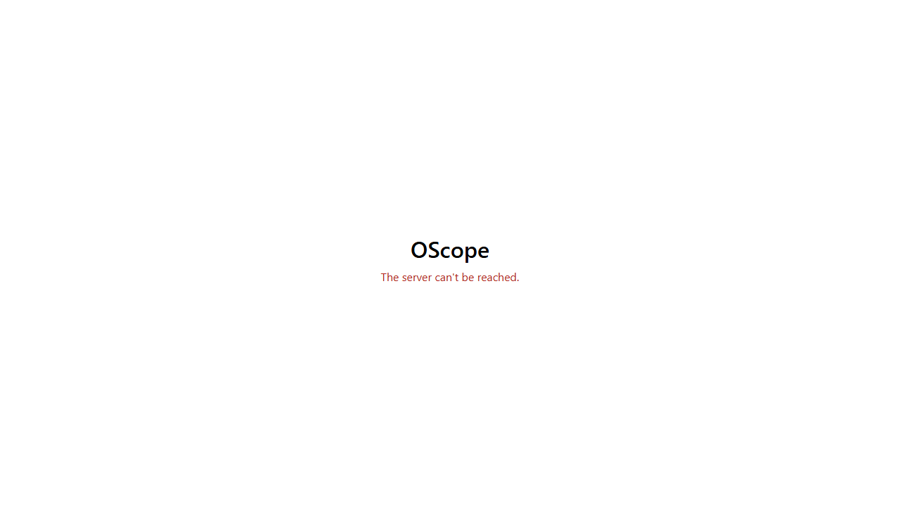

# W0.1: The web workspace and its checks

- Status: Done
- Branch / PR: `m2/w0.1-web-workspace` / [#76](https://github.com/lucaswewa/OScope/pull/76)
- Estimate: first 900, the spec's · second ~1,420 (code ~430, tests ~290, styles ~40, try-it ~140, glue ~520), in the plan's change log before the code, 58 % over the first: one pull request, at the owner's standing choice for W0 and W1 · measured **1,513** hand-written lines changed (code 457, tests 437, styles 25, try-it 231, glue 363). **That is 93 over the second estimate:** the size of what the first gate found, below. Tests took more than estimated, and glue less

## Summary

`web/` exists ([spec](../phases.md#w0-1)). It is a Vue 3 app that builds, is checked as the Rust workspace is, and shows the server's version on its first page. The server serves the built app at its own address. From here on, the replays check the app on Windows and on Linux, with an end-to-end test in three browsers.

## What was built

- **`web/`:** Vue 3.5, TypeScript 6 in strict mode, Vite 8, Pinia, Vue Router by hash, and vue-i18n, on Node 24.
- **The layers** ([ADR-0039](../../adr/0039-the-web-app-its-layers-state-and-routing.md)), kept by `eslint.config.js`:
  - `src/ui/`, `api/`, `host/`, `features/` and `app/`;
  - only `ui/` imports reka-ui;
  - only `api/` reaches the network, and only `host/` the platform.
- **The first page,** `features/home/`: OScope, and the server's version. It asks every 2 s, so it follows a server that stops and one that returns.
- **The checks** ([ADR-0040](../../adr/0040-testing-the-app.md)), as npm scripts: `typecheck`, `lint`, `test:unit`, `build`, `licences`, `advisories` and `test:e2e`.
- **The packages' rules,** `scripts/packages.mjs`:
  - **Two tiers.** What the app ships is measured: the build writes the names of the packages whose code is in the bundle, to `.bundle/packages.json`.
  - **Licences:** `deny.toml`'s list with 0BSD and MIT-0 for what ships; with Python-2.0, BlueOak-1.0.0, CC-BY data and MPL-2.0 for development tools.
  - **Advisories:** none in what ships; in tools, only those in `advisories.json`, each with its reason.
- **The server,** `oscope-server`: `--web FOLDER` and `[web] root` give the built app's folder to ADR-0006's pages, at the API's origin.
- **End-to-end tests,** `tests/e2e/`:
  - each test starts its own `oscope-server`, on a port the system picks, serving the built app;
  - the server's configuration, data and scratch space are in a folder of the test's, and its power actions are dry runs;
  - each run of the suite writes into a folder of its own, which it removes when nothing failed.
- **The replays and CI:**
  - `scripts/ci-local.sh` gains nine web steps, after the server is built;
  - `scripts/two-core.sh` takes `web:unit` and `web:e2e`;
  - `ci.yml` has the same steps.
- **`scripts/vitest.mjs`:** starts Vitest from the folder's path as the disk spells it.

## How to try it

From the repository's root, with Node 24:

```sh
cargo run --release -p oscope-server -- --config configs/oscope.toml   # the simulated instrument, on 8210
npm --prefix web ci
npm --prefix web run dev                                               # http://127.0.0.1:8280/
```

- The page shows **OScope** and **Server 0.1.1**.
- Stop the server: within a few seconds it says **The server can't be reached.**
- Start it again: the version returns.

The server serving the built app itself:

```sh
npm --prefix web run build
cargo run -p oscope-server -- --web web/dist    # http://127.0.0.1:8210/
```

## Screenshots

Taken by the end-to-end test (`OSCOPE_SHOTS=1`). The page has one look until W0.2 brings the themes.

| The server found | The server stopped |
|---|---|
|  |  |

## Design notes and deviations from the plan

- **An advisories check, which the spec doesn't name.** The Rust side has `cargo-deny`'s; the app's packages had none.
  - **What it found on its first run:** three advisories, all in development tools, none in the bundle:
    - `picomatch`, high: a slow regular expression on a hostile glob. No fixed version exists. Vite and Vitest depend on it.
    - `minimatch`, moderate: the same kind. Its fix is a new major, which ESLint doesn't take yet.
    - `glob`, moderate: its fix, 13.0.7, was a week old.
  - **What was decided, for the owner's review:** they are listed in `web/advisories.json` with their reasons, as `deny.toml` lists `chrono`'s. Each is about patterns from a stranger, and these tools match our own files. A new advisory fails the check until it is looked at.
- **The tiers are measured from the bundle,** not read from the lock file. Vue Router 5 brings its build plugin as a production dependency, with 60 packages behind it, `picomatch` among them. None of it is in the bundle, which holds 10 packages, all MIT.
- **Vitest and the drive letter.** Run from VS Code's terminal on Windows, every test failed before it started: *Cannot read properties of undefined (reading 'config')*. Node had been given `c:\repos\…`, and Vite names the same files under `C:\`, so Vitest was loaded twice. `npm run test:unit` now starts it from the path as the disk spells it. Playwright, ESLint and the build aren't affected.
- **No check of the packages' ages.** They are installed with `--before`, and the dates are below. A check would ask the registry about 250 packages on every run.
- **Prettier leaves Markdown alone.** It wanted `web/README.md`'s tables padded and its italics changed, which isn't the repository's style.
- **The screenshots are of one look.** The spec asks for both themes; there are none before W0.2.
- **`ci.yml`'s web steps haven't run on GitHub:** its Actions are still blocked. The replays run the same steps.
- **WSL, with the owner's word:** Node 24.18.0, installed by the owner; Playwright's system libraries for the three browsers, installed as root (217 packages).
- **`@types/node` is 24's,** to match the runtime: npm first chose 26's.

### What the first gate found

The first commit of the code, `902b78d`, failed its gate at the first step: the two-core runs. Five copies of the end-to-end suite side by side passed **none of five,** then, after the first fix, **four of five.** Each alone had passed, in all three browsers. There were two faults, both in what the tests shared, and a third in my own checking:

- **Playwright's output folder.**
  - **The fault:** a run clears `test-results/` as it starts, and its workers delete their folders there as they end. Each copy took the traces the others were writing: `browserContext.close: ENOENT`.
  - **The fix:** each run has a folder of its own, `test-results/<date>-<time>-<process>/`. A small reporter, `tests/e2e/tidy.ts`, removes it when the run left nothing but Playwright's note of its result.
- **The server's scratch space.**
  - **The fault:** a server given only `--data-root` keeps its scratch space in the working folder, `.oscope/scratch`. Every test's server shared `web/.oscope/scratch`, and each clears its `tmp` as it starts: *the scratch space: .oscope/scratch\tmp: Access is denied*. My two Rust tests of `--web` shared one too, in the crate's folder.
  - **The fix:** each test's server has a configuration of its own, as Milestone 1's tests have: its data and scratch space in the test's folder.
  - **With it, power in a dry run.** No end-to-end test, now or later, can turn the computer off.
- **Lint failed on the committed tree,** on `web/README.md`: I had written it after my last lint run. The Windows replay would have stopped there. Every check now runs on the final tree before a commit.

The two-core runs are what the rule says they are for: this PC, with all its cores, showed neither fault in a single run.

## Tests

- **Unit** (`npm run test:unit`, 43 tests):
  - the version line: found, lost, found again; an answer that takes too long; no more requests after its page goes;
  - the lint rules, each on lines that break it and on the place where they are allowed: 18 cases;
  - the packages' rules: licence expressions, the two tiers, advisories judged: 22 cases.
- **Rust** (`oscope-server`):
  - the app's folder is served beside the API, and nothing outside it, however the path is written;
  - a folder that would hide the API, or isn't there, is refused;
  - `[web] root` is relative to the file, and `--web` takes its place.
- **End to end** (`npm run test:e2e`, 4 tests):
  - the first page against its own server, which is stopped and started again at the same address: Chromium, Firefox and WebKit;
  - the tests' own footing: a test's server keeps its data and scratch space in its own folder, and its power is a dry run.
- **Mutation checks.** 14 mutants were listed against the tests first; each had a test. Seven were run, and all were caught:
  - the server doesn't serve the folder; `[web] root` isn't relative;
  - a stopped server is never noticed; the page asks only once;
  - a feature may use `fetch`;
  - a licence's `AND` counts as `OR`; a shipped package's advisory can be listed away.
- **Four more, on the tests' footing,** all caught:
  - the tests' server is given only a data root, as it first was;
  - it has no scratch space of its own; its power is real;
  - the Rust test's configuration has no scratch space.
- **Broken without meaning to:**
  - Vitest without its launcher, from a lower-case drive letter, fails all 43;
  - one shared output folder: none of five copies passes.
- **Two cores, five times,** on `f8db27f`: `oscope-server:cli`, `oscope-server:config`, `web:unit` and `web:e2e`, 20 of 20. A run of the end-to-end suite takes 23 to 24 s there.
  - On `902b78d`, before the fixes: `web:e2e` 0 of 5, the others 15 of 15.
- **The replays,** the merge gate (ADR-0038), each run alone on `f8db27f`. The commit since has only docs.
  - **Windows:** `scripts/ci-local.sh`, in 21 minutes from an empty build folder: 78 of 78 steps, 632 Rust tests in 235 suites, the nine web steps, and every example's `--smoke`.
  - **Linux:** `scripts/ci-clone.sh` on a fresh WSL clone, in 16 minutes: 78 of 78 steps, 632 tests in 235 suites; 950 files, none with a CR.
  - **Disk:** from empty, a replay's build output is 95 GB on Windows and 136 GB in WSL. C: has 262 GB free after both.
- **Docs:** the relative links and anchors in the Markdown files resolve.

## Follow-ups and known gaps

- **The listed advisories:** take `glob` 13.0.7 once it is two weeks old (2026-11-20); watch `minimatch`'s and `picomatch`'s.
- **Features importing each other** is allowed. To be looked at as the tabs grow (ADR-0039).
- **The lint rules name globals.** A new way to the network needs adding.
- **`ci.yml`'s web steps,** to be watched on their first run once Actions is back.
- **From Milestone 1, found on the way:**
  - `oscope-server --print-td` makes an empty `.oscope/scratch/zoom` in the working folder, though its test says it creates nothing: the test looks only at the data root. Harmless side by side.
  - Two servers on one scratch space aren't refused: the second clears the first's `tmp`.
- **A server started again at its address** could find the port taken in between by another program. It hasn't happened; the failure would say so, with the server's log.
- **Failures' folders** in `web/test-results/` stay until deleted, and Playwright's `--last-failed` finds no earlier run.

## Clean room

Nothing was copied from `microscope` or any other codebase. Its two lint rules, the component library in one folder and the platform behind one door, are ideas ADR-0002 allows, written here afresh.

The packages added, all installed with `--before=2026-11-03`:

| Package | Version | Licence | Released | Tier |
|---|---|---|---|---|
| `pinia` | 4.1.0 | MIT | 2026-10-14 | ships |
| `vue` | 3.5.44 | MIT | 2026-10-13 | ships |
| `vue-i18n` | 11.4.17 | MIT | 2026-11-01 | ships |
| `vue-router` | 5.4.0 | MIT | 2026-10-07 | ships |
| `@eslint/js` | 10.0.1 | MIT | 2026-02-06 | tool |
| `@playwright/test` | 1.64.1 | Apache-2.0 | 2026-10-14 | tool |
| `@types/node` | 24.19.2 | MIT | 2026-10-09 | tool |
| `@vitejs/plugin-vue` | 6.0.10 | MIT | 2026-10-10 | tool |
| `@vue/test-utils` | 2.5.1 | MIT | 2026-09-16 | tool |
| `@vue/tsconfig` | 0.9.1 | MIT | 2026-03-24 | tool |
| `eslint` | 10.14.0 | MIT | 2026-10-30 | tool |
| `eslint-plugin-vue` | 10.12.0 | MIT | 2026-10-26 | tool |
| `happy-dom` | 21.0.4 | MIT | 2026-10-20 | tool |
| `prettier` | 3.9.10 | MIT | 2026-10-10 | tool |
| `typescript` | 6.0.3 | Apache-2.0 | 2026-04-16 | tool |
| `typescript-eslint` | 8.72.1 | MIT | 2026-10-26 | tool |
| `vite` | 8.3.5 | MIT | 2026-10-21 | tool |
| `vitest` | 5.1.0 | MIT | 2026-11-02 | tool |
| `vue-tsc` | 3.3.14 | MIT | 2026-10-29 | tool |

With what they bring, the lock file names 267 packages across platforms, of which 242 are installed on Windows:

- **In the bundle:** 10, all MIT.
- **Development tools:** MIT 200, Apache-2.0 19, MPL-2.0 12, ISC 11, BSD-2-Clause 8, BlueOak-1.0.0 5, BSD-3-Clause 2.
