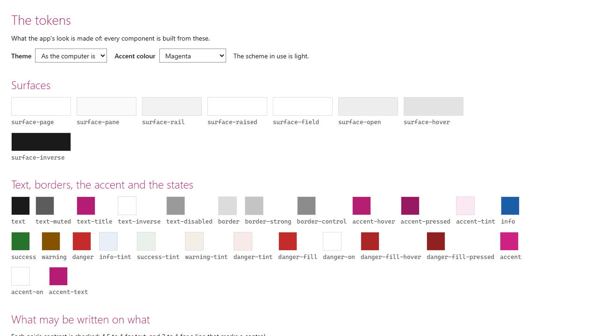
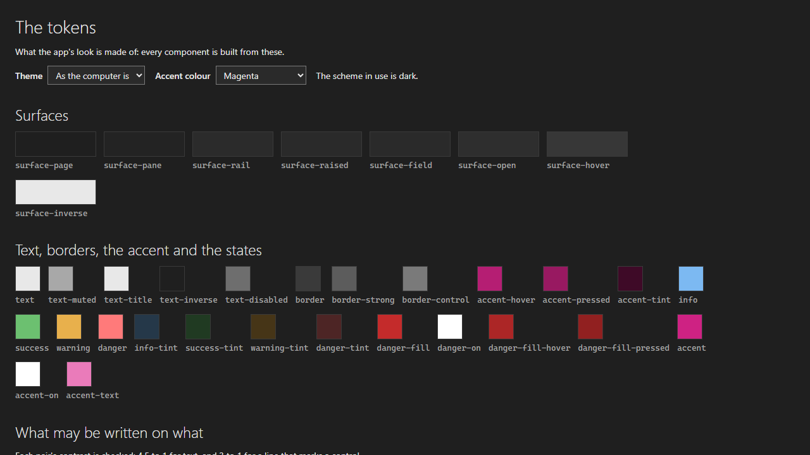

# W0.2: Design tokens, themes and icons

- Status: Done
- Branch / PR: `m2/w0.2-tokens-themes-icons` / [#77](https://github.com/lucaswewa/OScope/pull/77)
- Estimate: first 1,100, the spec's · second ~1,600 (code ~420, tests ~460, styles ~430, try-it ~255, glue ~35), in the plan's change log before the code, 45 % over the first: one pull request, at the owner's standing choice for W0 and W1 · measured **1,600** hand-written lines changed (code 359, tests 511, styles 448, try-it 237, glue 45)

## Summary

The look, as tokens ([spec](../phases.md#w0-2)): [`look.md`](../look.md) says what `microscope` looks like, measured from the running app, and `web/src/ui/tokens/` turns that into CSS custom properties, in light, dark and the system's theme, with nine accents. A test computes the contrast of every pair of text and background the tokens allow. Icons are Material Symbols in the bundle.

## Behaviour spec

Written before the code. What follows is what the phase must do, and where each rule comes from.

### Sources

- **[WCAG 2.2]** W3C, *Web Content Accessibility Guidelines (WCAG) 2.2*, W3C Recommendation, 5 October 2023. <https://www.w3.org/TR/WCAG22/>
  - Success criteria 1.4.3 *Contrast (Minimum)*, 1.4.11 *Non-text Contrast*, 2.4.7 *Focus Visible* and 2.5.8 *Target Size (Minimum)*, all level AA.
  - 2.4.13 *Focus Appearance* and 2.3.3 *Animation from Interactions*, level AAA, for their measures.
  - Its definitions of *contrast ratio*, *relative luminance* and *large scale* text.
- **[sRGB]** IEC 61966-2-1:1999, *Multimedia systems and equipment – Colour measurement and management – Part 2-1: Colour management – Default RGB colour space – sRGB*. The transfer function WCAG's luminance uses.
- **[CSS Color 4]** W3C, *CSS Color Module Level 4*. <https://www.w3.org/TR/css-color-4/> Hexadecimal colours and `rgb()`.
- **[CSS Color 5]** W3C, *CSS Color Module Level 5*. <https://www.w3.org/TR/css-color-5/> `color-mix()` and `light-dark()`.
- **[Color Adjust]** W3C, *CSS Color Adjustment Module Level 1*. <https://www.w3.org/TR/css-color-adjust-1/> The `color-scheme` property.
- **[MQ5]** W3C, *Media Queries Level 5*. <https://www.w3.org/TR/mediaqueries-5/> `prefers-color-scheme` and `prefers-reduced-motion`.
- **[CSSOM View]** W3C, *CSSOM View Module*. <https://www.w3.org/TR/cssom-view-1/> `matchMedia()` and a `MediaQueryList`'s `change` event.
- **[Variables]** W3C, *CSS Custom Properties for Cascading Variables Module Level 1*. <https://www.w3.org/TR/css-variables-1/>
- **[Scrollbars]** W3C, *CSS Scrollbars Styling Module Level 1*. <https://www.w3.org/TR/css-scrollbars-1/>
- **[ARIA]** W3C, *Accessible Rich Internet Applications (WAI-ARIA) 1.2*, W3C Recommendation, 6 June 2023. <https://www.w3.org/TR/wai-aria-1.2/> The `img` role and `aria-hidden`.
- **[Material Symbols]** Google, *Material Symbols*, under the Apache License 2.0. <https://fonts.google.com/icons> Taken as SVG files from the npm package `@material-symbols/svg-300`.
- **[The look]** [`look.md`](../look.md): `microscope`'s look, measured from its running app.

### Tokens

1. **Every colour, size and time the app uses is a token:** a CSS custom property on the root [Variables]. A colour written anywhere else in the app's styles fails a test.
2. **A colour token is a role with two values,** one for a light scheme and one for a dark one, written with `light-dark()` [CSS Color 5]. A token may be made from others with `var()` and with `color-mix(in srgb, …)`.
3. **The roles** are [The look]'s: surfaces, text, borders, the accent, and the states information, success, warning and danger.
4. **The rest of the tokens:** the type scale, spacing on a 4 px step, the controls' sizes at compact density, radii, elevation, the focus ring, and motion. No control's size is under the 24 px that 2.5.8 asks of a target.
5. **Sizes are in `rem`,** so the app follows the reader's text size (WCAG 2.2, 1.4.4).

### Themes

6. **The theme is one of system, light and dark.**
   - **Light or dark** is the root's `data-theme` attribute, which sets `color-scheme` to that one scheme [Color Adjust].
   - **System** is no attribute: `color-scheme: light dark` then follows the computer's `prefers-color-scheme` [MQ5], as it changes, with no script.
7. **The accent is one of nine,** the root's `data-accent` attribute. Without it, the accent is magenta.
8. **Each accent has** a fill, what is written on the fill, and its colour as text in each scheme. Its fill under the pointer, its fill held down and its tint are made from the fill.
9. **With `prefers-reduced-motion: reduce`** [MQ5], the motion tokens are zero, and no animation or transition runs (WCAG 2.2, 2.3.3).

### Contrast

10. **The tokens name the pairs they allow:** which text may be written on which background, and which lines must stand out from which surfaces.
11. **For each allowed pair, in each scheme and with each accent:**
    - **text** has a contrast ratio of at least 4.5 to 1 (WCAG 2.2, 1.4.3). The allowance of 3 to 1 for large text isn't used;
    - **a line that marks a control** (a field's border, the focus ring, a state's icon) has at least 3 to 1 against the surface it is on (1.4.11).
12. **The ratio is WCAG's:** (L1 + 0.05) / (L2 + 0.05), with L1 the lighter colour's relative luminance.
    - L = 0.2126 R + 0.7152 G + 0.0722 B.
    - Each of R, G and B is the channel's value c in 0 to 1, made linear [sRGB]: c / 12.92 if c ≤ 0.04045, else ((c + 0.055) / 1.055)^2.4.
13. **A token's value is worked out as a browser does** before it is measured:
    - `var()` by the value it names [Variables];
    - `light-dark()` by the scheme [CSS Color 5];
    - `color-mix(in srgb, A p%, B)` channel by channel, as p of A and the rest of B [CSS Color 5]. Only opaque colours are mixed.
14. **Outside the rule,** as WCAG's own exceptions are: text on a control that is switched off; hairlines that only decorate; shadows; the dimming behind a dialog.
15. **A token that fails its pair fails the test,** which names the pair, the scheme, the accent and the ratio.

### The focus ring

16. **Focus from the keyboard shows a ring** (2.4.7): 2 px wide, 2 px away from the control, in the accent's text colour. That is the size 2.4.13 asks for, and the ring has at least 3 to 1 against every surface.

### The store

17. **The theme and the accent are kept by the browser,** under one name in its storage. W8.1 keeps them with the account.
18. **A change applies at once** to the root, and is there on the next visit.
19. **A kept value that isn't one of those offered** is taken as the default: system, magenta.
20. **Storage that fails,** as in a private window, doesn't stop the change: it holds until the page goes.
21. **The scheme in use** is known to the app, for what it draws itself: light or dark by the choice, or by `prefers-color-scheme` under system, followed through the `MediaQueryList`'s `change` event [CSSOM View].

### Icons

22. **`Icon` draws an icon by its name** from a registry of the icons the app uses: an inline SVG, in the text's colour, at a size from the tokens.
23. **A name that isn't in the registry fails the type check.**
24. **No icon is fetched at run time:** each is a path in the bundle. The gallery's page asks the network for no image and no font.
25. **An icon beside text says nothing to a screen reader** (`aria-hidden`). An icon that stands alone is given a label, and is then an image with that name [ARIA].
26. **The icons are Material Symbols,** outlined, at weight 300 [Material Symbols], [The look].

### Base styles

27. **A reset:** `box-sizing`, margins, and controls that take the page's typeface.
28. **The body** has the page's surface, the text colour and the body's type.
29. **Scrollbars** are thin, in the tokens' colours [Scrollbars]. **Selected text** has the accent's tint behind it.

### The gallery

30. **`#/dev/gallery` shows the tokens:** the surfaces, the allowed pairs each as a sample, the accent and the states, the type scale, spacing, radii, elevation, and every icon in the registry.
31. **Its two lists choose the theme and the accent,** through the store.

### Not in this phase

- Components: W0.3 to W0.5 build them on these tokens.
- The theme kept with the account: W8.1.

## What was built

- **[`docs/milestone-2/look.md`](../look.md):** `microscope`'s look, in our own words and measured from its running app: the layout, both themes' colours, its nine accents, type, density, corners, shadows, focus, and its controls.
- **The tokens,** `web/src/ui/tokens/`:
  - `tokens.css`: the colour roles, the accents, the type scale, spacing, the controls' sizes, radii, elevation, the focus ring and motion, as custom properties on the root;
  - `base.css`: a reset, the body's type, titles, links, the focus ring, scrollbars, the selection, and no motion for a reader who asks for less;
  - `pairs.ts`: the pairs the tokens allow, 57 of them: 46 of text on a background, and 11 of a line on a surface;
  - `theme.ts`: the themes' and the accents' names, and how a choice reaches the root.
- **Icons,** `web/src/ui/`: `Icon.vue`, and `icons.ts`, a registry of 35 Material Symbols under the names the app knows them by.
- **The store,** `web/src/features/display/`: the theme and the accent, kept by the browser, and the scheme in use.
- **`web/src/host/storage.ts`:** the browser's storage, the first of the platform's doors.
- **The gallery,** `#/dev/gallery`, in `web/src/features/dev/`: every token, each allowed pair as a sample, and every icon, with a list each for the theme and the accent.
- **The first page** takes its type and colours from the tokens.
- **Visual tests:**
  - the gallery's baselines for Windows and Linux, in `web/tests/e2e/baselines/`;
  - `OSCOPE_VISUAL=1` in the replays and in `two-core.sh`;
  - `scripts/baselines.sh`, which makes the baselines again.
- **[ADR-0041](../../adr/0041-design-tokens-and-themes.md).**

## How to try it

```sh
cargo run --release -p oscope-server -- --config configs/oscope.toml   # the simulated instrument, on 8210
npm --prefix web ci                                                    # the icons' package is new
npm --prefix web run dev                                               # http://127.0.0.1:8280/#/dev/gallery
```

- **Open `#/dev/gallery`.** It shows the surfaces, the colours, each allowed pair, the type, the spacing, the corners and the icons.
- **Choose a theme:** *Light* and *Dark* change the page at once.
- **Choose an accent:** the swatches named `accent` change, and so do the titles, which take its text colour in light.
- **With *As the computer is*,** change the computer's own theme (in Windows: Settings, Personalisation, Colours). The page follows without a reload, and the line beside the lists says which scheme is in use.
- **Reload:** the theme and the accent are still chosen.
- **Press Tab:** the list with the focus has the ring.

## Screenshots

Taken by the end-to-end test (`OSCOPE_SHOTS=1`): the top of the gallery, following the computer's scheme.

| Light | Dark |
|---|---|
|  |  |

The whole page, in both themes and on both systems, is in the baselines: [`web/tests/e2e/baselines/`](../../../web/tests/e2e/baselines/).

## Design notes and deviations from the plan

- **How the look was taken.** `microscope` had no built server, so its server was built (2.4 GB in its own `target/`) and run on its manual-check port 5090, serving its built app.
  - It ran on a copy of its simulated configuration that keeps its settings, data and logs in a temporary folder: its own `.microscope/` wasn't touched.
  - A script drove it in a browser by the names on its controls and took screenshots, and another measured their pixels.
  - It was stopped by its process ID. Its repository shows no change.
- **Nine accents,** where the spec says only "accent colours to choose from": the nine `microscope` offers, by D1.
  - Their fills, the writing on them and their text colours are as measured.
  - What is made from a fill (under the pointer, held down, the tint) is by our own formulas.
- **Warning and information colours are ours.** `microscope` shows neither. They were chosen to read as well as its success and danger do.
- **Every measured pair passed** the contrast rule as it stood: the look needed no correction. Two kinds of pair that fall short aren't allowed: a field's border on the grey surfaces, and danger's text on the surface under the pointer.
- **Titles are plain text in dark,** as in the look, and take the accent's text colour in light. One token says both.
- **`light-dark()` and `color-mix()`,** rather than two sets of values. The theme *system* then needs no script. The end-to-end test checks both functions in Chromium, Firefox and WebKit.
- **The store is a feature,** `features/display`, not part of `ui/`: it needs the browser's storage, and `ui/` may not reach `host/`. How a choice reaches the root is in `ui/tokens/theme.ts`, which needs nothing.
- **The gallery reads the stylesheet** for its tokens' names: a new token appears there without being listed.
- **A colour is written only in the tokens.** The test that says so found one at once: the first page's own red, from W0.1.
- **The visual tests run only with `OSCOPE_VISUAL=1`.** A baseline is one system's picture, and GitHub's runners have other typefaces.
- **The comparison allows a pixel a level or two, not Playwright's 0.2.** With its default, a hairline made a shade darker passed: see the mutation checks.
- **Linux's baselines are made under WSL from the Windows checkout,** by `scripts/baselines.sh`, with the server the Linux replay built.
- **The icons are at weight 300:** the look's strokes are about a pixel and a half at 24 px, which that weight draws.
- **The icons' package has 23,673 files.** It adds 14 s to an install. The alternative, copying the files used into the repository, would keep their licence by hand.
- **`Icon` is one word,** which Vue's lint rule refuses. The rule is off in `ui/`, where a component is named for what it is.
- **WSL's system typeface has no light weight:** its titles are drawn regular. An Ubuntu desktop's typeface has one.

## Tests

- **Unit** (`npm run test:unit`: 89 tests, 46 of them new):
  - **the tokens' reader,** 5:
    - `var()`, `light-dark()` and `color-mix()` worked out as CSS says, and what it can't measure refused;
    - WCAG's own figures: black on white 21; `#767676` on white 4.54, and `#777777` 4.48;
    - which rules reach a root;
  - **the tokens,** 23:
    - every allowed pair, in each scheme with each accent: 18 tests of 57 pairs;
    - the system's theme follows the computer; the accents styled are the accents offered;
    - no control under 24 px; no motion for a reader who asks for less;
    - no colour written outside the tokens;
  - **the store,** 11: its start; a change applied at once and kept; the scheme followed as the computer's changes; seven kept values, good and bad; a browser that refuses to keep;
  - **the storage,** 2;
  - **the icons,** 5: drawn by name; silent beside text, and named alone; a file in another form refused; a name that isn't in the registry refused by the type check.
- **End to end** (`npm run test:e2e`: 8 tests). The gallery, in Chromium, Firefox and WebKit:
  - it follows the computer's scheme as it changes, and a chosen theme holds against it;
  - a title is in the accent's text colour in light, and plain in dark;
  - an accent changes the fill, and its tint has a colour;
  - both are there after a reload;
  - no image and no font was fetched.
- **Visual:** the gallery, in light and in dark, against its baselines, in Chromium on Windows and on Linux.
- **Mutation checks.** 20 mutants, each against the test that should catch it. 19 were caught at once:
  - **the tokens,** 6: quieter text too light; white on the one light accent; a dark theme asking for the light scheme; an accent styled that isn't offered; motion left on; a control under 24 px;
  - **the reader,** 4: the light value taken in every scheme; the mix's shares the wrong way round; red's and green's weights exchanged; no sRGB curve;
  - **the store,** 5: a change that never reaches the page; one that isn't kept; anything kept taken as a theme; the computer's scheme not followed; the system's theme written on the root;
  - **the icons,** 3: a named icon still hidden; a registry that takes any name, caught by the type check; a file with two paths drawn by its first;
  - **the gallery,** 1: its theme list not the store's.
- **The twentieth survived at first: a hairline a shade darker,** `#dcdcdc` to `#cfcfcf`, passed the visual test. Playwright's default lets a pixel differ by about 50 grey levels. With the comparison held to a level or two, it is caught: 22,312 pixels differ.
- **Found by a test, not by a mutant:** the first page's own red, by the rule that a colour is written only in the tokens.
- **Two cores, five times,** on `e41be79`: `web:unit` and `web:e2e`, 10 of 10, the visual tests among them. The comparison holds with five copies side by side.
- **The replays,** the merge gate (ADR-0038), each run alone on `e41be79`. The commit since has only docs.
  - **Windows:** `scripts/ci-local.sh`, in 14 minutes: 78 of 78 steps, 632 Rust tests in 235 suites, the web steps with the visual tests, and every example's `--smoke`.
    - **Its first run failed one step,** the Rust tests' build, 16 s in: *the paging file is too small* (os error 1455). That is this PC's known shortage, and not in this phase's code, which changes no Rust. Its other 76 steps passed.
    - **Why it happens:** `oscope-api`'s build script records the commit, so every commit rebuilds it, and some sixty test and example binaries then link at once.
    - **The second run** had 12 compile jobs at once (`CARGO_BUILD_JOBS=12`) where the PC has 24 threads, and passed.
  - **Linux:** `scripts/ci-clone.sh` on a fresh WSL clone, in 11 minutes: 78 of 78 steps, 632 tests in 235 suites; 974 files, none with a CR. The app is built there on Linux, and matched the baselines made from the Windows build.
- **Docs:** the relative links and anchors in the Markdown files resolve.

## Follow-ups and known gaps

- **A chosen theme's first frame.** A theme that differs from the computer's shows the computer's until the store has read what the browser kept. W8.1, which keeps the theme with the account, meets it again.
- **Thin titles on Linux** depend on the system's typeface having a light weight.
- **The baselines grow** by about a megabyte a page: for W10.2 to look at.
- **`ci.yml` doesn't run the visual tests,** by design, and its web steps still haven't run on GitHub.
- **`microscope`'s pages have no slider, tabs, table or progress bar.** W0.3 to W0.5 design them in the same manner.
- **The reader knows `color-mix(in srgb)` only.** A token in another colour space fails the test until the reader learns it.
- **The Windows replay's memory.** A commit relinks some sixty binaries at once, which ran the PC out of memory once here. Fewer compile jobs avoid it: `CARGO_BUILD_JOBS=12 scripts/ci-local.sh`. Whether the script should set that itself is the owner's to say.

## Clean room

- **Nothing was copied from `microscope` or any other codebase.** Its look was taken from its running app: screenshots, measured pixel by pixel, and its controls' names as a user reads them. None of its styles, markup or code was read. Its screenshots aren't in this repository.
- **Its palette and its accents are reused,** as D1 allows, as measured values.
- **The contrast arithmetic** is WCAG 2.2's definition, with sRGB's transfer function. `color-mix()` and `light-dark()` follow CSS Color 5. The sources are in the behaviour spec above.
- **The package added,** installed with `--before=2026-11-03`:

  | Package | Version | Licence | Released | Tier |
  |---|---|---|---|---|
  | `@material-symbols/svg-300` | 0.48.2 | Apache-2.0 | 2026-10-27 | ships |

  The bundle now holds 11 packages: 10 under MIT, and this one.
