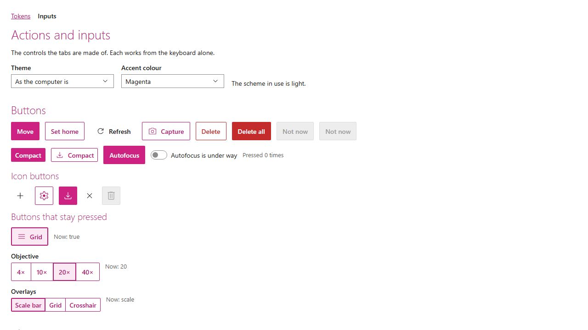
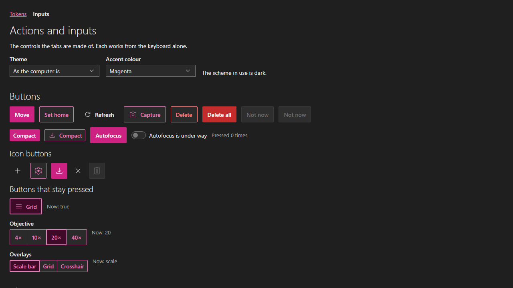

# W0.3: Components I: actions and inputs

- Status: Done
- Branch / PR: `m2/w0.3-components-inputs` / [#78](https://github.com/lucaswewa/OScope/pull/78)
- Estimate: first 2,000, the spec's · second ~2,800 (code ~910, tests ~560, styles ~670, try-it ~600, glue ~40), in the plan's change log before the code, 40 % over the first and over 2,500: one pull request, at the owner's standing choice for W0 and W1 · measured **3,679** hand-written lines changed (code 1,077, tests 873, styles 760, try-it 966, glue 3). **That is 31 % over the second estimate:** see the design notes

## Summary

The controls the tabs are made of ([spec](../phases.md#w0-3)): sixteen components in `web/src/ui/`, on reka-ui's primitives ([ADR-0042](../../adr/0042-the-component-library-on-reka-ui.md)), with the tokens' look in both themes. Each works from the keyboard alone, has a disabled and a read-only state, and passes axe. A gallery page shows every one in each of its states.

## What was built

- **Actions:**
  - `Button`: primary, outlined and bare; an accent and a danger tone; a compact size; an icon before its text; a busy state that keeps the focus and takes no press;
  - `IconButton`: an icon alone, which must be named, and shows its name as a tooltip;
  - `ToggleButton` and `ToggleGroup`: buttons that stay pressed, one of a group or several.
- **Choices:** `Checkbox`, with a state for "some"; `RadioGroup`; `Switch`.
- **Text:** `TextField`, `TextArea`.
- **Numbers:**
  - `NumberField`: a unit beside it, a range and a step, taken on Enter or on leaving, and a refusal that says why;
  - `Slider`, with its number beside it to read and to type.
- **Lists:** `Select`, one choice from a list that opens; `Combobox`, one from a long list, found by typing.
- **`Field`:** a label, a hint and an error, which the control inside takes up by itself. **`Tooltip`.**
- **What they share,** in `web/src/ui/`:
  - `control.ts`: the five things every control takes, and what a `Field` tells its control;
  - `number.ts`: the number field's rules, apart from the field;
  - `styles/`: a field's box, a list, a tooltip and a pressed button, for what a scoped style can't reach;
  - `words/en.ts`: the components' own words;
  - `Provider.vue`, at the app's root.
- **The gallery:** `#/dev/gallery/inputs`, every control in each state, with what it holds written beside it. The gallery's pages now share a header, with the way from one to the other and the theme's and the accent's lists, which are the app's own `Select`.
- **Tests' tools:** `tests/e2e/axe.ts`, and `src/ui/test-kit.ts`, which mounts a component as the app has it.

## How to try it

```sh
cargo run --release -p oscope-server -- --config configs/oscope.toml   # the simulated instrument, on 8210
npm --prefix web ci                                                    # reka-ui is new
npm --prefix web run dev                                               # http://127.0.0.1:8280/#/dev/gallery/inputs
```

Put the mouse aside, and use Tab and Shift+Tab to go from control to control.

- **Buttons:** Enter and Space press *Move*, and the count beside the row goes up. Turn *Autofocus is under way* on: the *Autofocus* button shows a ring, keeps the focus, and no longer counts a press.
- **Buttons that stay pressed:** on *Objective*, the arrow keys go from button to button, Space presses one, and Tab leaves the group in one step. One stays pressed.
- **Choices:** Space ticks *Invert x*. On *Scan order*, an arrow moves the choice, past *Spiral*, which is switched off. *Set by the instrument* is read-only: the focus reaches it, and Space changes nothing.
- **Numbers:** in *x*, type `12,5` and press Enter: the field says *This isn't a number.* and keeps 1250. Press Escape. Type `300` and Enter; then Arrow Up, Page Down, End, Home. In *Image overlap*, type `0.9` and press Tab: *At most 0.7.*
- **The wheel:** with the pointer on *Step* and the focus elsewhere, the wheel scrolls the page. With the focus in *Step*, it changes the value, and the page stays.
- **Sliders:** on *Exposure*, the arrows, Home and End move the thumb; typing in the number beside it and pressing Enter moves it too.
- **Lists:** on *Workflow*, Enter opens the list; the arrows, Home, End or a letter move through it; Enter chooses; Escape closes it as it was. In *Node*, type `den`: the list narrows to two.
- **A tooltip:** Tab to *Fill in*, at the page's foot: its tooltip shows. Escape sends it away.
- **Both themes:** choose *Dark* at the top, and go round again.

## Screenshots

Taken by the end-to-end test (`OSCOPE_SHOTS=1`): the top of the page of inputs.

| Light | Dark |
|---|---|
|  |  |

The whole page, in both themes and on both systems, is in the baselines: [`web/tests/e2e/baselines/`](../../../web/tests/e2e/baselines/).

## Design notes and deviations from the plan

- **The size: 3,679 lines, where 2,800 were estimated.** The components themselves came out as estimated (928 lines against ~910). The rest didn't:
  - **tests, 873 against ~560:** the number field's rules took 295 lines of tests alone, and each control's read-only and switched-off states doubled its cases;
  - **the try-it, 966 against ~600:** the end-to-end tests are 404 lines, since every control is used from the keyboard in a real browser, and the gallery page's words are 95;
  - **what the browser found,** below, which no estimate foresaw.
- **Where OScope differs from reka-ui.** Four things, each found by a test or a measurement in a real browser, and each now held by a test:
  - **Radio buttons chose only if the arrow key was held.** The library moves the focus at the key and the choice a moment later, if the key is still down. A quick tap left the focus on a button that wasn't chosen. `RadioGroup` now moves the choice at the key.
  - **A list's field showed its placeholder after every choice,** for a moment: the library reads the chosen label from the list's items as they are being removed. `Select` writes the label from its own options.
  - **A tooltip never showed for a control that Tab scrolled into view:** 0 of 10 tries, against 10 of 10 for one already in view. The library hides a tooltip whose control scrolls. An icon alone would go unnamed for a keyboard's user. `Tooltip` now stays while the keyboard's focus holds it, until Escape.
  - **A switched-off control's label failed axe's contrast rule,** which exempts such a label only when it points at its control by id. The labels now do, as well as holding their controls.
- **The number field is our own,** not reka-ui's: the spec's rules (taken on Enter or on leaving; refused with a reason) aren't the library's, which moves a value into its range unasked.
- **A number is written with a point.** A comma is refused, with *This isn't a number.* When the app is given other languages, the field's reading must follow.
- **A step to nothing was written "-0.00".** Three steps of 0.1 down from 0.3 gave negative zero. The first test run caught it; a step and a typed value now give plain zero.
- **Styles for what is drawn at the page's root** (lists, tooltips) are shared stylesheets, not scoped ones: a scoped style doesn't reach them. The first tooltip had no background at all. A test now checks both.
- **A grid's own column grows to its content.** The number beside a slider overflowed its place, and a combobox shrank. `Field` and `NumberField` now give their one column the width they have.
- **`exactOptionalPropertyTypes` is off for the app,** a change to W0.1's configuration: 23 errors, all for passing a value that may be absent to an optional prop, which in Vue is the same as not passing it.
- **axe runs with its good-practice rules too,** beyond WCAG's A and AA. With a list open, it checks the list by itself: the library hides the page behind it from a screen reader, and the page's rules then have no page.
- **axe measured buttons mid-fade once.** My test switched the scheme on a live page and measured at once. The tests now ask for less motion and wait for the scheme before measuring: `inScheme` in the fixtures.
- **Some keys are tested only in a browser:** the slider's thumb, the lists, the tooltip. happy-dom has no layout, and the library needs one to find them.
- **The gallery's theme and accent lists are now the app's `Select`,** in place of the browser's own: the components are used where they can be.
- **Packages:** reka-ui and what it stands on, ten in the bundle, all under MIT; and axe, a development tool under MPL-2.0, unmodified, as ADR-0002 allows.

## Tests

- **Unit** (`npm run test:unit`: 164 tests, 75 of them new):
  - **the number field's rules,** 27: what is read as a number and what isn't; the range; nothing typed; steps without stray digits; the ends;
  - **the number field,** 13: Enter and leaving; refusals and their reasons; Escape; the arrows, the page keys, Home and End; the wheel with and without the focus; a value from outside; read-only and switched off; what it says to a screen reader;
  - **buttons,** 12: variants; the icon; busy; switched off; the icon button's name; pressed buttons, alone and in groups, required or several;
  - **choices,** 10: the checkbox, its "some" and its read-only; the switch; the radio group;
  - **fields,** 10: text fields; the field's label, hint and error reaching its control; two fields' own ids; a group named by the label;
  - **the slider,** 3: its name and unit; the number beside it; read-only.
- **End to end** (`npm run test:e2e`: 21 tests, 13 of them new):
  - **the keyboard,** in Chromium, Firefox and WebKit, 3 tests each: buttons and choices; text, numbers and sliders; lists and tooltips;
  - **Tab's stops,** in Chromium: a group of buttons, and one of radio buttons, are one stop each;
  - **axe,** on both gallery pages, in both themes; on the inputs in error; and on each of the two lists while open: no violation.
- **Visual:** the inputs, and the tokens' gallery again with its new header, in both themes, in Chromium on Windows and on Linux.
- **Mutation checks.** 23 mutants, each against the test that should catch it. All were caught:
  - **the number field,** 7: taken at each key; a value over the range let through; anything JavaScript reads as a number taken; steps with stray digits; the wheel without the focus; Escape leaving what was typed; a read-only field moved by the arrows;
  - **buttons,** 3: a busy button that takes a press; a busy button switched off, which loses the focus; a group that lets its one required button go;
  - **fields and choices,** 6: an error that doesn't mark its control; a control that ignores its field's id; a read-only checkbox changed; radio buttons left to the library's timing; a switched-off checkbox whose label doesn't point at it, caught by axe; a read-only slider moved by a key;
  - **lists and tooltips,** 5: the field's label read from the list's items; a read-only list that opens; a list narrower than its field; a tooltip that goes when its control scrolls into view; a tooltip with no surface;
  - **what only axe and the baselines see,** 2: an icon button with no name; a button a step wider.
- **One mutant was replaced:** a comma allowed in the number's pattern changed nothing, since the number is then read by a step that refuses a comma anyway. Dropping the pattern, which lets `0x10` through as sixteen, is caught.
- **Two cores, five times,** on `442e222`: `web:unit` and `web:e2e`, 10 of 10. A run of the end-to-end suite, 21 tests in three browsers, takes about a minute there.
- **The replays,** the merge gate (ADR-0038), each run alone on `442e222`. The commit since has only docs.
  - **Windows:** `scripts/ci-local.sh`, with 12 compile jobs at once as W0.2's notes found it needs, in 14 minutes: 78 of 78 steps, 632 Rust tests in 235 suites, the web steps with the visual tests, and every example's `--smoke`.
  - **Linux:** `scripts/ci-clone.sh` on a fresh WSL clone, in 12 minutes: 78 of 78 steps, 632 tests in 235 suites; 1,017 files, none with a CR.
- **Docs:** the relative links and anchors in the Markdown files resolve.

## Follow-ups and known gaps

- **A comma for a decimal point** is refused: for when the app has other languages (D29).
- **Keys pressed within a few milliseconds of opening a list** land before its option has the focus, and are lost. A person can't type that fast; a script can, and must wait for the option.
- **An icon button is named twice** to a screen reader: by its label, and by its tooltip as a description.
- **The tabs' own controls aren't here yet:** W0.4 brings dialogs, menus and what tells the user something happened; W0.5 tabs, tables and trees.
- **`ci.yml`'s web steps** still haven't run on GitHub.

## Clean room

- **Nothing was copied from `microscope` or any other codebase.** The controls' look is from [`look.md`](../look.md). What `microscope` doesn't have (a slider, radio buttons, a pressed button, a combobox) is designed here in the same manner.
- **The keyboard patterns** are the WAI-ARIA Authoring Practices' (W3C, *ARIA Authoring Practices Guide*, <https://www.w3.org/WAI/ARIA/apg/patterns/>): button, checkbox, radio group, switch, spin button, slider, listbox, combobox, tooltip.
- **The packages added,** installed with `--before=2026-11-03`:

  | Package | Version | Licence | Released | Tier |
  |---|---|---|---|---|
  | `reka-ui` | 2.11.0 | MIT | 2026-10-05 | ships |
  | `@axe-core/playwright` | 4.14.0 | MPL-2.0 | 2026-10-15 | tool |

  With what they bring, the bundle now holds 21 packages: 20 under MIT, and the icons under Apache-2.0. axe-core 4.14.0, also MPL-2.0, comes with `@axe-core/playwright`; neither is modified, and neither is shipped.
