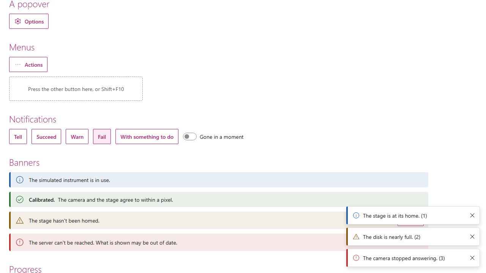
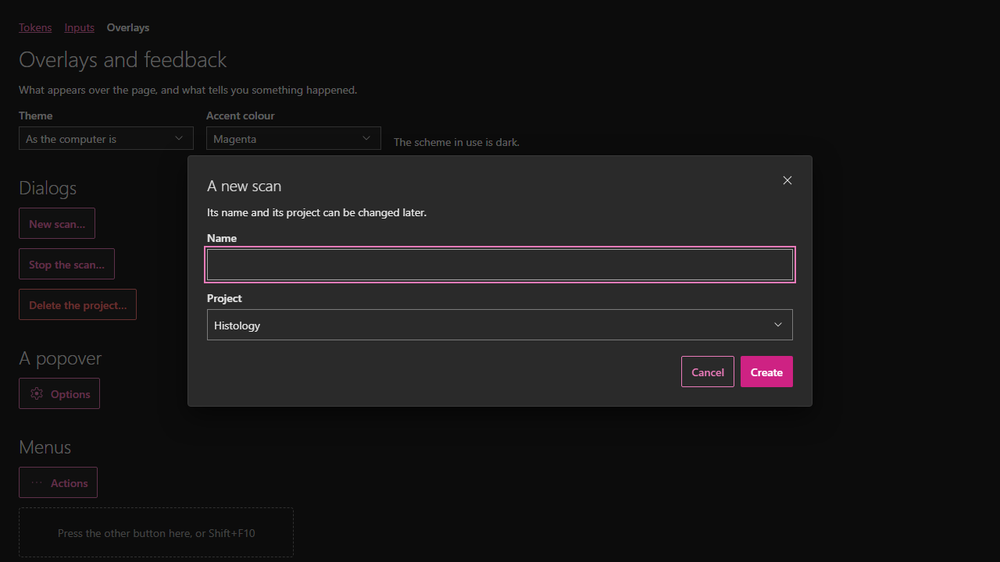

# W0.4: Components II: overlays and feedback

- Status: In review
- Branch / PR: `m2/w0.4-components-overlays` / [#79](https://github.com/lucaswewa/OScope/pull/79)
- Estimate: first 1,500, the spec's · second ~2,900 (code ~810, tests ~520, styles ~460, try-it ~1,050, glue ~10), in the plan's change log before the code, nearly twice the first and over 2,500: one pull request, at the owner's standing choice for W0 and W1 · measured **3,031** hand-written lines changed (code 827, tests 930, styles 453, try-it 813, glue 8): 5 % over the second estimate

## Summary

What appears over the page, and what tells the user something happened ([spec](../phases.md#w0-4)). Twelve components in `web/src/ui/`:

- **dialogs**, with a confirmation whose dangerous kind is typed;
- **a popover**, a menu and a context menu;
- **notices**, queued, with levels and an action;
- **a banner**, progress as a bar and a ring, a skeleton, an empty state, a badge and a tag.

Each opens and closes from the keyboard, gives the focus back where it was, and passes axe. A gallery page shows them all.

## What was built

- **Overlays,** on reka-ui's primitives ([ADR-0042](../../adr/0042-the-component-library-on-reka-ui.md)):
  - `Dialog`: a task of its own over the dimmed page. The focus goes into it and stays; Escape, its close button or a press beside it closes it; the focus goes back; the page behind doesn't scroll.
  - `Confirm`: a question to answer first, which opens on the answer that changes nothing. With `typed`, its button works only once a word is typed, and the focus starts in the field for it.
  - `Popover`: a panel beside its control, named by it.
  - `Menu` and `ContextMenu`: the second opens where the pointer is, or from the keyboard by Shift+F10 or the menu key. What they offer is a list, `menu.ts`.
- **Notices,** our own:
  - `toasts.ts`: the queue. Three show at once and the rest wait their turn. A notice's time runs only while it shows, and stops while it is looked at. What failed stays until it is sent away.
  - `Toaster.vue`: draws them at the page's foot, and reads each out as it shows, at once if it warns or failed. F8 takes the focus to them, and Escape there sends away the one with the focus. `notify()` raises one from anywhere.
- **Feedback:** `Banner`, `Progress` (a bar or a ring, with or without a known end), `Skeleton`, `EmptyState`, `Badge`, `Tag`.
- **Shared styles** for what is drawn at the page's root: `styles/layer.css` (the dimming, dialogs, popovers), `menu.css` and `toast.css`. Every layer has one height above the page, so the one opened last lies on top: a list opened from a dialog is over it.
- **The gallery:** `#/dev/gallery/overlays`, with what each overlay last did written beside it.
- **The tests' footing:**
  - every unit test unmounts what it mounted;
  - a unit test fails if anything warns or reports an error on the console;
  - an end-to-end test fails if the page throws an error it didn't catch.

## How to try it

```sh
cargo run --release -p oscope-server -- --config configs/oscope.toml   # the simulated instrument, on 8210
npm --prefix web run dev                                               # http://127.0.0.1:8280/#/dev/gallery/overlays
```

With the keyboard alone:

- **A dialog:** Enter on *New scan…*. The focus is in *Name*. Tab goes round the dialog and never leaves it; the page behind doesn't scroll. Open *Project* with Enter: its list lies over the dialog, and Escape closes the list first, then the dialog. The focus is back on *New scan…*.
- **A confirmation:** *Stop the scan…* opens on *Keep scanning*. A press beside it does nothing; Escape is *no*. *Delete the project…* opens with the focus in its field: its button works once `slide-4` is typed.
- **A popover:** *Options* opens a panel with the focus inside; Escape gives it back.
- **Menus:** Enter on *Actions*; the arrows pass *Rename*, which is switched off; Home, End and a letter work; Enter does it. In the dashed box, Shift+F10 opens the same menu.
- **Notices:** press *Tell*, *Succeed*, *Warn* and *Fail* in turn. Three show, and the fourth waits. Rest the pointer on them, and they stay; take it away, and the first two go after five seconds, the warning after ten. What failed stays. Press F8, then Tab and Escape to send them away one by one. *With something to do* offers *Undo*.
- **Both themes:** choose *Dark* at the top, and go round again.

## Screenshots

Taken by the end-to-end tests (`OSCOPE_SHOTS=1`).

| Notices and banners, light | A dialog, dark |
|---|---|
|  |  |

The whole page, the dialog, the menu and the notices, in both themes and on both systems, are in the baselines: [`web/tests/e2e/baselines/`](../../../web/tests/e2e/baselines/).

## Design notes and deviations from the plan

- **The notices are our own, not reka-ui's.** reka-ui 2.11's notices each listen for Escape on the whole window. In a browser:
  - **every Escape on the page sent every notice away.** Closing a menu or a list would send away a failure meant to stay until read;
  - **the focus fell to the page's body** when a notice that held it went.

  The queue already existed. Drawing it, timing it and announcing it took 125 lines. The timing is in the queue, on a clock a test turns by hand, so it is tested to the millisecond.
- **What reka-ui does that the components change,** each with a test that fails without the change:
  - **A typed confirmation's focus starts in its field.** The library moves it to the cancel button it knows of, a moment after opening. The typed kind's cancel button isn't the library's, so the focus stays on the first thing to use.
  - **The context menu opens itself from the keyboard.** Firefox and WebKit, as Playwright drives them, don't turn Shift+F10 into the event the other button makes. On Shift+F10 or the menu key, the menu asks for itself at its target's corner, and the browser is kept from opening it twice.
  - **A dialog's close button is last in the page,** though drawn at the top: the focus starts in what the dialog is for.
- **A popover is named by its control.** It first took a name of its own too, which the library's reference to the control outweighed: its name was the control's all along, and the test that looked for its own found nothing. The name of its own went.
- **An icon button lost every listener a page put on it.** Its tooltip, around the button, draws nothing of its own, and Vue dropped the listener there, saying so only on the console in development. The banner's close button did nothing. The icon button and the list's field now pass on what a page gives them.
- **So a warning now fails a unit test.** The setup listens to the console during every test, and the test fails if anything was said there. A test that means to make a component warn takes what was said, with `heard()`.
- **Every unit test unmounts what it mounted.** A notices' component left from an earlier test kept its listener on the window, and answered the next test's F8.
- **An uncaught error in the page fails an end-to-end test,** whatever the test was looking at.
- **The live regions' roles are now on every page.** Tests that found the first page's status line, or a number field's refusal, by their role look inside the page's content now.
- **A stopped clock and Vue's events.** Vue skips an event that seems no newer than its listener, to keep the press that drew a button from pressing it. With Playwright's clock stopped, a button drawn after the stop has the press's very time, and its handler is skipped. The notices' test lets time run again before it presses *Undo*. Real presses can't hit this.
- **Lists move their focus a moment after an arrow key.** A test that pressed Enter at once chose the old option. The tests wait for the focus, as a hand would.
- **A menu opened by a press puts the focus on itself,** and one opened from the keyboard on its first entry, as the WAI-ARIA pattern allows.
- **The notices' list shows the focus ring** when F8 takes the focus there.
- **No new packages.**

### What the gate found

- **The replay's `npm ci` ran under the owner's dev server.** The owner had started `npm run dev` from the checkout during the gate. `npm ci` deletes every installed package first. It then failed on the bundler's native module, which the dev server had loaded, leaving most of `web/node_modules` gone from under it. The Rust and example steps passed; the web steps failed for want of packages.
  - **The owner chose** that I stop the dev server and reinstall (it had already exited), and that **a gate's Windows runs go in a worktree of the commit,** sharing the build folder, so that a gate never touches the owner's checkout.
  - **`scripts/README.md` says so,** with the commands to replay a worktree.
- **Then a bare `npx` fetched another Playwright.** With the packages gone, the replay's browser step, `npx playwright install`, fetched the newest Playwright from the registry, 1.65.1, and ran it. Its install removed the browser builds of the lock file's 1.64.1, whose installation had just been deleted. The next gate's end-to-end tests couldn't launch a browser.
  - **The replay, `scripts/baselines.sh` and CI now call `npx --no-install`,** which fails instead of fetching.
  - **1.64.1's browsers are installed again.** npx's copy of 1.65.1 and its browsers are still in the user's caches, for the owner to remove or keep.

## Tests

- **Unit** (`npm run test:unit`: 218 tests, 54 of them new):
  - **the notices' queue,** 16: the oldest three shown, the rest waiting their turn; dismissal from anywhere; numbers never used twice; an action kept; the levels' times; the time itself, on a hand-turned clock (runs out; never for what failed; only while shown; stopped and resumed; forgotten with its notice);
  - **the notices on the page,** 8: their region and its name; what is read out, and how urgently; icons and the dismiss button; the action; time stopped under the pointer and the focus; F8; Escape passing the focus on, and back; every other Escape left alone;
  - **dialogs and confirmations,** 9: the focus taken in, kept in, and given back; Escape; the close button; the answer that changes nothing first; yes, no, and Escape as no; the typed word, with the focus in its field;
  - **feedback,** 13: banners' levels, words and dismissal; progress with and without an end, its limits, the ring, and a field's name; the skeleton; the empty state; badges; tags and their buttons;
  - **a list's field, closed,** 5; **the icon button** passing on a page's press, 1; **the console rule,** 2.
- **End to end** (`npm run test:e2e`: 35 tests, 14 of them new):
  - **the keyboard,** in Chromium, Firefox and WebKit, 4 tests each:
    - a dialog's focus, kept and given back, the page held still, and a list over it;
    - confirmations, typed and not;
    - a popover and both menus;
    - the notices, on Playwright's clock: their queue, their time while looked at, F8, Escape, and the action;
  - **axe,** on the page and with each overlay open, in both themes: no violation.
- **Visual:** the page, the dialog, the menu and the notices, in both themes, in Chromium on Windows and on Linux. The gallery's other pages again, for their header's new link.
- **Mutation checks.** 22 mutants, each against the test that should catch it:
  - **the queue,** 4: everything shown at once; time running while waiting; a pause that forgets the time gone; a failure that goes by itself;
  - **the notices on the page,** 5: no pause under the pointer; everything read out when the reader is free; every Escape sending every notice away, as reka-ui's do; the focus dropped with a notice; F8 taken with nothing to show;
  - **dialogs,** 4: a dialog that isn't modal; a confirmation that goes on without its word; Escape not taken as no; a typed confirmation that starts on Cancel;
  - **the context menu** that the keyboard can't open, caught in Firefox;
  - **feedback,** 3: progress with no end that claims one; a failure's banner read out late; a tag's button with no name;
  - **what a page puts on a component,** 2: an icon button that loses a press; a list's field that loses its attributes;
  - **the console rule,** 1: the console not listened to;
  - **what only the baselines see,** 2: a warning's notice and a failure's, each without its stripe.
- **One survived at first:** a failure's stripe could go unseen, since no picture showed a failure's notice. The dark picture now shows the last two notices once the first two's time is up, so every level is in a picture.
- **Broken on purpose, once:** a throwaway test that throws in the page fails for it, by the new fixture.
- **Two cores, five times,** on `c9596e7`: `web:unit` and `web:e2e`, 10 of 10. A run of the end-to-end suite, 35 tests, takes about a minute and a half there.
- **The replays,** the merge gate (ADR-0038), each run alone on `c9596e7`. The commit since has only docs.
  - **Windows:** `scripts/ci-local.sh`, in a worktree of the commit, in 19 minutes: 78 of 78 steps, 632 Rust tests in 235 suites, the web steps with the visual tests, and every example's `--smoke`.
  - **Linux:** `scripts/ci-clone.sh` on a fresh WSL clone, in 12 minutes: 78 of 78 steps, 632 tests in 235 suites; 1,062 files, none with a CR.
  - **Two runs before them failed,** as *What the gate found* says: the first under the owner's dev server, the second without its browsers.
- **Docs:** the relative links and anchors in the Markdown files resolve.

## Follow-ups and known gaps

- **Notices can't be pressed while a dialog is open:** the dialog holds the pointer for itself. The keyboard reaches them by F8 when the dialog closes.
- **A notice can't be swiped away,** as reka-ui's could: the desktop app has no touch screen.
- **Enter in a typed confirmation's field** doesn't press its button. Tab gets there.
- **What a notice says is in the page twice** for a screen reader: in the notice, and in the region that reads it out. reka-ui's did the same.
- **A context menu opened from the keyboard** appears at its target's top corner, wherever the focus is within it.

## Clean room

- **Nothing was copied from `microscope` or any other codebase.** The overlays' look is from [`look.md`](../look.md): its dialog, its alert dialog, its menu-like list, its notice with a stripe of its level's colour.
- **The keyboard patterns** are the WAI-ARIA Authoring Practices' (<https://www.w3.org/WAI/ARIA/apg/patterns/>): dialog (modal), alert dialog, menu button, menu.
- **The notices** follow WCAG 2.2's success criteria 4.1.3 *Status Messages* (read out without taking the focus) and 2.2.1 *Timing Adjustable* (time stops while a notice is looked at, and what failed doesn't go by itself).
- **No package was added.**
