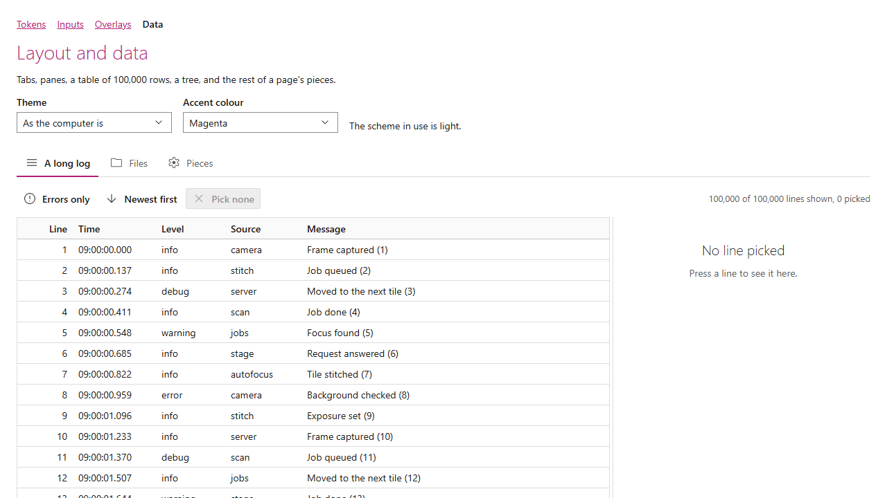
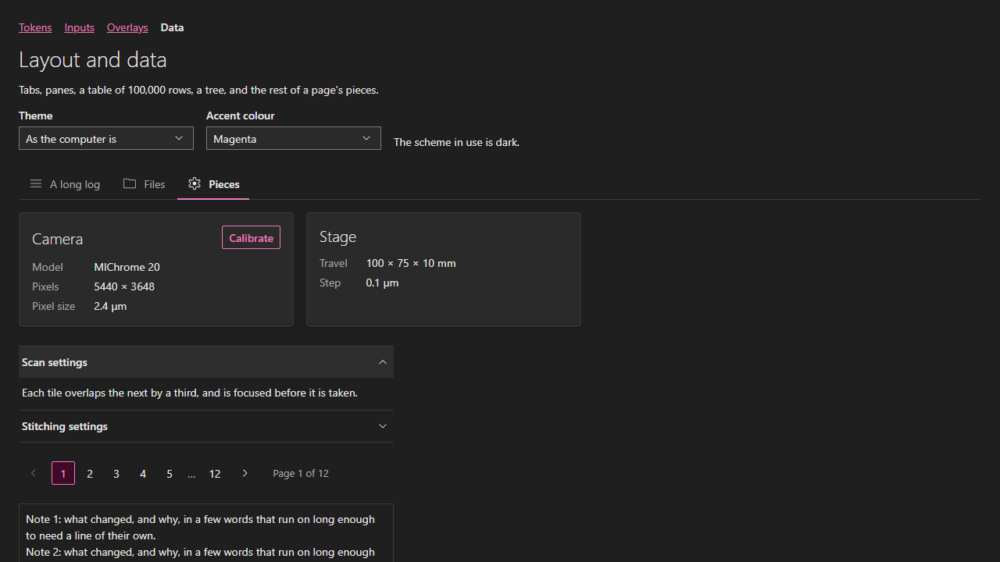

# W0.5: Components III: layout and data

- Status: Done
- Branch / PR: `m2/w0.5-components-data` / [#80](https://github.com/lucaswewa/OScope/pull/80)
- Estimate: first 2,000, the spec's · second ~4,000 (code ~1,250, tests ~1,000, styles ~650, try-it ~1,090, glue ~10), in the plan's change log before the code, twice the first and over 2,500: one pull request, at the owner's standing choice for W0 and W1 · measured **2,754** hand-written lines changed (code 890, tests 759, styles 372, try-it 727, glue 6): 31 % under the second estimate, 38 % over the first

## Summary

The pieces a page is laid out with, and the data it shows ([spec](../phases.md#w0-5)). Eleven components in `web/src/ui/`:

- **layout:** tabs, two panes with a handle between them, a toolbar, a card, a section that opens and closes, and a part that scrolls on its own;
- **data:** a table that sorts, resizes its columns and picks rows, drawing only the rows in view, so that 100,000 scroll as easily as ten; a tree; pages; and a list of terms with their values.

The table follows WAI-ARIA's grid pattern, the tree its tree pattern, and the handle its window splitter's. A pane's size and a column's width are kept between visits. A gallery page shows them all.

## What was built

- **Layout:**
  - `Tabs`, on reka-ui's: an arrow key shows the next tab at once.
  - `Splitter`, on reka-ui's: two panes and a handle, dragged, or moved by the arrow keys a step at a time and by Home and End to its ends. `sizes` is each pane's share, for a page to keep. It takes the height its page gives it.
  - `Toolbar` and `ToolbarButton`: one stop for Tab, and the arrow keys along it. A button that stays pressed says so.
  - `Card` and `Collapsible`: a titled box, and a section that opens and closes by its title. Each title is a heading at the level the page says.
  - `ScrollArea`: a named part that scrolls on its own, which the keyboard reaches.
- **Data:**
  - `DataTable`, our own, with its rules apart in `table.ts`:
    - **its rows in order:** numbers by size, words as people order them ("scan 2" before "scan 10"), and rows that tie as they were;
    - **only the rows in view drawn,** with five more each side, in a body as tall as all of them, under a header that stays in view;
    - **the keys of the grid pattern:** the arrows, Page Up and Down, Home and End, and with Ctrl to the grid's ends. Enter on a header sorts by its column; Shift and an arrow change its width;
    - **the pointer:** a header pressed sorts; its edge dragged changes its width;
    - **rows picked:** one, or several where the page allows, with Ctrl, Shift, Space and Ctrl+A.

    The sort, the rows picked and the columns' widths are the page's, as `v-model`s.
  - `Tree`, on reka-ui's, with a search by letters of our own.
  - `Pagination`, on reka-ui's: the page before and after, the first and the last, and those near this one.
  - `KeyValue`: terms and their values.
- **`host/kept.ts`:** a value the browser keeps between visits, used again only if it is still of its kind.
- **The gallery:** `#/dev/gallery/data`, in three tabs:
  - **a long log:** 100,000 lines in a table, beside the line picked, in two panes, under a toolbar;
  - **files:** a project's files in a tree;
  - **pieces:** cards, sections, pages and release notes that scroll.
- **A file icon,** Material Symbols' *draft*, for the tree's files.

## How to try it

```sh
cargo run --release -p oscope-server -- --config configs/oscope.toml   # the simulated instrument, on 8210
npm --prefix web run dev                                               # http://127.0.0.1:8280/#/dev/gallery/data
```

With the keyboard alone:

- **The table:** Tab from the toolbar reaches the first header, *Line*.
  - The arrows move from cell to cell. Ctrl+End goes to line 100,000, Page Up a page back, and Ctrl+Home to the start.
  - Enter on *Level* sorts by it, and again the other way. Shift+→ widens the column.
  - Space picks a line, which shows in the pane beside it. Ctrl+A picks them all.
- **Scrolling:** with the wheel, as fast as you like. The rows are there, and only some thirty are drawn at once.
- **The panes:** Tab to the handle between them. ← and → move it a step; Home and End to its ends. Reload the page: the panes and the columns are as you left them.
- **The toolbar:** *Errors only* stays pressed, and shows one line in eight. *Newest first* sorts by the time, the other way.
- **The tree,** in *Files*:
  - ↑ and ↓ move;
  - → opens an item, or goes into it, and ← closes it, or goes up;
  - a letter goes to the next item it starts;
  - Enter picks.
- **The pieces:** the pages' buttons; the sections, opened and closed by their titles; the release notes, a part that scrolls: Tab to it, then Page Down.
- **Both themes:** choose *Dark* at the top, and go round again.

## Screenshots

Taken by the end-to-end tests (`OSCOPE_SHOTS=1`).

| The log, light | The pieces, dark |
|---|---|
|  |  |

Each tab, in both themes and on both systems, is in the baselines: [`web/tests/e2e/baselines/`](../../../web/tests/e2e/baselines/).

## Design notes and deviations from the plan

- **The table is our own,** on WAI-ARIA's grid pattern: reka-ui has none. Its rules are in `table.ts`, tested without a page: the order, the window of rows a scroll shows, where each key takes the focus, and which rows a press picks.
- **The virtual list is the table's own window,** not a component of its own: `windowOf` says which rows a scroll shows, and a list that isn't a table can use it too. Every row has the same height, the compact control's, 1.875 rem. The grid says how many rows it has in all, and each row drawn its place among them, as WAI-ARIA has it for rows not in the page.
- **Measured in Chromium:** scrolling 900 pixels a frame for 240 frames, the median frame took 16.7 ms and the 95th 16.8 ms, a frame's time at 60 a second. No task held the page up for 50 ms or more, and at most 27 rows were drawn at once.
- **A table with no height drew all 100,000 rows.** reka-ui's splitter sets its own height, inline, as 100 % of what holds it. The page's height, a class on the splitter, lost to it, and the table in it grew to hold every row.
  - **The splitter is now a box of our own,** which takes the page's size, with the library's inside it.
  - **And a table never draws more rows than the browser's window can show,** whatever height it has.
- **The grid is one stop for Tab, at its cell.** Firefox makes a box that scrolls a stop of its own, so Tab first stopped on the whole grid. The grid is out of the Tab order (`tabindex="-1"`), and one cell is in it: the last one with the focus, or the same column in the first row drawn once that one has scrolled away.
- **Going to the grid's start shows its first rows.** Ctrl+Home, going up into the header, and a sort all scroll the rows back to the top. The header is always in view, so the focus there said nothing of where the rows were.
- **The tree's search by letters is our own.** reka-ui's:
  - **adds every key to its word** for a second, Home and the arrows too: Home and then *c* looked for "Homec", and found nothing;
  - **runs from wherever the focus is,** so beside ours, a first letter moved the focus twice.

  Ours starts again after any other key, and the library's never sees a letter.
- **A toolbar's button said it could be pressed when it couldn't.** Vue makes a boolean prop that isn't given `false`, so every button in the toolbar said it was a toggle, not pressed. `pressed` is left undefined unless it is given.
- **A card's or a section's title is a heading at the page's level,** the third unless told. On the gallery page they come straight under the page's title, and axe found a level skipped: they say `:level="2"`.
- **reka-ui marks the page shown,** and names each page's button; ours names it in the app's words.
- **No new packages.**

## Tests

- **Unit** (`npm run test:unit`: 265 tests, 47 of them new):
  - **the table's rules,** 18: values and texts; the order of words and numbers, either way, with ties kept; no sort, or one by a column it doesn't know; the header's turn; 100,000 rows sorted in well under a second; the window of rows, at the ends, for no rows and no height; the grid's keys, by a cell, a page and to the ends, into the header and no further, and in a grid with no rows; picking one, with Ctrl and with Shift, and where nothing may be;
  - **the table,** 10: its grid's counts and only some rows drawn; no more rows than the window shows where it has no height; one cell for Tab, and another when that one scrolls away; sorting, by a press and by Enter, which shows the first rows; picking by press and by key; the grid's keys and Ctrl+Home back to the first rows; columns' widths and their least; nothing picked where nothing may be; a table with nothing to show;
  - **the layout's pieces,** 11: tabs; the splitter's handle; the toolbar and a button that stays pressed; cards' and sections' heading levels; a section opened by its title; the pages; the part that scrolls; terms and values; the tree's items, picks, and search by letters, first and after any other key;
  - **kept values,** 8: what was kept; the fallback for nothing and for five kinds of wrong; each change kept, inside it too; a browser that keeps nothing.
- **End to end** (`npm run test:e2e`: 50 tests, 15 of them new):
  - **the keyboard,** in Chromium, Firefox and WebKit, 4 tests each: the table of 100,000 rows; the table by the pointer, with its widths kept; the panes, kept; the tabs, the tree, the toolbar, the pages and the sections;
  - **the frames** while scrolling 100,000 rows, in Chromium, where the browser says what took long;
  - **axe** on each tab, in both themes: no violation.
- **Visual:** each tab in both themes, in Chromium on Windows and on Linux. The gallery's other pages again, for their header's new link.
- **Mutation checks.** 30 mutants, each against the test that should catch it:
  - **the table's rules,** 10: no rows drawn beyond those in view; a window that runs past the last row; a descending sort that ascends; words sorted letter by letter, *scan 10* before *scan 2*; rows that tie turned round; a header pressed again that doesn't turn the sort round; Down past the last row; Ctrl+End only to the row's end; Shift picking only the row pressed; Ctrl taking nothing away;
  - **the table,** 9: the grid a stop for Tab of its own, caught in Firefox; a table with no height drawing every row; rows numbered from the header's number; Tab sent to a cell that isn't drawn; a sort, or Ctrl+Home, leaving the rows where they were scrolled, 2; Ctrl+A picking where nothing may be; a column made narrower than its least; a thousand rows drawn around those in view, caught by the frames' test;
  - **the panes,** 1: the page's height given to the library's own box, whose height wins;
  - **the tree,** 2: letters kept after another key; the library's search seeing letters too, caught in Chromium;
  - **the toolbar, the titles and the part that scrolls,** 4: every toolbar button saying it can be pressed; a card's title at the second level when not told; the page's card a level too deep, caught by axe; a part that scrolls which the keyboard can't reach;
  - **kept values,** 2: what was kept used whatever its kind; a change inside a kept value not kept;
  - **what only the baselines see,** 2: the tab shown without its line; a tree's items not set in by their level.
- **Four survived at first:**
  - **a table with no height:** the test counted the rows before the table had drawn again at its new height. It waits for that now;
  - **Ctrl+Home:** from a row, it goes up into the header, which shows the first rows anyway. A new test presses it on a header, with the rows scrolled away;
  - **the library's search for letters:** in the unit tests' page, the library's search found nothing, whatever it was given. The test that catches it is in the browser now: a letter first, before any other key;
  - **the page shown, in the pages:** reka-ui marks it itself, and ours was a second mark, which went.
- **Two cores, five times,** on `35e8aec`, the commit the replays ran on: `web:unit` and `web:e2e`, 10 of 10, eight runs at once; and 10 of 10 again in the gate's worktree. A run of the end-to-end suite, 50 tests, takes about two and a quarter minutes there, and the frames' test passes there too.
- **The replays,** the merge gate (ADR-0038), each run alone on `35e8aec`. The commit since has only docs.
  - **Windows:** `scripts/ci-local.sh`, in a worktree of the commit, in 14 minutes: 78 of 78 steps, 632 Rust tests in 235 suites, the web steps with the visual tests, and every example's `--smoke`.
  - **Linux:** `scripts/ci-clone.sh` on a fresh WSL clone, in 11 minutes: 78 of 78 steps, 632 tests in 235 suites; 1,098 files, none with a CR.
- **Docs:** the relative links and anchors in the Markdown files resolve.

## Follow-ups and known gaps

- **A row is one line high:** a long message is cut short, and shows whole in the pane beside the table.
- **Columns' widths are in pixels,** and stay so at another text size; the rows' height follows the text.
- **The table has no filter of its own,** and its columns can't be moved or hidden: the page filters what it gives it.
- **Shift and an arrow on a header change its column's width.** WAI-ARIA's grid pattern has no key for it.
- **The tree draws every item that is open.** A tree of thousands of open items would want the table's window.
- **A screen reader's reading of the table** is checked by axe, not yet by a screen reader: the manual checklist after W1.5 has it.

## Clean room

- **Nothing was copied from `microscope` or any other codebase.** The look is from [`look.md`](../look.md): its tables, tabs, panes and tree.
- **The keyboard patterns** are the WAI-ARIA Authoring Practices' (<https://www.w3.org/WAI/ARIA/apg/patterns/>): grid (data grid), tree view, tabs (with automatic activation), toolbar, window splitter and disclosure.
- **Rows not in the page** are counted as WAI-ARIA 1.2 says, with `aria-rowcount` on the grid and `aria-rowindex` on each row drawn (<https://www.w3.org/TR/wai-aria-1.2/#aria-rowcount>).
- **Words in order** are compared by ECMA-402's `Intl.Collator`, with numbers by their value.
- **A frame's budget** is 1/60 s, 16.7 ms. A long task is one of 50 ms or more, as the W3C's Long Tasks API defines it (<https://w3c.github.io/longtasks/>).
- **No package was added.**
