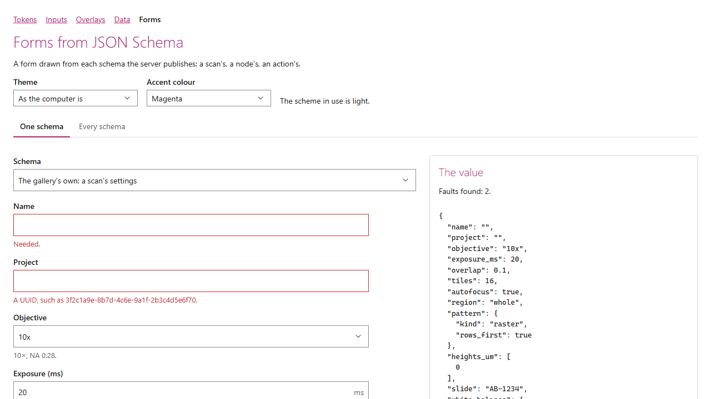
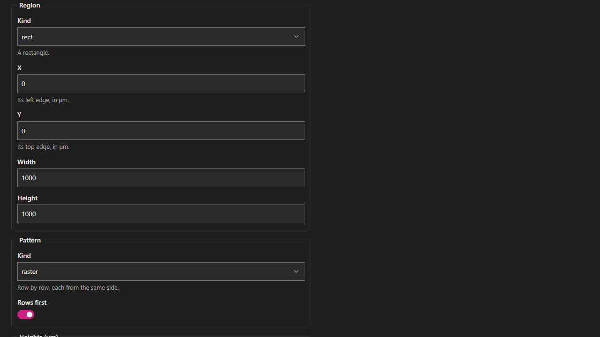

# W0.6: Forms from JSON Schema

- Status: In review
- Branch / PR: `m2/w0.6-schema-forms` / [#81](https://github.com/lucaswewa/OScope/pull/81)
- Estimate: first 1,500, the spec's · second ~2,400 (code ~900, tests ~700, styles ~150, try-it ~640, glue ~10), in the plan's change log before the code, 60 % over the first: one pull request, at the owner's standing choice for W0 and W1 · measured **3,106** hand-written lines changed (code 1,393, tests 1,080, styles 72, try-it 555, glue 6): 29 % over the second estimate, and twice the first

## Summary

A form drawn from a JSON Schema, for everything the server describes that way ([spec](../phases.md#w0-6)). `SchemaForm`, in `web/src/ui/schema-form/`, takes a schema and a value. It gives back the value changed, and its faults: those it finds itself, and those the server refused, each on the field it names.

All 272 schemas the server publishes are drawn as forms, and none as JSON. A test fails the day one isn't. A gallery page fills in the gallery's own example, or any of the server's schemas, and draws them all at once.

## What was built

- **`shape.ts` reads a schema into the shapes a form draws.** The subset is the one the server's schemas use, found by reading all 272 before the estimate:
  - **objects,** with the fields that must be given, and whether others may be; and **maps,** whose fields are all of one kind;
  - **numbers** and whole numbers, with their ranges, open or closed, and their units;
  - **strings,** with their lengths, and four formats checked: UUID, date and time, date, and IP address;
  - **choices,** written as an `enum` or as `oneOf` constants, each with its description; **booleans**; **lists,** with their least and most items;
  - **values that may be left out,** written three ways: a `type` with `null`, `oneOf` with `null` (teta-wot's) and `anyOf` with `null` (schemars'); and an object's field that needn't be given;
  - **unions,** in the three forms serde writes:
    - tagged by a field inside each object (`kind`, `state` or `type`);
    - named by each object's one key;
    - and those keys beside bare names, for kinds that hold nothing;
  - **`$ref`** to the schema's own `$defs` or `definitions`, with what stands beside it first; a single `allOf`;
  - **defaults, titles and descriptions**; and a value the schema says nothing of (`{}`), which is JSON by right;
  - **anything else** as JSON to edit, with the reason: "it uses `pattern`".
- **`check.ts` checks a value against its shape.** Each fault is at its place, in the components' words.
  - **The server's refusals:** a 422's `{"detail": [{"loc", "msg"}]}` is read as faults, their places counted from the request's body.
  - **Each fault is shown** at its place, or at the nearest place drawn around it, or on the whole form.
- **`SchemaForm` and `SchemaField` draw it with the existing controls:** text and number fields, with units; lists; switches; tick boxes; and text areas for JSON.
  - **A field that needn't be given** has a box to leave it out. One with a default is given, from its default.
  - **A list's items and a map's entries** are added and taken out within their bounds. A map's names are changed in place, and a name already taken is refused.
  - **A union's kind** is chosen from a list, and its fields follow.
- **`Field` can say its label without showing it** (`quiet`): for a value drawn under the box that gives it.
- **`api/schemas.ts` reads every schema the server publishes:**
  - each Thing's properties, actions' inputs and outputs, and events' data, from the directory's Thing Descriptions;
  - each pipeline node's parameters, and each scan pattern's with its own;
  - and `offer` sends an action its input.
- **The gallery:** `#/dev/gallery/forms`, in two tabs:
  - **One schema:** the gallery's own, a scan's settings with a field of every kind and one the forms don't draw; or any of the server's, chosen from a list. The value and its faults are beside the form. An action's input can be sent for the server to check, only while the form finds a fault, so that the server refuses it and does nothing.
  - **Every schema:** all 272 drawn at once, and how many of them as JSON: none.

## How to try it

```sh
cargo run --release -p oscope-server -- --config configs/oscope.toml   # the simulated instrument, on 8210
npm --prefix web run dev                                               # http://127.0.0.1:8280/#/dev/gallery/forms
```

- **The example:** fill in *Name*. *Project* says what a UUID looks like until one is typed. In *Exposure (ms)*, type 5000 and press Enter: "At most 1000.", and the value stays 20. Escape puts the 20 back.
- **A union:** in *Region*, choose *rect* from *Kind*. Its four fields appear, at their defaults.
- **Values that may be left out, lists and maps:** tick *White balance*; add a height; tick *Labels*, then add an entry and rename it.
- **JSON:** *Slide* uses `pattern`, which the forms don't draw. It is JSON, and says why. *Extra* says nothing of what it holds: it is JSON by right.
- **The server's schemas:** choose *Jobs · reorder · input* from *Schema*.
  - Type 1.5 in *Position*, press Enter, then *Let the server check it*. The server's refusal joins the form's own on *Position*.
  - Change it to 2, and ask again. The server's refusal of the empty ID is the whole form's.
- **Every schema:** the second tab draws them all, and says that none is JSON.
- **Both themes:** choose *Dark* at the top, and go round again.

## Screenshots

Taken by the end-to-end tests (`OSCOPE_SHOTS=1`).

| The example, light | A union and its kind, dark |
|---|---|
|  |  |

The whole page, in both themes and on both systems, is in the baselines: [`web/tests/e2e/baselines/`](../../../web/tests/e2e/baselines/).

## Design notes and deviations from the plan

- **The subset is the server's, read before the estimate.** There are 272 schemas: 230 in the Thing Descriptions, and 42 in the pipeline's nodes. Without extensions, the scan patterns have none of their own, and the job kinds are only names. The server uses five things the spec's list doesn't name, and each is drawn:
  - maps (14);
  - unions named by an object's one key (7), and with bare names beside them (2);
  - enums written as `oneOf` constants (75);
  - and values of any kind (3).
- **Two forms of schema are read alike:**
  - a Thing Description's, which teta-wot writes with `$ref`s followed and `oneOf` for what may be null;
  - schemars' own, with `$defs`, `$ref`s and `type` arrays: the nodes'.
- **A value of any kind is JSON by right, not a fallback.** The contract counts only what falls outside the subset.
- **A field that needn't be given, and has a default, is given from its default.** The server would fill it in the same, and a box for each was more to read than to use.
- **The server's refusals stand on the fields they name until those change.**
  - teta-wot checks a value against the schema first, field by field, and those refusals name their field.
  - What fails later, as the action reads its input, such as a malformed ID, names only the request's body. That refusal is the whole form's.
- **The gallery sends a value only while the form finds a fault.** The server then refuses it before anything is done. A value it took would be acted on.
- **Two faults in Vue's ways, found in the browser,** each with a test that fails without its fix:
  - **A form with no page holding its value started from `false`.** Its value may be any JSON, a boolean too, and Vue makes a missing prop that may be a boolean `false`. The model is now undefined unless given, and the web README says so for every component.
  - **The fields were drawn empty, though the value had them.** The form tells the page its starting value as it starts, and the page gives it back at once: the fields, drawn empty, were filled in the same moment. Vue's `v-model` sets an input's text once the input is in the page, which is later, and from what the input was made with, which was empty.

    The form now draws its starting value at once, so nothing changes in that moment. happy-dom doesn't show this; the browser test does.
- **The test kit's `drawModel`** takes a value that a component says as it starts, before it has been drawn.
- **No ADR:** the spec names none. The subset is written in `shape.ts` and here.
- **No new packages.**

## Tests

- **Unit** (`npm run test:unit`: 311 tests, 46 of them new):
  - **the shapes,** 17: objects and maps; numbers, their ranges and units, schemars' formats left out; strings and the formats checked; choices written either way; values that may be left out, written three ways; each of the three unions; references, with their neighbours first; what is drawn as JSON, and why, eleven ways; values of any kind; names in words; the starting value, defaults copied; a union's value put together and taken apart;
  - **the checks,** 13: no fault where none is; fields missing and fields unknown; numbers, closed and open bounds; strings' lengths in characters and their four formats; choices, booleans and constants; lists and their items' places; maps, and values that may be left out; unions and what they hold; the server's refusals, field by field, for the whole, and of no kind; every place drawn; faults placed at the nearest place; values at a place, and compared;
  - **the form,** 14: the starting value and faults, with and without a page holding it; names and hints; typing; a fault at its field, and a number out of range not taken; values given and left out; unions; lists within their bounds; maps' names; JSON by hand; JSON as the fallback; the server's refusals until their fields change; read-only; a value alone, and an object with nothing to fill in;
  - **the server's schemas in Thing Descriptions,** 2.
- **End to end** (`npm run test:e2e`: 57 tests, 7 of them new):
  - **the contract,** in Chromium: the test counts the schemas the server serves, and the page must draw that many forms, none as JSON;
  - **the keyboard,** in Chromium, Firefox and WebKit, through the example:
    - the defaults shown;
    - text typed;
    - a number out of range not taken, Escape, and an arrow key;
    - a union's kind chosen from its list;
    - a value given by its box, and a list's item added;
  - **the server's refusals:** a whole number refused by the server's schema on its field, and gone once changed; a malformed ID refused on the whole form;
  - **axe** on the example in both themes, and on all 272 forms at once: no violation.
- **Visual:** the example with a rectangle chosen, in both themes, in Chromium on Windows and on Linux. The gallery's other pages again, for their header's new link.
- **Mutation checks.** 34 mutants, each against the test that should catch it; all were caught at the first run:
  - **reading a schema,** 11: a reference's neighbours lost; a keyword it doesn't know passed over; a null not making a value one that may be left out, written two ways; the two unions the server uses drawn as JSON, caught by the contract; maps read as any value; defaults not started from, or shared rather than copied; numbers started from nought; a unit read as a word;
  - **checking a value,** 9: a field that must be given not missed; a closed object taking any field; fractions taken as whole; an open bound taken as closed; a length counted in JavaScript's units; any text a UUID; a refusal's place kept from the body, caught by the browser test; a fault not drawn shown nowhere; a kind that holds nothing checked as holding something;
  - **drawing it,** 6: a field with a default given a box; a quiet label shown; a map's name taken over; a list's items taken out below its least; JSON by hand not taken; a union's new kind starting from nothing, caught in the browser;
  - **the form,** 3: drawn empty while the page takes its starting value, caught in the browser; refusals kept after their fields change; Vue's `false` for a value not given;
  - **the server's schemas and the page,** 3: a property's forms left in its schema, and the nodes left out, both caught by the contract; the server asked when the form finds nothing wrong;
  - **what only the baselines see,** 2: a group without its border; a list's item and its button one under the other.
- **Three were found unguarded while the mutants were planned,** before the run, and the tests now catch them:
  - a form with no page holding its value, made `false`;
  - a field with a default given a box;
  - a string's length counted in JavaScript's units: "µµ" is two of either, "𝜇𝜇" isn't.
- **Two cores, five times,** on `10b2906`, the commit the replays ran on: `web:unit` and `web:e2e`, 10 of 10, eight runs at once; and 10 of 10 again in the gate's worktree. A run of the end-to-end suite, 57 tests, takes about two and three quarter minutes there.
- **The replays,** the merge gate (ADR-0038), each run alone on `10b2906`. The commit since has only docs.
  - **Windows:** `scripts/ci-local.sh`, in a worktree of the commit, in 15 minutes: 78 of 78 steps, 632 Rust tests in 235 suites, the web steps with the visual tests, and every example's `--smoke`.
  - **Linux:** `scripts/ci-clone.sh` on a fresh WSL clone, in 12 minutes: 78 of 78 steps, 632 tests in 235 suites; 1,117 files, none with a CR.
- **Docs:** the relative links and anchors in the Markdown files resolve.

## Follow-ups and known gaps

- **Labels are the fields' names in words,** such as "Exposure (ms)", not schemars' titles, which are sentences. A tab may give its own labels.
- **A union's kinds are listed by their names,** such as `rect`, with each kind's description as its hint.
- **`pattern`, `multipleOf`, `uniqueItems` and the rest are JSON** where they appear. The server's schemas use none of them.
- **The gallery sends only actions' inputs,** not writable properties.
- **An IPv6 address is checked only loosely.**
- **A type that holds itself is drawn 64 levels deep,** then as JSON. The server has none.

## Clean room

- **Nothing was copied from `microscope` or any other codebase.** The look is [`look.md`](../look.md)'s fields and groups.
- **The keywords' meanings** are JSON Schema 2020-12's, *Core* and *Validation* (<https://json-schema.org/specification>):
  - a `$ref` beside other keywords;
  - `exclusiveMinimum` as a number;
  - `minLength` counted in characters.
- **The formats** are RFC 3339's date and time, RFC 9562's UUID, and RFC 791's and RFC 4291's IP addresses.
- **The unions** are serde's enum representations, as its guide describes them (<https://serde.rs/enum-representations.html>): externally and internally tagged.
- **The refusals** are in FastAPI's validation-error form, as teta-wot writes it.
- **No package was added.**
