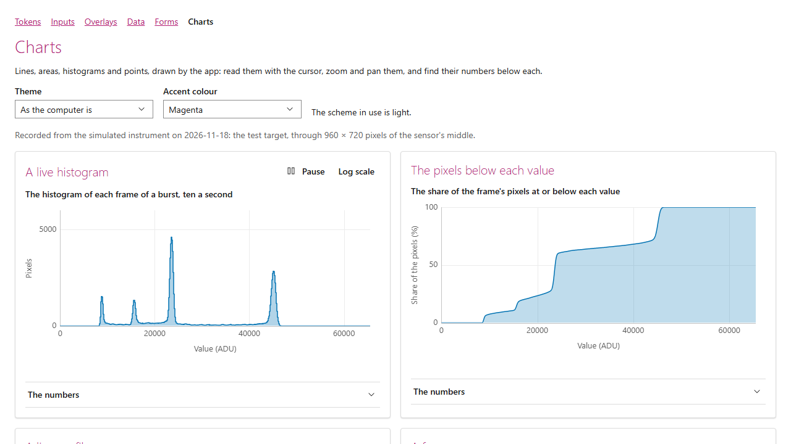
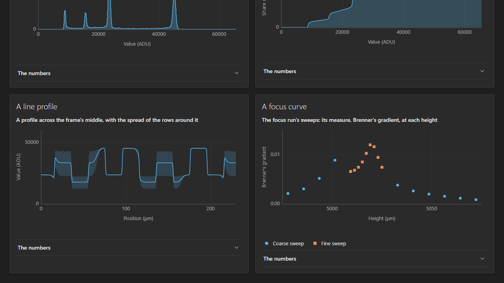

# W0.7: Charts

- Status: Done
- Branch / PR: `m2/w0.7-charts` / [#82](https://github.com/lucaswewa/OScope/pull/82)
- Estimate: first 1,200, the spec's · second ~2,230 (code ~820, tests ~600, styles ~80, try-it ~720, glue ~10), in the plan's change log before the code, 86 % over the first: one pull request, at the owner's standing choice for W0 and W1 · measured **2,512** hand-written lines changed (code 1,152, tests 608, styles 85, try-it 647, glue 20): 13 % over the second estimate, and twice the first. The recorded data, 130 KB, are generated, and not counted

## Summary

The few charts the app needs, drawn by the app ([spec](../phases.md#w0-7)): lines and areas, histograms and points, on a canvas, with axes at round numbers, a cursor that reads the values, zoom and pan, and a table of the same numbers behind each.

## Behaviour spec

Written before the code, as a spec-first phase's must be.

### What a chart draws

- **Its kinds:**
  - **a line,** through points in order of x;
  - **an area,** a line filled down to the axis;
  - **a histogram,** counts in bins of equal width, drawn as steps and filled;
  - **points,** each a mark at its x and y.
- **Several series** in one chart, each with its name, in a legend below the chart when there is more than one.
- **A band** between two series, filled faintly in the colour of the series it goes with: the 10th to 90th percentiles around a mean, say.
- **Told apart without colour.** Each series has its own colour, and also its own dash for a line (solid, dashed, dotted, dash and dot) or its own mark for points (circle, square, triangle, diamond). Colour is never the only way a series is known (WCAG 2.2, success criterion 1.4.1).
- **Colours from the tokens,** never written in the chart: six series colours, the grid, the axes and their words.
  - Each series colour has a contrast of at least 3:1 with the chart's background in both themes (WCAG 2.2, 1.4.11, *Non-text Contrast*).
  - The tokens' contrast test checks this, as it checks the rest.
- **On a canvas,** sized in the screen's own pixels, its size in the page times `devicePixelRatio` (CSSOM View), and drawn again when either changes. No charting package.

### Its axes

- **Linear,** with ticks at round numbers, by Heckbert's *nice numbers* (Heckbert, 1990):
  - **A nice number** near x, written x = f × 10ᵉ with 1 ≤ f < 10, is 1, 2, 5 or 10 times 10ᵉ.
    - Rounded, f goes to 1 below 1.5, to 2 below 3, to 5 below 7, and otherwise to 10.
    - Not rounded, f goes up: to 1 if it is 1, to 2 up to 2, to 5 up to 5, and otherwise to 10.
  - **The step** is the nice number, rounded, of the range's nice number (not rounded), divided by the ticks wanted less one. The ticks wanted are one for each 80 pixels across, or for each 50 pixels up, and at least two.
  - **The ticks** are the step's multiples in view. The first view widens the y range out to a tick at each end, Heckbert's *loose* labels. A view zoomed is shown as it is.
  - **Each tick's words** have as many decimals as the step needs: the larger of 0 and −⌊log₁₀ step⌋. From 10⁶ up, a value is written in scientific notation, such as 2.5e6. A number is written with a point, and nothing else, as the number fields write it.
  - **A range of nothing,** all values the same, is widened by one each way, or by a tenth of the value if that is more.
- **Logarithmic,** base 10, for values above 0:
  - **The ticks** are at powers of ten: 1, 10, 100, 1000, and from 10⁴ up as 10⁴, 10⁵ and so on. With fewer than three decades in view, they are also at 2 and 5 times each power. With more than ten, only every second, fifth or tenth decade is labelled.
  - **The words are the values themselves,** not their logarithms (Cleveland, 1985).
  - **A value at or below 0** isn't drawn; the readout says so.
- **The unit** is in the axis's title: *Counts*, *Position (µm)*.
- **The y axis fits the values in view:** the loose range of their least and greatest, or from 0 for a histogram and an area, unless the chart gives a range of its own.

### Reading it

- **The cursor:** over the plot, the pointer puts a line at the nearest point.
  - **For lines, areas and histograms,** the nearest point is by x, found by a binary search in each series' x, which are in order.
  - **For points,** it is the nearest on the screen, in pixels.
  - **The readout** beside the line gives x and each series' y there, in the axes' units, with one more decimal than the ticks.
- **From the keyboard,** the chart is one stop for Tab:
  - ← and → move the cursor to the point before or after, and Home and End to the first and the last;
  - + and − zoom in and out about the cursor, by a factor of 2;
  - Page Up and Page Down move the view by half its width, back and on;
  - 0 shows everything again.

  The readout is read out as the cursor moves, without taking the focus (WCAG 2.2, 4.1.3).
- **Zoom and pan,** on x:
  - **the wheel** zooms by 1.25 a notch, about the pointer: the value under it stays under it;
  - **a drag** moves the view;
  - **a double press,** or the *Show all* button that appears when zoomed, shows everything again;
  - **the view** goes no further out than the data, and no further in than two of their points.

### Fast enough

- **A histogram of 4,096 bins, redrawn ten times a second,** keeps the page free: each redraw takes under 4 ms at the median, measured in Chromium on the owner's PC. Ten a second allows 100 ms; 4 ms leaves the page's frames their time.
- **More bins than the plot has columns of pixels:** each column is drawn as the highest of the bins it covers, so that no peak is lost.

### The numbers, as a table

- **Behind each chart,** a section, *The numbers*, closed at first, holds a table of the same numbers: x and each series' y; for a histogram, each bin's range and its count. Its rows are the data table's, so 4,096 scroll easily.
- **The canvas is an image named** by the chart's title and a sentence of what it shows: its kind, its series, their ranges. The sentence sends the reader to the table, as W3C's tutorial on complex images has it (W3C, 2022).

### The gallery's data, recorded

- **The try-it page's charts** draw data recorded from the simulated instrument, through its API, as a client would, by a script committed with them.
  - **The script** starts the simulated instrument, loads a sample, focuses it, captures a short burst, exports each frame as a 16-bit TIFF, and reads the frames back.
  - **It keeps** each frame's histogram, a line profile across the middle of the frame with the spread of the rows around it, and the focus run's curve.
- **The live histogram** shows the recorded frames in turn, ten a second, and can be paused.

### Sources

- Cleveland, W. S. (1985). *The Elements of Graphing Data.* Wadsworth.
- Heckbert, P. S. (1990). Nice numbers for graph labels. In A. S. Glassner (ed.), *Graphics Gems*, pp. 61–63 and 657–659. Academic Press.
- W3C (2023). *Web Content Accessibility Guidelines (WCAG) 2.2.* Success criteria 1.1.1, 1.4.1, 1.4.11, 2.1.1 and 4.1.3. <https://www.w3.org/TR/WCAG22/>
- W3C (2022). *Complex images*, in the Web Accessibility Initiative's images tutorial. <https://www.w3.org/WAI/tutorials/images/complex/>
- WHATWG. *HTML Living Standard:* the `canvas` element and its 2D context. W3C. *CSSOM View Module:* `devicePixelRatio`.

## What was built

- **`web/src/ui/charts/`:**
  - **`scale.ts`:** Heckbert's nice numbers; linear ticks, with his loose range for the first view; logarithmic ticks; how a value is written; where a value goes on an axis, and back; the nearest point, by a binary search or on the screen; and a view's zoom and pan, kept inside the data.
  - **`draw.ts`:** the grid, the axes and their words; lines, areas, histograms and points, each series in its colour and its dash or mark; bands; the cursor. A histogram with more bins than columns of pixels draws each column as the highest of its bins.
  - **`Chart.vue`:**
    - the canvas, at the screen's own pixels;
    - its colours, read from the tokens, and read again when the theme, the accent or the computer's scheme changes;
    - the cursor and its readout; zoom and pan by the wheel, a drag and the keys; *Show all*;
    - a legend, and *The numbers*, the data table behind it.
- **Tokens:** six series colours, `--chart-1` to `--chart-6`, in Okabe and Ito's hues; `--chart-grid` and `--chart-axis`. The contrast test holds each series colour to 3:1 on every ground, in both schemes.
- **Icons:** *pause* and *play*.
- **`web/scripts/record-charts.mjs`** records the gallery's data from the simulated instrument through its API, into `src/features/dev/charts/recorded.ts`.
- **The gallery:** `#/dev/gallery/charts`, four charts:
  - **a live histogram** of each frame of a burst of ten, ten frames a second, which can be paused and put on a log scale;
  - **the pixels below each value,** as an area;
  - **a line profile** across the frame's middle, with the band of the rows' 10th to 90th percentiles;
  - **a focus curve:** the focus run's coarse and fine sweeps, as points.

## How to try it

```sh
cargo run --release -p oscope-server -- --config configs/oscope.toml   # the simulated instrument, on 8210
npm --prefix web run dev                                               # http://127.0.0.1:8280/#/dev/gallery/charts
```

- **The cursor:** move the pointer over a chart. The line follows the nearest point, and the readout below the chart gives x and each series' value. Over the histogram, it gives the bin's range.
- **Zoom and pan:** the wheel zooms about the pointer, and the value under it stays there. Drag to move the view. Press twice, or *Show all*, to see everything again.
- **The keyboard:** Tab to a chart.
  - ← and → move the cursor, and Home and End go to the ends;
  - + and − zoom about the cursor;
  - Page Up and Page Down move the view by half;
  - 0 shows everything.
- **The histogram:** *Pause* holds the frame. *Log scale* puts the counts on a logarithmic axis, marked in decades.
- **The numbers:** open *The numbers* below a chart: the histogram's 4,096 bins, or the profile with its band's two edges.
- **Both themes:** choose *Dark* at the top. The charts take the dark scheme's colours at once.
- **Recording the data again:** from `web/`, `npm run build`, then `OSCOPE_SERVER_BIN=../target/release/oscope-server.exe node scripts/record-charts.mjs`, with the server built for release. It takes about four minutes.

## Screenshots

Taken by the end-to-end tests (`OSCOPE_SHOTS=1`).

| The histogram and the pixels below each value, light | The profile and the focus curve, dark |
|---|---|
|  |  |

The whole page, in both themes and on both systems, is in the baselines: [`web/tests/e2e/baselines/`](../../../web/tests/e2e/baselines/).

## Performance

- **Measured** in headless Chromium on the owner's PC, drawing in software, by the end-to-end test that reads each drawing's time from the page's own timeline (`performance.measure`, as `oscope.chart.draw`):
  - the histogram of 4,096 bins is drawn 10.0 times a second;
  - each drawing takes 0.20 ms at the median, and 0.50 ms at the longest.
- **The spec's bound,** under 4 ms at the median, holds twenty times over. On two CPUs, with eight runs at once, the drawing took 0.20 ms at the median there too, and 1.3 ms at the longest.

## Design notes and deviations from the plan

- **No charting package.** The canvas is drawn by the app, as the plan has it.
- **The tokens' colours are read through an element.** A custom property holds `light-dark(…)` as it is written; only an element's computed colour gives the colour in use. The chart reads them once, and again when the page's theme or accent, or the computer's scheme, changes.
- **A band is its own pair of edges,** not two series, for the spec's "band between two series" of percentiles. In the table, its rows are its low and high edges.
- **The first view's y range is Heckbert's loose one,** so that a chart starts with a tick at each end. Zoomed, the y range fits the values in view.
- **A view as wide as the data is no zoom,** and *Show all* goes.
- **The view is kept inside the data** when the data change under it. A mutant found the clamp unguarded, and the chart now applies it whenever it draws.
- **Points have a little room at the ends,** 3 % each side. At the very edge, they were drawn by half.
- **The readout has one decimal more than the ticks,** and says when a value can't be shown on a log scale.
- **The live histogram** is new arrays ten times a second. The chart draws again when its series change, once a frame at most.
- **Recording the data:**
  - **The test target, not the tissue.** The tissue's islands are known only to the simulator's own code, and the coverslip's middle may be bare glass. The test target covers it, and gives the profile its edges and the histogram its levels.
  - **The release server.** The debug server's simulator had not finished the focus run after seven minutes; the release one records everything in about four.
  - **What the API taught:**
    - an action answers with its invocation, whose output comes when it completes;
    - a job ends `completed`;
    - the stage must be homed first;
    - an export's result is its file's path under `/api/v1/`.
  - **The frames are read** by a small reader of the export's uncompressed TIFF pages, in the script.
  - **The data file is generated.** Prettier and ESLint leave it alone. It is typed by an interface, not `as const`, which would make the type checker carry tuples of 4,096.
- **No new packages,** and no ADR: the spec names none.

## Tests

- **Unit** (`npm run test:unit`: 348 tests, 37 of them new):
  - **the scales,** 18:
    - nice numbers, rounded and not; steps and loose ranges; a range of nothing;
    - linear ticks for awkward ranges: a narrow one far from zero, thousandths, one value, millions, and tenths that add up;
    - how values are written; ticks by the pixels along an axis;
    - logarithmic ticks: at powers of ten, at 2 and 5 times them over few decades, and at every second, fifth or tenth over many;
    - placing values, and nought on a log scale;
    - the nearest point, by x and on the screen;
    - zoom about a value, its limits, and pan;
  - **the drawing,** 9, on a canvas that records what it is told:
    - each series' colour and dash; points' marks;
    - areas, and gaps on a log scale;
    - histograms as steps; 4,096 bins in 400 columns with the peak kept; only the bins in view;
    - bands; the axes' grid and words; the cursor;
  - **the chart,** 10:
    - its image's name;
    - the readout from the keyboard, each series at the cursor, a value off a log scale, and a histogram's bin;
    - zoom from the keys, and *Show all*; the y range fitted to the view;
    - its colours read again when the theme or the accent changes;
    - the legend; the numbers' table, by x and by series.
- **End to end** (`npm run test:e2e`: 66 tests, 9 of them new):
  - **the keyboard,** in Chromium, Firefox and WebKit: the profile's cursor, zoom, the view following the cursor, and everything again; the histogram paused from its toolbar;
  - **the pointer:** the wheel's zoom, keeping the value under it; a drag; a double press; and the cursor on the histogram's bins;
  - **the redraw,** measured: ten a second, under 4 ms at the median;
  - **the numbers:** the histogram's 4,097 rows, and the profile's columns;
  - **a screen of twice the pixels:** the canvas has them;
  - **axe,** in both themes: no violation.
- **Visual:** the page in both themes, its clock held, in Chromium on Windows and on Linux. The gallery's other pages again, for their header's new link.
- **Mutation checks.** 26 mutants, each against the test that should catch it:
  - **the axes,** 12: a nice number rounded wrong; a loose range not widened at its foot; a range of nothing left as nothing; ticks without their decimals; millions written out; -0; a log axis of few decades without 2 and 5; every decade marked over many; nought placed on a log axis; the wrong one of two nearest points; zoom about the view's start; a view wider than the data;
  - **the drawing,** 4: one dash for all; a column of bins drawn at its last, not its highest; one mark for all; a band drawn solid;
  - **the chart,** 8: the colours not read again for the computer's scheme, caught by the baselines, or for the page's theme; the canvas at the page's pixels; the y range fitted to all the data; the cursor off the data's points; the wheel not zooming; points at the ends cut in half, caught by the baselines; the table by series where the series share their x;
  - **the detector of slow drawing,** 1: each drawing held up for 8 ms, caught by the measured test;
  - **what only the baselines see,** 1: the dark grid as light as the light one's.
- **One survived at first:** a view wider than the data, since the zoom clamps its own. The clamp now has a test, and the chart uses it when the data change under a view.
- **Three were found unguarded while the mutants were planned,** before the run, and the tests now catch them: the colours not read again for the page's theme; the y range not fitted to the view; and the cursor off the data's points.
- **Two cores, five times,** on the commit the replays ran on: `web:unit` and `web:e2e`, 10 of 10, eight runs at once, and 10 of 10 again in the gate's worktree at each of its three runs. A run of the end-to-end suite, 66 tests, takes about three minutes there.
- **The replays,** the merge gate (ADR-0038), passed on `8714a49` at the gate's third run:
  - **Windows:** 78 of 78 steps; 632 tests in 235 suites.
  - **Linux,** on a fresh clone (1,134 files, none with a CR): 78 of 78 steps; 632 tests in 235 suites.
- **The first two runs failed, neither in this phase's code:**
  - **The first run's Windows replay hung for 1 h 30 min** in a Milestone 1 test, oscope-api's `tls_serves_https_and_refuses_plain_http`. Its request was left in rustls's buffer, unsent, and the test had no deadline. The fix is [#83](https://github.com/lucaswewa/OScope/pull/83), a PR of its own.
  - **The second run failed in an end-to-end test of W0.5's,** the table of 100,000 rows. Chromium couldn't load a stylesheet (`net::ERR_NO_BUFFER_SPACE`, Windows short of buffers for a socket), so the page never drew.
  - **The third run had a watchdog sampling sockets and memory every 5 s,** and passed. Connections in `TIME_WAIT` peaked at 10,313 of the 16,384 ephemeral ports, during the examples' smoke runs. Free memory never fell below 9.4 GB.
- **Docs:** the relative links and anchors in the Markdown files resolve.

## Follow-ups and known gaps

- **Zoom and pan act on x only.** Points could want both axes.
- **The logarithmic axis is for y.** x can be logarithmic in the scales, but the zoom treats its values as linear.
- **The legend is a list beside the chart,** not drawn on it, and doesn't hide a series when pressed.
- **The focus curve's peak,** the Gaussian estimate the run moved to, isn't marked on the chart.
- **A screen reader's reading of the charts** is checked by axe, not yet by a screen reader: the manual checklist after W1.5 has it.

## Clean room

- **Nothing was copied from `microscope` or any other codebase.** The look is the app's own tokens.
- **The ticks** are Heckbert's algorithm, written from its description (Heckbert, 1990). The log axis's words follow Cleveland (1985).
- **The series' hues** are from Okabe and Ito's published set (Okabe, M. and Ito, K. (2008). *Color Universal Design (CUD): how to make figures and presentations that are friendly to colorblind people*), made darker or lighter for each scheme, and checked by the contrast test.
- **The TIFF pages** are read by the script's own code, from the TIFF 6.0 specification's baseline fields (Adobe, 1992).
- **No package was added.**
