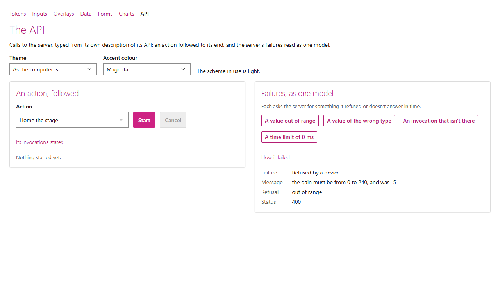
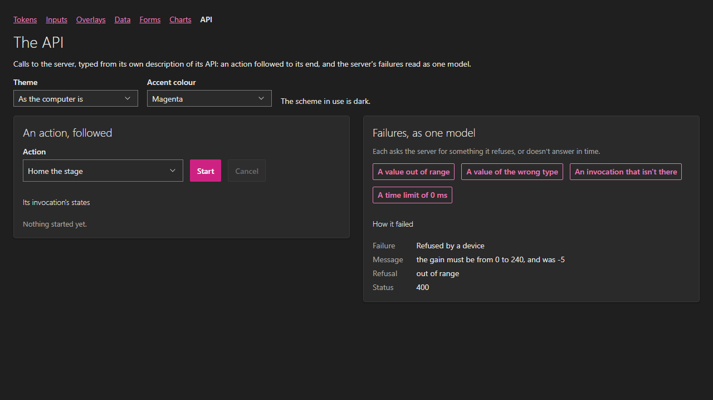

# W1.1: Generated API types and the typed client

- Status: Done
- Branch / PR: `m2/w1.1-api-types` / [#84](https://github.com/lucaswewa/OScope/pull/84)
- Estimate: first 1,300, the spec's · second ~2,300 (code ~770, tests ~930, styles ~50, try-it ~480, glue ~70), in the plan's change log before the code, 77 % over the first: one pull request, at the owner's standing choice for W0 and W1 · measured **2,541** hand-written lines changed (code 1,037, tests 979, styles 48, try-it 449, glue 28): 10 % over the second estimate, and twice the first. The generated types, 21,891 lines, and the recorded answers are generated, and not counted

## Summary

Calls to the server are now typed from the server's own description of its API, and can't drift from it ([spec](../phases.md#w1-1), [ADR-0043](../../adr/0043-generated-api-types-and-the-typed-client.md)).

- **The types:** `npm run api:types` makes TypeScript of `oscope-server --print-openapi`, and the file is committed. `npm run api:check` fails while it is stale, and the replays and CI run it.
- **The calls:** a typed client over openapi-fetch makes them, each with a time limit and its caller's abort. It reads every failure the server can give as one error model.
- **Actions** are started, followed to their end, and cancelled. **Jobs** are followed to their results.
- **The media plane,** which the description lacks, has wrappers written by hand, each checked against a real server.

W1.1 was the first phase begun in a sandbox of its own, `C:/repos/OScope-dev`, while the previous phase's gate ran: the owner's trial of 2026-11-18. It was rebased onto `main` once W0.7 was merged.

## What was built

In `web/`:

- **`scripts/api-types.mjs`:** the generator, behind `npm run api:types`, and its stale check, `npm run api:check`.
  - **It finds the server** as the end-to-end tests do: `OSCOPE_SERVER_BIN`, or the workspace's debug build.
  - **The check** makes the types again in memory, compares them with the file, line endings aside, and names the first line that differs.
- **`src/api/generated/openapi.ts`:** the types, made by openapi-typescript from 259 paths and 312 schemas. It is left out of lint and formatting.
- **`src/api/client.ts`:**
  - `Server`: a server's typed client, relative to the page by default (`.`), or at a URL;
  - `call(start, limits)`: a call through it, with a time limit (10 s unless told) and the caller's abort, made one signal; it gives the answer's value, or throws an `ApiError`;
  - `fetched(address, read, limits)`: the same for the routes the description lacks;
  - `pause`, a wait that ends when its caller aborts, and `Schema<"Name">`, one of the server's schemas by its name.
- **`src/api/errors.ts`: one error model.** An `ApiError` has:
  - its `failure`: refused, invalid, missing, unauthorised, forbidden, cancelled, failed, server, unreachable, timeout or aborted;
  - the server's message;
  - a device's `refusal` and `status`, from ADR-0012's table;
  - the `fields` a 422 refused, each with its place in the body;
  - the `body` the server gave, for a form's `refused` (W0.6).

  `answerError`, `invocationError` and `thrownError` read it from each of the server's ways of failing.
- **`src/api/actions.ts`:**
  - `start`, `follow`, `cancel`, and `act`, which does all three;
  - each action is typed by its path: `ActionPath`, and its `Input` and `Output`, read from its generated operation;
  - `follow` looks at the invocation 50 ms after the start, then waits half as long again each time, up to 1 s;
  - a caller that aborts cancels the invocation on the server.
- **`src/api/jobs.ts`:** `Job`, `JobRef`, `job(id)`, and `finished(ref)`, which follows a job to its results, telling each change of its state or progress once. A job's answer has no schema in the description, so `Job` is written here.
- **`src/api/media.ts`:**
  - deep zoom: `zoomDescriptor`, read without a DOM, `zoomStatus`, `tileAddress` and `tile`;
  - volumes: `volumeMeta`, `slice`, `brick`, and `voxelsOf`, which reads ADR-0029's binary header;
  - a project's files: `fileAddress` and `download`, whole or a range;
  - the logs: `logTail`, the live tail's WebSocket.
- **`src/api/system.ts` and `src/api/schemas.ts`** call the server through the typed client now.
- **`scripts/record-answers.mjs`** drives a server of its own, as a client would, to record 13 of its answers into `src/api/recorded-answers.json`, for the error model's tests:
  - a 422 for a wrong value, for a body that isn't JSON, and for a value the action can't read;
  - a 404;
  - a refusal out of range, and a busy one;
  - actions that end in an alarm, out of range, and cancelled;
  - a job that completed and one that failed;
  - the media plane's leaner problem details.
- **`#/dev/gallery/api`, `src/features/dev/ApiPage.vue`:** an action called and followed, each state of its invocation shown, or cancelled. Beside it, four buttons that ask the server for a failure, each shown as the error model reads it.

Elsewhere:

- **`scripts/ci-local.sh` and `.github/workflows/ci.yml`:** a step, "web api types", that runs `npm run api:check`, once the server is built.
- **ADR-0043**, the generated types and the typed client.

## How to try it

```sh
cargo build -p oscope-server
cd web && npm ci && npm run build && cd ..
target/debug/oscope-server --port 8211 --web web/dist
```

Open `http://127.0.0.1:8211/#/dev/gallery/api`.

1. **A refusal:** choose *Move the stage to its middle*, then *Start*. The stage hasn't been homed, so its error says *Refused by a device*, `alarm`, 409.
2. **An action followed:** choose *Home the stage*, then *Start*. Its invocation's states appear as they are seen: `pending`, `running`, `completed`, then its output, the stage's position.
3. **A cancellation:** choose *Move the stage slowly to its far corner*, then *Start*, then *Cancel*. It ends `cancelled`.
4. **Failures, as one model:** each button on the right asks the server for a failure, and shows how it reads.

**To see the types catch a change on the server:**

1. Change the type of a Thing's property, then `cargo build -p oscope-server`.
2. In `web/`, `npm run api:check` fails, naming the first line that differs.
3. `npm run api:types` writes the types again. `npm run typecheck` then fails wherever the app used the old shape.

## Screenshots

The API's page, after *A value out of range*:

| Light | Dark |
|---|---|
|  |  |

## Design notes and deviations from the plan

- **The calls are made by openapi-fetch,** typed by the generated `paths` (ADR-0043 §4). The spec's "the client, over `fetch`" is kept: openapi-fetch is fetch with types, 6 KB in the app. Our own would be some 150 lines of types for paths, parameters and bodies.
- **openapi-typescript runs on the app's TypeScript 6.** Its newest release asks for TypeScript 5 as a peer, so an npm `overrides` entry gives it the app's. The 21,891 lines it writes type-check, and the stale check would show a TypeScript it couldn't use.
- **The addresses are relative to the page,** as `system.ts`'s were: the app works served at the root or under a path. A test serves it under `/oscope/` to tell the two apart.
- **A 422's places start at the body's root:** `["x"]`, not `["body", "x"]`. A body that isn't JSON is refused as a whole, rather than at the character where its parser stopped.
- **An action's refusal is read from its invocation's detail,** "alarm (409): …", since the request itself always answers 201 (ADR-0034). A kind the device's refusals don't know makes the action *failed*, not refused.
- **A job's answer is typed by hand.** The OpenAPI document gives `jobs/job/{id}` no schema, so the contract test checks `Job` against a real one.
- **The modules in `src/api/` name their imports' files, `./client.ts`.** The contract test, under `tests/e2e/`, imports them, and is type-checked by the scripts' configuration: Node's module resolution, with `exactOptionalPropertyTypes`. The limits' fields say `| undefined` for that reason.
- **A capture needs the camera streaming.** The contract test found it: the job failed with "no frame came in 10 s: is the camera streaming?", which the error model read as the job's own words.
- **The logs' tail tells its query back with every condition,** unset ones `null`: `TailQuery` says so.
- **CLAUDE.md's list of the app's checks doesn't name `npm run api:check`.** The replays and CI run it, and `web/README.md` lists it. I left CLAUDE.md, your file, to you.

## Tests

- **Unit, 63 new, 411 in all:**
  - **the error model, 21,** from the server's recorded answers: each 422, the 404, the refusals, the media plane's leaner problem details, the invocations' alarm, out of range and cancellation, and a call with no answer;
  - **the client, 13,** with the network stood in for: an address relative to a page served under a path, a server elsewhere, parameters and bodies, the time limit, the caller's abort, no network, and the routes the description lacks;
  - **actions, 7:** followed to their output, refused, cancelled, cancelled on the server when their caller aborts, and the growing waits. Their types too: a wrong input, a missing one and a path that isn't an action fail the type check (`@ts-expect-error`);
  - **jobs, 6:** followed to their results, each change told once, failed, cancelled, interrupted, and a caller that stops following;
  - **the media plane, 11:** voxels of each sample type, a voxel's size, refusals of what isn't voxels, the descriptor, tiles' and files' addresses, slices and bricks, and ranges;
  - **the stale check, 5,** on a small description of its own: a change named at its line, line endings, a line missing or added, and the committed file's mark.
- **Contract, 4,** against a real server each, in Chromium's project, with no page:
  - an action followed to completion, refused, and cancelled by its caller, and so on the server;
  - the error model, on the server's live answers;
  - a captured image: its job, its tiles, its volume, and its file whole and in part, then a job that fails;
  - the logs' tail: its query, the records that match, `caught_up`, and another query.
- **End to end, 6 more,** on the API's page:
  - the main path, an action refused, followed and cancelled, in Chromium, Firefox and WebKit;
  - the failures, as one model;
  - axe, in both themes: no violation;
  - visual, in both themes, on Windows and Linux. The gallery's other pages have new baselines too, for their header's new link.
- **Mutation checks, 26, all caught:**
  - **the detector of stale types, 3:** the committed file made stale, which `npm run api:check` refused at its line 5; a difference not seen; line endings taken for one;
  - **the error model, 7:** a 422's place keeping `body`; a body that isn't JSON refused where its parser stopped; any title taken for a refusal's kind (`"toString" in REFUSALS`); a 404 not missing; a cancellation taken for a failure; a refusal without its status; a time limit's end taken for no network;
  - **the client, 5:** no time limit; the caller's abort not heard; an answer that isn't a success given as a value; addresses relative to the root; a route's failure taken as a success;
  - **actions, 4:** an abort not cancelling the invocation; every wait as long as the first; a change not told; an error given as an output;
  - **jobs, 2:** a failed job given as completed; each look told, changed or not;
  - **the media plane, 5:** a level read big-endian; a voxel's size of nought given; a descriptor's width its height; a slice asked for at the wrong place, and the tail never asking another query, both caught by the contract tests.
- **One gap was found while the mutants were planned,** and closed before the run. A test at the page's root couldn't tell an address relative to the page from one relative to the root, so it now serves the page under `/oscope/`.
- **Two cores, five times:** `web:unit` and `web:e2e`, 10 of 10, eight runs at once.
- **The sandbox's slower CPUs:** whole runs on the sandbox's eight E-cores twice failed one of W0.5's timed tests: sorting 100,000 rows in under a second, which took 1,027 ms, and scrolling them within a frame's budget. Both pass on two of the P-cores, as on CI's runners, in each of the two-core runs. Timed tests stay out of the sandbox while a gate runs.
- **The replays,** the merge gate (ADR-0038), passed on `35dd294` at the gate's second run. Each has a new step, "web api types", the stale check:
  - **Windows:** 79 of 79 steps; 632 tests in 235 suites.
  - **Linux,** on a fresh clone (1,160 files, none with a CR): 79 of 79 steps; 632 tests in 235 suites.
  - **Two cores, five times,** in the gate's worktree: 10 of 10 again.
- **The first run's Windows replay failed in a Milestone 1 example,** not in this phase's code. `ex-live-recipe --smoke` had its recipe refused at 210.5 ms, against the live recipes' budget of 200 ms. It ran while the sandbox ran W1.2's end-to-end tests on the E-cores. The cores share power and cache, and since then the sandbox does nothing but edit while a gate runs.
- **Docs:** the relative links and anchors in the Markdown files resolve.

## Follow-ups and known gaps

- **Actions are followed by looking,** up to 1 s after their end. W1.2's live events could tell an invocation's end instead.
- **A job's answer and the media plane are typed by hand.** The server could describe them in its OpenAPI document; then their types would be generated too.
- **openapi-typescript and TypeScript 7:** if the generator can't follow the next TypeScript, a generator of our own can be written from the schemas W0.6 reads (ADR-0043).
- **The logs' tail doesn't reconnect** when its socket closes. Logging, W4.2, is where it will.
- **`offer`, in `schemas.ts`,** still sends a form's value to the address a Thing Description gives it, outside the typed client: its path comes at run time.

## Clean room

- **Nothing was copied** from `microscope` or any other codebase. The types are made from OScope's own server's description of its API.
- **Packages added:**

  | Package | Version | Released | Licence | Where |
  |---|---|---|---|---|
  | openapi-typescript | 7.13.0 | 2026-02-11 | MIT | development tool |
  | openapi-fetch | 0.17.0 | 2026-02-11 | MIT | in the app |

  Each was installed with `--before=2026-11-04`, as were their dependencies. The licence check passed: 317 packages, 22 of them in the bundle, none refused. The advisories check passed: none in what the app ships.
- **Formats followed:** RFC 9457 (problem details), RFC 9110 §14 (range requests), and Microsoft's Deep Zoom descriptor.
