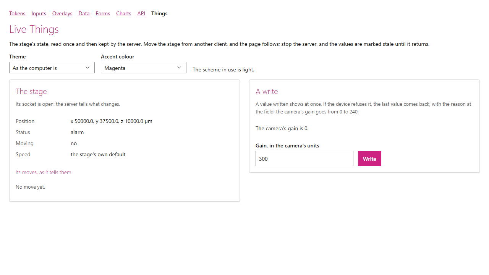
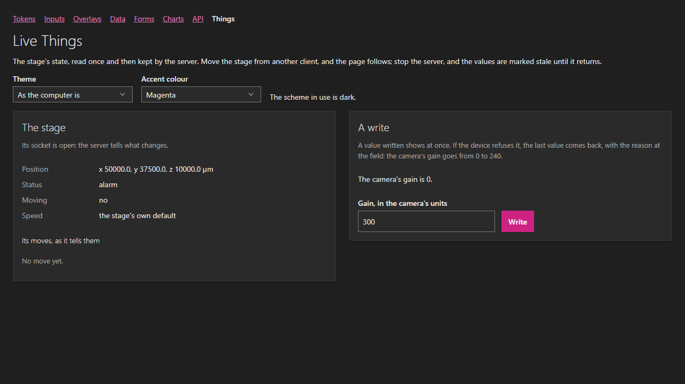

# W1.2: Things, live properties and events

- Status: In review
- Branch / PR: `m2/w1.2-live-things` / [#85](https://github.com/lucaswewa/OScope/pull/85)
- Estimate: first 1,500, the spec's · second ~2,230 (code ~850, tests ~850, styles ~50, try-it ~450, glue ~30), in the plan's change log before the code, 49 % over the first: one pull request, at the owner's standing choice for W0 and W1 · measured **1,734** hand-written lines changed (code 629, tests 752, styles 74, try-it 273, glue 6): 22 % under the second estimate, and 16 % over the first. The second counted on more code: most of the Things' state turned out to be read, which needed less than a socket keeping it would have

## Summary

A Thing's state in the app is now live: read once, then kept by the server ([spec](../phases.md#w1-2), [ADR-0044](../../adr/0044-things-in-the-app-live-properties-and-events.md)).

- **A Pinia store for each Thing in use** keeps its properties. Those the Thing's WebSocket can observe, it keeps by the socket. Every other one it reads at intervals, and again whenever the Thing tells an event.
- **A write shows at once.** If the server refuses it, the last value comes back, with the reason.
- **A value the server hasn't confirmed for 5 s is marked stale.**
- **One socket for each Thing in use,** shared, and opened again with back-off.
- **Components use them** through `useProperty`, `useEvent` and `useAction`, typed by their paths, as W1.1's calls are.

W1.2 was developed in the sandbox while W1.1's gate ran, at the owner's trial.

## What was built

In `web/src/api/things/`:

- **`descriptions.ts`:** the Thing Descriptions, read once for each server and again only after a failure. Also whether a property is observable, from its `observeproperty` form, and whether it is writable.
- **`socket.ts`: `ThingSocket`,** a Thing's WebSocket, `/api/v1/{thing}/ws`, one for each Thing in use:
  - it opens with its first listener and closes after its last;
  - it observes properties and subscribes to events, each name once, and asks again for all of them each time it opens;
  - under security, its first message is the session's token (ADR-0031);
  - closed by the server, it opens again after 250 ms, then twice as long each time, up to 10 s, and 250 ms again once it had stayed open 5 s;
  - `heardIn` reads a message: a property's value, an event, or a refusal.
- **`store.ts`: `thingStore(thing)`,** a Pinia store for each Thing on a server:
  - `follow(property, every)` keeps a property, by the socket or by reading it, with one reader for all who follow it, at the quickest interval asked;
  - `on(event, listener)` passes on each event;
  - `write(property, value)` shows the value at once, then keeps it or takes it back with the server's reason;
  - `isStale(property)` reads the store's clock, which ticks each second while the store is in use.
- **`use.ts`:** `useProperty`, `useEvent` and `useAction`, each kept for as long as its component lasts.
  - `useProperty`'s value is typed from its path's `GET`, and `write` takes only what its `PUT` does: `never` for one that can't be written.
  - `useAction` stops following its action when its component goes, and doesn't cancel it.

Elsewhere in `web/`:

- **`src/api/client.ts`:** `Server.socketAddress`, a WebSocket's address on a server, and `session`, whose token W1.3 sets.
- **`src/api/actions.ts`:** `follow`'s new `cancelling: false`, which stops following without cancelling.
- **`#/dev/gallery/things`, `src/features/dev/ThingsPage.vue`:**
  - the stage's position, status and moving, read four times a second, and its speed, kept by its socket, each marked stale when it is;
  - whether the stage's socket is open, and its moves as it tells them;
  - the camera's gain, and a field to write it, where a refusal's reason shows.
- **`tests/setup/stand-ins.ts`:** a WebSocket whose server's side a test plays, and a network that answers by path, for the unit tests.
- **ADR-0044.**

## How to try it

```sh
cargo build -p oscope-server
cd web && npm ci && npm run build && cd ..
target/debug/oscope-server --port 8211 --web web/dist
```

Open `http://127.0.0.1:8211/#/dev/gallery/things`.

1. **The page follows another client.** Move the stage with `curl`:

   ```sh
   curl -X POST -H 'content-type: application/json' -d '{}' http://127.0.0.1:8211/api/v1/stage/home
   curl -X POST -H 'content-type: application/json' -d '{"x":5000,"y":4000,"z":1000}' http://127.0.0.1:8211/api/v1/stage/move_to
   ```

   The position follows, and each move is listed as the stage tells it.
2. **Stale values.** Stop the server. Within a few seconds every value is marked stale and the socket says it is closed. Start the server again on the same port: the values are live again.
3. **A refused write.** Write a gain of 300. It shows at once, then the gain as it was comes back, with the camera's reason at the field. A gain of 100 is taken.

## Screenshots

| Light | Dark |
|---|---|
|  |  |

## Design notes and deviations from the plan

- **Most properties can't be observed.** The spec has a property "kept by its Thing's WebSocket". teta-wot observes only data properties, and a device's state is mostly functional properties: the stage's position, status and moving, the camera's exposure and gain.
  - **They are read at intervals,** and again at each of their Thing's events. The stage's `moved` and `alarm` say when its position or status may have changed.
  - **Keeping them up to date costs reads:** the page reads the stage's position four times a second.
- **The event isn't taken as the value.** `moved` carries the position, but a read is right whatever an event carries, and needs no map of which event carries which property.
- **The stage's speed is a saved setting,** checked when it is used, not when it is written: 99,999 µm/s is taken. The page's refused write is the camera's gain, which the device refuses outside 0 to 240.
- **Leaving a page doesn't cancel its action:** `useAction` stops following, with W1.1's `follow` given `cancelling: false`.
- **The socket's address and the session's token are the client's,** in `client.ts`, so that the media plane's tail and W1.3's login share them.
- **The simulated stage stops within about 1 µm of its target:** 2,999.0 for 3,000. The tests compare within 5 µm.

## Tests

- **Unit, 27 new, 438 in all,** on a stand-in socket and network, with the clock held by the test:
  - **the socket, 10:**
    - what a message tells: a property's value, an event, a refusal, or nothing;
    - it opens at its first listener, at its Thing's address, and asks for each name once;
    - the session's token goes first;
    - each listener is told;
    - it closes after its last listener, and stays closed;
    - dropped, it opens again after 250 ms, then twice as long each time up to 10 s, and 250 ms again once it had stayed open 5 s, asking again for all it was asked;
    - it knows when it last heard the server;
  - **the store, 8:**
    - a property its socket can't keep is read at once, then every `every` ms;
    - an observable one is kept by the socket, and read only once;
    - an event makes what isn't observed read again, and is passed on;
    - a write shows at once, and is kept;
    - a refused write is taken back, with the server's reason;
    - a read value and an observed one both go stale without the server, and are live again when it returns;
    - all who follow a property share one reader, at the quickest interval asked;
    - each Thing has one store;
  - **the composables, 9:**
    - a property's value is live until its component goes;
    - a write shows while it is under way, and its refusal after;
    - their types: the position can't be written, and a speed is a number;
    - events come in order, the newest kept;
    - an action runs and gives its output or its error, and can be cancelled, but leaving its component doesn't cancel it;
    - a path's parts.
- **Contract, 4,** against a real server each:
  - a property followed through another client's writes, by its Thing's socket;
  - one its socket can't keep, followed by reading it while another client moves the stage;
  - events in the order they happened;
  - the socket open again after the server restarts, keeping what it kept.
- **End to end, 7,** on the Things page:
  - it follows the stage while another client moves it, in Chromium, Firefox and WebKit;
  - its values are stale while the server is stopped, and live again when it returns;
  - a refused write is taken back, with the camera's reason at the field;
  - axe, in both themes: no violation;
  - visual, in both themes, on Windows and Linux. The gallery's other pages have new baselines too, for their header's new link.
- **Mutation checks, 17, all caught, none hung:**
  - **the spec's own:** with the socket's message handler removed, the follow contract test fails;
  - **the socket, 6:**
    - never opened again, caught both by the unit test and by the contract test of a real server's restart;
    - every wait as long as the first;
    - the wait never short again;
    - nothing asked again on opening again;
    - no token under security;
  - **the store, 7:**
    - an event not making what isn't observed read again;
    - an open socket not confirming what it keeps, and a closed one still confirming it;
    - never stale;
    - a refused write left showing;
    - a refusal's reason lost;
    - a reader for each follower;
  - **the composables, 2:** a component's end not stopping its property, and leaving a component cancelling its action;
  - **the page, 1:** a stale value not marked.
- **A test that could hang, found by a mutant.**
  - **What happened:** the socket's reopening test waited in a loop with no bound. The mutant that stops the reopening made it spin, and a synchronous loop blocks Vitest's own time limit. The mutation run hung for 47 minutes before the owner saw it.
  - **The fixes:**
    - the loop is now bounded by a minute of the held clock;
    - the mutation runner stops a run's whole process tree at its time limit, and reports it as hung, not caught;
    - a watchdog now follows every long run, not only the gates.
- **Two cores, five times:** `web:unit` and `web:e2e`, 10 of 10, eight runs at once. An end-to-end run takes about 345 s there now: the Things page's tests stop and restart their servers.
- **The replays,** the merge gate (ADR-0038): REPLAYS
- **Docs:** the relative links and anchors in the Markdown files resolve.

## Follow-ups and known gaps

- **teta-wot could tell functional properties' changes.** The store would then keep them by the socket, and read far less.
- **Each event means a read of every followed property its socket doesn't keep,** even when the event didn't change it.
- **The session's token is set by W1.3's login.** Until then, the sockets send none.

## Clean room

- **Nothing was copied** from `microscope` or any other codebase.
- **The WebSocket's protocol is teta-wot v0.2.0's,** read from its source and guide: the Web Thing Protocol's `addPropertyObservation`, `propertyStatus` and `event` messages, and its own first message under security.
- **No package was added.**
