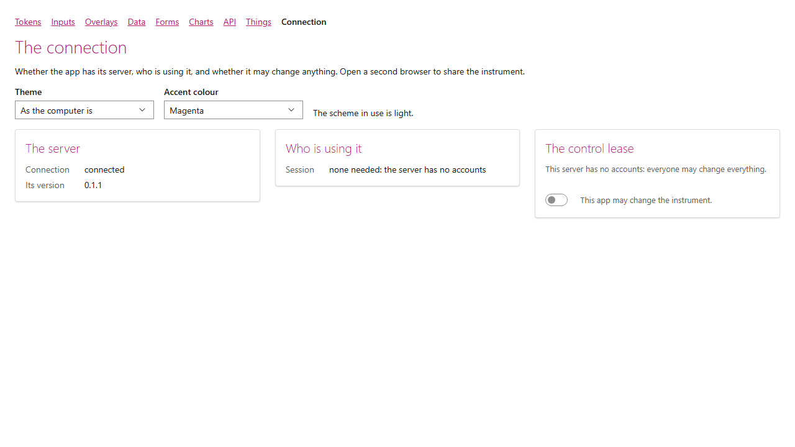
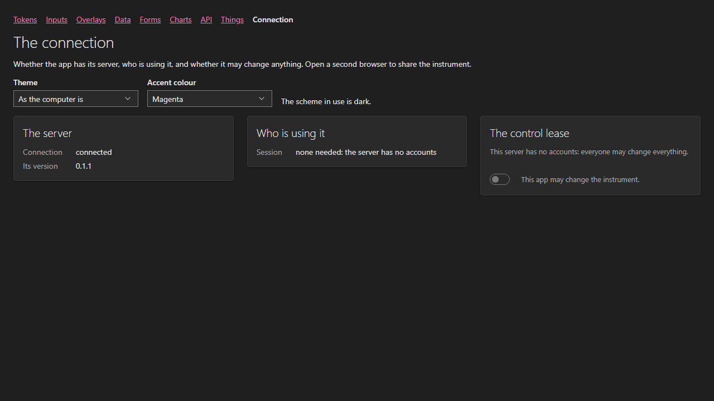
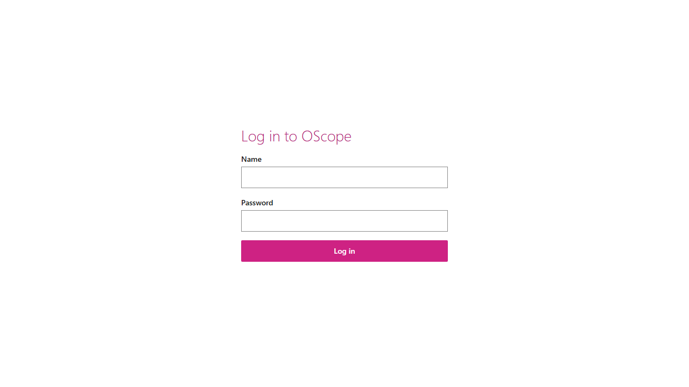
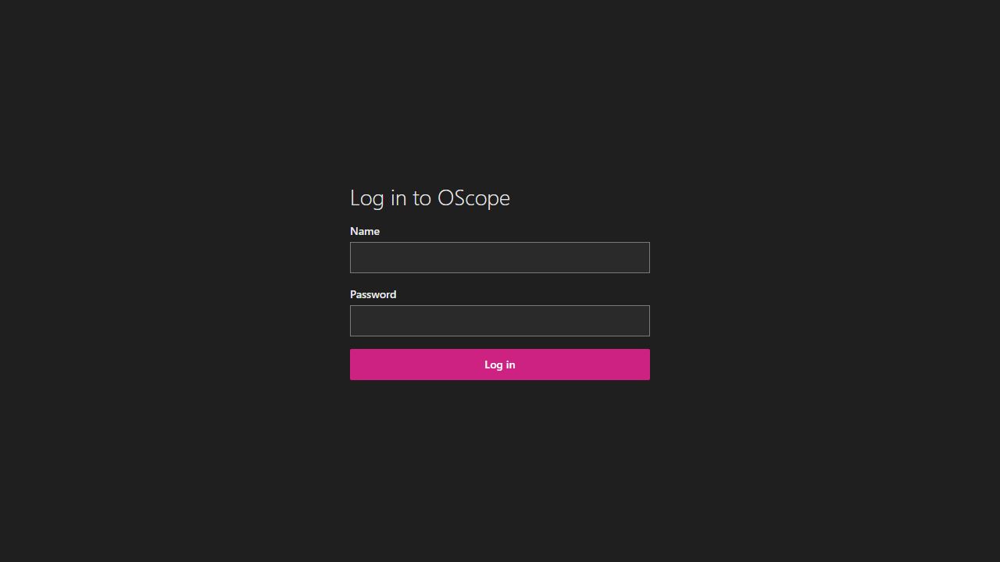

# W1.3: Connection, login and the control lease

- Status: Done
- Branch / PR: `m2/w1.3-connection` / [#86](https://github.com/lucaswewa/OScope/pull/86)
- Estimate: first 1,900, the spec's · second ~2,960 (code ~1,250, tests ~900, styles ~100, try-it ~650, glue ~60), in the plan's change log before the code, 56 % over the first: one pull request, at the owner's standing choice for W0 and W1 · measured **1,867** hand-written lines changed (code 698, tests 731, styles 64, try-it 353, glue 21): 37 % under the second estimate, and 2 % under the first. The second overestimated each part, the origins layer most: 220 lines planned, 144 written. The size script counts `features/login/` as code, and the pages' style blocks as styles

## Summary

The app now knows whether it has a server, who is using it, and whether it may change anything ([spec](../phases.md#w1-3), [ADR-0045](../../adr/0045-the-app-s-connection-sessions-and-media-under-security.md)).

- **The connection** watches the server's `/health`, and checks the server's version against the app's.
- **With accounts,** every page asks for a login, the token goes with every call, and a session that ends goes back to the login and then to where its user was.
- **The control lease** can be taken, asked for, handed over and given up. Its holder is warned before it lapses. `useCanControl()` is what every control asks.
- **Media under security** are fetched with the token and shown as blobs. Files move with their progress.
- **On the server,** `[network] origins` lists the pages elsewhere that a browser may call it from. Every other origin is refused.

W1.3 was begun in the sandbox while W1.2's gate ran. Its Rust was built only between gates.

## What was built

In `web/`:

- **`src/api/connection/connection.ts`: `useConnection()`:**
  - it watches `/health` every 2 s;
  - its states are connecting, connected, reconnecting, refused, and a version the app doesn't know;
  - `knows(version)` compares major and minor numbers with the app's own, from its `package.json`.
- **`src/api/connection/session.ts`: `useSession()`:**
  - `probe` asks the server who the app is, out of three: open, with no accounts; out; or in;
  - then `login`, `logout`, and `resume`, which takes up a token kept from before;
  - `keepWith` tells the host each token, so the host can keep it;
  - a 401 while logged in ends the session.
- **`src/api/connection/lease.ts`:**
  - `useLease()`: the `auth` Thing's lease, `me` and accounts, through W1.2's store; its four actions; and `lapsesIn` and `lapsing`, a minute before the lease lapses;
  - `useCanControl()`, which follows `me` only while there is a session.
- **`src/api/client.ts`:**
  - the session's token on every call, by openapi-fetch's middleware, and on every `fetched` medium;
  - `onUnauthorised`, told each 401;
  - `activity.last`, the app's last change.
- **`src/api/transfer.ts`:** `receive`, a download read from its stream with its progress, and `send`, an upload by `XMLHttpRequest` with its progress, each with the token.
- **`src/host/session.ts`:** the token kept in the tab's session storage.
- **`src/features/login/`:**
  - `LoginPage.vue`, at `#/login`;
  - `keep.ts`: the token kept and taken up again, a guard that sends a page without a session to the login, and a session that ends returned there.
- **`src/ui/TextField.vue`:** `secret`, for a password, and `autocomplete`.
- **`#/dev/gallery/connection`, `ConnectionPage.vue` and `LeaseCard.vue`:**
  - the connection and the server's version;
  - who is using it, and logging out;
  - the lease and what this app may do with it;
  - a control that is read-only while another holds the lease.
- **`tests/e2e/server.ts`:** `addAccount`, before a server starts.

In the server:

- **`oscope-api`'s `origins` layer:**
  - `Origins`, and `ApiBuilder::origins`;
  - a request whose `Origin` is neither the server's own, judged by its `Host`, nor listed is refused with 403, before it is served, WebSocket upgrades among them.
- **`oscope-server`:**
  - `[network] origins`, passed to the API;
  - `--print-openapi` and `--print-td` describe the API with security on and no account, so that the app's types have the `auth` Thing.

## How to try it

```sh
cargo build -p oscope-server
cd web && npm ci && npm run build && cd ..
target/debug/oscope-server account add alice    # asks for a password, twice
target/debug/oscope-server account add bob
target/debug/oscope-server --port 8211 --web web/dist
```

1. **A login:** open `http://127.0.0.1:8211/#/dev/gallery/connection`. It asks for a login. A wrong password is refused at the field. Alice's lets her in.
2. **The lease between two browsers:** open a second browser, or a private window, and log in as Bob.
   - Alice takes control: her control may change things, and Bob's is read-only.
   - Bob asks for control; Alice sees his request, and hands it over.
3. **A session that ends:** log out in one tab of Alice's, and use another of hers. It goes to the login, and after it, back to the page.

## Screenshots

| | Light | Dark |
|---|---|---|
| The connection, without accounts |  |  |
| The login |  |  |

## Design notes and deviations from the plan

- **teta-wot lets every origin in,** and has no setting for it, so `[network] origins` needs a layer of OScope's own. It refuses the request itself, not only its CORS headers, since a page's request without CORS can still change state. The estimate's second counted it; the spec didn't.
- **A page's own origin is judged by its `Host`.** The dev server's proxy keeps the browser's `Host`, so its requests count as the server's own: development needs no `origins`. I checked it by running a server of my own on 8231, with the dev server on 8281 in front of it, both carrying 8281's `Origin`:
  - **through the dev server:** an action was let in, 201, and `/health`, 200;
  - **straight to the server:** refused, 403.
- **The printed API has security on.** `--print-openapi` described the API without accounts, so the app's types had no `auth` Thing. It now describes it with security on and no account, as an app meets it.
- **The token is kept in the tab's session storage,** through the host: `api/` can't touch storage (ADR-0039).
- **The lease's warning counts from this app's own last change.** Another tab of the same account keeps the lease without this one knowing, and would see a warning that is early.
- **`TextField` gained `secret` and `autocomplete`,** for the password.

## Tests

- **Unit, 28 new, 466 in all:**
  - **the connection, 7:**
    - a version known by its major and minor numbers;
    - connecting until the first answer;
    - reconnecting after a loss, and connected again;
    - refused;
    - a version the app doesn't know;
    - the version read once the server lets it;
    - no more asking once stopped;
  - **the session, 8:**
    - open without accounts, and out without a token;
    - a login, its token then on every call and told to its keepers;
    - a wrong password refused;
    - a logout;
    - a session ended by the server's 401;
    - a kept token taken up, or dropped;
    - a 401 not ending a session that the server's lack of accounts never began;
  - **the lease, 5:**
    - always allowed without accounts;
    - with a session, allowed only while holding the lease;
    - not allowed while logged out;
    - the warning a minute before it lapses, and none after a change;
    - no warning for a lease not held;
  - **the transfers, 4:** a download's progress and its token; an upload's type, token, progress and answer; its refusal; its abort;
  - **the client, 4:** the token on every call and medium, none without a session, each 401 told, and each change noted.
- **The server, 5:**
  - `Origins::allows` itself;
  - through the whole router: a client without an origin, the server's own and a listed one let in;
  - pages anywhere else refused, at `/api/` and at `/health`;
  - a WebSocket's upgrade refused from elsewhere;
  - nothing listed letting in only the server's own.
- **Contract, 2,** against a real server with accounts:
  - an image's file and tile fetched with the token, and refused, 401, without it, the token never in their addresses;
  - the lease taken by Alice, Bob's write refused, 403, then asked for and handed over.
- **End to end, 7,** with two browsers on servers with accounts:
  - a wrong password refused at the field, and the right one letting the user in, in Chromium, Firefox and WebKit;
  - the lease taken, asked for and handed over between Alice and Bob, each one's controls read-only while the other holds it;
  - a session ended from elsewhere, back to the login and then to the page;
  - axe on both pages: no violation;
  - visual, the connection page and the login page, in both themes, on Windows and Linux. The gallery's other pages have new baselines too, for their header's new link.
- **Mutation checks, 18, all caught, none hung:**
  - **the server, 4:** any origin let in; the server's own origin not known; the listed ones not known; and the printed API without security, which `npm run api:check` refused at its line 6287;
  - **the client, 4:** no token with a call; none with a medium, caught by the contract test; a 401 not told; a change not noted;
  - **the session, 2:** an ended session not ended; no accounts taken for logged out;
  - **the lease, 3:** every control always allowed, caught both by the unit tests and with two browsers; and never warned;
  - **the connection, 2:** a lost server never reconnecting; every version known;
  - **the pages, 2:** no login asked for; an ended session left on its page;
  - **the transfers, 1:** an upload's progress not told.
- **The printed API's mutant first survived,** through a fault in my mutation runner, not in the code: its copy of the server took a Windows path, which bash read as escapes. Fixed, the mutant was caught.
- **Two cores, five times:** `web:unit`, `web:e2e`, `oscope-api:origins` and `oscope-server:cli`, 20 of 20, eight runs at once.
- **The replays,** the merge gate (ADR-0038), passed on `3c3468d` at the gate's first run, with the sandbox only editing beside it:
  - **Windows:** 79 of 79 steps; 637 tests in 236 suites.
  - **Linux,** on a fresh clone (1,210 files, none with a CR): 79 of 79 steps; 637 tests in 236 suites.
  - **Two cores, five times,** in the gate's worktree: 20 of 20 again.
  - **The machine:** connections in `TIME_WAIT` peaked at 10,247, and free memory stayed above 12 GB.
- **Docs:** the relative links and anchors in the Markdown files resolve.

## Follow-ups and known gaps

- **The shell's own status of the connection, the session and the lease** comes in W2.2.
- **Media shown as blobs must be revoked** when they leave the view: the deep-zoom viewer, W6.4, will do it for its tiles.
- **The desktop app** will list its webview's origin, W9.1.

## Clean room

- **Nothing was copied** from `microscope` or any other codebase.
- **No package was added.**
