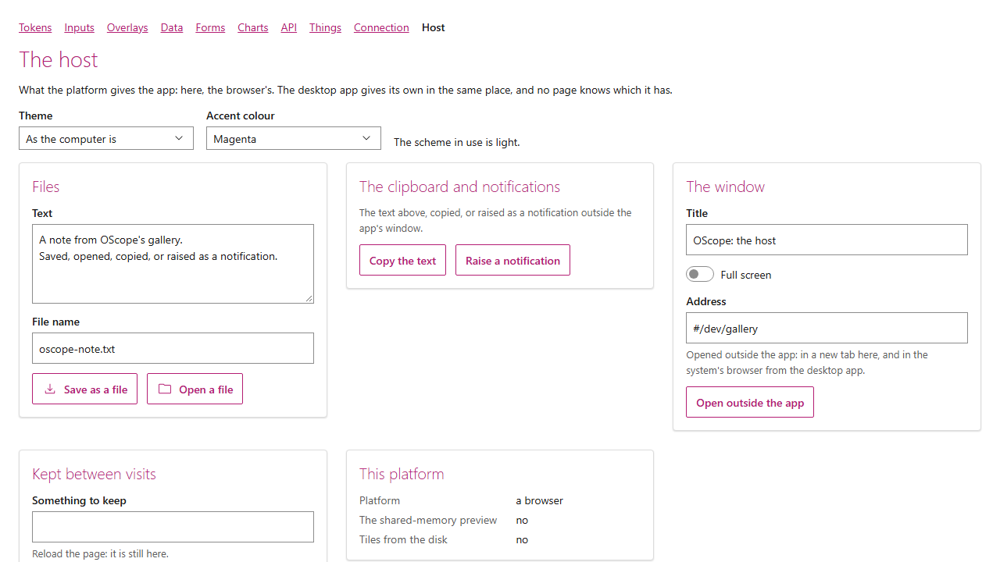
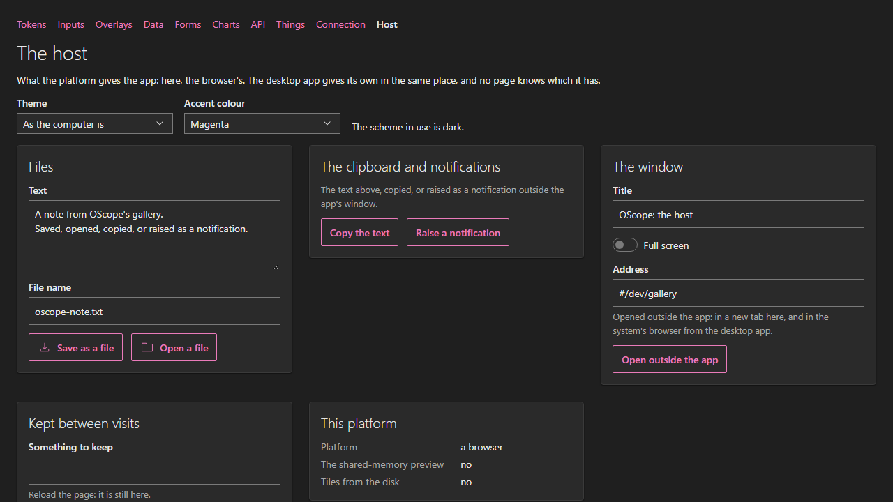

# W1.4: The host adapter

- Status: In review
- Branch / PR: `m2/w1.4-host-adapter` / [#87](https://github.com/lucaswewa/OScope/pull/87)
- Estimate: first 800, the spec's · second ~1,110 (code ~330, tests ~390, styles ~40, try-it ~310, glue ~40), in the plan's change log before the code, 39 % over the first: one pull request, at the owner's standing choice for W0 and W1 · measured **1,262** hand-written lines changed (code 393, tests 441, styles 26, try-it 354, glue 48): 14 % over the second estimate, and 58 % over the first. Of those, 131 fix a race in W1.3's session that this phase's two-core runs found (code 39, tests 92); without them, the phase is 1,131, 2 % over its second estimate

## Summary

Everything the platform gives the app now goes through one interface, so that the desktop app gives its own in one place ([spec](../phases.md#w1-4), [ADR-0046](../../adr/0046-the-host-adapter.md)).

- **`HostAdapter`:** storage by key, between visits and for the session; files saved and opened; the clipboard; notifications; the window's title and full screen; links opened outside the app; and what the platform can do beyond a browser.
- **The browser's implementation,** given its window so that a test can fake it. Its clipboard still copies when the page is served over plain HTTP.
- **The theme, the session's token and the values pages keep** are kept through it.
- **W0.1's lint rules** name the adapter's call in place of each of the browser's own.
- **A race in W1.3's session is fixed,** found by this phase's two-core runs: a read sent just before a login, and refused just after it, ended the new session.

W1.4 was begun in the sandbox while W1.3's gate ran.

## What was built

In `web/src/host/`:

- **`adapter.ts`:** the `HostAdapter` interface, with `Store`, `Files`, `AppWindow` and `Abilities`.
- **`browser.ts`: `browserHost(window)`:**
  - `kept` and `session`, on `localStorage` and `sessionStorage`, each reached afresh; a refusal keeps nothing and throws nothing;
  - `files.save`, a download of an object URL revoked a minute later, and `files.open`, through a file input, with none for a cancelled chooser;
  - `copy`, by the Clipboard API, or from a selection where the page has none, the focus given back;
  - `notify`, which asks for permission unless it was given, and says whether it showed anything;
  - `window`: the document's title, and full screen for the app or one element, with a listener;
  - `openOutside`, for a web page's or an email's address only, in a new tab with no opener;
  - `platform` and `can`: a browser, without the shared-memory preview or tiles from the disk.
- **`host.ts`:** `host()`, the browser's unless `installHost` put another in its place.
- **`kept.ts`:** kept by the host.
- **Gone:** `storage.ts` and `session.ts`, the browser's own storage, and their tests.

Elsewhere in `web/`:

- **`src/features/display/display.ts`:** the theme and the accent, kept by the host.
- **`src/features/login/keep.ts`:** the session's token, kept by the host until the window is closed.
- **`eslint.config.js`:** the platform's calls refused outside `api/` and `host/`, each naming the adapter's.
- **`src/api/client.ts`:** a 401 is told to the session only when its request was sent in the session the app has now: with its token, or without one while it has none.
- **`src/features/login/keep.ts`:** a page reached as its session ended, on its way from the login, is sent back to the login when it arrives.
- **`#/dev/gallery/host`, `HostPage.vue`:** a file saved and opened; the text copied, or raised as a notification; the window's title, full screen, and an address opened outside; a value kept between visits; and what this platform can do.

## How to try it

```sh
cargo build -p oscope-server
cd web && npm ci && npm run build && cd ..
target/debug/oscope-server --port 8211 --web web/dist
```

Open `http://127.0.0.1:8211/#/dev/gallery/host`:

1. **A file:** change the text, and press **Save as a file**: the browser downloads it. Press **Open a file**, and choose a text file: its name, size, type and first line are shown.
2. **The clipboard and a notification:** press **Copy the text**, and paste it anywhere. Press **Raise a notification**, and allow it: it appears outside the browser's window. From another computer, by plain HTTP, the copy still works, and the notification is refused: the page says so.
3. **The window:** change the title, and see the tab's. Turn on **Full screen**, and leave it with Escape: the switch follows.
4. **What is kept:** type in **Something to keep**, choose a theme, and reload: both are still there.

## Screenshots

| | Light | Dark |
|---|---|---|
| The host |  |  |

## Design notes and deviations from the plan

- **A file saved in a browser is a download,** not a dialog. Only Chromium has a dialog to save (`showSaveFilePicker`), and Playwright can't drive it, so a file's arrival on the disk couldn't be tested. The desktop app gives the system's dialog (W9.1).
- **The clipboard has a fallback.** The Clipboard API is there only for a page served securely, and the instrument's server is often reached over plain HTTP. There, the host copies a selection from a field of its own, with `document.execCommand`, which browsers have deprecated and still support.
- **Storage is read at once, not awaited:** the theme must be known before the page is first drawn. The desktop app, if it keeps its own store, reads it into memory before the app starts.
- **The try-it page's address to open outside is relative,** the gallery's own, so that its baselines don't hold the test server's port. A web page's address may be typed in its place.
- **Leaving the try-it page gives the window back its name,** "OScope": nothing else names it until the shell does, in W2.1.
- **The lint rules also refuse `document.title`,** reading it as much as setting it: the adapter only sets it.
- **A race in W1.3's session, found by the two-core runs.** One of five runs failed in WebKit: after a login, the page showed the session logged out, and stayed on it. Its trace showed the cause:
  - the connection reads the server's version every 2 s until it may. One read went out without a token while the login's answer was on its way, and its 401 came back after the login;
  - the client told the session of every 401, so the new session ended;
  - the page was still loading its code, so the guard, which watches from the page the app is on, saw the login and sent nowhere.

  The client now tells the session only of a 401 to a request sent in it, deciding once before any listener can change the token. The guard also looks again when a page arrives. Each has a unit test, and each was broken on purpose and caught. W1.3 was merged under the standing approval, so this is fixed here, in the next phase's pull request.
- **Permission for notifications is asked for unless it was given,** not only while unanswered. Headless Chromium says `denied` for permission that Playwright gave it, and answers a request truly, so the end-to-end test shows a real notification. A real browser asked again after a refusal answers at once, without asking its user.

## Tests

- **Unit, 29 new, 493 in all,** the old storage helpers' two tests gone with them:
  - **the browser's host, 16,** on a faked window:
    - what is kept between visits apart from the session's, by key, and forgotten;
    - a refusal, by a storage area or by a browser that blocks storage altogether, keeping nothing and throwing nothing;
    - a file saved as a download of an address of its own, in the page while it is clicked, and the address given up a minute later;
    - the files chosen through the chooser, with its types and its choice of several, and none when it is closed;
    - a copy by the page's clipboard, and its refusal;
    - a copy from a selection where there is none, the focus given back, and its refusal;
    - notifications, five ways: given; asked for and given; asked for and refused; refused; and headless Chromium's `denied` for permission given;
    - none shown where the browser has none, or refuses one; one without a body;
    - the window's title; full screen entered and left, its listener and its end, and one element filling the screen;
    - a web page's, an email's and a relative address opened outside, with no opener; `javascript:` and `file:` refused;
    - a browser, with neither of the desktop app's abilities;
    - `host()`, the browser's until another is installed;
  - **`kept`, 1:** kept by the host installed, not the browser's;
  - **W1.3's race, 3:** a 401 told only in the session its request was sent in, for a call and a medium; a session not ended by a 401 to a call sent before its login; and a page reached as its session ended sent to the login, then back to it;
  - **the lint rules, 9:** the storage's message naming the adapter; `open`; the clipboard; `document.execCommand`; `Notification`; `showSaveFilePicker`; `document.title`; `requestFullscreen`; and `document.exitFullscreen`. `src/host/` may use each.
- **End to end, 13 new, 109 in all:**
  - **in Chromium, Firefox and WebKit:** a saved file read back from the disk; an opened file's name, size, type and first line; a kept value and the theme surviving a reload;
  - **a login kept for its tab:** a reload stays logged in, and another tab is asked to log in;
  - **in Chromium:** the text copied, and read back from the clipboard; a notification shown; the window's title; full screen entered and left; and the window's name given back on leaving the page;
  - **axe,** in both themes: no violation;
  - **visual:** the host page in both themes, on Windows and Linux. The gallery's other pages have new baselines, for their header's new link.
- **Mutation checks, 19, all caught, none hung:**
  - **storage, 2:** the session kept between visits; a refusal thrown;
  - **files, 3:** a saved file's address given up at once; a cancelled chooser never answered; and a saved file's address not given to its link, caught in Chromium by the file read back from the disk;
  - **the clipboard and notifications, 4:** no copy without the clipboard; the focus not given back; a notification shown without asking; and a refusal taken as it was said, not asked again, caught in Chromium;
  - **the window and links, 4:** full screen never given back, caught by the unit test and in Chromium; any address opened outside; and a link outside given its opener;
  - **the host the app has, 1:** an installed host ignored, caught by `kept`'s test;
  - **what the app keeps, 2:** the token kept between visits, caught by the login kept for its tab; and the theme kept for the session only;
  - **the lint rules, 1:** the clipboard let through;
  - **W1.3's race, 2:** a 401 to a request sent before the login ending its session; and a page reached as its session ended left there.
- **The mutation script's first run stopped at its eighth mutant,** whose text I had changed after writing the script. Its check comes before any file is touched, so nothing was left changed; run again from there, every mutant was caught.
- **Two cores, five times:** the first runs found W1.3's race, in one of five end-to-end runs: `web:unit` 5 of 5, `web:e2e` 4 of 5. Fixed, 10 of 10: `web:unit` and `web:e2e`, five each, eight runs at once.
- **The replays,** the merge gate (ADR-0038), passed on `aa524fb` at the gate's first run, with the sandbox only editing beside it:
  - **Windows:** 79 of 79 steps; 637 tests in 236 suites.
  - **Linux,** on a fresh clone (1,222 files, none with a CR): 79 of 79 steps; 637 tests in 236 suites.
  - **Two cores, five times,** in the gate's worktree: 10 of 10 again.
  - **The machine:** connections in `TIME_WAIT` peaked at 10,207. Free memory fell to 2.4 GB while the replay linked its tests, the lowest yet, without a failure.
- **Docs:** the relative links and anchors in the Markdown files resolve.

## Follow-ups and known gaps

- **The shell names the window for each page,** W2.1.
- **The desktop app's adapter,** with the system's dialogs and its own store, W9.1.
- **Images on the clipboard,** when a phase needs to copy one.
- **An older browser without the file chooser's `cancel` event** leaves a cancelled choice waiting; the browsers the app supports all have it.

## Clean room

- **Nothing was copied** from `microscope` or any other codebase. Its idea of a host adapter is described in ADR-0046 in our own words.
- **No package was added.**
