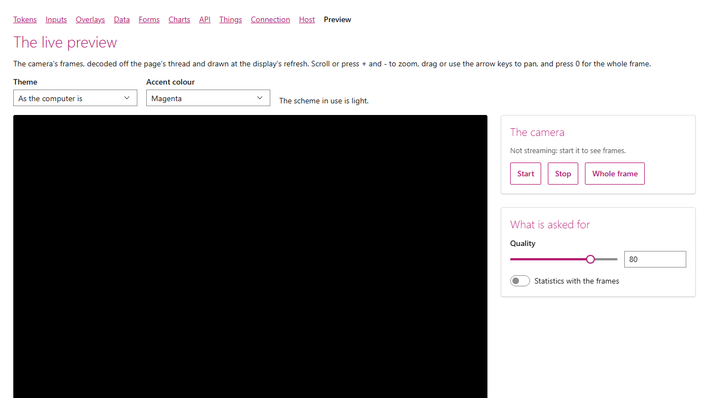
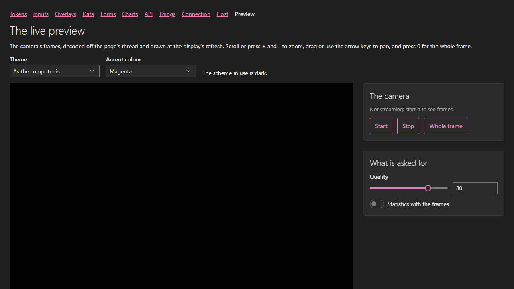
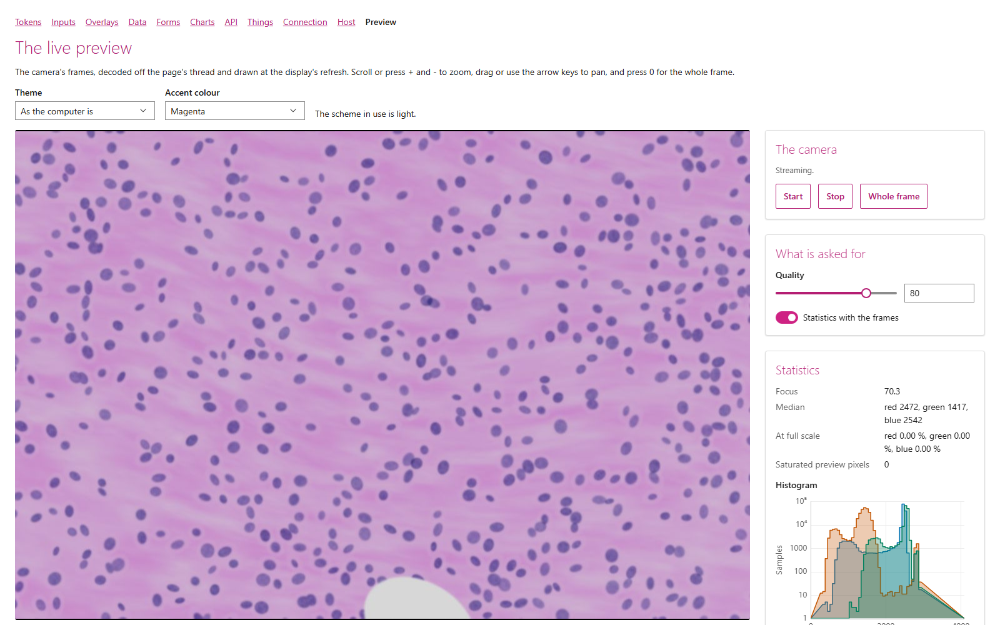

# W1.5: The preview client

- Status: In review
- Branch / PR: `m2/w1.5-preview-client` / [#88](https://github.com/lucaswewa/OScope/pull/88)
- Estimate: first 1,800, the spec's · second ~2,090 (code ~820, tests ~700, styles ~50, try-it ~480, glue ~40), in the plan's change log before the code, 16 % over the first: one pull request, at the owner's standing choice for W0 and W1 · measured **2,560** hand-written lines changed (code 1,077, tests 863, styles 58, try-it 556, glue 6): 22 % over the second estimate, and 42 % over the first. The page's client and its composable came to 379 lines against ~220; the recorder finds, by halving, the exposure at which part of the frame saturates; and the end-to-end tests put tissue, and a region, under the camera

## Summary

The live stream reaches the app: decoded off the page's thread, and drawn at the display's rate ([spec](../phases.md#w1-5), [ADR-0047](../../adr/0047-the-preview-client-a-worker-and-webgl.md)).

- **A worker holds the WebSocket.** It reads ADR-0014's header, refuses a version it doesn't know, decodes each JPEG with `createImageBitmap`, and hands the bitmap to the page.
- **The page draws the newest frame,** replacing one not yet drawn, at the display's next refresh, then acknowledges it. The server never holds more than two frames for it.
- **WebGL2 draws it,** with pan and zoom as a transform; zoomed in, the region shown is asked for at its own resolution. A 2D canvas draws where WebGL2 is missing.
- **Its numbers:** frames drawn a second, the latency from the exposure's end to the draw, and frames replaced.
- **P18's data,** the statistics and the saturation mask, is published to the app.
- **It reconnects, and rests while the page is hidden.**

W1.5 was begun in the sandbox while W1.4's gate ran.

## What was built

In `web/src/api/preview/`:

- **`message.ts`:** ADR-0014's header and ADR-0035's blocks read, with their types: the statistics, and the saturation mask, a bit a pixel.
- **`params.ts`:** what the page asks for: the viewport, the region, the quality, the rate and the statistics, sent whole each time.
- **`stream.ts`, run by `worker.ts`:** the WebSocket, its first message under security, the acknowledgements, each JPEG decoded, and reopening after a wait that grows.
- **`preview.ts`: `PreviewClient`:** the worker's frames, the newest winning, drawn at the display's refresh and acknowledged; the numbers; resting while hidden; and the statistics and the mask, as refs.
- **`renderer.ts`:** WebGL2's textured quad, and a 2D canvas without it.
- **`view.ts`:** the view onto the frame: fitted, zoomed about a point, panned, kept to the frame, and the region to ask for.
- **`use.ts`: `usePreview(canvas, choices)`:** all of it for a page, following the canvas's size and the view.

Elsewhere in `web/`:

- **`#/dev/gallery/preview`, `PreviewPage.vue`:** the live frame, with the wheel, dragging and the keyboard to zoom and pan; its readout; the camera started and stopped; the quality; and the statistics, with a histogram.
- **`scripts/record-preview.mjs`:** messages from a server of its own, recorded for the reader's tests.
- **`tests/setup/stand-ins.ts`:** binary messages from the fake socket, and preview messages made by hand.

## How to try it

```sh
cargo build --release -p oscope-server
cd web && npm ci && npm run build && cd ..
target/release/oscope-server --port 8211 --web web/dist
```

Open `http://127.0.0.1:8211/#/dev/gallery/preview`:

1. **Live:** put the default slide's tissue under the camera, as P17's example does, then press **Start**. The readout shows the frames drawn a second and the latency:

   ```sh
   curl -X POST http://127.0.0.1:8211/api/v1/stage/home -H "content-type: application/json" -d "{}"
   curl -X POST http://127.0.0.1:8211/api/v1/stage/move_to -H "content-type: application/json" \
     -d '{"x": 40000, "y": 12000, "z": 5000}'
   ```
2. **Zoom and pan:** scroll over the frame, or press + and -, and drag or use the arrow keys. Zoomed in, the region asked for is smaller, and the picture sharper. Press 0, or **Whole frame**, to go back.
3. **Resize the window:** the frames' size follows.
4. **Statistics:** turn on **Statistics with the frames**: the focus value, the median, the share at full scale and the histogram.
5. **Hidden:** switch to another tab and back: the readout says it rested, and the frames go on.

## Screenshots

| | Light | Dark |
|---|---|---|
| The live preview, the camera still |  |  |

Live, over the default slide's tissue, with statistics, at the camera's 14.5 frames a second:



## Performance

Measured on the owner's PC: the release server, built on 2026-11-17, whose preview code is this commit's; headless Chromium, whose WebGL draws in software; the canvas 1920 pixels wide, over the default slide's tissue. Each run is 30 seconds, read from the page's readout and the `preview` Thing's `sessions`:

| Frames | Camera | Sent | Drawn | Replaced | Missed | Latency | the server's | the page's |
|---|---|---|---|---|---|---|---|---|
| a 1920 × 1272 region, `design` mode | 14.5 a second | 437 | 437 | 0 | 0 | 40.2 ms | 30.7 ms | 9.5 ms |
| the same, with statistics | 14.5 a second | 437 | 437 | 0 | 0 | 46.2 ms | 33.3 ms | 12.8 ms |
| the whole sensor, its default mode | 7.24 a second | 173 | 172 | 0 | 0 | 373 ms | 356 ms | 17.1 ms |

- **The spec's measure is met:** at 1920 pixels wide, the app drew every frame the simulated camera gave at 14.5 a second, none replaced, 40 ms after its exposure ended. *Missed* counts the frames the server skipped while the page hadn't acknowledged.
- **The whole sensor is the server's limit, not the page's:** the simulated camera renders 20 megapixels on the CPU, and the server sent about 6 frames a second, of which the page drew every one. P17's follow-up, the simulated camera on the GPU in the server, would lift it.
- **The latency leaves out the network,** loopback here: the clocks differ.
- **The camera's region** keeps the rate, as its notes say, and makes each frame 1920 pixels wide at its own resolution.

## Design notes and deviations from the plan

- **The page acknowledges a frame once it has drawn it,** not when it arrives: the server then never sends far ahead of what is shown.
- **The view's extent is the frame's own,** from the header of a frame asked for whole: no camera property is read.
- **Latency leaves out the network's part:** the server's clock isn't the page's. The page's part is counted on the epoch's clock, since a worker's `performance.now()` has another origin.
- **The stream's parameters and statistics are typed by hand:** the OpenAPI document describes only the stream's address. A contract test holds the parameters to the schema in the `preview` Thing's description.
- **The mosaic's block of changed tiles (ADR-0026) is passed over;** the live mosaic comes in its own phase.
- **Resting closes the socket from the worker,** which stays. Ended at once, a worker may not send its socket's close: in one run, the server kept the session for 15 s while the page was hidden. A preview that stops ends its worker a second after telling it to close.
- **The end-to-end tests give the camera a 1920 × 1272 region,** over the default slide's tissue. A debug server renders the whole 20 MP sensor on the CPU, and a dozen at once, as the suite runs them, starved the browsers: in one full run, a keyboard test of W0.3's failed in Firefox. The region keeps the camera's rate, for an eighth of the work. The two tests that look at what is drawn put the default slide's tissue under the camera; the others stay on glass, since homing the stage takes some 16 s. The contract tests read the whole sensor, but for the one whose pace follows the camera.
- **The latest-wins test paces its stand-in decoder by the camera:** three of the camera's frame intervals for each frame. At a fixed pace, a camera slowed by a busy computer was slower than the decoder, and the server had nothing to skip.

## Tests

- **Unit, 31 new, 524 in all:**
  - **the reader, 9:**
    - three messages recorded from a server: a plain one, its JPEG whole and fitted to the size asked for; one with the statistics asked for, 16 bins a channel, and a mask of the pixels saturated; and one of a region;
    - made by hand: a version this app doesn't know refused; what isn't a preview, or is cut short, refused; ADR-0014's first header, whose JPEG runs to the end; a field added to the header, and a kind of block it doesn't know, passed over; a block running past its message refused; and the mask's rows read from each byte's highest bit down;
  - **the stream, 8:** its token first, then everything, ready for message 0; at once without a token; each frame decoded and handed over, and acknowledged only once drawn; a new ask sent whole with the acknowledgement it has; a JPEG that won't decode passed over, as if drawn; a version refused for good; opening again after a wait that grows, short again once a socket settled; and closed when told;
  - **the client, 7:** its worker opened with the stream's address, the token and the ask; the newest frame drawn at the next refresh, the one it replaced closed, then acknowledged; the last second's frames and latency, the server's and the page's; resting while hidden, its worker closing the socket and staying; a frame on its way then dropped; a new ask sent whole; the statistics and the mask published, none where nothing saturated; and stopped, its worker ended a second after it was told to close;
  - **the view, 6:** fitted; a frame that is part of the sensor; zoomed about a point that stays under it, then the region asked for; kept to the frame; panned with the pointer; and a side that fits whole, centred;
  - **the renderer, 1:** a 2D canvas without WebGL2, the frame where the view places it, each bitmap closed.
- **Contract, 5,** against a real server:
  - frames numbered, each a JPEG of the size its header says;
  - a region given the pixels asked for, at their own size;
  - statistics with a frame when asked for;
  - what the app asks for, its statistics' request too, as the server's description of the stream has it;
  - **the newest frames, not a backlog:** the worker's own stream, decoding more slowly than the camera, had frames skipped for it by the server, and their numbers ran ahead of the count decoded.
- **End to end, 10 new:**
  - **in Chromium, Firefox and WebKit:** frames drawn and acknowledged over the tissue, the canvas showing them and moving on;
  - **at 1920 pixels wide,** every frame the server sent drawn, none missed or replaced;
  - the frames' size following the window;
  - zoomed in from the keyboard, the region shown asked for, and the whole frame again;
  - resting while the page is hidden, the server's session gone, and going on when it is shown;
  - statistics with the frames: the focus value, the median and the histogram of red, green and blue;
  - axe, in both themes: no violation;
  - visual: the page with the camera still, in both themes, on Windows and Linux. The gallery's other pages have new baselines, for their header's new link.
- **Mutation checks, 18, all caught, none hung:**
  - **the reader, 3:** a version it doesn't know read; the JPEG's length ignored, its blocks then read as the JPEG; and the mask's bits read from the lowest;
  - **the stream, 5:** no acknowledgement, caught by the contract test whose stream decodes slowly, as the spec asks; acknowledged on arrival, not once drawn; a version refused, then opened again; the wait never growing; and no token first;
  - **the client, 6:** a replaced frame not closed; a frame drawn not told, caught in Chromium, where the stream stalled after two frames; never resting, and resting without closing the socket, both caught in Chromium; latency without the page's part; and a stopped worker ended at once;
  - **drawing and the view, 4:** the quad turned upside down, caught in Chromium by the tissue's picture; zoomed about the centre, not the point; the region shown never asked for, caught in Chromium; and the window's size not asked for, caught in Chromium.
- **Two of the mutation script's runs stopped at a mutant whose text Prettier had rewrapped,** before any file was touched. Run again, every mutant was caught.
- **Two cores, five times:** `web:unit` and `web:e2e`, 10 of 10, eight runs at once. An end-to-end run takes some 10 minutes on two cores, where W1.4's took 6.5: the preview's tests over tissue each home the stage, some 16 s.
- **The replays,** the merge gate (ADR-0038), passed on `54bfe8e` at the gate's first run, with the sandbox only editing beside it:
  - **Windows:** 79 of 79 steps; 637 tests in 236 suites.
  - **Linux,** on a fresh clone (1,249 files, none with a CR): 79 of 79 steps; 637 tests in 236 suites.
  - **Two cores, five times,** in the gate's worktree: 10 of 10 again, an end-to-end run taking some 10 minutes.
  - **The machine:** connections in `TIME_WAIT` peaked at 10,467, and free memory stayed above 5.7 GB.
- **Docs:** the relative links and anchors in the Markdown files resolve.

## Follow-ups and known gaps

- **The live viewer and its overlays** come in W3.1, on this client.
- **The shared-memory preview** in the desktop app, W9.3, as one more way into the worker.
- **W10.3 turns the numbers here into budgets.**

## Clean room

- **Nothing was copied** from `microscope` or any other codebase. The header's reader and the acknowledgement follow ADR-0014 and ADR-0035, and P17's example page, which is OScope's own.
- **No package was added.**
