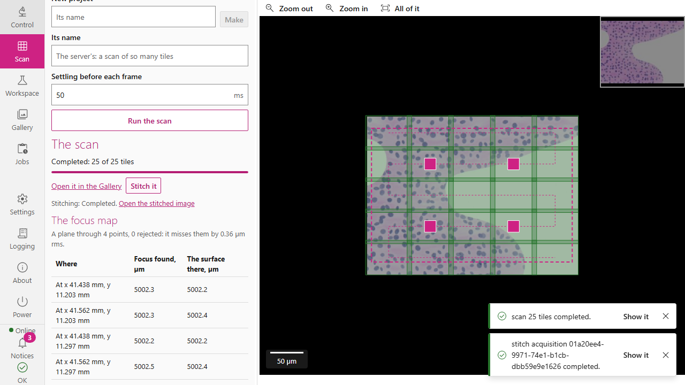
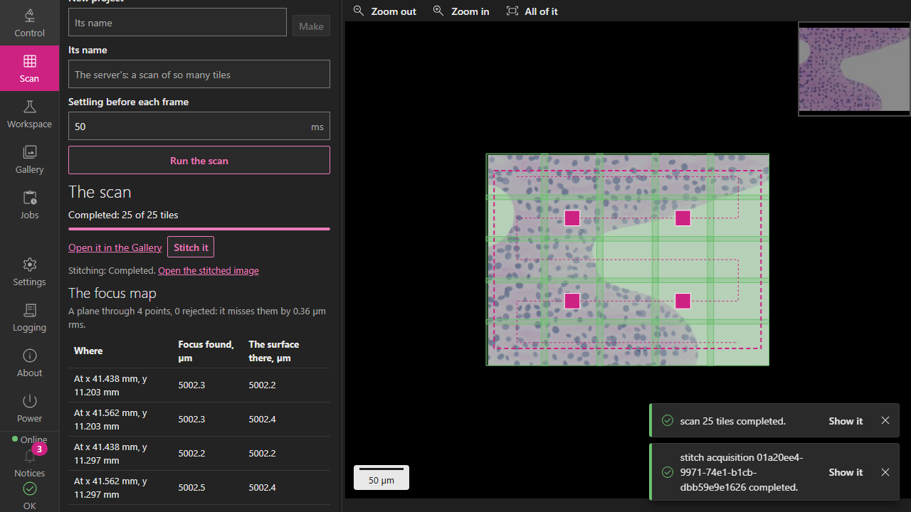
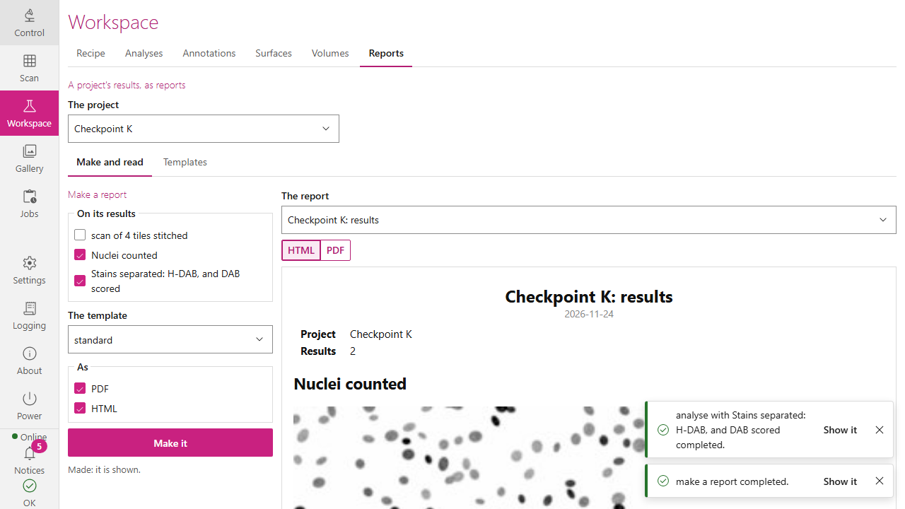
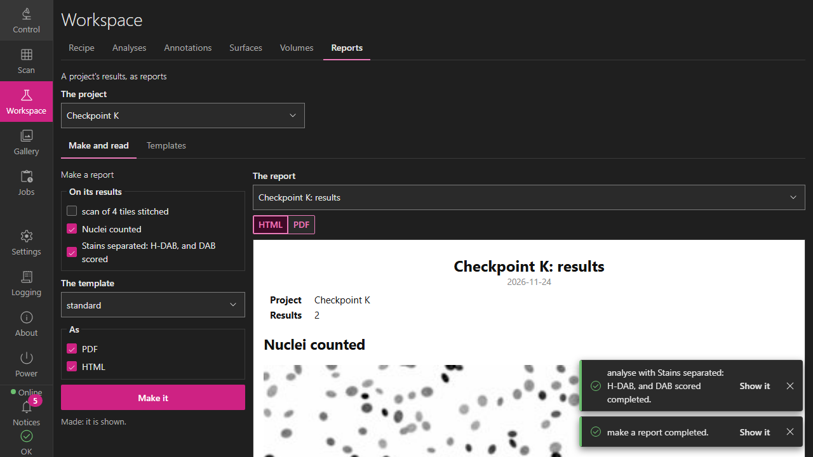

# W10.1: Workflows end to end

- Status: In review
- Branch / PR: `m2/w10.1-workflows` / [#137](https://github.com/lucaswewa/OScope/pull/137)
- Estimate: first 1,500, the spec's · second ~1,600 (the suites ~1,300, the configuration ~60, the gate's scripts ~120, glue ~120), in the plan's change log before the code · measured 1,436 (the suites and their steps 1,176; the gate's scripts and the configuration 101; the app's fixes 88; unit tests 69; the app's words 2), 10 % under the second

## Summary

Milestone 2's checkpoints, G to L, as Playwright suites in `web/tests/workflows/` ([spec](../phases.md#w10-1)). Each drives the app through its checkpoint's demo, as a person at the instrument would:

- on a server of its own, from a clean data root, on the simulator's default samples;
- the stage's moves at their real distances, the long ones on the simulator's fast clock;
- waiting for the instrument's own conditions, never for a time.

Chromium runs every test, and Firefox and WebKit the main path, as the end-to-end tests do. `npm run test:workflows` runs them, and so do both replays, CI, and `scripts/two-core.sh web:workflows`.

**Found by the suites, and fixed:**

- **The scan tab's plan stopped** once the tab had been left. The plan, which the tab's panes share, was made in the scope of the tab that first asked for it. When another tab opened, that scope ended, and the plan was never asked for again. Checkpoint I's demo leaves Scan for Control to fit the 10x.
- **The scan's tiles lost their marks** a few seconds after a histo scan ended. The overview, read again every 10 s, made an equal plan anew, which the tab took for a change of plan.
- **A project made after the Workspace opened** wasn't offered in its Annotations, Surfaces, Volumes or Reports, nor in Analyses: the Workspace keeps its views, and each read the projects once. Each list now reads them again as it opens.
- **The tissue step said "1 islands of tissue".**

## What was built

In `web/tests/workflows/`, a suite for each checkpoint:

- **`g-live-microscope.spec.ts`, Checkpoint G:** homed and over the tissue by the stage's fields; streaming; a jog by the arrow keys; one to one by `1`; the saturated pixels marked at 30 ms and cleared at 10 ms, then the histogram; Page Up twice at 10 µm, and autofocus back within a quarter of the depth of field of the simulator's truth; a frame captured into a project made there; and a mosaic grown by jogging, a frame drawn at each new place.
- **`h-instrument.spec.ts`, Checkpoint H:** a long burst, a second page's capture and an autofocus queued; the autofocus moved first by Alt and the up arrow; the waiting capture and the burst cancelled, the burst asked first; the autofocus run to its end; a move past a limit refused and found under *Error* and `out of range`, its fields shown; the log's tail held while scrolled up, and followed again; the status in full, the camera unplugged and back; the service restarted from Power, About's time up from seconds; a reboot only said.
- **`i-histo-scan.spec.ts`, Checkpoint I:** the overview through the 5x; its tissue said; the regions proposed, the first narrowed and the rest dropped, drawn fainter; a focus map of 2 by 2, its points on the view after the 10x is fitted on Control; the run, paused and resumed, each tile marked as taken; the map said; and the scan stitched.
- **`j-gallery.spec.ts`, Checkpoint J:** a scanned and stitched slide, made by the API as Checkpoint I's, found by part of its name; its acquisition's details and the result's provenance; viewed from all of it to its pixels and back; full screen; its look, the tiles asked for at the white point and gamma chosen; the scan's acquisition beside it, panned together, its planes walked; the view saved as a PNG, the mosaic exported as OME-TIFF and downloaded; and a TIFF dropped on the project's page, imported and viewed.
- **`k-analysis.spec.ts`, Checkpoint K, three tests:**
  - **the main path:** the H-DAB tissue loaded from Settings; a snake at 20x, stitched; the library's nuclei count on the mosaic, a row leading to its cell; DAB measured, its channel alone and its score; a rectangle, an ellipse and a polygon measured on the mosaic, their table exported; and a report on both, read as PDF;
  - **a recipe drawn from the palette**, the demo's four nodes joined from the input to the outputs, its sigma given: *It can run*, and it runs live on the camera, its cost and each node's said;
  - **a surface and a volume:** depth from focus's surface turned and profiled; the cells' stack and its deconvolution turned together, cut, and sliced.
- **`l-settings.spec.ts`, Checkpoint L:** the 20x calibrated by the wizard on a simulator turned by -20°, its objectives 2 % off, the geometry within that truth, a reload finding it at its third step; one's own photograph imported as a sample and seen at the coverslip's middle; the sample extension installed, loaded at a restart, and its panel run; lengths in mm on Control; and the first account, the login asked for after the second restart.
- **`steps.ts`:** the steps they share: homed and moved by the stage's fields on the fast clock, streaming through a region of the sensor, and a project made from a pane.

The configuration, `web/playwright.workflows.config.ts`, is the end-to-end tests' with the workflows' folder, 10 minutes a test, and a minute an action, so that a step stuck ends its test soon.

The gate:

- **`scripts/ci-local.sh`:** a *web workflows* step, after the end-to-end tests, run whole, four at a time, whenever the change reaches the app or the server. `ci-clone.sh` runs it as `ci-local.sh` does.
- **`web/scripts/changed.mjs`:** the plan's `workflows: yes` or `no`: yes for the app's sources, the server, the end-to-end harness, or the workflows themselves.
- **`scripts/two-core.sh`:** `web:workflows`, and `web:workflows:SPEC,…`.
- **CI:** a step after the end-to-end tests.

The app:

- **`features/scan/planning.ts`:** the plan made in a scope of its own, and asked for again only when what it asks changes; `scanning.ts` follows the same.
- **`ui/Select.vue`:** `opened` as its list opens; **`features/workspace/projects.ts`:** the projects read again then, by each of the Workspace's five lists.
- **`features/scan/histo/HistoScan.vue`:** the islands counted in words: none, one, or several.

## How to try it

After the end-to-end tests' preparation ([`web/README.md`](../../../web/README.md)):

```sh
cargo build -p oscope-server
npm --prefix web run build
npm --prefix web run test:workflows
```

Each checkpoint starts a server of its own and drives the app through its demo. `-- --headed --project chromium` shows it; `-- k-analysis` runs one.

## Screenshots

| | Light | Dark |
|---|---|---|
| Checkpoint I: the histo scan at its end, its tiles marked, its map said |  |  |
| Checkpoint K: the report on the count and the DAB |  |  |

## Design notes and deviations from the plan

- **Where the demos ask what the app can't do,** the suites do what it can, and say so:
  - **H, three captures queued from the capture pane:** the pane's button waits for its own capture, so the second comes from another page, as a colleague's.
  - **K, the recipe's outlines over the live image:** a live recipe shows its `image` output alone, and an output takes its port's name. The demo's four nodes run live, the image shown being the blur's, and the outlines computed beside it.
  - **G, one to one in WebKit:** Playwright's Safari has two device pixels to a CSS pixel, and the viewer never zooms out past its fit. G streams a region as wide as the view's device pixels, so that one to one fits, as with the whole sensor.
- **Some setup is by the API, as the demos' own scripts did:**
  - the camera's region, a part of the sensor: a debug server renders each frame on the CPU;
  - J's scan and stitch, which are Checkpoint I's;
  - K's surface and volume, as W7.7's and W7.8's try-its make them;
  - the refused move in H, which the demo sends from another terminal;
  - the log's records in H, made so that there are some to scroll;
  - the simulator's truth, to type a focus by hand, or to judge autofocus.
- **Smaller than the demos,** where a debug build would take minutes:
  - the overview is 1 × 0.75 mm, not 10.5 × 7;
  - the runs are a few tiles;
  - the cells' stack has 9 planes, not 21;
  - the burst is 5,000 frames, to hold the queue while the suite works, where the demo's 500 come in under a minute through the tiny region.
- **The frames are kept small while the server is asked things:** a debug server renders each frame on the CPU, and on two cores a large one starved its answers. The autofocus, a double click on the mosaic, and a new project were each answered past the app's limit of 10 s. G streams its wide region only for one to one, and K stops the camera once its scan is stitched.
- **A step pressed while the last step's request is under way is let go,** as W3.3 meant, so that a held key's repeats don't pile up. Its request can outlast the stage's own *Idle*, so G presses again only if the stage didn't move. The simulator's backlash takes some 2 µm from a step that reverses z, within the 3 µm the suites allow.
- **Full screen is left as the browser leaves it at Escape,** `document.exitFullscreen()`: a test's keys don't reach the browser's own handling.
- **G reads the saturation's marks before opening the histogram:** Playwright's WebKit on Windows draws a resized WebGL canvas black, as W3.6 found.
- **The workflows run whole** on any change to the app or the server, and are left out for docs alone, or Rust that the server doesn't reach. The replays run them four at a time, not as many as the end-to-end tests: each is a session at the instrument, its server rendering frames on the CPU.

## Tests

- **The suites:** 8 tests, run 20 times across the browsers, on Windows and under WSL.
- **Unit, 3 new:**
  - the scan tab's plan asked for once the tab that made it has gone;
  - the plan asked for again only when what it asks changes;
  - the workflows reached by the app, the server, the harness and themselves, and not by another crate, or a spec.
- **Broken on purpose:**
  - **one fault a suite, in what it is there to catch:**
    - G: Page Up moving the stage down;
    - H: a fault injected as cleared;
    - I: the plan in the first tab's scope;
    - J: the look's gamma not asked for;
    - K: the projects never read again;
    - L: the first account's password not sent whole;
  - **this phase's fixes:** an equal request asking for the plan again; one island said as many; and the server's change not running the workflows.
  - **9, all caught, none hung,** each suite in Chromium on one worker, under a limit. One needed the suite put right first. *The islands said as many*, the sentence without its forms, passed Checkpoint I's first check, which took "1 islands" for a count. The check now reads the overview's own count of islands, and catches it.
  - **Tried and left out:** the count left out of the sentence's call. With the simulator's single island, vue-i18n's default form is the right one, so no suite can tell.
- **Two cores, five times:**
  - **The first gate, on `2dba8c5`:** every spec, the workflows and every unit test, side by side.
    - **The workflows passed 0 of 5,** each with this phase's own failures:
      - G in WebKit, five times: its saturation's marks unread in 30 s, WebKit's screenshots taking 12 to 18 s on two cores; then, with those given 90 s, its autofocus and its double click on the mosaic answered too late;
      - K in Firefox, once: its new project answered too late.
    - Fixed as the design notes say: the polls given 90 s, and the frames kept small while the server is asked things.
    - **The specs passed 1 of 5 and the unit tests 4 of 5.** The failures were earlier phases' tests, under the workflows' load beside them:
      - W8.4's `simulation.spec.ts`, one's own image never streamed, twice;
      - W7.8's `volume.spec.ts`, a second volume's view without its box for an instant;
      - W8.3's `wizard.spec.ts`, its last skip not taken;
      - W7.3's `recipes.spec.ts` in WebKit, named in W8.6's gate;
      - W0.5's `table.test.ts`, 100,000 rows sorted in 1,053 ms where it allows 1,000.
  - **On `138f26a`, each alone:**
    - the workflows passed 5 of 5 (1,407–1,442 s);
    - those four specs passed 5 of 5 (394–408 s);
    - the table's test passed 5 of 5 (2.6–2.7 s).
  - `138f26a` changes only the workflows from `2dba8c5`, whose other specs and unit tests the first gate ran.
- **The replays,** in full, as the gate's scripts changed, the CUDA tests on Windows:
  - **The second gate, Windows, on `138f26a`:** 78 of 81 steps in 39 min, with 685 Rust tests.
    - **This phase's own:** the workflows, twelve at a time, failed G in Firefox, its autofocus answered past the app's limit, and in WebKit, a double click on the mosaic taken for two clicks. The replays now run the workflows four at a time, and G double-clicks again if the stage didn't move: on `74c7bb2`, all 20 passed four at a time, in 2.7 min.
    - **Earlier phases':** W8.6's `accounts.spec.ts` in Firefox, the open server's page not said in 15 s, as in W8.6's own gate; and `ex-live-recipe`'s smoke run, its recipe 218 ms against a budget of 200, under the replay's load. The 429 other specs passed.
  - **The third gate, on `74c7bb2`:** the workflows passed 5 of 5 on two cores first (1,462–1,491 s).
    - **Windows:** 80 of 81 steps in 37 min, with 685 Rust tests; the workflows passed, four at a time, in 202 s.
      - **Its one failed step held two earlier phases' tests, in Firefox,** each answered past the app's limit of 10 s:
        - W8.6's `accounts.spec.ts`, adding the first account, its password hashed by a debug build;
        - W1.1's `api.spec.ts`, named in earlier gates.
      - The 428 other specs passed.
      - Those two specs, run five times again on two CPUs, passed 5 of 5 (90.8–92.5 s). As the owner chose, they are named and merged past.
    - **Linux,** on a fresh clone of `74c7bb2`, run alone: 80 of 80 steps in 25 min, with 685 Rust tests; 431 end-to-end tests passed, and the 20 workflows, four at a time, in 3.2 min.
- **Docs:** the relative links and anchors in the Markdown files resolve.

## Follow-ups and known gaps

- **A live recipe's outlines over the live image:** the preview shows a live recipe's image output alone. Drawing its geometry over the image would be server work, as would naming an output other than after its port.
- **W8.6's first account under load:** the password's hashing, argon2id in a debug build, took the app past its 10 s limit in Firefox in each of this phase's full Windows replays, and once in W8.6's. Building argon2 optimised in the dev profile would keep the tests' server quick there; that changes the build's files, so it is left for a change of its own.
- **One to one on a HiDPI screen,** through a part of the sensor narrower than the view's device pixels, shows the image at its fit.

## Clean room

Nothing was copied from `microscope` or any other codebase. No dependency was added.
