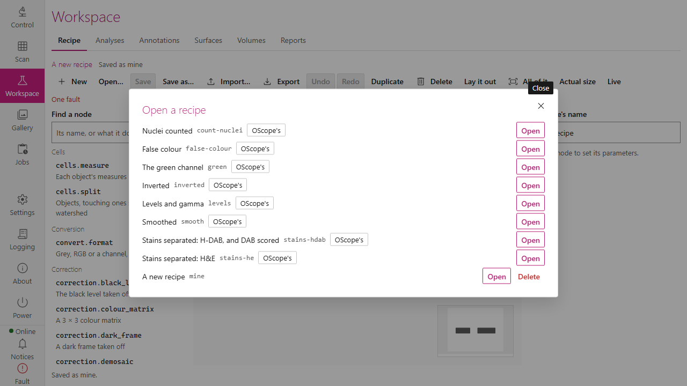
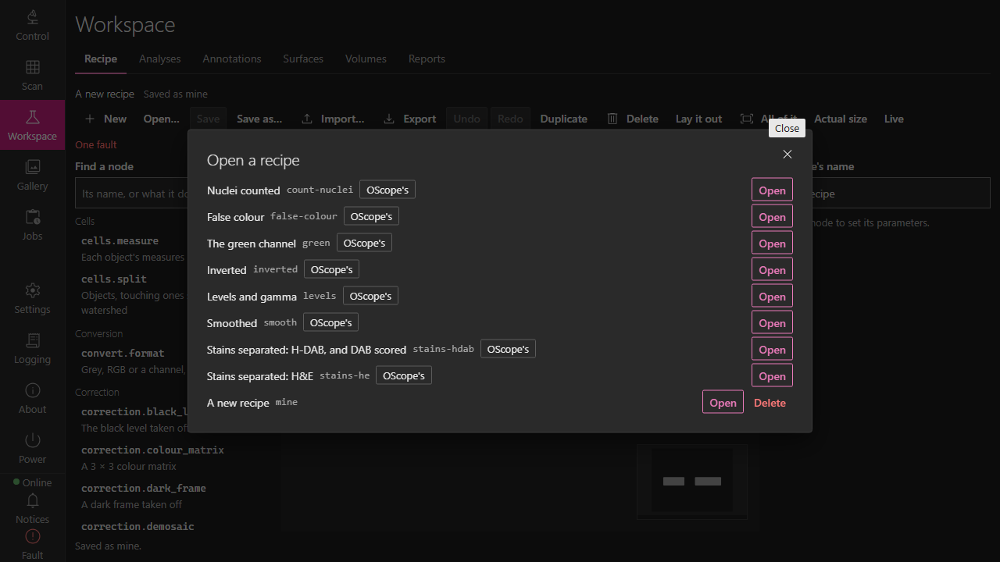

# W10.2: Visual baselines and accessibility

- Status: In review
- Branch / PR: `m2/w10.2-baselines-a11y` / [#138](https://github.com/lucaswewa/OScope/pull/138)
- Estimate: first 1,200, the spec's · second ~1,150 (the routes ~300, the dialogs ~300, keyboard only ~220, the scripts ~40, the app's fixes ~200, glue ~90), in the plan's change log before the code · measured 710 (the routes 202, the dialogs 225 and their stylesheet 6, keyboard only 214, the names scan 33, the scripts 20, the app's fix 10), 38 % under the second: the app needed one fix, where ~200 lines were allowed for, and the tabs had most of their baselines; 92 baselines besides, generated

## Summary

Every tab and dialog has its baseline in both themes, every route passes axe, every control has a name for a screen reader, and the main workflows are walked without a mouse ([spec](../phases.md#w10-2)). Most tabs had baselines and axe checks already, from their own phases; W10.2 fills the gaps and adds what no phase had:

- **The views without a baseline:** Settings' *System*, *Devices* and *The whole document*; Workspace's *Reports*; the calibration wizard's first step; and an extension's panel.
- **Every dialog,** 17 of them, each opened on fixed data: its baseline, the dialog alone, and axe on it.
- **Every route and view,** 26 of them, each checked by axe and for a name on every control, in both themes.
- **Keyboard only:** a frame captured into a project made on Control; a scan planned and run; a record found in the Gallery and viewed; and an analysis run and reported on. Each control is reached by Tab, in the page's order, and worked by its keys.
- **`npm run test:visual`** runs the baselines alone, and **`npm run test:a11y`** axe and the names alone.

**Found and fixed:** a project's card in the Gallery takes the focus and moves by the arrows, but Enter did nothing. Its link was the only way in, and Safari, by default, passes links by Tab: a Safari user couldn't open a project from the keyboard. Enter on a card now opens it.

## What was built

In `web/tests/e2e/`:

- **`routes.spec.ts`:** every route and view, axe and the names scan in both themes; and the baselines of the six views whose phases took none, on fixed data.
- **`dialogs.spec.ts`:** every dialog, opened as a person opens it, on data made for it: axe and the names scan on the dialog, in both themes, and its baseline.
- **`keyboard.spec.ts`:** the four workflows by the keyboard alone.
- **`axe.ts`'s `expectNamed`:** every control in the page, or in a dialog, has a name, as Playwright's ARIA snapshot reads the accessibility tree. A control's line in the snapshot without a name in quotes after its role is one without.
- **`hide-tooltips.css`:** a dialog focuses its first control as it opens, and that control's tooltip comes a moment later. The dialogs' baselines leave it out.

In `web/`:

- **`scripts/visual.mjs`, `npm run test:visual`:** the baselines alone, with `OSCOPE_VISUAL=1`, which npm's scripts can't set the same way on Windows and Linux.
- **`npm run test:a11y`:** the tests of axe and of names alone.

The app:

- **`features/gallery/GalleryTab.vue`:** Enter on a project's card opens it, as its link does.

## How to try it

After the end-to-end tests' preparation ([`web/README.md`](../../../web/README.md)):

```sh
npm --prefix web run test:a11y
npm --prefix web run test:visual
```

Change a token's colour in `web/src/ui/tokens/tokens.css`, the accent's say, and `test:visual` again: the baselines that use it fail.

## Screenshots

| | Light | Dark |
|---|---|---|
| The recipes' library, one of the 17 dialogs |  |  |

## Design notes and deviations from the plan

- **The baselines are what the phases didn't take:** the 56 the tabs had are kept, and 23 added, each in both themes, on Windows and Linux.
- **A dialog's baseline is the dialog alone:** the page behind it is another baseline's, and often moves. Its rounded corners blend with that page, so a dialog's baseline allows 20 pixels of difference.
- **The names scan reads the accessibility tree,** as a screen reader would, not the markup: a control named by its text, by `aria-label` or by a `<label>` is named alike. axe checks names too, but only by the rules it has for each kind of control.
- **Keyboard only means Tab to reach and the control's own keys to work:** Enter, Space, the arrows, and typing. No click, and no focus put on a control by the test.
  - **A tab list is one stop of Tab,** at its chosen tab, and the arrows move along it, as the ARIA pattern has it.
  - **The walk goes back by Shift and Tab** when its next control comes before the focus. Firefox moves the focus out to its own window past the page's last control, where Chromium and WebKit go round to the first.
- **The Gallery's walk is left out in WebKit:** Safari, and Playwright's WebKit with it, passes links by Tab unless Option is held, and Playwright's WebKit on Windows doesn't take Option and Tab. The record's *View it, deep-zoomed* is a link, as a way to another page should be. The card's Enter is for Safari's users all the same.
- **Every dialog's setup is the API's,** as the end-to-end tests' are: a burst running to cancel, a scan to cancel, a result to delete. The dialog is opened from the page.

## Tests

- **The new specs:** 26 routes, 17 dialogs, 6 views' baselines and 4 workflows: 50 tests in Chromium, the two workflows of the main path in Firefox and WebKit too. Run three times on Windows and three times under WSL, each time all passed.
- **Broken on purpose, 5, all caught, none hung:**
  - **an icon button without its name:** the names scan, now run before axe, found it on Control. At first it was run on the Gallery alone, which has no icon button on a server without projects, and survived; run on every route, it is caught;
  - **a question without its title:** the dialogs' names scan;
  - **the accent another colour,** as the try-it has it: the baselines that use it, the dialogs' first among them;
  - **a card not opened by Enter:** the Gallery's walk;
  - **the capture's button out of Tab's reach:** Control's walk.
- **Two cores, five times,** what the change reaches, on `4776bfd`: the end-to-end harness and `package.json` reach every spec, every unit test and the workflows.
  - **The workflows,** alone: 5 of 5 (1,395–1,462 s).
  - **Every spec and every unit test,** side by side: the unit tests passed 5 of 5 (139–159 s), and the specs 4 of 5 (3,438–3,474 s), this phase's own among them each time. The one failure was W7.3's `recipes.spec.ts` in WebKit, the live image not brightening enough after a parameter changed, as in earlier gates. That spec, run five times again on two CPUs, passed 5 of 5 (75–84 s). As the owner chose, it is named and merged past.
- **The replays,** the merge gate (ADR-0038), what the change reaches: every unit test, every spec and the workflows; no Rust.
  - **Windows, on `4776bfd`:** 16 of 17 steps reached, in 20 min; 479 of 480 specs passed, this phase's own among them, and the 20 workflows, in 195 s.
    - **Its one failure was W3.8's `mosaic.spec.ts`,** its axe test: its page never loaded, Windows answering `net::ERR_NO_BUFFER_SPACE`, short of what sockets need under the replay's load, as the gate's watchdog has seen before.
    - That spec, run five times again on two CPUs, passed 5 of 5 (56–59 s). As the owner chose, it is named and merged past.
  - **Linux,** on a fresh clone of `4776bfd`, run alone: 17 of 17 steps reached, in 16 min; 481 specs passed, and the 20 workflows.
- **Docs:** the relative links and anchors in the Markdown files resolve.

## Follow-ups and known gaps

- **Links in Safari's default:** Safari's users reach links by Option and Tab, or by turning on *Press Tab to highlight each item*. The app's links are links.
- **A first build after an edit came out broken, twice:** the app threw "reading '_s'" as it started, and the next build of the same files was sound. Seen only on this PC, after a source changed; the replays build afresh.

## Clean room

Nothing was copied from `microscope` or any other codebase. No dependency was added.
