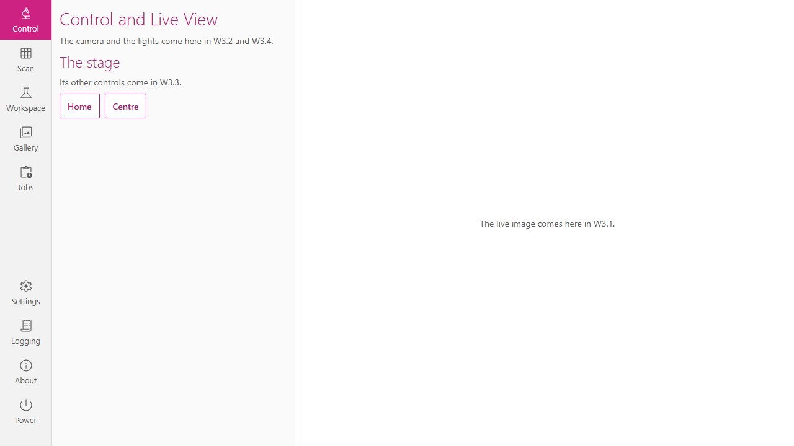
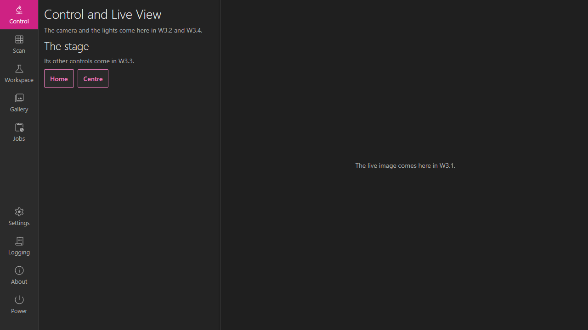

# W2.1: The shell and navigation

- Status: In review
- Branch / PR: `m2/w2.1-shell` / [#90](https://github.com/lucaswewa/OScope/pull/90)
- Estimate: first 1,400, the spec's · second ~1,850 (code ~900, tests ~300, styles ~180, try-it ~420, glue ~50), in the plan's change log before the code, 32 % over the first: one pull request, at the owner's standing choice for W2 to W4 · measured **1,463** hand-written lines changed (code 778, tests 231, styles 234, try-it 220): 21 % under the second estimate, and 5 % over the first. The scope's reach into the components came to some 70 lines, against ~170; the tests were fewer than estimated, since the end-to-end tests cover the rail and the keys in three browsers at once

## Summary

The app has its frame: the rail, the routes, and the layout every tab shares ([spec](../phases.md#w2-1), [ADR-0048](../../adr/0048-the-shell-and-the-lease-s-read-only-mode.md)).

- **The rail:** goal.md's nine tabs, the working ones at the top and the instrument's own at the bottom, as one toolbar, with the status indicator's place below them.
- **The routes:** each tab by hash, its page a chunk loaded when first opened. The first is Control. The component gallery stays at its address, out of the rail.
- **Control's layout:** the control pane and the view, with a handle between them whose place is kept.
- **Keys:** the rail from the keyboard, the digits for the tabs, `?` for the list of shortcuts, the focus moved to the tab's heading, and a link that skips to the content.
- **The read-only mode:** while another holds the control lease, every control in the tab is switched off, with one line saying why and the way to ask for control. The theme stays free.
- **Failures:** each tab catches its own, and offers to load it again; an action the server refuses is raised as a notice in its words.
- **The window's title** follows the tab.

W2.1 was begun in the sandbox while PR #83's gate ran.

## What was built

In `web/src/`:

- **`app/AppShell.vue`:** the rail and the tab; the tab locked without the lease, in its boundary; the window named; the focus moved to the heading after a change of route; the skip link; the shortcuts listened for; a refused action raised as a notice.
- **`app/tabs.ts`:** the nine tabs, their icons and pages, and the stage that fills each one still to come.
- **`app/shortcuts.ts` and `ShortcutsDialog.vue`:** the shortcuts' registry, and their list under `?`.
- **`app/TabBoundary.vue`:** a tab's failure, said, with a way to load it again.
- **`app/ReadOnlyLine.vue`:** the read-only mode's line, with *Ask for control* or *Take control*.
- **`app/router.ts`:** the tabs as the shell's children; the component gallery's routes renamed apart from the Gallery tab.
- **`ui/Rail.vue`:** the rail, a vertical toolbar of links.
- **`ui/ControlScope.vue`, and `useDisabled` in `ui/control.ts`:** a part of the page whose controls are locked, or freed again; every control and button switched off inside a locked part.
- **`api/things/use.ts`: `onActionFailed`:** told each action that the server refused or that failed.
- **The tabs' pages:**
  - `features/control/ControlTab.vue`: the pane and the view; in the pane, the stage's first two controls, *Home* and *Centre* (`StageSample.vue`), which W3.3 grows;
  - `features/settings/SettingsTab.vue`: the display's theme and accent, freed;
  - `features/about/AboutTab.vue`: the server's version, from W0.1's first page, which is gone;
  - `features/shell/TabPlaceholder.vue`: the others, each with the stage that fills it.

## How to try it

```sh
cargo build --release -p oscope-server
cd web && npm ci && npm run build && cd ..
target/release/oscope-server --config configs/oscope.toml --port 8211 --web web/dist
```

Open `http://127.0.0.1:8211/`:

1. **The rail:** the app opens on Control. Press Tab: *Skip to the content* appears; press Tab again to reach the rail, then the arrow keys, Home and End to go from tab to tab, and Enter to open one. The tab's heading takes the focus, and the window's title follows.
2. **The keys:** away from a field, press 1 to 9 to open the tabs, and `?` to list the shortcuts.
3. **A refusal:** on Control, before homing, press *Centre*: the stage refuses, and a notice says so in its words.
4. **The read-only mode:** add two accounts (`target/release/oscope-server account add alice`, and bob), restart, and log in as each in two browsers. Alice takes control: Bob's *Home* and *Centre* are switched off, with a line saying that alice is in control, and *Ask for control*. His theme is still his to choose, in Settings.

## Screenshots

| | Light | Dark |
|---|---|---|
| The shell, on Control |  |  |

## Design notes and deviations from the plan

- **The read-only mode locks a part of the page,** through the components, rather than each control asking for the lease. A control a later phase adds is locked with its tab by being one of the app's components. A tab frees what changes nothing on the instrument: the theme and the accent, here.
- **The stage's first two controls** are in Control's pane: the spec's end-to-end test needs a control to lock, and a refusal to tell.
- **The digits 1 to 9 open the tabs,** in the rail's order: no letter suits all nine.
- **The skip link is a button:** a link to `#content` would be a route.
- **W0.1's first page is gone:** the server's version is About's, until W4.3 fills it. Its test follows it there.
- **The theme and the accent are in Settings,** at the owner's choice, until W8. The gallery's pages keep their own.
- **The shortcuts' list takes the focus first.** With only its close button to take it, the button showed its tooltip, and the first Escape sent the tooltip away, not the list: the end-to-end test found it in every browser.
- **Control's handle starts at a third,** look.md's pane of 400 px at a window 1,280 pixels wide, and keeps where it is moved to. The tab is a grid, so that the splitter fills it.
- **`Shell` is `AppShell`:** Vue's rule asks for names of more than one word outside `src/ui/`.
- **A page that couldn't load is tried again** by *Load it again*: the router's failed navigation, not the tab it came from.

## Tests

- **Unit, 8 new, 532 in all:**
  - **the shortcuts, 4:** a key runs its shortcut, and the list keeps the order they were added; a key typed in a field, a chord, a repeat and a key handled already are left alone; a key taken twice is refused, and is free again once taken away; and they are heard until their listener stops;
  - **the tab's boundary, 2:** a tab that fails is stopped, its failure said, and loaded again; a page that couldn't load stops its tab, *Load it again* tries its navigation again, and another tab clears it;
  - **the scope, 1:** every control inside a locked part is switched off, but where a part frees it, and each comes back when it is unlocked;
  - **the actions, 1:** a refusal is told in the server's words, and nothing of an action left.
- **End to end, 10 new, 134 in all:**
  - **in Chromium, Firefox and WebKit:** each tab opened from the rail, the window named, its heading focused and its tab marked, and the component gallery still at its address; and the skip link, the rail's arrows and End, the digits, and `?`'s list, closed by Escape;
  - **a refusal, in the server's words:** *Centre* before homing, refused with `alarm`;
  - **the read-only mode between two browsers:** nobody in control, then Alice; Bob's controls off, with the line, his request said, and his theme free;
  - **axe,** on Control and on Settings, in both themes: no violation;
  - **visual:** the shell in both themes, on Windows and Linux. The tokens page has new baselines, for its eight new icons.
- **Mutation checks, 14, all caught, none hung:**
  - **the read-only mode, 4:** a locked part's controls left on; the tab never locked, and the theme locked with the rest, both caught with two browsers; and the line never shown;
  - **keys, 6:** a shortcut taken from a field; a key taken twice; the digits opening nothing; the focus left behind after a change of route; the window not named; and the rail's tab shown not marked, the last four in a browser;
  - **failures, 4:** a tab's failure not caught; a page that couldn't load not tried again; a refusal not told, caught in Chromium; and an action left told as a failure.
- **A mutant that survived showed a gap:** a tab loaded again was mounted anew by the boundary anyway, so the counter the mutant took away did nothing. But a page that couldn't load was then drawn as the tab it came from, and its navigation never tried again. Now *Load it again* tries it, with a test, and that mutant is caught.
- **Two cores, five times:** `web:unit` and `web:e2e`, 10 of 10, eight runs at once.
- **The replays,** the merge gate (ADR-0038): REPLAYS
- **Docs:** the relative links and anchors in the Markdown files resolve.

## Follow-ups and known gaps

- **The instrument's status, the connection and the lease in the rail,** W2.2.
- **The tabs' own contents,** from W3 to W8.

## Clean room

- **Nothing was copied** from `microscope` or any other codebase. The rail follows look.md, in our own words.
- **No package was added.**
