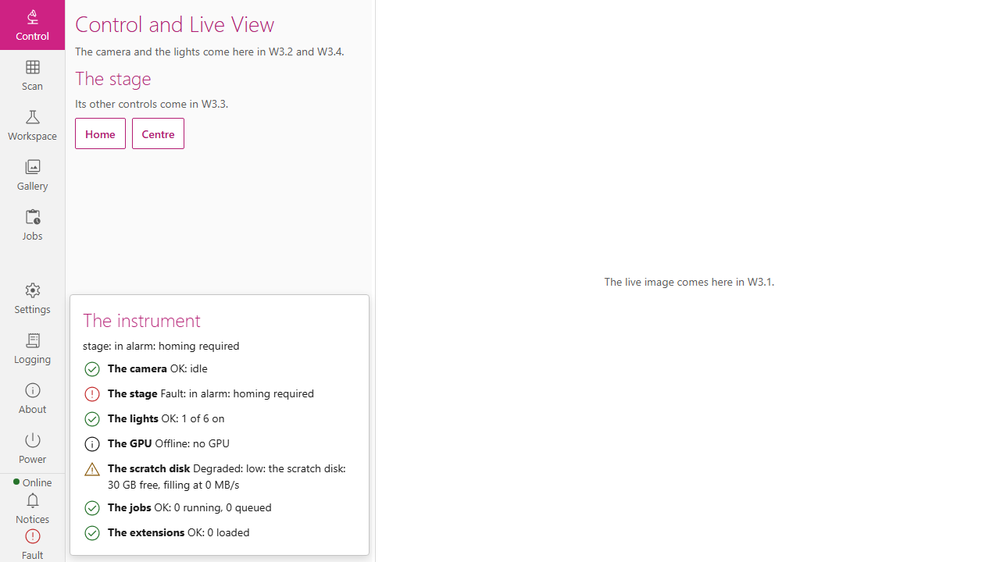
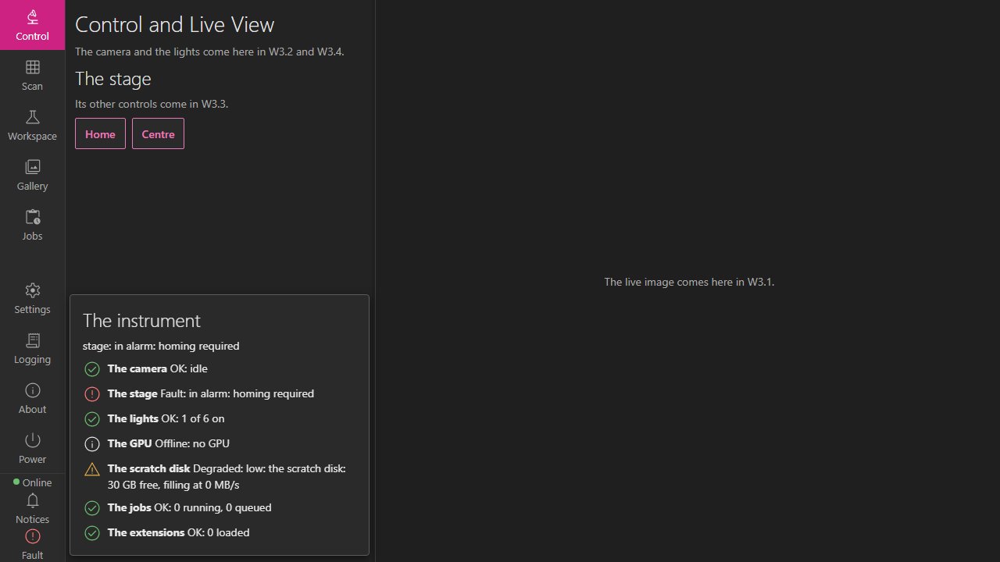
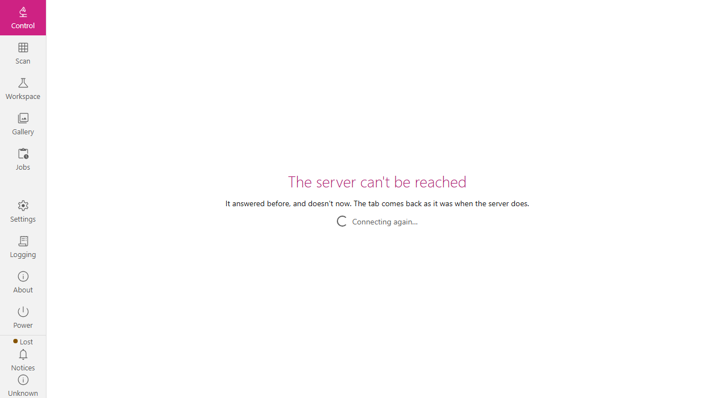
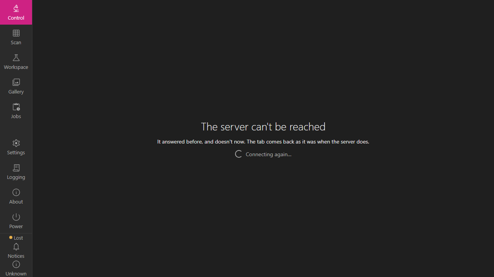

# W2.2: Status, connection and lease in the shell

- Status: In review
- Branch / PR: `m2/w2.2-status` / [#91](https://github.com/lucaswewa/OScope/pull/91)
- Estimate: first 1,100, the spec's · second ~1,350 (code ~620, tests ~250, styles ~150, try-it ~310, glue ~20), in the plan's change log before the code, 23 % over the first: one pull request, at the owner's standing choice for W2 to W4 · measured **1,358** hand-written lines changed (code 455, tests 315, styles 232, try-it 356): 1 % over the second estimate, and 23 % over the first. The code came in under its estimate, the styles over it: the rail's foot and its two panels. The Thing store's fix is 13 of the code's lines and 53 of the tests'

## Summary

The rail says how the instrument is, whether the server is there, and who is in control ([spec](../phases.md#w2-2)).

- **The instrument's status:** at the rail's foot, *OK*, *Degraded* or *Fault*, in its colour and with its icon. A click away: why, and each subsystem with its state and message. It is read from `status/instrument` every five seconds, and at once when `status/changed` says it changed. Without the server, it is *Unknown*.
- **The connection:** its state in the rail, in a word. While there is no server, a page takes the tab's place, and the tab comes back as it was when the server does. At the start, the page waits two seconds for the server's first answer. A tab whose page couldn't load without the server is loaded when it is back.
- **The lease:** who holds it, in the rail, when the server has accounts. Another's request is raised as a notice that hands the lease over; the notice goes when the request does.
- **Notifications:** the notices raised, the newest first, each with when, kept after they go: a hundred of them. The rail's button counts those not yet read.

W2.2 was begun in the sandbox while W2.1's gate ran.

## What was built

In `web/src/`:

- **`features/status/status.ts`:** the status's types; `toneOf`, the colour a state is shown in; `noServer`, when the page without a server shows; and `useInstrument`, the status as last read.
- **`features/status/StatusIndicator.vue`:** the indicator, *Unknown* without the server, and its panel of subsystems.
- **`features/status/RailStatus.vue`:** the rail's foot: the connection's state, the lease's holder, the notices' button with the count of those not yet read, and the indicator.
- **`features/status/ConnectionLost.vue`:** the page in place of the tab: looking for the server, lost, refused, or of a version the app doesn't know.
- **`features/status/leaseRequests.ts`:** another's request for the lease, raised as a notice once for each asker; `requestsToTell` decides which to raise and which have gone.
- **`ui/NoticeHistory.vue`, and the history in `ui/toasts.ts`:** the notices raised, the newest first, with when. The component gallery's notices have it too, under *Those told*.
- **`app/AppShell.vue`:** the rail's foot; the page without a server in the tab's place, the tab kept; a page that couldn't load tried again when the server is back; and the lease's requests listened for.
- **`app/TabBoundary.vue`:** `retry`, which tries again a page that couldn't load, and leaves a tab that failed in itself to its user.
- **`ui/Rail.vue`:** the rail scrolls in a window too short for its tabs and its foot.
- **`api/things/store.ts`** (W1.2): a property its socket keeps is read again each time the socket opens, and as the server is asked to keep it on a socket already open. A change made meanwhile isn't told, and the store kept the old value for good: the two-core runs found it.
- **`tests/e2e/server.ts`:** a test's server may take more configuration, such as a faster clock for the simulator.

## How to try it

```sh
cargo build --release -p oscope-server
cd web && npm ci && npm run build && cd ..
target/release/oscope-server --config configs/oscope.toml --port 8211 --web web/dist
```

Open `http://127.0.0.1:8211/`:

1. **The indicator:** at the rail's foot it says *Fault*, in red: the stage waits to be homed. Press it: the panel says why, `stage: in alarm: …`, with each subsystem and its message.
2. **Homing:** home the stage, with *Home* on Control or with `curl`:

   ```sh
   curl -X POST http://127.0.0.1:8211/api/v1/stage/home -H 'content-type: application/json' -d '{}'
   ```

   Some sixteen seconds later, the indicator turns to *OK*, in green.
3. **A fault:** unplug the simulated camera, and plug it in again:

   ```sh
   curl -X POST http://127.0.0.1:8211/api/v1/simulation/inject_fault -H 'content-type: application/json' -d '{"fault": "camera_unplugged", "active": true}'
   curl -X POST http://127.0.0.1:8211/api/v1/simulation/inject_fault -H 'content-type: application/json' -d '{"fault": "camera_unplugged", "active": false}'
   ```

   The indicator turns to *Fault*, the camera *Offline* in its panel, then back to *OK*.
4. **The connection:** stop the server. Within a few seconds, the rail says *Lost*, the indicator *Unknown*, and a page takes the tab's place. Press another tab in the rail: the page stays. Start the server again: the tab pressed comes back.
5. **The notices:** before homing, press *Centre* on Control: the stage refuses, and a notice says so. Send it away: the rail's *Notices* counts it as new. Press *Notices*: it is there, with when.
6. **The lease:** add two accounts (`target/release/oscope-server account add alice`, and bob), restart, and log in as each in two browsers. Alice takes control: the rail says *You* for her and *alice* for Bob. Bob asks for control: Alice's notice says so, with *Hand over*. She presses it: the rail says *You* for Bob now.

## Screenshots

| | Light | Dark |
|---|---|---|
| The indicator's panel, the stage waiting to be homed |  |  |
| The page without a server |  |  |

## Design notes and deviations from the plan

- **The server weighs the subsystems,** and the indicator shows its verdict: an absent GPU counts for nothing, a stopped camera for a fault (P50). The app doesn't weigh them again, so the spec's unit test, *the worst subsystem decides the colour*, is the indicator's: each state's colour, and the indicator taking the state the server rolled up, with each subsystem in its own colour in the panel.
- **The colour is never the only sign:** each state has its own icon and its word.
- **The tab is kept** behind the page without a server, hidden rather than taken away: what was typed in it is still there when the server comes back. The rail still goes from tab to tab.
- **The page waits two seconds at the start** for the server's first answer, so that it doesn't flash as the app opens. Lost, refused or of another version, it shows at once: the connection gives the server two seconds to answer each time it asks.
- **The notices' drawer is a panel** beside the rail, as the indicator's is, rather than a sheet over the page: the page behind stays in use.
- **A request's notice goes when the request does:** handed over, or the lease no longer this app's.
- **The rail's foot follows its tabs** (look.md): the notices and the indicator are each an icon over a word, shorter than a tab; the connection and the lease's holder are a line each. The rail stays 84 pixels wide, so the connection's state is one word, *Waiting*, *Online*, *Lost*, *Refused* or *Mismatch*, with the whole of it in a tooltip: Linux's wider font cut *Connected* short. The rail fits a window 720 pixels high, and scrolls in a shorter one.
- **The connection's line is a polite live region:** a screen reader hears *The server: Lost*.
- **Without the server, the instrument's state is *Unknown*:** what the server last said may no longer be so.
- **A tab whose page couldn't load is loaded when the server is back.** In the web build, the server serves each tab's code: a tab pressed while it was gone failed to load, and stayed failed once it was back. The end-to-end test found it.
- **WebKit keeps a module's failure,** even across a reload of the page: there, a tab whose code couldn't load stays stopped once the server is back, and *Load it again* fails too, until the browser's cache lets go. The second gate's Linux replay found it, the retry's promise failing unseen; the promise is caught now, and the failure told once more by the tab. Chromium and Firefox load the tab again. It is the web build's case in Safari: the desktop app's code is on its own disk.
- **The Thing store reads again what its socket keeps, each time the socket opens** (W1.2's store, fixed here). One of the five two-core runs failed W1.2's contract test: another client wrote the stage's speed some 18 ms after the test's socket opened, before the server kept the speed for it. The change was never told, and the store kept the speed's first read, for good; and an open socket counts what it keeps as confirmed. Now the store reads the property again when the socket opens, and as it asks the server to keep it on a socket already open. A change can still slip between that read and the server's keeping it, but it is then told by the socket.
- **The visual test serves a steady status:** the server's own says the GPU's temperature and the disk's free space, which change from run to run.
- **The fast clock is the test's whole server,** `[simulator] rate = 50` in its configuration: the simulator's `rate` property can be read, not written. Homing takes a third of a second, and nothing in these tests streams. W3.1's shared helper, which runs the clock fast only while the stage homes and moves, needs the rate written while the server runs: W3.1 makes the property writable.

## Tests

- **Unit, 16 new, 548 in all:**
  - **the status, 7:** each state's colour; offline and unknown neutral; an icon for each tone; the page without a server, shown while lost, refused or of another version, and at the start only once late; the status read, then each change told; and the indicator, *Unknown* without the server, then in the worst subsystem's colour as the server weighs them, with each subsystem a click away, in its own;
  - **the lease's requests, 3:** each asker told once while this app holds the lease; told again only after it stopped asking; and none while another holds it, every one told gone;
  - **the notices' history, 3:** every notice kept, the newest first, sent away or not; when each was raised; and the newest hundred kept;
  - **the tab's boundary, 1:** a page that couldn't load tried again when the server is back, and a tab that failed in itself left to its user;
  - **the Thing store, 2:** what its socket keeps read again each time it opens, a change made while it was closed caught; and a property it starts to keep on a socket already open read again. Its test of an observed property now counts the read as the socket opens.
- **End to end, 12 new, 146 in all:**
  - **the indicator,** on a clock fifty times as fast, in Chromium, Firefox and WebKit: *Fault*, the stage in alarm, in its panel; *OK* once homed; *Fault* with the camera unplugged, and *OK* again;
  - **the page without a server,** in the three browsers: the tab gives way to it when the server stops, the rail saying *Lost* and the indicator *Unknown*, and comes back with the server; and in Chromium, another tab pressed meanwhile, whose code couldn't load, is loaded once the server is back;
  - **the lease, between two browsers:** the holder in each rail; Bob's request raised in Alice's notice, handed over from it, and kept in her history;
  - **the notices:** a refusal sent away, counted as new, and kept in the history; and the gallery's, the newest first, each with when;
  - **axe:** the indicator's panel, the notices and the page without a server, in both themes: no violation;
  - **visual:** the indicator's panel, on a steady status, and the page without a server, in both themes, on Windows and Linux. The shell's baselines are new, with the rail's foot; so are the tokens page's, for its new icon, and the overlays page's, for *Those told*.
  - About's version, lost and found again (W2.1), now loses it to the page without a server.
- **Mutation checks, 20, all caught, none hung:**
  - **the status, 2:** a fault shown as a warning; and each subsystem in the instrument's colour;
  - **the page without a server, 7:** never shown; shown at once at the start; the tab not hidden behind it; the rail's connection always well; a page that couldn't load not tried again when the server is back; a tab that failed in itself tried again; and the state still shown without the server;
  - **the lease, 5:** each request told again and again; told while another holds the lease; handed over to nobody; the holder never *You*; and the requests not listened for, the last three caught with two browsers;
  - **the notices, 4:** the history oldest first; the history without end; those read still counted as new; and every notice counted;
  - **the Thing store, 2:** what a socket keeps not read again as it opens; and a property kept on an open socket not read again.
- **A mutant that survived showed code that did nothing:** the status's own watcher of `changed`. The Thing store reads the property again on each of the Thing's events, so the watcher's value was always the property's. The watcher is gone, and the mutant with it.
- **Two cores, five times:** `web:unit` and `web:e2e`, 10 of 10, eight runs at once, at the second try. The first try's 9 of 10 found the Thing store's race, above.
- **The replays,** the merge gate (ADR-0038): REPLAYS
- **Docs:** the relative links and anchors in the Markdown files resolve.

## Follow-ups and known gaps

- **The jobs' ends** join the notices in W4.1.
- **The simulator's clock, written while the server runs,** for the tests' shared helper: W3.1.
- **A tab whose code couldn't load, in Safari,** stays stopped until the browser's cache lets go (above). Loading every tab's code once the server first answers would spare it; it would also load the later tabs' heavy libraries for nothing.

## Clean room

- **Nothing was copied** from `microscope` or any other codebase. The rail's foot follows look.md, in our own words.
- **No package was added.**
