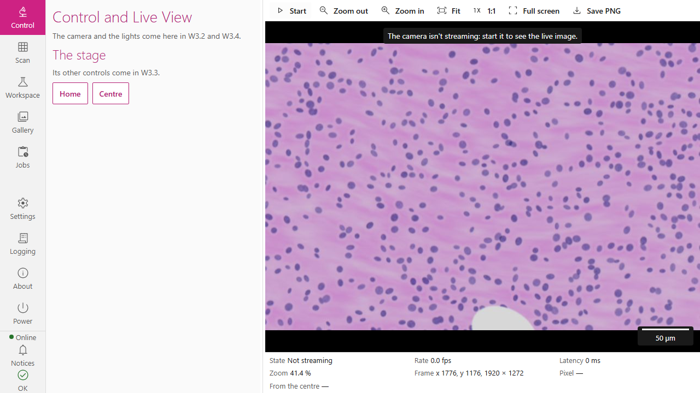
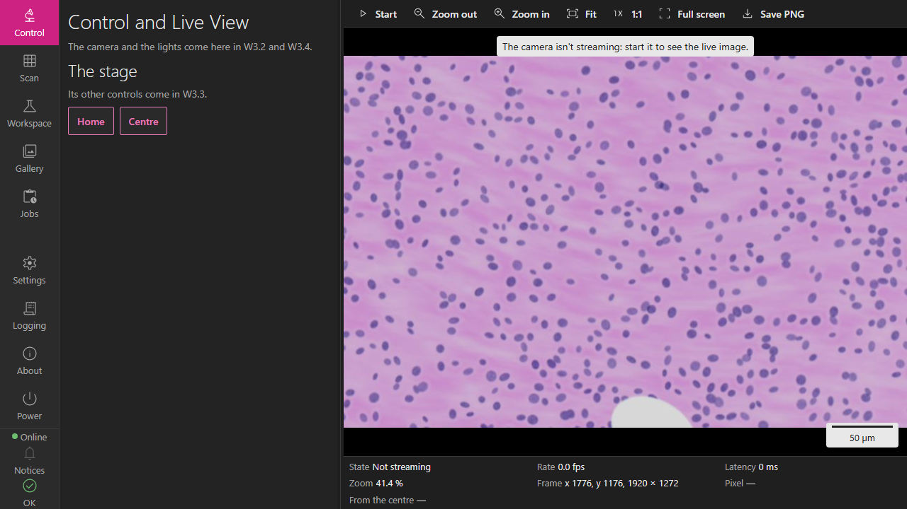

# W3.1: The live viewer

- Status: Done
- Branch / PR: `m2/w3.1-live-viewer` / [#92](https://github.com/lucaswewa/OScope/pull/92)
- Estimate: first 1,500, the spec's · second ~1,800 (code ~750, tests ~350, styles ~200, try-it ~450, glue ~50), in the plan's change log before the code, 20 % over the first: the spec didn't count the server's clock nor the tests' helper · measured **1,258** hand-written lines changed (code 485, tests 182, styles 110, try-it 481): 30 % under the second estimate, and 16 % under the first. 1,198 when the PR opened; the gates' fixes added 60, most of them the tests'. W1.5's client gave the zoom, the pan and the region asked for, which the estimate had counted again; the toolbar is the components' own

## Summary

The live image is in Control's view: fitted, zoomed and panned, with full resolution where the user looks ([spec](../phases.md#w3-1), [ADR-0049](../../adr/0049-the-live-viewer-and-its-overlays.md)).

- **The viewer,** on W1.5's client: fitted to the view; the wheel zooms about the pointer, and dragging pans. Zoomed in, it asks for the region shown at the sensor's resolution, and past one to one the sensor's pixels are squares.
- **Streaming** starts and stops from its toolbar. Its state is shown: not streaming, waiting for a frame, live, or stale.
- **The readouts:** the rate and the latency; the zoom; the region of the sensor the frame shows; and the place under the pointer, in the sensor's pixels and in µm at the sample.
- **The scale bar,** from the objective fitted. **Full screen,** and **the view saved as a PNG**, the preview as shown.
- **The simulator's clock can be written** (`simulation/rate`), and the end-to-end tests run it fifty times as fast while the stage homes and moves, then back to real time. W1.5's preview tests use it, and so do W1.2's and W2.2's.

W3.1 was begun in the sandbox while W2.2's gate ran.

## What was built

In `web/src/`:

- **`features/live/LiveViewer.vue`:** the viewer: its canvas, the pointer and the keys, its toolbar, the state's word over the image, the scale bar and the readouts.
- **`features/live/viewer.ts`:** the pointer on the canvas, the wheel's steps, one to one, the sensor's pixel under the pointer and its place at the sample, and the scale bar's round lengths.
- **`features/live/streaming.ts`:** the camera's streaming started and stopped, and the image's four states.
- **`features/control/ControlTab.vue`:** the viewer in the view.
- **`api/preview/use.ts` and `renderer.ts`** (W1.5): one to one about a point, the canvas's size, the view as a PNG, and the sensor's pixels drawn as squares past one to one.
- **`ui/icons.ts`:** seven icons for the viewer's tools.

In `crates/oscope-api/`: **`devices/simulation.rs`:** the simulator's `rate` may be written, above 0 and up to 1,000; stepped or faster is refused with a 400.

In `web/tests/e2e/`: **`sim.ts`:** the fast clock while the stage homes and moves, the stage over the tissue, and the camera's region: shared by the tests that home the stage.

## How to try it

```sh
cargo build --release -p oscope-server
cd web && npm ci && npm run build && cd ..
target/release/oscope-server --config configs/oscope.toml --port 8211 --web web/dist
```

Open `http://127.0.0.1:8211/#/control`:

1. **The stage over the tissue:** press *Home*, then move to the tissue:

   ```sh
   curl -X POST http://127.0.0.1:8211/api/v1/stage/move_to -H 'content-type: application/json' -d '{"x": 40000, "y": 12000, "z": 5000}'
   ```

2. **Streaming:** press *Start* in the view's toolbar. The state turns from *Waiting for a frame* to *Live*, and the rate and the latency are read out.
3. **Zoom:** turn the wheel over a nucleus: it stays under the pointer. Keep going past *100 %*: the sensor's pixels show as squares, and the *Frame* readout is the small region asked for. The scale bar shortens as you zoom in. Press *Fit*, or `0` on the image, to see the whole frame again.
4. **The place:** move the pointer over the image: its pixel, and its distance from the sensor's centre in µm.
5. **Waiting and stale:** press *Stop*, set the camera to expose only when triggered, and press *Start*: the image waits for its first frame. Trigger one: it is live, then two seconds later stale.

   ```sh
   curl -X PUT http://127.0.0.1:8211/api/v1/camera/trigger -H 'content-type: application/json' -d '{"kind": "software"}'
   curl -X POST http://127.0.0.1:8211/api/v1/camera/trigger_exposure -H 'content-type: application/json' -d '{}'
   ```

   Set it back with `{"kind": "free_running"}`.
6. **The PNG and full screen:** press *Save PNG*: the view as shown is downloaded. Press *Full screen*, or `F` on the image, and Escape to leave.

## Screenshots

| | Light | Dark |
|---|---|---|
| The live tissue, the camera stopped |  |  |

## Design notes and deviations from the plan

- **The place under the pointer, in µm, is from the sensor's centre,** along its axes: the stage's coordinates need the active calibration, which W3.3 uses for pointing at the image (ADR-0049).
- **A new readout, *Frame*:** the region of the sensor the last frame shows. It is how the end-to-end test sees that the region asked for comes back, and it tells the user what the server sends.
- **Stale is three of the frames' gaps without one, and never sooner than two seconds:** a long exposure is slow, not stale.
- **The keys on the focused image:** `+`, `-`, `0`, `1` and `F`. The arrows are left for W3.3's jogging; the digits and the letter take precedence over the shell's shortcuts there.
- **The view's buttons are free in the read-only mode,** as the theme is: zooming changes nothing on the instrument. *Start* and *Stop* are locked with the tab.
- **The scale bar and the state's word sit on chips** of the inverse surface: a brightfield image is mostly light, and white would vanish on it. Over a frame, stopped or stale, the word goes to the top, out of the image's way.
- **The simulator's clock is written over the API,** not set in the test server's configuration as W2.2 had it: the clock runs fast only while the stage moves, and streams and measurements stay at real time.
- **The baselines hide the frame** with a style sheet, its noise different each time; the chrome stays, the scale bar on it.

## Tests

- **Unit, 11 new, 559 in all:**
  - **the viewer's arithmetic, 8:** the pointer's CSS pixels as the canvas's; the sensor's pixel under the pointer, fitted and zoomed in, and none outside the frame; a pixel's place at the sample from the sensor's centre; the wheel's steps, a hard flick held to four; one to one about the pointer, and the zoom's percentage; the scale bar's round lengths; the bar shorter at the sample when zoomed in, as long on the screen, a screen's two device pixels to a CSS pixel counted; and no bar without an objective;
  - **the states, 3:** not streaming, or not read yet; waiting, a frame from before the start not counting; and stale after three gaps, never sooner than two seconds, a long exposure's frames slow and not stale.
  - **The renderer's test** now has the sensor's pixels drawn as squares past one to one.
- **Rust, 1 new:** the simulator's clock written within its range, the clock itself following; and stepped, below 0 or over 1,000 refused, the rate kept. The simulation Thing's description, in its snapshot, says the rate may be written.
- **End to end, 8 new, 154 in all:**
  - **A first frame may take a minute,** as in W1.5's tests: on two cores, one of WebKit's took longer than Playwright's fifteen seconds, the fifth gate found. So may the region asked for when zoomed in, and the server's count of W1.5's preview sessions, past the 15 s a session not closed cleanly lingers: the sixth gate found one still counted 15 s after its page hid.
  - **frames drawn live on Control,** in Chromium, Firefox and WebKit: the clock back at real time after the stage moved on the fast one; *Start*, then the rate, the camera's region as the frame, the scale bar; the pointer over the middle reading the middle pixel, and its place at the sample; *Stop*;
  - **zooming in:** `1` on the focused image asks for the region the canvas shows at one to one, and the frame that comes back is that region, rounded out to the camera's grid of two pixels; the scale bar shorter; `0` fits the whole region again;
  - **the states,** the camera triggered by software: waiting for a frame after *Start*, live after one is triggered, stale two seconds later, live again;
  - **the PNG and full screen:** the view saved, a PNG of the canvas's size with the tissue in it; full screen filled by the viewer, and left;
  - **axe:** Control with the viewer, stopped in both themes and streaming: no violation;
  - **visual:** the viewer's chrome in both themes, on Windows and Linux, the frame hidden and the latency masked, once the rail says the homed stage is *OK*: a baseline taken a moment sooner had *Fault*, the twelfth gate found. The shell's and the status's baselines are new, Control's view now the viewer's.
  - **The fast clock** runs in W1.2's contract and Things tests, W1.5's preview tests and W2.2's status test, while the stage homes and moves.
  - **WebKit reports a request that a reload cuts off as one access control refused,** an error of the page, though the page threw nothing: W1.4's reload test failed once in five runs on two cores in three gates. Aborting the requests at `pagehide` didn't stop it. The tests' fixture lets that message be, in WebKit only.
  - **W1.5's test of every frame drawn at 1920 pixels wide** counted the frames replaced since the page opened, not while it counted: one replaced as the stream started, while WebGL warmed up, failed it on two Linux replays in a row, W2.2's and this phase's first. It counts over its window now, as it counts the frames dropped. Even so, the Linux replays' software GL, loaded, replaced one within the window in the fourth gate and two in the seventh. The test's claim is W1.5's: the server drops none, and the page draws all but two of the frames sent while it counts, those on their way or replaced. Windows' replays never replaced one. The renderer, which set its filter at each draw, sets it only when it changes. And the live viewer's own tests stream a region of 960 × 648 pixels about the sensor's centre, a quarter of W1.5's: four of four Linux replays failed W1.5's timed test while they streamed 1920 × 1272 beside it, decoded and drawn on the same software GL.
- **Mutation checks, 17, all caught, none hung:**
  - **the viewer's arithmetic, 6:** the wheel zooming the wrong way; the pointer's CSS pixels taken as the canvas's; the pixel under the pointer rounded, not floored; the sample's place from the sensor's corner; the scale bar's length not round; and the bar blind to the screen's device pixels;
  - **the states, 2:** stale after a fixed time; and a frame from before the start counted;
  - **the renderer, 1:** the pixels smoothed past one to one;
  - **in a browser, 7:** one to one at the wrong scale; the image's keys not handled; the frame's region not read out; the PNG taken without drawing first, which saves a blank, as WebGL clears its buffer; the whole app filling the screen; *Start* doing nothing; and the fast clock left on after the stage moved;
  - **the server, 1:** any rate taken.
- **Two cores, five times:** `web:unit`, `web:e2e` and `oscope-api:devices`, 15 of 15, `web:e2e` at its second try. Its first five runs failed on the baselines alone: made again for the viewer's own test after the state's word moved onto its chip, not for the shell's, the status's and the tokens page's, which show it too.
- **The replays,** the merge gate (ADR-0038), passed on `ecfbebe`, each stage under its hard limit, at the thirteenth gate:
  - **Two cores, five times,** in the gate's worktree: `web:e2e` 10 of 10 across two gates, 5 of 5 on `ecfbebe`; `web:unit` 5 of 5 on `ea068a1`, whose unit code `ecfbebe` keeps.
  - **Linux,** on a fresh clone (1,312 files, none with a CR): 79 of 79 steps; 638 tests in 236 suites, run alone.
  - **Windows:** 79 of 79 steps; 638 tests in 236 suites, at its third run on `ecfbebe`, run alone. The two before each failed one older test under the replay's load: W0.5's scrolling of 100,000 rows within a frame's budget, and W0.3's keyboard test in Firefox, a radio not yet checked.
  - **The gates before** found the failures above, each fixed in its own commit: W1.5's every-frame test (counted since the page opened, then its claim, then this phase's streaming beside it); WebKit's report of a request a reload cuts off; a first frame, a zoom's region and a session's count waiting a minute; and a baseline taken before the homed stage was *OK*. Two failed as eight runs started at once, Windows refusing a socket's buffer (`ERR_NO_BUFFER_SPACE`); one, W1.2's stale values, didn't recur.
- **Docs:** the relative links and anchors in the Markdown files resolve.

## Follow-ups and known gaps

- **Pointing at the image to move the stage,** through the calibration: W3.3.
- **Overlays:** W3.5 and W3.6, as ADR-0049 lays them out.

## Clean room

- **Nothing was copied** from `microscope` or any other codebase. The viewer follows ADR-0049 and look.md, in our own words.
- **No package was added.** The icons are Material Symbols', as before.
