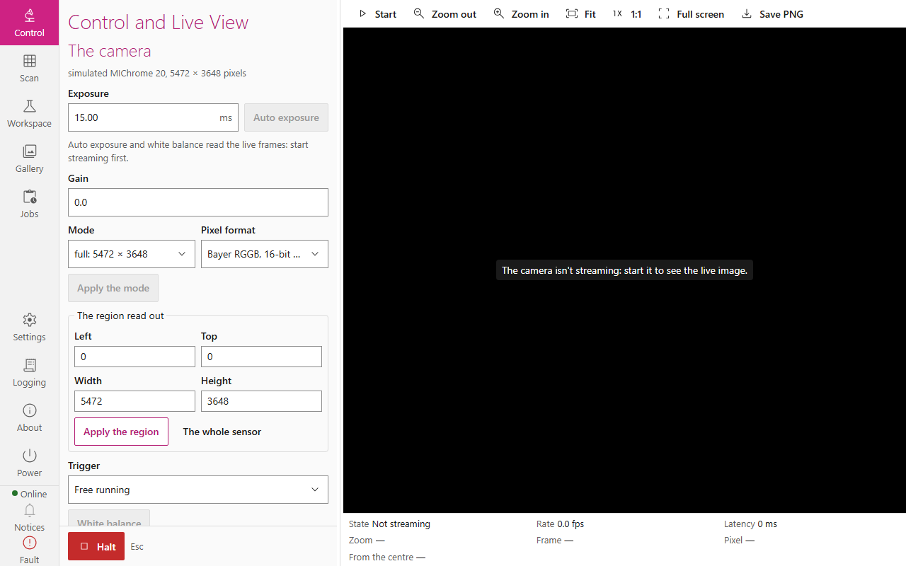
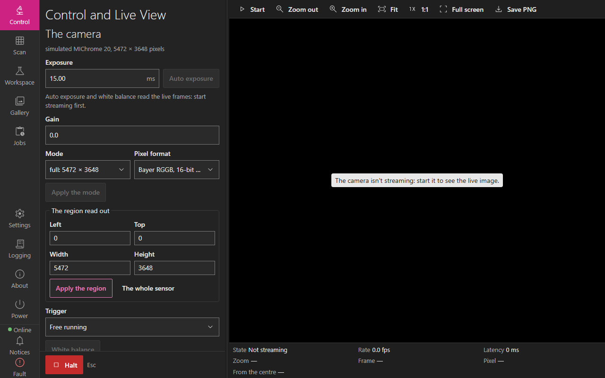

# W3.2: Camera controls

- Status: Done
- Branch / PR: `m2/w3.2-camera-controls` / [#94](https://github.com/lucaswewa/OScope/pull/94)
- Estimate: first 1,400, the spec's · second ~1,280 (code ~560, tests ~200, styles ~90, try-it ~400, glue ~30), in the plan's change log before the code, 9 % under the first · measured **1,030** hand-written lines changed (code 512, tests 171, styles 65, try-it 282): 20 % under the second estimate, and 26 % under the first. The pane's styles are the components' own; the end-to-end tests share W3.1's helpers

## Summary

Every setting of the camera is in Control's pane, within what the camera says it can do ([spec](../phases.md#w3-2)).

- **The settings:** the exposure and the gain, within the camera's ranges; the mode and its pixel format, applied together, and kept from while the camera streams; the region read out, typed or the whole sensor; and the trigger, with an external one's edge. The model, the sensor's size and its temperature are shown.
- **Auto exposure and white balance** run as jobs, followed to their end, and say what they found: the exposure, the bright pixels' level and the steps it took, or why it didn't converge; the gains.
- **What is saved:** a setting changed behind the pane, as auto exposure changes the exposure, differs from those saved; the pane says which, and puts the saved ones back.
- **A refusal** shows at its field: a value out of range by the field itself, and the camera's own refusal in its words (ADR-0034).

W3.2 was begun in the sandbox while W3.1's gate ran.

## What was built

In `web/src/features/control/`:

- **`camera/CameraPane.vue`:** the camera's pane, in Control's.
- **`camera/cameraFields.ts`:** the fields from the camera's `capabilities`: each range and step, the formats each mode gives, the fastest first, the region's grid, and the triggers it takes; and which settings differ from those saved.
- **`camera/recorded-capabilities.json`:** the simulated camera's capabilities, recorded by `web/scripts/record-camera.mjs` for the unit tests. An end-to-end test checks that the server still says the same.
- **`jobAction.ts`:** an action that hands its work to a job (ADR-0016), run, its job followed to its end, and how it ended said where it was started. W3.4 and the later panes use it.

## How to try it

```sh
cargo build --release -p oscope-server
cd web && npm ci && npm run build && cd ..
target/release/oscope-server --config configs/oscope.toml --port 8211 --web web/dist
```

Open `http://127.0.0.1:8211/#/control`, home the stage, and move it over the tissue (W3.1's notes say how):

1. **The exposure:** press *Start* in the view, then halve the exposure: the image darkens, and in the full mode's 16-bit format the rate rises if the exposure held it down.
2. **Auto exposure:** press *Auto exposure*. Its job runs, and the pane says what it found: the exposure moves there. The pane now says the exposure differs from the settings saved: *Put the saved settings back* returns it.
3. **The mode:** while streaming, the mode can't be applied, and the pane says so. Press *Stop*, choose the other mode or format, and apply it.
4. **The region:** type a region and apply it: the live image shows that part of the sensor. *The whole sensor* gives it all back. A region off the sensor is refused, in the camera's words.
5. **The trigger:** choose *Software*: the camera waits for a trigger (W3.1's notes trigger one).
6. **White balance:** press *White balance*: its gains are said.

## Screenshots

| | Light | Dark |
|---|---|---|
| The camera's pane |  |  |

## Design notes and deviations from the plan

- **The fields come from `capabilities`:** the ranges, the steps, the modes and their formats, the region's grid and the triggers. A camera that says it can do more gets more, with no change to the pane.
- **The exposure's arrows move it a millisecond;** the gain's a hundredth of its range, rounded to a power of ten. A value is taken on Enter, on leaving the field, or at each arrow.
- **The mode and the format are applied together,** as `set_mode` takes them, with a button: changing the mode alone would leave a format it may not give.
- **The region is typed, then applied;** the camera rounds it to its grid. W3.5 draws it on the image.
- **A mode chosen, or a region typed, is kept until applied:** they follow the camera's own only when those change. Reset at each read of the camera's settings, every few seconds and at each of its events, a choice was lost before it could be applied; a mutant that survived found it.
- ***The whole sensor* writes the sensor's whole rectangle,** not `null`: the server answers a property written `null` that a body is needed (422), though the region's description offers none for the whole sensor. teta-wot should take `null` for a property that may be none: a follow-up upstream.
- **The saved settings are the last applied** through the camera's Thing. Auto exposure sets the camera's exposure itself, so after it the two differ: *Put the saved settings back* is how its result is undone.
- **Auto exposure and white balance read the live frames,** so they are off until the camera streams, and the pane says so: started without frames, their jobs would wait for good.
- **A job's end is said where it was started.** W4.1 adds the Jobs tab, and the notices of jobs that end.

## Tests

- **Unit, 9 new, 568 in all:**
  - **the fields, from the recorded capabilities, 7:** the ranges and their steps; the modes, and the formats each gives, the fastest first; the region's grid, the sensor, and the triggers, a camera without a software trigger or a region offered neither; a format's key telling apart each kind, pattern and depth; a range's step; and the settings that differ from those saved, none when they are the same or unread;
  - **the job's action, 2:** run, its job followed through its states to its end; and a job that failed said in the job's words.
- **End to end, 9 new, 163 in all:**
  - **each setting changes the camera,** in Chromium, Firefox and WebKit: the exposure and the gain typed; the trigger chosen, software then free running; a region typed and applied, then the whole sensor;
  - **a value out of range refused at its field:** an exposure past the camera's longest, by the field; a region off the sensor, by the camera, in its words;
  - **the mode** applied, and, streaming, kept from: *Apply* off, and why said;
  - **auto exposure** off until the camera streams; run as a job, its value taken by the field; the saved exposure put back;
  - **the recorded capabilities are still the server's;**
  - **axe,** in both themes: no violation;
  - **visual:** the camera's pane in both themes, on Windows and Linux. The shell's, the status's and the viewer's baselines are new, Control's pane now the camera's.
  - **The streaming tests share W3.1's small region,** now in `sim.ts`. W0.3's keyboard test waits for the radio's focus before its arrow: a busy Firefox took the key before the focus once.
- **Mutation checks, 13, all caught, none hung:**
  - **the fields, 5:** the formats slowest first; a format's key blind to its pattern; a software trigger offered to any camera; the gain's step not from its range; and the exposure not compared with that saved;
  - **the job's action, 2:** the job not followed; and its failure not said;
  - **the pane, in a browser, 6:** the exposure not written; the mode applied while streaming; the camera's refusal of a region not said; auto exposure offered without the live frames; the saved exposure not put back; and the trigger's kind not written.
- **A mutant that survived found a bug:** the mode applied while streaming survived, as the mode chosen was put back to the camera's at each read of its settings, so *Apply* was off anyway. The choices are now kept until the camera's own change.
- **Two cores, five times:** `web:unit` 5 of 5, then `web:e2e` 5 of 5, each run apart: ten at once twice ran Windows out of sockets' buffers (PR #93 staggers them).
- **The replays,** the merge gate (ADR-0038), passed on `682b206` at the first gate, each stage under its hard limit, with the sandbox only editing beside it:
  - **Windows:** 79 of 79 steps; 638 tests in 236 suites.
  - **Linux,** on a fresh clone (1,326 files, none with a CR): 79 of 79 steps; 638 tests in 236 suites.
  - **Two cores, five times,** in the gate's worktree: `web:e2e` 5 of 5.
  - **The machine:** connections in `TIME_WAIT` peaked at 10,855, and free memory stayed above 5.9 GB.
- **Docs:** the relative links and anchors in the Markdown files resolve.

## Follow-ups and known gaps

- **The region drawn on the image,** and the statistics' region: W3.5.
- **The jobs' list and their notices:** W4.1.
- **A property that may be none can't be written `null`** (teta-wot answers 422): an upstream follow-up. Until then the whole sensor is written as its rectangle.

## Clean room

- **Nothing was copied** from `microscope` or any other codebase. The pane follows look.md, in our own words.
- **No package was added.**
