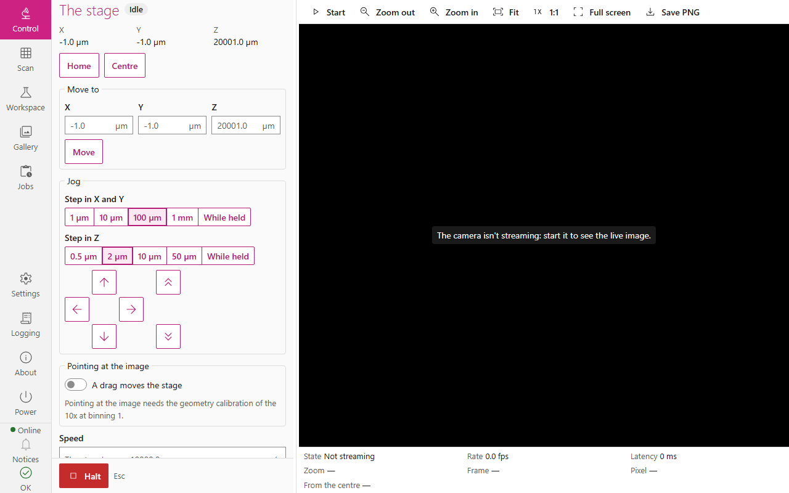
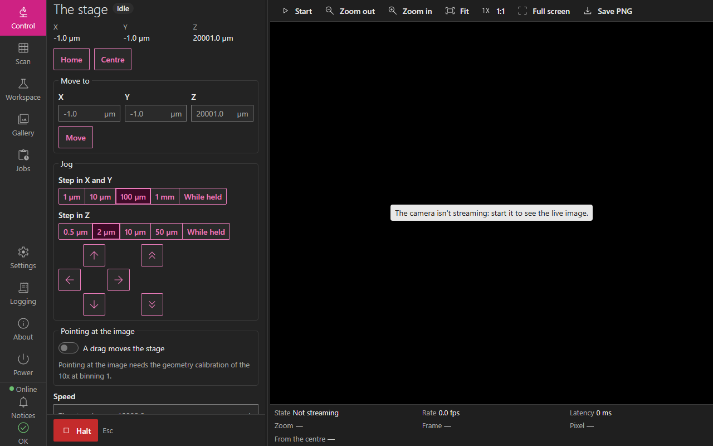

# W3.3: Stage controls

- Status: Done
- Branch / PR: `m2/w3.3-stage-controls` / [#95](https://github.com/lucaswewa/OScope/pull/95)
- Estimate: first 1,700, the spec's · second ~1,700 (code ~760, tests ~250, styles ~120, try-it ~520, glue ~50), in the plan's change log before the code, as the first · measured **1,748** hand-written lines changed (code 852, tests 322, styles 98, try-it 476): 3 % over the second estimate and the first. The tests found that every step from the home corner was refused, and the work round it, its tests and its mutants are most of the difference

## Summary

The stage moves from Control: to a place, by a step, by jogging, from the keyboard, and by pointing at the image ([spec](../phases.md#w3-3)).

- **What it shows:** where the stage is, in the display's unit; whether it is idle, moving, homing, on hold or in alarm; and an alarm's reason, with clearing it. After a start, the stage waits to be homed, and the pane says so.
- **Moves:** to a place typed, an axis left empty staying where it is; by a step from the jog pad, along x, y and z, with a step for x and y and a finer one for z; or for as long as a pad's button is held. The speed, and the stage's own again when the field is cleared. Home, and the travel's middle.
- **Halt** stays at the control pane's foot as it scrolls, and Escape halts anywhere on the tab, in a field too.
- **Limits:** a move that would end past the travel `capabilities` gives is refused before it is sent, and said; a place typed past it is refused by its field.
- **From the keyboard,** with the image focused: the arrows move along x and y, and Page Up and Page Down along z, by the pane's step, or for as long as the key is held.
- **By pointing,** through the active geometry calibration (P31): a double click brings the place to the view's centre, and a drag pans the stage once the pane's *A drag moves the stage* is on. The place under the pointer is read out on the stage. Without a calibration, the pane says what is missing, and so does a double click.

W3.3 was begun in the sandbox while W3.2's gate ran.

## What was built

In `web/src/features/control/stage/`:

- **`StagePane.vue`:** the stage's pane, in Control's, in place of W2.1's two buttons.
- **`StageHalt.vue`:** Halt, stuck to the control pane's foot, and Escape.
- **`useStage.ts`:** the stage, live, for the pane, the image and Halt: its position, status and limits; moves checked against the limits; steps that don't pile up as a key repeats; and jogs that always get their halt, after their start, when their button or key is let go, when the page loses the keys, and when it is left.
- **`usePointing.ts`:** pointing at the image, through the active geometry: the move that brings one place to another, a place's coordinates on the stage, and what is missing without a calibration.
- **`choices.ts`:** the jog's steps, and whether a drag on the image moves the stage: shared by the pane and the image, and kept between visits.
- **`stage.ts`:** the arithmetic: the limits' check, the keys' map, lengths in the display's unit, the geometry in a calibration set, and the move from the sensor's pixels to the stage's µm.

And in `web/src/features/live/LiveViewer.vue`: the keys, the double click, the drag and the readout above. The icons for z are new.

## How to try it

```sh
cargo build --release -p oscope-server
cd web && npm ci && npm run build && cd ..
target/release/oscope-server --config configs/oscope.toml --port 8211 --web web/dist
```

Open `http://127.0.0.1:8211/#/control`:

1. **Homing:** the pane says the stage waits to be homed. Press *Home*: the state turns to *Homing*, then *Idle*, at the home corner.
2. **A move:** type 40 mm in *Move to*'s X and 12 in Y, as µm, `40000` and `12000`, and 5000 in Z, then press *Move*: the position follows, and the state is *Moving* until it arrives. That is over the tissue.
3. **The jog pad:** press *Start* in the view. Choose a step of 100 µm and press the pad's arrows: the image slides as the stage moves. Choose *While held* and hold an arrow: the stage moves until it is let go.
4. **The keys:** click the image, then press the arrow keys, and Page Up and Page Down for z, by the step shown; with *While held*, hold one.
5. **Halt:** type 90000 in X and press *Move*, then press Escape: the stage stops. *Halt*, at the pane's foot, does the same.
6. **A limit:** at x's least, step towards it: the move isn't sent, and a notice says why.
7. **Pointing:** with the camera streaming, calibrate the geometry:

   ```sh
   curl -X POST http://127.0.0.1:8211/api/v1/calibration/geometry -H 'content-type: application/json' -d '{}'
   ```

   Once it is done, the readout under the image says where the pointer is on the stage. Double-click a nucleus: it comes to the centre. Turn on *A drag moves the stage* in the pane and drag the image: the stage follows. Before the calibration, the pane says what is missing.

## Screenshots

| | Light | Dark |
|---|---|---|
| The stage's pane |  |  |

## Design notes and deviations from the plan

- **The keys' directions:** right and down go towards x's and y's maxima, as the image's own x and y grow, and Page Up raises z. On the simulator, whose camera is turned 20° on the stage, the stage then brings in what lay that way. The jog pad's arrows go the same ways.
- **A step and a jog are told apart by the step chosen,** not by how long a button is held: *While held* is one of the steps. A held key's repeats don't pile up moves: the next step waits for the last.
- **A jog always gets its halt:** its halt waits for its start to be answered, so a quick press can't stop the stage before it starts and then leave it jogging; and it is halted when the page loses the keys, or Control is left.
- **Halt needs the lease,** as every control does: the server refuses changes from anyone else (ADR-0031). An emergency stop for anyone watching would be the server's to allow.
- **Escape halts anywhere on Control,** heard before anything on the page can keep it: in a field, Escape both puts the field back and halts.
- **A drag moves the stage only when chosen,** with the pane's *A drag moves the stage*, kept between visits: dragging otherwise pans the view, as in W3.1. The choice is the stage's pane's, not the viewer's toolbar's, which it would have wrapped onto a second line; the pane says beside it what pointing lacks. While dragged, the image is drawn aside with the pointer; let go, the stage moves, and the image comes back to its place as it does.
- **A double click brings the place to the view's centre,** which is the frame's when the view is fitted. The matrix is the calibration's at the camera's binning, in the image's pixels, so the view's sensor pixels are divided by the binning.
- **The place under the pointer, on the stage,** takes the stage's position as the sensor's centre's (ADR-0049 left it to W3.3).
- **Homing leaves the simulated stage a micrometre past its soft limits:** at (−1, −1, 20,001) µm, as its encoders report it. The stage refuses a target past them on any axis, and the server's `move_by` adds its step to where the stage says it is, so from the home corner every step was refused, though it moved along one axis only. So the app checks a move only along the axes it moves; a place to move to keeps an axis left empty within the travel; and a step from past the limits is sent as a `move_to`, each axis it leaves alone brought within. The tests found it: their first run homed, then moved.
- **Waiting to be homed** is an alarm whose reason says homing is needed: the simulator's *homing required*, as grblHAL's. Its banner doesn't offer to clear it: cleared, the stage would believe it was at its home corner, wherever it was. A homing that failed is an alarm like any other.
- **The calibration's values aren't typed in the API's document:** the set's values are a tagged union whose fields the OpenAPI types lose. `geometryOf` checks the fields it takes.
- **The speed cleared** is the stage's own again, through the property's `reset`: the server takes no `null` for it (W3.2's follow-up).

## Tests

- **Unit, 16 new, 584 in all:**
  - **the arithmetic, 12:** the limits, a place within or on them taken, each axis past them named, and only the axes a move moves checked, a place brought within them; the keys' map, the arrows along x and y and the page keys along z, every other key left alone, the object's own names too, and a step's sign; lengths in µm and mm; pointing, the move the matrix gives, the image's pixels counted at the binning, the place brought where it was asked to by the matrix's inverse, and the geometry taken from a set's values and nothing else; and an alarm that waits for homing told from one that doesn't;
  - **moving the stage, 4:** a step past the limits refused before it is sent, and said; a step from a micrometre past them, as homing leaves the stage, sent as a move to where it goes; a jog halted only once its start is answered, however quickly it is let go; and a jog halted when the page loses the keys, and when it is left.
- **End to end, 11 new, 180 in all,** on the simulator at real distances:
  - **in Chromium, Firefox and WebKit:** after a start, the stage waits to be homed, and *Home* homes it; a move of 20 mm and 15 mm arrives within 3 µm; a jog moves while held, on the pad and on a key, and stops when let go;
  - **steps** of 1 mm and 10 µm from the pad and from the keys on the image, each within 3 µm;
  - **a move past a limit** refused before it is sent, with no invocation made, and the step the other way sent from the home corner; a place typed past the travel refused by its field;
  - **a long move halted** by Escape, and again by *Halt*, well short of its end;
  - **an alarm** injected, said with its reason, and cleared;
  - **pointing:** without a calibration, the pane says what is missing, and a double click says so and moves nothing; with one, measured by the server's geometry job, the place double-clicked is found again at the middle of the image, by normalised cross-correlation of the screenshots, within the fit's error, the stage's 2 µm of backlash and two pixels; and a drag carries the middle to where it was let go, within the same;
  - **axe,** in both themes, and **the baselines:** the stage's pane, its positions masked, and the shell's, the viewer's, the status's and the gallery's again, with Halt at the pane's foot and the icons for z, on Windows and on Linux. The camera's visual test takes a window tall enough for its pane, which Halt would otherwise stand over.
- **Mutation checks, 17, all caught, none hung:**
  - **halt, 2:** halt's call removed, the spec's own, which the halt test catches as the move runs on past 30 mm; and Escape not heard;
  - **the limits, 5:** never passed; a step past them sent; a step checked along the axes it doesn't move; an axis left empty sent past the travel; and a step from past the limits moved by;
  - **the keys and the steps, 2:** the up arrow up y; and the step's size not taken;
  - **the jog, 3:** its halt not waiting for its start; losing the keys halting nothing; and the pad let go not halting;
  - **pointing, 4:** the move the wrong way; the binning not taken; the matrix taken by columns; and what pointing lacks not said;
  - **the wait to be homed not said, 1.**
  - **The checks' own fixes:** two mutants' texts no longer matched the code they were written for, and stopped the run before they were applied; a failed unit test left its component polling after the network's stand-in was gone, and now each test's component is unmounted after it, the halt it may owe made first.
- **Two cores, five times,** before the pull request: `web:unit` 5 of 5, then `web:e2e` 4 of 5, run apart. The fifth failed W1.2's Things page in WebKit, as the last of its 180 tests: the page's socket wasn't open within the test's 15 s, while the page's own reads went on, answered. W3.3 doesn't touch that page nor the socket; the gate's two-core runs give it five more.
- **The replays,** the merge gate (ADR-0038), passed on `f163ec8`, each stage under its hard limit, with the sandbox only editing beside it:
  - **Two cores, five times,** in the gate's worktree: `web:e2e` 5 of 5. The Things page's socket opened every time.
  - **Windows,** at the replays' third run: 79 of 79 steps; 638 tests in 236 suites.
  - **Linux,** on a fresh clone (1,343 files, none with a CR): 79 of 79 steps; 638 tests in 236 suites.
  - **The runs before, on the same commit:**
    - **The first lost the network** for some three minutes as its Windows replay ran: the five steps that download failed on DNS (the Python extensions' packages from pypi, `cargo deny`'s advisories, `npm audit`, and a smoke run's packages). The replays were run again once it was back.
    - **The second's Windows replay** failed one smoke run, `ex-live-recipe`: its dark-and-flat recipe took 200.1 ms against the smoke's budget of 200 ms, under the replay's load, and was refused. Nothing of W3.3's touches it; a budget so close to what a loaded machine takes is a follow-up.
  - **The machine:** connections in `TIME_WAIT` peaked at 11,258, and free memory stayed above 3.3 GB in the first run's Windows replay, 13.8 GB in the last's.
- **Docs:** the relative links and anchors in the Markdown files resolve. Their check found W3.2's two screenshots missing from its pull request: they are taken here, by the camera's visual test, now at the usual window size after its tall one.

## Follow-ups and known gaps

- **The calibration's wizard:** W8.3. Until then, the geometry is calibrated through the API.
- **The display's unit is chosen in Settings** from W8.1; the pane follows `settings/display` already.
- **An emergency stop without the lease,** if wanted: the server's to allow.
- **`ex-live-recipe`'s smoke budget** of 200 ms was passed by 0.1 ms under a replay's load: a smoke with room for a loaded machine, or a recipe timed more than once, would not fail so.
- **The server's `move_by` from a micrometre past the limits** is refused, as it adds its step to the position reported: it could move from where the stage was told to be, or keep untouched axes where they are. The app works round it (above); a server phase should mend it.

## Clean room

- **Nothing was copied** from `microscope` or any other codebase. Pointing at the image to move the stage is a common idea in microscopy software, written here from P31's matrix.
- **No package was added.**
