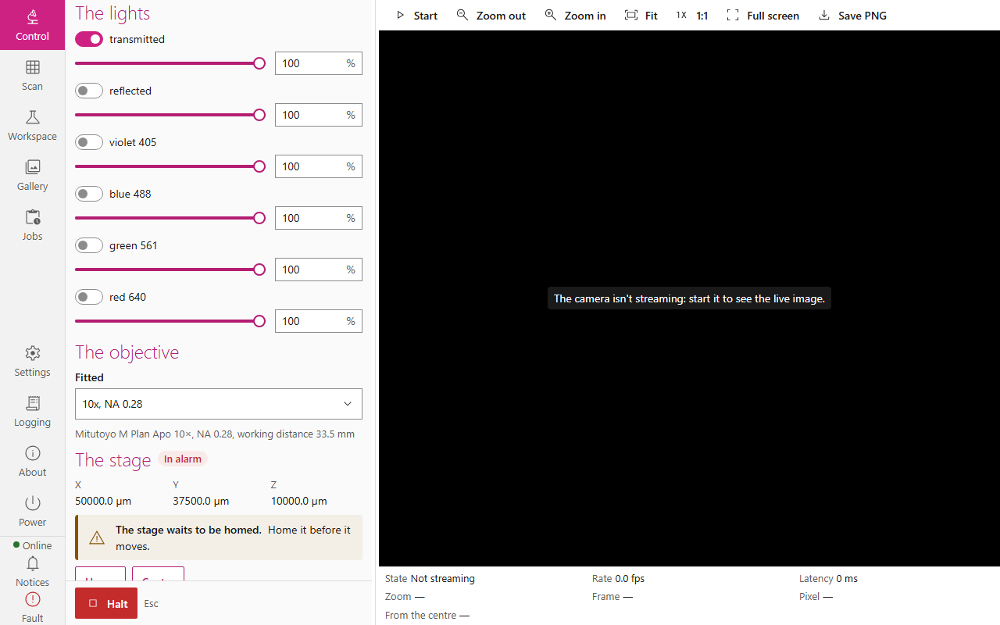
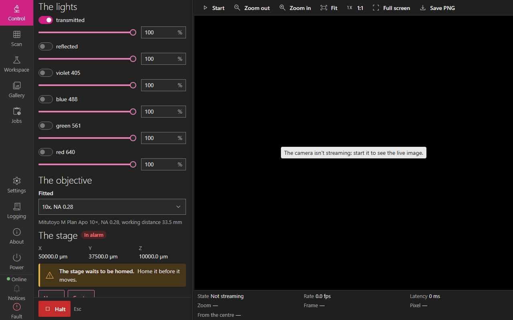

# W3.4: Illumination and the objective

- Status: Done
- Branch / PR: `m2/w3.4-illumination` / [#96](https://github.com/lucaswewa/OScope/pull/96)
- Estimate: first 900, the spec's · second ~910 (code ~380, tests ~120, styles ~60, try-it ~330, glue ~20), in the plan's change log before the code, 1 % over the first · measured **713** hand-written lines changed (code 225, tests 57, styles 56, try-it 375): 22 % under the second estimate, and 21 % under the first. The panes are the components' own, a switch and a slider each light; the screenshots' helpers moved from W3.3's tests, and the recording script grew rather than doubled

## Summary

The lights, and which objective is fitted, in Control's pane ([spec](../phases.md#w3-4)).

- **The lights:** each channel the lights' `capabilities` give, on or off, and dimmed if it can be, set with `set_light` as it is changed. Lights changed behind the pane differ from those saved, and are put back.
- **The objective:** the catalogue, and the one fitted, chosen as it is swapped by hand. The pixel's size at the sample follows at once, and with it the scale bar and every µm the tab shows.
- **After a change,** the objective's check (`calibration/check_objective`) is offered: two small moves measure the pixel, and say whether it is the one fitted, or which is nearest. It reads the live frames, and says so until the camera streams.

W3.4 was begun in the sandbox while W3.3's gate ran.

## What was built

In `web/src/features/control/`:

- **`lights/LightsPane.vue`:** the lights' pane: a switch and an intensity for each channel, and the saved lights put back.
- **`lights/lights.ts`:** each channel with its state, and those not as saved.
- **`lights/recorded-capabilities.json`:** the simulated lights' capabilities, recorded for the unit tests by `web/scripts/record-capabilities.mjs`, which was W3.2's `record-camera.mjs` and now records the camera's and the lights'. An end-to-end test checks that the server still says the same.
- **`objective/ObjectivePane.vue`:** the objective's pane: the catalogue, the one fitted, and its check offered after a change.

The end-to-end tests' screenshot helpers, W3.3's, are now shared, in `web/tests/e2e/pixels.ts`.

## How to try it

```sh
cargo build --release -p oscope-server
cd web && npm ci && npm run build && cd ..
target/release/oscope-server --config configs/oscope.toml --port 8211 --web web/dist
```

Open `http://127.0.0.1:8211/#/control`, home the stage, and move it over the tissue (W3.3's notes say how):

1. **A light:** press *Start* in the view. Dim *transmitted* to 20 %: the image darkens. Switch it off: the camera sees the dark. Switch on *reflected* instead.
2. **The objective:** choose *50x* under *Fitted*: the scale bar shortens, and the µm under the pointer are a fifth of what they were.
3. **Its check:** the pane offers it. Press *Check the objective*: the stage makes two small moves, and the pane says whether the pixel measured is the 50×'s. On the simulator the camera sees through whichever objective is fitted, so its check always finds the one fitted; on the instrument, a check after the wrong choice names the nearest.

## Screenshots

| | Light | Dark |
|---|---|---|
| The lights |  |  |

## Design notes and deviations from the plan

- **A light is set as it is changed:** the switch at once, the intensity when the slider is let go or a number is typed. While dragged, the slider shows where it is, and the light's applied state is read again after it is set: one that can't dim says so.
- **What is saved** is the lights as last set through `set_light`, which saves them; the server sets them again when it starts. The pane says which channels differ from them, as the camera's pane does, and puts them back.
- **Choosing an objective fits it at once:** on the instrument, objectives are swapped by hand, so the choice says which is in the light path; there is nothing to apply. `fitted` and `pixel_at_sample` are read again after it, so the scale bar and the µm follow at once, not at the next reading.
- **The check is offered after a change made here,** until it is run; failed, it is offered again. What the last check found is said while it is of the objective fitted.

## Tests

- **Unit, 4 new, 588 in all:** the lights' list, from the recorded capabilities, each channel in their order as it is now, and every channel off until the lights' state is told; and the lights not as saved, none while they are as saved or either is untold, and the saved states of those switched, dimmed or gone since.
- **End to end, 6 new, 190 in all:**
  - **in Chromium, Firefox and WebKit:** the transmitted light dimmed to 20 %, typed as a user may, and the image's mean, read from screenshots, falls below three quarters of what it was; switched off, below a fifth; the 50× fitted: the scale bar changes, the µm from the centre of the same place are a fifth of the 10×'s, to within half a percent, and the check offered is run, found plausible, and offered no more;
  - **the check waits for the live frames:** fitted without streaming, the offer says to start streaming, and its button is off. The test waits for both panes to be drawn before it chooses: on two cores, the lights' six channels came while the objectives' list was open, the pane grew, and the choice was out of the window (two of five runs, below);
  - **the lights' recorded capabilities are still the server's;**
  - **axe,** in both themes, and **the baselines:** the lights' pane and the objective's, on Windows and Linux. The stage's baselines on Windows are made again, the pane now lower in a taller window: the panes' visual tests take a window 3,000 pixels tall.
  - **The screenshots' helper reads through an ordinary canvas:** WebKit's build has no `OffscreenCanvas`, which W3.3's, run in Chromium only, used.
- **Mutation checks, 8, all caught, none hung:**
  - **the lights, 4:** a channel's state not taken; a light dimmed taken as saved; the intensity sent in percent, which the server refuses; and the switch not switching;
  - **the objective, 4:** not fitted; the check's offer kept after it; what the check found said the wrong way; and the check offered without the live frames.
  - **Not checked by a mutant:** reading `fitted` and `pixel_at_sample` again after a fit. Without it, they follow at their next reading, within five seconds, which the tests' waits allow: it makes the change prompt, not right.
- **Two cores, five times,** before the pull request: `web:unit` 5 of 5; `web:e2e` 3 of 5 at first, both failures the objectives' list moved as the lights' pane grew (above), then 5 of 5 once the test waits for the panes; run apart.
- **The replays,** the merge gate (ADR-0038), passed on `af3f3a7` at the first gate, each stage under its hard limit, with the sandbox only editing beside it:
  - **Two cores, five times,** in the gate's worktree: `web:e2e` 5 of 5.
  - **Windows:** 79 of 79 steps; 638 tests in 236 suites.
  - **Linux,** on a fresh clone (1,361 files, none with a CR): 79 of 79 steps; 638 tests in 236 suites.
  - **The machine:** connections in `TIME_WAIT` peaked at 10,632, and free memory fell to 2.8 GB for a moment as the Windows replay linked its tests, then came back.
- **Docs:** the relative links and anchors in the Markdown files resolve.

## Follow-ups and known gaps

- **The image's statistics** in the viewer, with its histogram: W3.6. The test reads the image's mean from screenshots.

## Clean room

- **Nothing was copied** from `microscope` or any other codebase.
- **No package was added.**
