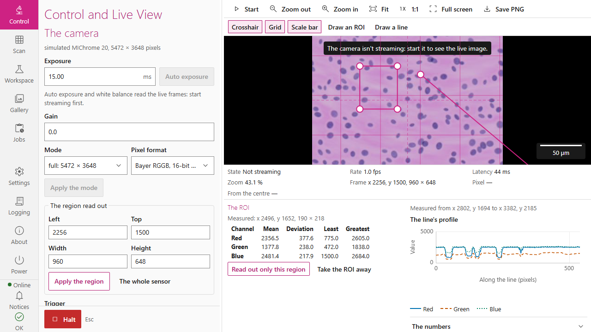
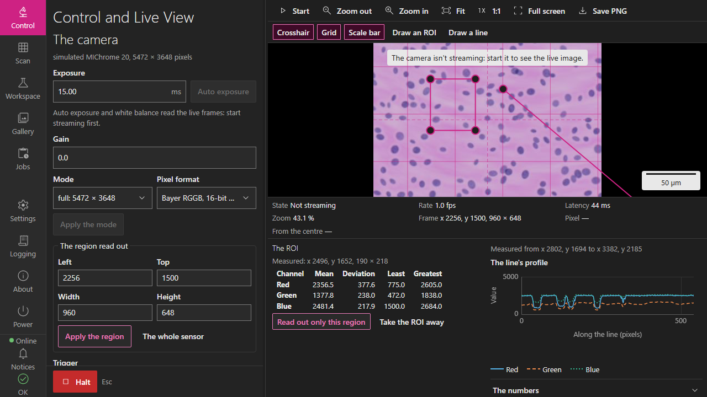

# W3.5: Overlays I: crosshair, ROI, grid and profile

- Status: In review
- Branch / PR: `m2/w3.5-overlays` / [#97](https://github.com/lucaswewa/OScope/pull/97)
- Estimate: first 1,600, the spec's · second ~1,600 (code ~670, tests ~250, styles ~150, try-it ~500, glue ~30), in the plan's change log before the code, as the first · measured **997** hand-written lines changed (code 558, tests 103, styles 118, try-it 218): 38 % under the second estimate and the first. The statistics and the profile were already in the stream (P18, ADR-0035), the chart W0.7's, and the view's transforms W1.5's: the layer only draws through them

## Summary

Layers drawn over the live image, placed in the image's own coordinates ([spec](../phases.md#w3-5)).

- **The layers:** the crosshair, a grid and the scale bar, each switched on and off from the overlays' toolbar, and kept between visits.
- **The ROI:** drawn on the image, moved and resized by the pointer or by its handles' keys. Its statistics, each channel's mean, deviation, least and greatest, come with the frames, over the region the server says it measured; and it is made the camera's region, on the camera's grid.
- **The line profile:** a line drawn on the image, its ends moved by the pointer or the keys, and the raw frame's values along it charted as they change.
- **Drawn as SVG** in the sensor's pixels, placed by the view, so each layer holds its place under zoom and pan; the handles are buttons the keyboard reaches.

W3.5 was begun in the sandbox while W3.4's gate ran.

## What was built

In `web/src/features/live/overlays/`:

- **`OverlayLayer.vue`:** the SVG over the canvas: the guides, the ROI and the line in the sensor's pixels, and their handles at the screen's size.
- **`geometry.ts`:** a rectangle from two corners, moved and resized within the frame; what an arrow key does to a handle; a region on the camera's grid; and the grid's lines.
- **`overlays.ts`:** the layers chosen, kept between visits; the drawing tool; the ROI and the line.
- **`OverlayMeasures.vue`:** the ROI's statistics and the line's profile, from the frames' statistics (ADR-0035), and the ROI made the camera's region.

And in `web/src/features/live/LiveViewer.vue`, the overlays' toolbar under the view's, the layer over the canvas, and the statistics asked for as the shapes change; in `web/src/api/preview/use.ts`, `measure`, which changes the statistics the stream is asked for.

## How to try it

```sh
cargo build --release -p oscope-server
cd web && npm ci && npm run build && cd ..
target/release/oscope-server --config configs/oscope.toml --port 8211 --web web/dist
```

Open `http://127.0.0.1:8211/#/control`, home the stage, move it over the tissue (W3.3's notes say how), and press *Start*:

1. **The layers:** press *Crosshair* and *Grid* in the second toolbar: they are drawn over the image, and hold their place as you zoom and pan. *Scale bar* hides it. Load the page again: they are as you left them.
2. **An ROI:** press *Draw an ROI* and drag over a nucleus: its statistics follow as you move it, by dragging it or with the arrow keys once it has the focus, Shift for ten pixels. Drag a corner to resize it. *Read out only this region* makes it the camera's region.
3. **A profile:** press *Draw a line* and drag across the tissue's edge: the profile shows the step. Its ends move by dragging them, or with the keys.

## Screenshots

| | Light | Dark |
|---|---|---|
| The layers, an ROI and a line, on a frozen frame |  |  |

## Design notes and deviations from the plan

- **The overlays have a toolbar of their own,** under the view's: the view's has no room for five more buttons, as W3.3 found.
- **A drawing tool draws one shape,** and the pointer goes back to the image: zoom, pan and the stage's pointing are where they were. Where nothing is drawn, the pointer goes through the layer to the image. While a tool is chosen, a press on a shape draws too: the test found a second ROI, drawn over the first, moving it instead.
- ***Read out only this region* stops the stream, sets the camera's region, and starts it again:** the camera takes a region only while it doesn't stream, and answered 409. A refusal is said beside the button.
- **The shapes are in the sensor's pixels,** the ROI in whole ones; the handles stay at the screen's size, whatever the zoom.
- **The ROI's statistics name the region the server measured:** the sensor's whole 2 × 2 cells, so each edge of the one drawn rounded out by a pixel at most, as W3.1's regions are. The tests hold the two together that way.
- **The camera's region from the ROI is rounded out to the camera's grid, and at least its least side:** the camera rounds a region down to its grid, which could cut the ROI's edge off, and refuses one with a side under 48 pixels. A mutant that left the rounding out survived until the test read out a small ROI, and held the camera's new region to the least side: the region it had before held the ROI too.
- **The baselines hide the frame,** as W3.1's do: its noise differs each time; the frozen frame keeps the view, and the layers over it. Each shape's numbers come before the next is drawn: the panel they fill takes room from the image, which moved under a drag, and the first baseline differed from its own next run.
- **The numbers' panel takes at most 40 % of the window,** and scrolls: with an ROI and a line, it had left the image a strip.

## Tests

- **Unit, 8 new, 596 in all:** a rectangle spanning two corners either way round, in whole pixels; kept within the frame, drawn or moved past it; resized by a corner, turning over when dragged past the opposite one; the handles' keys, a pixel, ten with Shift, other keys left alone; the camera's region rounded out to its grid and its least size; the grid's step and its lines on the sensor's multiples; and a shape keeping its place on the sensor under zoom and pan.
- **End to end, 5 new, 197 in all:**
  - **an ROI drawn is the region the server measures,** in Chromium, Firefox and WebKit: rounded out to the sensor's cells; moved ten pixels from the keyboard, and measured there; and made the camera's region, on its grid;
  - **a line's profile has the line's ends,** as the server says it measured them, and its chart;
  - **the layers are switched, and kept** across a reload;
  - **axe,** in both themes, with an ROI and a line drawn;
  - **the baseline of the layers,** the crosshair, the grid, an ROI and a line on a frozen frame, the frame hidden, on Windows and Linux; and the viewer's, the shell's and the status's again, the overlays' toolbar under the view's.
- **Mutation checks, 12, all caught, none hung:**
  - **the geometry, 5:** two corners taken in order; a rectangle moved past the frame; a corner's neighbour kept for its opposite; Shift moving a pixel; and the camera's region rounded in;
  - **the layer and the viewer, 7:** the ROI's statistics not asked for; its keys not moving it; the camera's region off its grid; the region written while streaming; a shape taking the press while a tool draws; the line's profile not asked for; and the layers not kept.
  - **A mutant that survived found a weak test:** the camera's region off its grid survived while the test read out a large ROI, which the camera's own region already held, the write being refused while it streamed. The test now reads out a small ROI and holds the new region to the least side; it found the refusal, and the read-out now stops the stream for it.
- **Two cores, five times,** before the pull request: `web:unit` 5 of 5, then `web:e2e` 5 of 5, run apart.
- **The replays,** the merge gate (ADR-0038): REPLAYS
- **Docs:** the relative links and anchors in the Markdown files resolve.

## Follow-ups and known gaps

- **The histogram, the saturated pixels and false colour:** W3.6.
- **The wheel over a drawn shape** goes to the shape, not the image: zoom beside it.

## Clean room

- **Nothing was copied** from `microscope` or any other codebase.
- **No package was added.**
