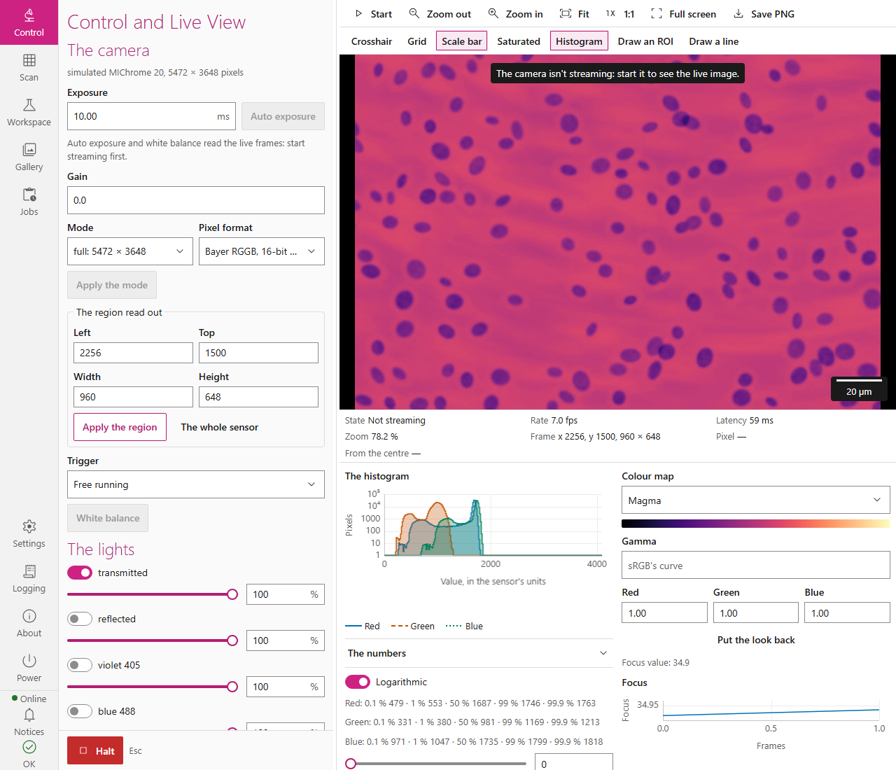
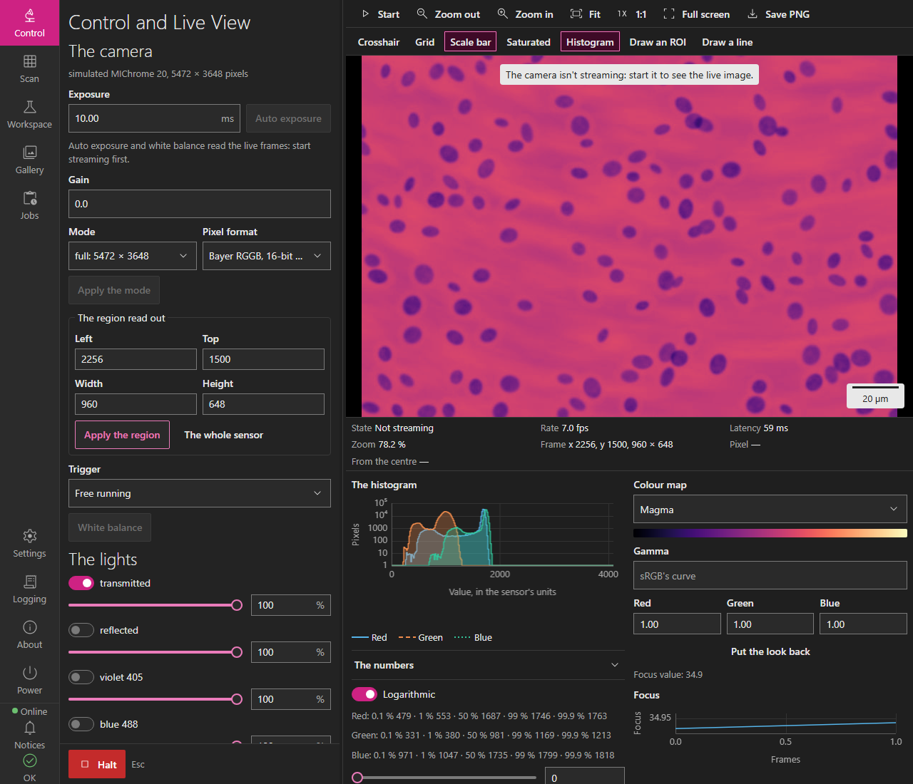

# W3.6: Overlays II: histogram, saturation, false colour and the look

- Status: In review
- Branch / PR: `m2/w3.6-overlays-ii` / [#98](https://github.com/lucaswewa/OScope/pull/98)
- Estimate: first 1,600, the spec's · second ~1,500 (code ~640, tests ~220, styles ~120, try-it ~480, glue ~40), in the plan's change log before the code, 6 % under the first · measured **896** hand-written lines changed (code 483, tests 100, styles 37, try-it 206, glue 70): 40 % under the second estimate, and 44 % under the first. The statistics, the mask and the chart were W1.5's and W0.7's already, and the maps' tables are data, left out of the size.

## Summary

See the frame's values, and set how the preview shows them ([spec](../phases.md#w3-6)).

- **The histogram:** a channel each, in the sensor's units, linear or logarithmic, its percentiles said (P18), live.
- **Saturation:** the pixels at the sensor's limit marked in red on the image, from the mask the statistics bring (ADR-0035), drawn by the renderer.
- **False colour:** seven maps, applied on the image's luminance in the fragment shader: grey; viridis, magma, inferno and plasma; turbo; and HiLo. The choice is kept, and shown as a bar.
- **The look** (`preview/look`): the black and white points, in the histogram's units; gamma; the white balance's gains, auto white balance's found gains offered; and the look put back.
- **The focus value:** a number and a trace, to focus by hand.

W3.6 was begun in the sandbox while W3.5's gate ran.

## What was built

In `web/src/features/live/`:

- **`ValuesPanel.vue`:** the histogram, the look, the colour map and the focus, under the image, shown from the overlays' toolbar.
- **`histogram.ts`:** the histogram's series, a channel each; the percentiles by name; and the look's levels on the sensor's axis.
- **`colourMaps.ts` and `colour-maps.json`:** the maps' tables, 256 sRGB colours each; grey and HiLo made there, the others written by `web/scripts/colour-maps.mjs` from their published data.

And in `web/src/api/preview/`: the renderer's false colour and saturation marks, a map's table and the mask as textures in its fragment shader (`renderer.ts`); and `colourBy` and `markSaturated` for the page (`use.ts`).

## How to try it

```sh
cargo build --release -p oscope-server
cd web && npm ci && npm run build && cd ..
target/release/oscope-server --config configs/oscope.toml --port 8211 --web web/dist
```

Open `http://127.0.0.1:8211/#/control`, home the stage, move it over the tissue (W3.3's notes say how), and press *Start*:

1. **The histogram:** press *Histogram* in the overlays' toolbar: it follows the frames, a channel each. *Logarithmic* shows the empty bins.
2. **Saturation:** press *Saturated*, and raise the exposure until the histogram piles up at the right: the saturated pixels light up red.
3. **The look:** drag the white point down: the image brightens, and the frame's percentiles don't change. *Put the look back* returns it. Run *White balance* in the camera's pane: its gains are offered here.
4. **False colour:** choose *Turbo* under *Colour map*: the image takes its colours, and the bar shows them. Load the page again: it is kept.
5. **Focus:** move the stage along z with Page Up and Page Down: the focus value peaks where the image is sharpest.

## Screenshots

| | Light | Dark |
|---|---|---|
| The values panel, the frame in Magma |  |  |

## Design notes and deviations from the plan

- **The black and white points are set on sliders under the histogram,** on its axis's scale, not dragged on the chart itself: the chart's pointer zooms and pans it (W0.7).
- **False colour maps the luminance,** Rec. 709's weights, of the frame as the preview shows it; HiLo is grey with the darkest level blue and the brightest red, to set the levels by. The 2D canvas's fallback draws the frame's own colours, and marks nothing.
- **The saturation test watches the frames as they come,** about half the frame at the sensor's limit at 30 ms: where the marks were, the frames after them are near white. Frozen, WebKit kept marks switched off on a stopped frame until the next frame came.
- **WebKit on Windows draws a resized WebGL canvas black,** a plain window's resize too, before W3.6 as after: the values panel resizes the canvas, so the false colour test is skipped there, saying why. WebKit on Linux, the desktop app's engine there, passes it; on Windows the app is Chromium's. A texture of its own for each frame's size, and a context with an alpha channel, didn't change it.
- **The map's texture is RGBA,** each colour's alpha full: WebKit sampled a three-byte RGB texture as black. Each draw binds its three textures again.
- **The look writes only what changed, and the reset waits for it:** a number field gives its value again as it loses the focus, and pressing *Put the look back* takes the focus from the white point's field. On two cores, now and then, that second write came after the reset and undid it. A value as it already is isn't written again, compared within a millionth: the server keeps the look in 32-bit floats, so its echo of 1024's level differs from what was sent in the eighth digit, which the first guard, within 10⁻⁹, missed (the gate's first try). And the reset waits for the panel's last write.
- **The statistics are asked for only while something uses them:** the histogram, the saturation marks, an ROI or a line. The mask comes with them, so a frame without statistics keeps the last marks.
- **The colour map is the browser's choice, kept between visits:** the server's display setting offers four maps (`grey`, `viridis`, `magma`, `inferno`); W8.1 brings the account's preferences, and should offer the seven.
- **The maps' tables are data,** made by a script from their published files and left out of the size: viridis, magma, inferno and plasma are Nathaniel Smith and Stéfan van der Walt's, under CC0 (github.com/BIDS/colormap, `colormaps.py`); turbo is Anton Mikhailov's, Copyright 2019 Google LLC, under the Apache License 2.0 (his gist `ee72ba4191942acecc03fe6da94fc73f`). The data file names each source, and the packages' notices carry turbo's, with the licence's text (`packaging/notices/turbo-colormap-NOTICE.txt`, which `make.sh` gathers).

## Tests

- **Unit, 10 new, 606 in all:** the histogram from a recorded message, its bins at their lower edges, one more a bin when logarithmic, its percentiles named in order; the look's levels on the sensor's axis and back; the mask's bits a byte a pixel, from each byte's highest bit, and the recorded message's marked; and the colour maps, seven tables of 256, dark to light where published, viridis's first colour as published, HiLo's ends, and their sources named.
- **End to end, 5 new, 206 in all:**
  - **the saturated pixels marked where the frame is at the sensor's limit,** in Chromium, Firefox and WebKit: where the marks were, the frames after them are near white, and what they left out is darker;
  - **a look's change reaches the preview, and not the frame's values:** the white point at a quarter, the image brighter by a third and more, the 99th percentile as it was; and put back;
  - **false colour chosen, and kept** across a reload, in Chromium and Firefox, and in WebKit on Linux;
  - **axe,** in both themes, the panel open;
  - **the values panel's baseline,** the charts and their numbers masked, the map's bar shown, on Windows and Linux; and the viewer's, the shell's and the status's again, the overlays' toolbar two buttons longer.
- **Mutation checks, 10, all caught, none hung:**
  - **the maps and the histogram, 5:** HiLo's ends grey; a table read a byte along; an empty bin lost to the logarithm; the bins a value too narrow; and the mask's bits read from the lowest;
  - **the renderer and the page, 5:** the marks never drawn; the map never used; the mask not asked for; the white point not written; and the map not kept.
- **Two cores, five times:** web:unit 5 of 5; web:e2e 5 of 5 (1,118–1,145 s), at the third try. The first try's five runs all failed the values panel's baseline: its focus trace was drawn in some and not yet in others, so the test now waits for it. The second try failed one run in five: *Put the look back* undone by the white point's field, which wrote its value again as it lost the focus. The look now writes only what changed.
- **The replays,** the merge gate (ADR-0038): both passed on `cb2c41b`, each alone, at the gate's third run: the Windows replay in 9 min, and the Linux one, on a fresh clone, in 17 min (79 steps, 638 Rust tests).
  - **The first gate,** on `cc5d5da`, failed its two-core runs, 1 of 5 passing: the look's reset undone (the server's 32-bit echo), and in WebKit the image's samples too slow for the poll of the marks' end. Both were fixed in `cb2c41b`.
  - **The second** passed its two-core runs, 5 of 5, and failed the Windows replay in one WebKit test of W0.2's gallery: an option of the accent's list, found but never stable within 60 s under the replay's load. It was that test's first failure in these logs.
  - **The third** ran the replays alone, on the same commit.
- **Docs:** the relative links and anchors in the Markdown files resolve.

## Follow-ups and known gaps

- **The server's display setting offers four colour maps:** it should offer the seven, for W8.1.
- **Dragging the black and white points on the chart itself,** if the chart grows handles.
- **WebKit on Windows and a resized WebGL canvas:** not the app's engine anywhere, but the renderer could be made to survive it, should Playwright's WebKit on Windows matter.

## Clean room

- **Nothing was copied** from `microscope` or any other codebase. The colour maps' tables are their published data, under CC0 and the Apache License 2.0, as above; the shader and the histogram are written from the usual methods.
- **No package was added.**
