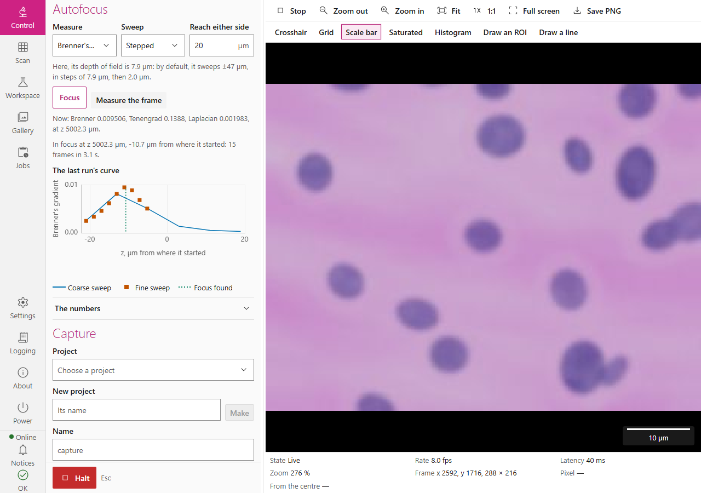
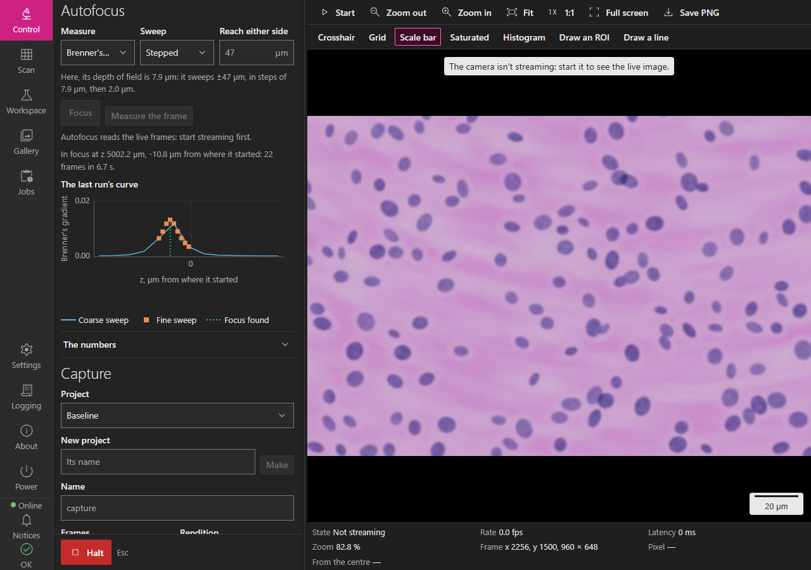

# W3.7: Autofocus, capture and the live recipe

- Status: In review
- Branch / PR: `m2/w3.7-autofocus-capture-recipe` / [#99](https://github.com/lucaswewa/OScope/pull/99)
- Estimate: first 1,400, the spec's · second ~1,300 (code ~700, tests ~110, styles ~70, try-it ~380, glue ~40), in the plan's change log before the code, 7 % under the first · measured **1,505** hand-written lines changed (code 757, tests 126, styles 118, try-it 504, glue 0): 16 % over the second estimate, and 8 % over the first. The try-it took more: the recording script, written against the API as it is because Node can't run the app's client (91); the end-to-end helpers W3.6's tests now share (80); the earlier panes' visual tests made to scroll at each look (28); and the gate's fix, below (19). So did the three panes' styles. The recorded run is data, left out of the size.

## Summary

The control tab's actions ([spec](../phases.md#w3-7)): focus, keep a frame, and choose what the preview runs.

- **Autofocus** (`autofocus/run`, `defaults`, `last`, `measures`): a sweep in z, run as a job and followed, its measure, sweep and reach from its defaults; what it found said, and its curve drawn: P34's follow-up.
- **Capture** (`capture/single`, `burst`): a frame or a burst, into a project chosen there or made there, named, with a rendition if asked; the record shown, its thumbnail, with a link to it in the gallery.
- **The live recipe** (`preview/set_live_recipe`): none, one of four that come with the app, or one opened from a file; its cost against the budget; and the references it reads, captured there (`capture_reference`).

W3.7 was begun in the sandbox while W3.6's gate ran.

## What was built

In `web/src/features/control/`:

- **`focus/AutofocusPane.vue` and `focus/curve.ts`:** the autofocus pane, and its curve from the last run's report: the coarse sweep, the fine one's points, and the focus found, each z from where the run started.
- **`capture/CapturePane.vue`:** the capture pane. The project chosen is kept between visits.
- **`recipe/RecipePane.vue` and `recipe/recipes.ts`:** the live recipe's pane, the recipes that come with the app, the references a recipe reads, and a file's recipe checked for its shape.

And `web/src/api/projects.ts`: a page of the projects (`projects/list`), whose answer the OpenAPI document doesn't type, checked by the contract tests.

## How to try it

```sh
cargo build --release -p oscope-server
cd web && npm ci && npm run build && cd ..
target/release/oscope-server --config configs/oscope.toml --port 8211 --web web/dist
```

Open `http://127.0.0.1:8211/#/control`, home the stage, move it over the tissue (W3.3's notes say how), and press *Start*:

1. **Autofocus:** jog z a few tens of µm with Page Up, until the image blurs, and press *Focus*: the job's progress shows, then where it found the focus, and the curve with its peak. The image is sharp again.
2. **Capture:** type a name under *New project* and press *Make*, then *Capture*: the record's thumbnail appears, with a link to it in the gallery, which W6 fills. Set *Frames* to 5 for a burst.
3. **The live recipe:** choose *The green channel alone*: the preview turns grey, and the check's time is said against the budget. Choose *Flat field*: it is refused, as it reads the reference `flat`. Move to empty glass, press *Capture the reference*, and choose it again. Choose *None* to go back to the look.

## Screenshots

| | Light | Dark |
|---|---|---|
| The tab's actions, after a run and a capture |  |  |

## Design notes and deviations from the plan

- **The saved recipes come with the app, for now:** the server keeps no recipes until W7.1's library. Four come with the app, as P22's example has them (levels and gamma, inverted, the green channel alone, and the flat field), and one can be opened from a file. The server checks each as it is set.
- **The frame's measures are read when asked,** not followed: each read waits for the next frame and measures it on the server.
- **The record's link goes to the gallery,** `#/gallery?project=…&record=…`, which W6 fills: until then it opens the gallery's placeholder. The record's files are served under the session's token, so a plain link to them would fail where security is on.
- **A raw capture's thumbnail is grey,** the Bayer mosaic's own: the store's thumbnails aren't demosaiced, as ADR-0030 says. Its rendition, when asked for, is demosaiced.
- **A debug build's recipes are slow:** the green channel alone took 141 ms on the check's 1920 × 1080 image, against a budget of 20 ms, and was refused, as the pane said. The end-to-end test raises its own server's budget to 5 s; a release build is within it.
- **The panes' visual tests scroll at each look:** with W3.7's three panes, the control pane overflows even at the tall window the visual tests use. So the stage's and the lights' tests (W3.3, W3.4) scrolled before the pane took the shorter window's height, and the scroll was undone, in two of five two-core runs. Each now scrolls again at each look, until its pane is at the top.
- **The actions' tests are light on the processor:** in the Windows replay, eight tests at once and unpinned, W3.7's first tests held the whole computer, and the gate's replays failed three times. An autofocus sweep renders the simulator's slide afresh at each z, and a debug server took 38 s of processor time over it, twice at once with the visual test's own. The suite then took 5.7 min instead of 2.2, and other tests timed out. Now the actions' tests use a 288 × 216 region, about what P34's server test focuses on; autofocus's sweeps 20 µm either side, checked; and the visual test runs no sweep of its own. A sweep takes 12.6 s of processor time, and the suite, unpinned, 2.2 min, twice. The notes' pictures are the autofocus test's.
- **A capture's thumbnail has a box of its own,** 6 by 4.5 rem, the picture fitted in it: the pane doesn't move with the frame's shape.
- **The recipe's cost** is the server's check as it was set: its time on an image the default viewport's size, against `recipe_budget_ms`. The live sessions' times are said too, the slowest's, as no session says which is the page's own.

## Tests

- **Unit, 8 new, 614 in all:** the curve from a recorded run (`scripts/record-focus.mjs`: a stepped run of 22 frames, 13 coarse and 9 fine, its focus 0.23 µm from the simulator's truth); the recipes that come with the app, each wired whole, their steps in order, and the references they read; a file's recipe taken, and refused saying why.
- **Contract:** the project list's page, as `projects.ts` has it.
- **End to end, 5 new, run 7 times across the browsers, 213 in all:**
  - **autofocus to the simulator's true focus,** from 12 µm above it, within a quarter of the depth of field, as P34's server test asks; the reach typed, 20 µm, the one swept; the curve drawn, and the measures read;
  - **a capture making a record** in a project made there, its thumbnail, its rendition and its link; and a burst of three, in Chromium, Firefox and WebKit;
  - **a live recipe set and cleared:** the green channel alone turns the preview grey, and none brings its colours back; the flat field refused until its reference is captured, then set;
  - **axe,** in both themes;
  - **the panes' baselines,** on Windows and Linux.
- **Mutation checks, 12, all caught, none hung:**
  - **the curve and the recipes, 6:** the curve's z not from the start; the focus marked though none was found; the peak the lowest point; a chain's steps each on the input; a reference read twice said twice; and a file's format unchecked;
  - **the panes, 6:** a focus found said as none; a burst sent as one frame; the rendition not asked for; the project made not chosen; none never set; and a refused recipe's references unsaid.
- **Two cores, five times:** web:unit 5 of 5; web:e2e 5 of 5 (1,316–1,347 s), at the second try. The first try passed 3 of 5: the stage's and the lights' visual tests (W3.3, W3.4) had their scroll undone, now that the control pane overflows sooner; they now scroll at each look.
- **The replays,** the merge gate (ADR-0038): both passed on `597f17a`, at the gate's fifth run: the Windows replay in 18 min, and the Linux one, on a fresh clone, in 17 min (79 steps, 638 Rust tests). Their end-to-end steps took 136 and 128 s.
  - **The first gate,** on `47577fd`, passed its two-core runs. Its Windows replay failed W0.6's scrolling test: one long task, of 66 ms, under the replay's load, that test's second failure in these logs.
  - **The replays ran twice more alone** on `47577fd`, and failed seven tests each, across the browsers, their end-to-end step taking 378 and 508 s. W3.7's tests held the computer, as the design notes say; `597f17a` is the fix.
  - **The fifth run,** on `597f17a`, passed every stage.
- **Docs:** the relative links and anchors in the Markdown files resolve.

## Follow-ups and known gaps

- **W7.1's library** replaces the recipes that come with the app.
- **Autofocus on the ROI drawn** (W3.5): the run takes a region, in the frame's pixels.
- **The gallery's link** opens the record once W6.2 reads its query.

## Clean room

- **Nothing was copied** from `microscope` or any other codebase. The recipes are P22's example's, OScope's own.
- **No package was added.**
