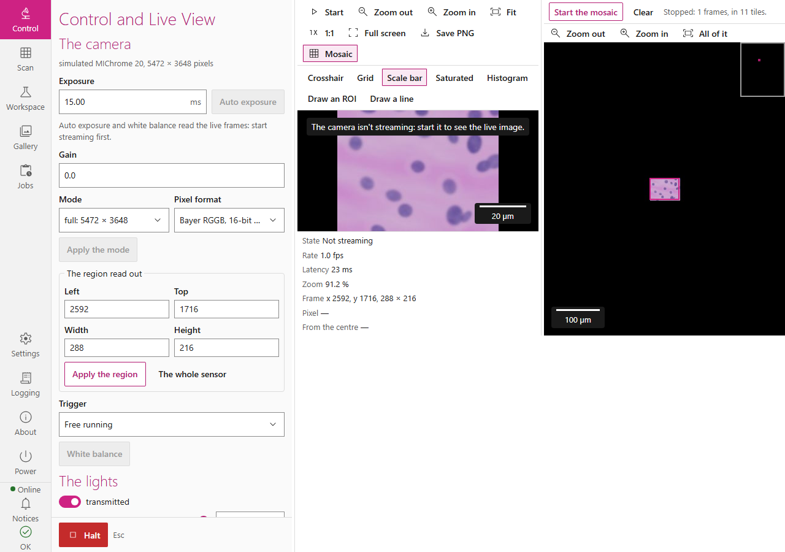
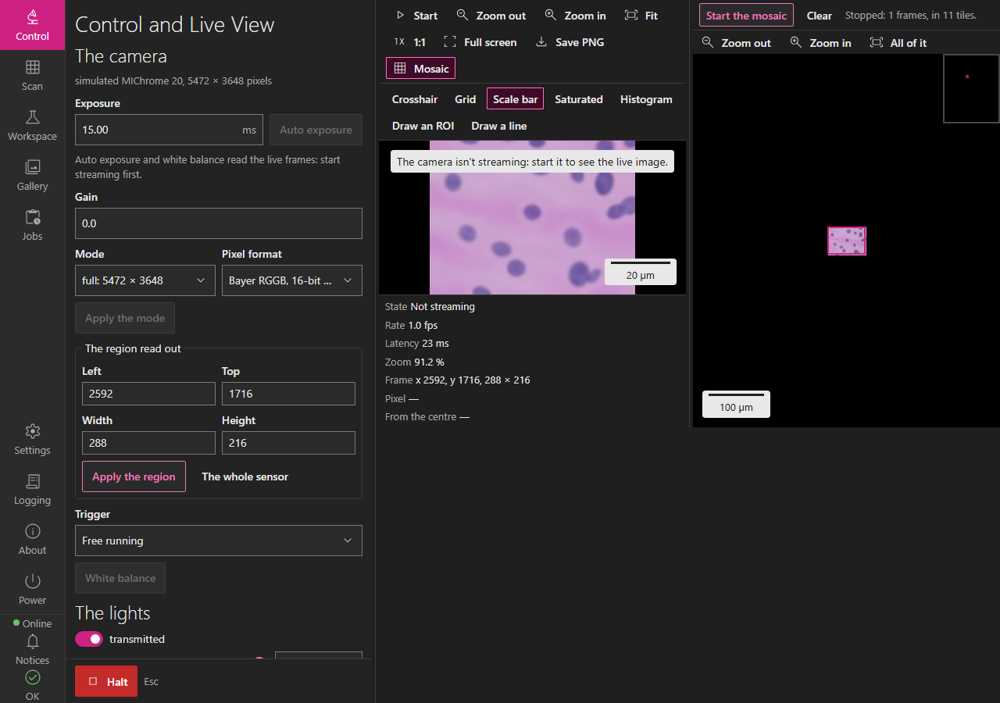

# W3.8: The free-roam mosaic and the tile viewer

- Status: In review
- Branch / PR: `m2/w3.8-free-roam-mosaic` / [#100](https://github.com/lucaswewa/OScope/pull/100)
- Estimate: first 1,500, the spec's · second ~1,450 (code ~700, tests ~150, styles ~90, try-it ~450, glue ~60), in the plan's change log before the code, 3 % under the first · measured **977** hand-written lines changed (code 606, tests 79, styles 80, try-it 188, glue 24): 33 % under the second estimate, and 35 % under the first. OpenSeadragon did more of the work than thought: its navigator, its tile cache and its gestures came as they are.

## Summary

A mosaic that builds as the stage is jogged (D13), in the tile viewer that the scans and the Gallery will use ([spec](../phases.md#w3-8)). It ends Stage W3 with Checkpoint G, below.

- **`TileViewer`** wraps OpenSeadragon once (ADR-0050): its tiles fetched with the session's token, its controls the app's own, a scale bar and a navigator, and its coordinates the stage's µm.
- **The live mosaic** (`live_mosaic/begin`, `halt`, `clear`, `state`): it grows as the stage moves, the field of view marked; a double click sends the stage there. It sits beside the live view, in a split.

W3.8 was begun in the sandbox while W3.7's gate ran.

## What was built

In `web/src/ui/tile-viewer/`, the tile viewer (ADR-0050):

- **`TileViewer.vue`:** OpenSeadragon, the one place it is used. Its toolbar, its scale bar, the pointer's place in µm, the navigator, the rectangle marked over the image, and a double click said as a place on the stage. A new key for the image fetches its tiles in view again, drawn over the old until they have come.
- **`source.ts`:** the image as OpenSeadragon opens it. Its tiles come from the caller's `load`, through the API layer; a tile with nothing drawn is a transparent pixel.
- **`coordinates.ts`:** the stage's µm, the image's pixels and OpenSeadragon's viewport, each into the others.

In `web/src/features/live/mosaic/`, the live mosaic:

- **`MosaicView.vue`:** begun, stopped and cleared, its counts said, and its tiles shown in the viewer, the field of view marked. A double click sends the stage there.
- **`mosaic.ts`:** the canvas's place on the stage, the levels in the viewer's order, and the field of view.
- **`shown.ts`:** whether the mosaic is shown beside the live view, kept between visits.

And:

- **`api/media.ts`:** `mosaicTile`, a tile of the live mosaic with the session's token, or nothing where nothing is drawn.
- **`ui/lengths.ts`:** the scale bar's round lengths, which the live viewer and the tile viewer share.
- **The live view's toolbar** has *Mosaic*, and the control tab splits the view between the live image and the mosaic.
- **A lint rule** refuses OpenSeadragon outside `ui/tile-viewer/`.

## How to try it

```sh
cargo build --release -p oscope-server
cd web && npm ci && npm run build && cd ..
target/release/oscope-server --config configs/oscope.toml --port 8211 --web web/dist
```

Open `http://127.0.0.1:8211/#/control`, home the stage, move it over the tissue (W3.3's notes say how), and press *Start*. Then follow Checkpoint G's last step.

## Checkpoint G

A live microscope in the app, end to end, on the simulator: Milestone 1's Checkpoint A, in the app.

### The demo

1. **Open the app:** start the server as above, and open `http://127.0.0.1:8211/#/control`. The status bar says the server is connected.
2. **Home the stage:** press *Home* in the stage pane. Its position reads the stage's home, at the corner of its travel.
3. **Go to the tissue:** under *Move to*, type x 40,000, y 12,000 and z 5,000 µm, and press *Move*.
4. **Start streaming:** press *Start* over the image. The H&E tissue appears, and the read-out says *Live*.
5. **Jog:** click the image, and hold an arrow key: the tissue slides across. Page Up and Page Down move z: the image blurs, and sharpens again.
6. **Zoom to full resolution:** press `1` on the image, or scroll in over a nucleus, until the read-out's zoom says 100 %: a sensor pixel to a screen pixel. The image stays sharp: the preview asks for the region it shows.
7. **The histogram and the saturation:** press *Histogram* and *Saturated* over the image. Raise the exposure to 30 ms in the camera pane: the histogram piles up at the right, and red marks the saturated pixels. Back at 10 ms, the marks clear.
8. **Autofocus:** choose z's step of 10 µm in the stage pane, press Page Up twice on the image, 20 µm out of focus, and press *Focus* in the autofocus pane. Its progress shows, then the curve with its peak, and where it found the focus. The image is sharp again.
9. **Capture a frame:** in the capture pane, type a name under *New project*, press *Make*, then *Capture*. The record's thumbnail appears, with a link to it in the gallery.
10. **Build a mosaic by jogging:** press *Mosaic* over the image: the mosaic opens beside it. Press *Start the mosaic*, then jog with the arrow keys on the image: a frame is drawn each time the stage stops somewhere new, and the field of view's rectangle follows the stage. Zoom out on the mosaic to see the path. Double-click a place on it: the stage goes there, and the mosaic grows on the way.

### The checklist

- [ ] The app opens on Control, and says the server is connected.
- [ ] Home leaves the stage at the corner of its travel, and *Move to* takes it over the tissue.
- [ ] *Start* shows the live image, and the read-out says *Live*.
- [ ] The arrow keys jog the stage, and Page Up and Page Down move z: the image blurs and sharpens.
- [ ] At 100 %, a sensor pixel is a screen pixel, and the image is sharp.
- [ ] At 30 ms, the histogram piles up at the right, and the saturated pixels are red; at 10 ms, they clear.
- [ ] Autofocus finds the focus, draws its curve, and leaves the image sharp.
- [ ] A capture makes a record in a project made there, with its thumbnail.
- [ ] The mosaic grows where the stage stops, its field of view marked, and a double click sends the stage to the place clicked.

## Screenshots

| | Light | Dark |
|---|---|---|
| The live mosaic beside the live view |  |  |

## Design notes and deviations from the plan

- **The tiles come through the API layer:** OpenSeadragon fetches nothing itself. Its tile source calls the caller's `load`, which `api/media.ts` serves with the session's token, as only `src/api/` talks to the server (ADR-0039, ADR-0045). ADR-0050 records the choice.
- **A tile with nothing drawn is a transparent pixel:** the live mosaic answers 404 there. Failed, OpenSeadragon would log an error for each, and a mosaic is mostly empty.
- **The mosaic is fetched again as its generation moves on,** which its state, read each second, says. The new tiles are drawn over the old until the tiles in view have come, so nothing blinks. Every tile in view is fetched again, changed or not. The preview stream can say which tiles changed (P38), but the page keeps only the newest frame, and the server drops messages under load: a viewer led by it could miss a tile. Following it is a follow-up.
- **The field of view is marked about the stage's place:** the camera's region, or its sensor, through the objective. Where a region off the sensor's middle lies on the stage is the calibration's to say, which the app doesn't have yet.
- **Starting a new mosaic, and clearing one, ask first** when it has anything drawn: either loses its tiles.
- **The viewer opens on the field of view, eight fields across,** not on the whole canvas: a mosaic over the stage's travel is 100 by 75 mm, and its first frames would be specks.
- **The mosaic's tests use the camera's tiny region,** as W3.7's do: a debug server draws each frame it keeps. The whole suite, unpinned and eight at once, still takes 2.2 min.
- **`advisories.json` loses picomatch's advisory,** which `npm audit` no longer reports, as the check asked.

## Tests

- **Unit, 6 new, 620 in all:** the coordinates, the stage's µm to the image's pixels and back, the viewport in the image's widths, down as well as across, and a field about its centre; the mosaic's canvas on the stage, its levels in the viewer's order, and the field of view through the objective.
- **End to end, 4 new, run 6 times across the browsers, 219 in all:**
  - **jogging adds tiles where the stage went, and none where it didn't,** in Chromium, Firefox and WebKit: three jogs of 200 µm, a frame drawn after each; on the server, the tile under each place, and none 20 mm away; in the viewer, drawn tiles fetched again after the jogs, none failing, the field of view marked an eighth of the view across or so, and the scale bar;
  - **a double click on the mosaic sends the stage there:** to the place the pointer's read-out said, within the stage's backlash and the read-out's tenth, as W3.3's moves allow;
  - **axe,** in both themes, the mosaic open and drawing;
  - **the tile viewer's chrome,** its tiles hidden: the field marked, the navigator's frame and the scale bar, on Windows and Linux. The live view's, the shell's and the status's baselines again, the toolbar a button longer, and on Linux the layers'.
- **The lint rule's own check:** a feature that imports OpenSeadragon is refused, and told to use `TileViewer`.
- **Mutation checks, 11, all caught, none hung:**
  - **the coordinates and the mosaic's numbers, 5:** the image's origin left out; the viewport's y in heights; a field from its corner; the levels in the viewer's order; and the field without the objective;
  - **the viewer and the page, 6:** an empty tile failed; the double click not said; a new key not fetched; the field never placed; the scale bar's length not the zoom's; and the generation left out of the key.
  - **"The field never placed" survived at first:** a marker left out of the viewer's overlays is a block as wide as its frame, which "wider than a twentieth of the view" let through. The test now bounds it on both sides.
- **Two cores, five times:** web:unit 5 of 5; web:e2e 5 of 5 (1,176–1,208 s), at the second try. The first passed 3 of 5: the jogging test counted the tiles fetched "after the jogs" from when the last one's frame was drawn, and the viewer had sometimes refreshed already, with nothing to change once the stage stood still. It now counts from before the last jog.
- **The replays,** the merge gate (ADR-0038): REPLAYS
- **Docs:** the relative links and anchors in the Markdown files resolve.

## Follow-ups and known gaps

- **The preview stream's changed tiles:** fetching only those, with a full refresh now and then.
- **The field of view's place, by the camera-to-stage calibration,** for a region off the sensor's middle.
- **The viewer's keys,** listed in the shortcuts' dialog with the live view's.
- **Full screen for the tile viewer,** through the host adapter (`ui/` can't use it).

## Clean room

- **Nothing was copied** from `microscope` or any other codebase. OpenSeadragon is used as a package, BSD-3-Clause, the version Milestone 1's examples vendor (6.1.1).
