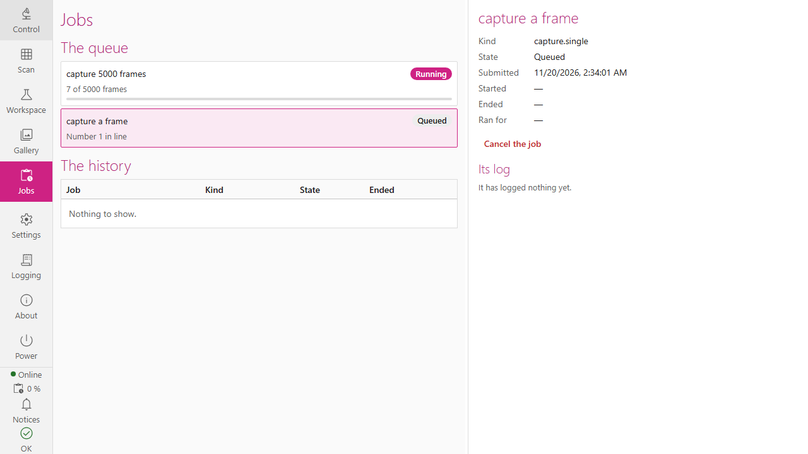
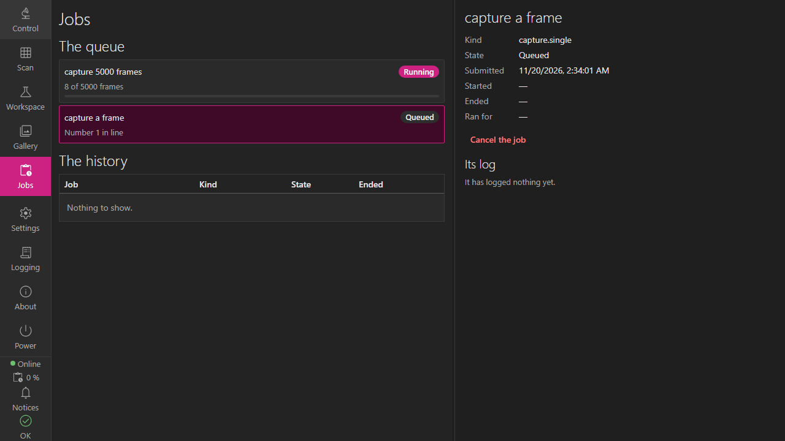

# W4.1: Jobs

- Status: In review
- Branch / PR: `m2/w4.1-jobs` / [#101](https://github.com/lucaswewa/OScope/pull/101)
- Estimate: first 1,500, the spec's · second ~1,500 (code ~750, tests ~180, styles ~110, try-it ~420, glue ~40), in the plan's change log before the code · measured **1,316** hand-written lines changed (code 747, tests 144, styles 169, try-it 256, glue 0): 12 % under both. The server's routes and the shell's toasts did more than thought; the styles, three panes' and a list's, more than the rest.

## Summary

Every long piece of work, watched and steered from one tab ([spec](../phases.md#w4-1)).

- **The queue and the history:** what runs, what is paused and what waits, in its order, from `jobs/queue`; and the jobs that ended, a page more at a time, from `jobs/list`. Both follow `jobs/changed`.
- **A job:** its kind, title, account and state; its progress, with its stage and the time left; its results, each leading to its record; its error; and its own log, from `logs/records`.
- **Steering,** with the lease: cancel, pause and resume, and the queue's order, by dragging or from the keyboard.
- **In the shell:** the hardware job that runs, at the rail's foot, leading to it; and each job's end as a notice, and as the system's notification when the app can't be seen.
- **Submitting a job by its kind,** in development builds.

W4.1 was begun in the sandbox while W3.8's gate ran.

## What was built

In `web/src/features/jobs/`:

- **`JobsTab.vue`:** the queue and the history beside the job chosen, which the address keeps (`#/jobs?job=…`): the rail's running job and a job's end lead there.
- **`JobQueue.vue`:** what runs, what is paused and what waits, in order. A waiting job is moved by dragging it onto another's place, or by Alt with the arrows, Home and End (`jobs/reorder`).
- **`JobDetail.vue`:** a job's kind, state, account and times; its progress, stage and time left; its error; cancel, pause and resume; its results, an acquisition or a result leading to it in the gallery; and its own log (`logs/records?job=…`).
- **`useJobs.ts`:** the queue from `jobs/queue`, which the jobs Thing's events read again, and the history from `jobs/list`, fetched again as `jobs/changed` says, at most once a second, a page more as asked.
- **`ends.ts`:** each job's end, told in the shell: a notice with *Show it*, and the system's notification when the app can't be seen.
- **`SubmitJob.vue`:** a job by its kind, its parameters as JSON, in development builds.
- **`jobs.ts`:** the sums: a share of 100, the time left, the time run, the queue's order, the keys' moves, the history's limits and where a result leads.

And:

- **`api/jobs.ts`:** `jobList`; a job's account.
- **`api/media.ts`:** `logRecords`, a page of the logs' records, for a job's log and for W4.2.
- **The host adapter's window:** `isHidden()`, whether the app can't be seen (ADR-0046).
- **The rail's foot:** the hardware job that runs, its share done, leading to it.

## How to try it

```sh
cargo build --release -p oscope-server
cd web && npm ci && npm run build && cd ..
target/release/oscope-server --config configs/oscope.toml --port 8211 --web web/dist
```

Open `http://127.0.0.1:8211/#/control`, home the stage, move it over the tissue (W3.3's notes say how), and press *Start*. Make a project in the capture pane (W3.7). Then:

1. **Queue three captures and an autofocus:** set *Frames* to 500 and press *Capture*; set it back to 1 and press *Capture* twice; and press *Focus* in the autofocus pane. Open `#/jobs`: the burst runs, and the rest wait in line. The rail's foot shows the running job's progress, and leads to it.
2. **Reorder:** drag the autofocus above the captures, or focus it and press Alt and the up arrow.
3. **Cancel one:** choose a waiting capture, and press *Cancel the job*. Cancel the burst too: it asks first.
4. **Pause one:** a pausable job, such as a batch over the camera's frames, has *Pause*, then *Resume*. Development builds can submit one under *Submit a job*: the kind `pipeline.batch`, with `{"recipe": …, "frames": 100}`.
5. **Open a finished job:** each job's end raises a notice, with *Show it*. A capture's results lead to its record in the gallery, which W6 fills.

## Screenshots

| | Light | Dark |
|---|---|---|
| The jobs tab: the queue, the history and a job |  |  |

## Design notes and deviations from the plan

- **The queue is the server's, read again at each of the jobs Thing's events;** the history is fetched again at each `jobs/changed`, at most once a second. Neither is kept by merging events into it: a missed event would leave it wrong until the next.
- **The history is the newest jobs that ended, a page more as asked:** `jobs/list` takes a `limit` and no offset, so a page more is a longer list, to the server's 1,000.
- **Submitting by kind takes JSON, not a form:** `jobs/kinds` names the kinds without their parameters' schemas, so SchemaForm has nothing to draw. Development builds only, as the spec says.
- **Cancelling what runs, or is paused, asks first;** a waiting job is cancelled at once.
- **A progress bar only for what runs or is paused:** a waiting job has none, not an empty one that moves.
- **A Thing's events read its properties again at most every quarter second** (`api/things/store.ts`, W1.1's): a running job tells `jobs/changed` with each frame's progress, and each event read again every property the page followed. With the rail following the queue on every tab, a burst's frames made some 20 reads a second, and on two cores, once, Firefox's page took the server for lost (the gate's first try). The first event reads at once, and a read always follows the last.
- **The rail's running job is a link of 24 px,** as axe asks of a target. The lines about it are words, not links.
- **A job's end is told from `jobs/changed`:** one that ends while the page isn't connected, or before its socket opens, isn't told. The history and the job's own page say it all the same.
- **The host adapter's window says whether the app can't be seen,** for the system's notification: the browser's page hidden; the desktop app's window, W9's to say.

## Tests

- **Unit, 9 new, 629 in all:** a flood of a Thing's events read again at most every quarter second, and after the last; a job's share of 100, clamped, and nothing unsaid; the time left in minutes and seconds; the time run, to its end or to now; the queue's order, running, paused and waiting, by place; the keys' moves, within the ends and only with Alt; the history's limit, a page more, to 1,000, and whether older jobs may be there; where a result leads; and the host's `isHidden`.
- **End to end, 6 new, run 12 times across the browsers, 231 in all:**
  - **the queue follows jobs submitted elsewhere,** in Chromium, Firefox and WebKit: a long burst running, two captures in line behind it in the order submitted; the rail's running job leading to it; and, cancelled from elsewhere, the burst leaving the queue for the history;
  - **reordering by the keys and by dragging, and cancelling, reach the server,** in Chromium, Firefox and WebKit: Alt and the up arrow, then a drag, each read back from `jobs/queue`; a waiting job cancelled at once, and the running one after its question;
  - **pausing and resuming reach the server:** a batch over the camera's frames, a blur on each, paused, resumed and cancelled, each read back from `jobs/job/{id}`;
  - **a job's end raises its notice,** in Chromium, Firefox and WebKit, on another tab, and *Show it* leads to the job, whose result leads to the gallery;
  - **axe,** in both themes, a job running and one waiting: it found the rail's running job, a link, under 24 px; now it isn't;
  - **the tab's baseline,** the times and the running job's progress masked, on Windows and Linux.
- **Mutation checks, 14, all caught, none hung:**
  - **the sums, the host and the store, 8:** every event read again at once; the share unclamped; the time left in seconds alone; the queue not by its places; a move without Alt; the history past a thousand; a result's file taken for its record; and the page never hidden;
  - **the page, 6:** the keys' move not sent; the drop not sent; a running job cancelled unasked; no pause offered; no end told; and the rail's running job never found.
- **Two cores, five times:** web:unit 5 of 5; web:e2e 5 of 5 (1,244–1,270 s), at the first try.
- **The replays,** the merge gate (ADR-0038): REPLAYS
- **Docs:** the relative links and anchors in the Markdown files resolve.

## Follow-ups and known gaps

- **Each kind's parameters' schema,** for a form in place of the JSON: the server's `jobs/kinds` would give them.
- **A job's end while the page is away,** told when it comes back: from the history, the ends since it last saw them.
- **Results that are files** (`data/…`): downloads, with W6.2's.

## Clean room

- **Nothing was copied** from `microscope` or any other codebase.
- **No package was added.**
