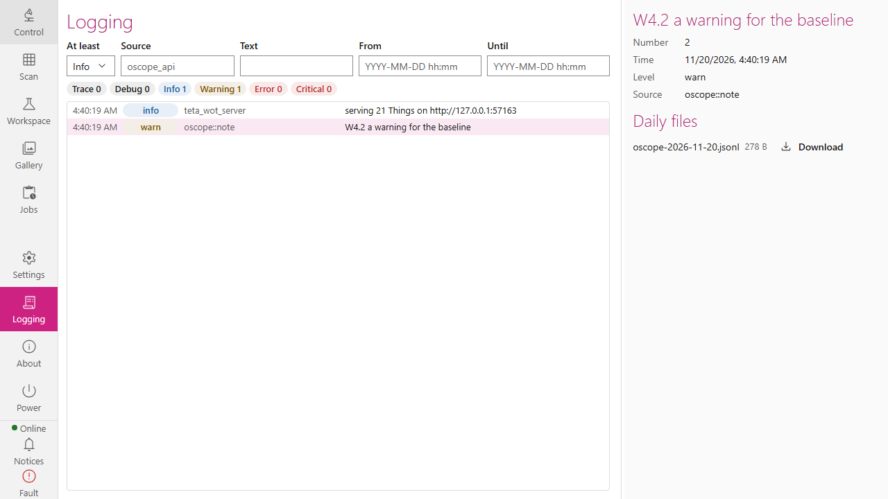
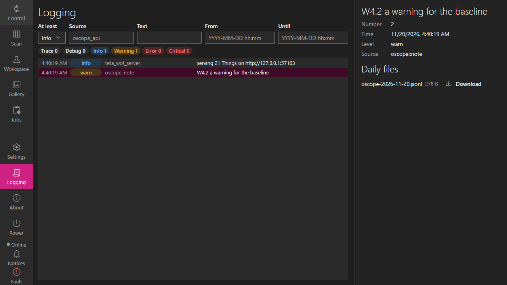

# W4.2: Logging

- Status: In review
- Branch / PR: `m2/w4.2-logging` / [#102](https://github.com/lucaswewa/OScope/pull/102)
- Estimate: first 1,300, the spec's · second ~1,280 (code ~650, tests ~150, styles ~100, try-it ~350, glue ~30), in the plan's change log before the code, 2 % under the first · measured **982** hand-written lines changed (code 528, tests 113, styles 177, try-it 164, glue 0): 23 % under the second estimate, and 24 % under the first. The tail and the records' route were W1.1's and W4.1's, and the list's window W0.6's.

## Summary

The server's log, searched and followed ([spec](../phases.md#w4-2)).

- **Records,** filtered by level, source, text and time, in a virtual list; a record opened shows its fields.
- **The levels** from trace to critical, each in its token's tone, with a count of each.
- **The live tail,** from the media plane: it holds while the user scrolls up, says how many came since, and follows again at the end.
- **The daily files** (`logs/files`), listed and downloaded.

W4.2 was begun in the sandbox while W4.1's gate ran.

## What was built

In `web/src/features/logging/`:

- **`LoggingTab.vue`:** the filters, kept between visits and taken after a pause in the typing; each level's count; the list; the record opened, with its fields, and the job it was made in; and the daily files, each downloaded through the host adapter.
- **`LogList.vue`:** the records in a virtual list, the newest at the foot, a screenful drawn at a time (`ui/table`'s `windowOf`, as W0.6's table). At its end, it follows; scrolled up, it holds, and a button says how many came since and goes back.
- **`useLogs.ts`:** the tail from the media plane (`logTail`, W1.1), asked anew as the filters change and opened again when it closes; its records merged once a frame; older pages from `logs/records`, by the oldest kept.
- **`logs.ts`:** the sums: the filters' query, the records kept in order and each once, the newest 100,000 at most, each level's count and tone, the list's end, and a file's size.

And `api/media.ts`: `logFile`, a daily file, whole.

## How to try it

```sh
cargo build --release -p oscope-server
cd web && npm ci && npm run build && cd ..
target/release/oscope-server --config configs/oscope.toml --port 8211 --web web/dist
```

Home the stage on `#/control`, then open `http://127.0.0.1:8211/#/logging`:

1. **Filter:** choose *Error* under *At least*, and type `out of range` under *Text*.
2. **A refusal at the tail:** move the stage past a limit, from another terminal:

   ```sh
   curl -s -X POST http://127.0.0.1:8211/api/v1/stage/move_to -H 'content-type: application/json' -d '{"x": 999999, "y": 0, "z": 0}'
   ```

   The refusal appears at the list's foot: *out of range (400): the x target in µm must be from 0 to 100000*, from `wot::things`.
3. **Hold the tail:** scroll the list up while records come: it stays, and a button says how many came since. Press it: the list follows again.
4. **A record's fields:** press a record: its fields show beside the list.
5. **Today's file:** under *Daily files*, press *Download*.

## Screenshots

| | Light | Dark |
|---|---|---|
| The logging tab, a record open |  |  |

## Design notes and deviations from the plan

- **The try-it filters errors by their words, not warnings by the stage:** a move past a limit is refused by the Things layer, and logged by it as an error (`wot::things`), not by the stage's own target.
- **A list of its own, not the data table:** the table's cells are words, and it can't follow a tail. The list keeps the table's window (`windowOf`), drawing a screenful and a few rows more.
- **The newest at the foot, as a tail is read:** the list follows there, and an older page comes in above.
- **The tail's records are merged once a frame,** and kept to the newest 100,000: a quick log would otherwise copy the list for each record.
- **Older records are offered only when there may be some:** when the tail's first batch is shorter than the page it asked for, nothing older matches.
- **The filters are applied after 400 ms without typing,** and kept between visits.
- **The times are typed,** `2026-11-20 09:00`, the page's own time: the components have no date picker yet.
- **A record's level is said in its token's tone,** with the levels' counts in the same tones: the tones' contrast is the badges', which axe passes.

## Tests

- **Unit, 9 new, 638 in all:** the filters' query, only what they say, the times in UTC; the records kept, the tail's after and an older page's before, each once and in order, the newest 100,000, and their window, a screenful and a few more wherever it is scrolled; each level's count; the list's end, give or take a few pixels; and a file's size, in the unit that keeps it short.
- **End to end, 5 new, run 7 times across the browsers, 238 in all:**
  - **a record emitted appears at the tail, and under its filter,** in Chromium, Firefox and WebKit: a warning at the list's foot, counted; gone under *Error*, where an error then comes; and found by its words;
  - **scrolling up holds the tail, and its end follows it again:** 60 records, the list at its foot; scrolled to the top, three more come, it stays, and says so; back at the end, it follows;
  - **a record opened shows its fields, and a daily file is downloaded:** today's file, a record a line, the one emitted among them;
  - **axe,** in both themes, a record open: it found the list's rows under 24 px; now they aren't;
  - **the tab's baseline,** the server's records, their counts, the times and the day's file masked, on Windows and Linux.
- **Mutation checks, 12, all caught, none hung:**
  - **the sums, 7:** an empty source asked for; the times not in UTC; the records kept without end; the newcomers not in order; each level counted once; the end's slack forgotten; and a size without its tenth;
  - **the page, 5:** the tail never followed; what came while held not counted; the filters not asked; the tail's records dropped; and a daily file not saved.
- **Two cores, five times:** web:unit 5 of 5; web:e2e 4 of 5 in each of two rounds (1,248–1,311 s), the logging tab's tests passing in all ten. Each failure was in an earlier phase's test, and came from the computer's load:
  - **W3.6's look test,** in the first round: the look's write had no answer within the app's 10 s, though the server drew with the new look within 1.5 s. The write timed out and went back, and the reset followed, as they should. Then `/health` went unanswered for 8 s: the app took the server for lost and hid the tab, and the browser drew nothing more in the test's last 28 s. The [follow-ups](#follow-ups-and-known-gaps) say what is known of the wait.
  - **W3.1's live test,** in the second: Windows refused a socket (`net::ERR_NO_BUFFER_SPACE`) as the Control tab's code loaded, as at W2.2 and W3.1, and the tab never came.
- **W4.1's jobs baseline waits for the rail's indicator now,** as W3.1's live baseline does. Two of the gate's three Windows replays on `3878a32` shot it while the page's only read of the status still said the stage wasn't homed, a sample from before the test homed it.
- **The replays,** the merge gate (ADR-0038): REPLAYS
- **Docs:** the relative links and anchors in the Markdown files resolve.

## Follow-ups and known gaps

- **A date and time picker** for the filters' times, when the components have one.
- **W3.5's layers baseline, once rewritten:** `baselines.sh`, four tests at once, drew the ROI a different height, a drag landing elsewhere. The committed baseline passed alone, 3 of 3, and was kept. The drag should wait for the view to settle.
- **An older page's place:** the list doesn't keep its place on the records shown as an older page comes in above.
- **What held the look's write,** in the first two-core round:
  - The server drew with the new look within 1.5 s, yet the trace's reads of the look still gave the old one, and the write had no answer. What held it isn't known.
  - teta-wot saves a setting's file within the write, synced to disk, on the async runtime. A writer filling the disk didn't slow that save here: 2.5 ms, as on an idle disk. So the disk alone isn't it.
  - If it comes again, a sample of the server's threads would say where it waits.

## Clean room

- **Nothing was copied** from `microscope` or any other codebase.
- **No package was added.**
