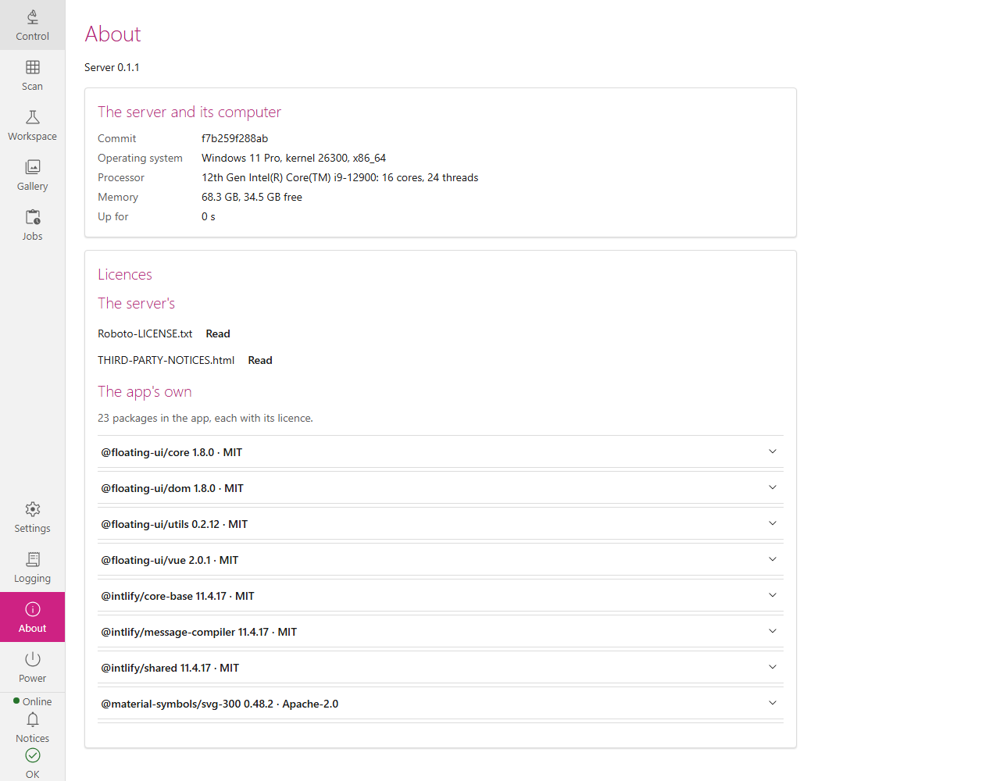
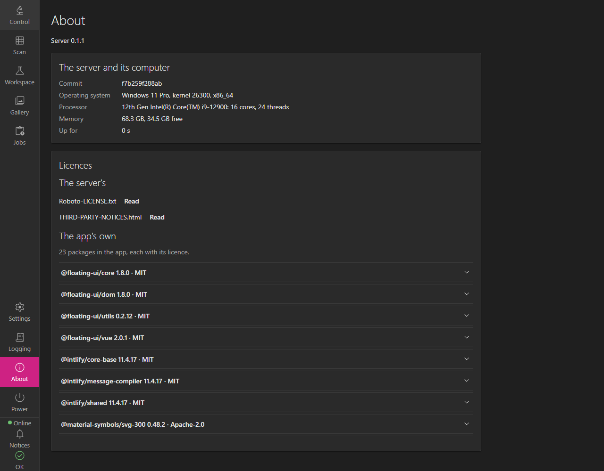
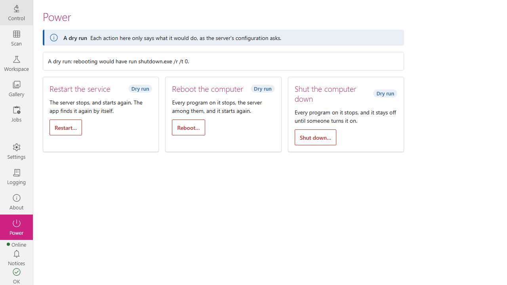
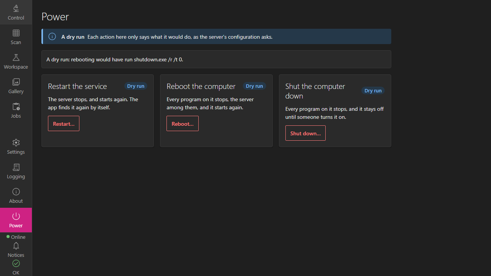
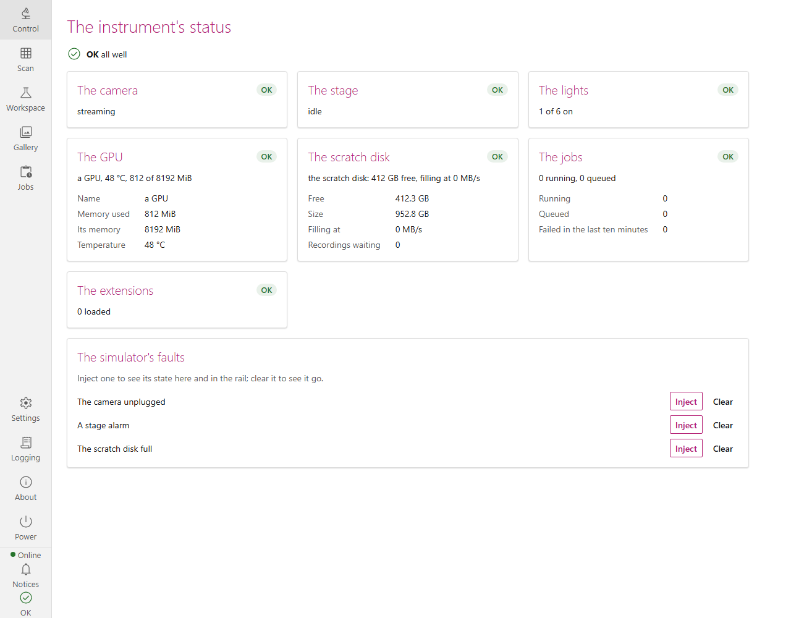
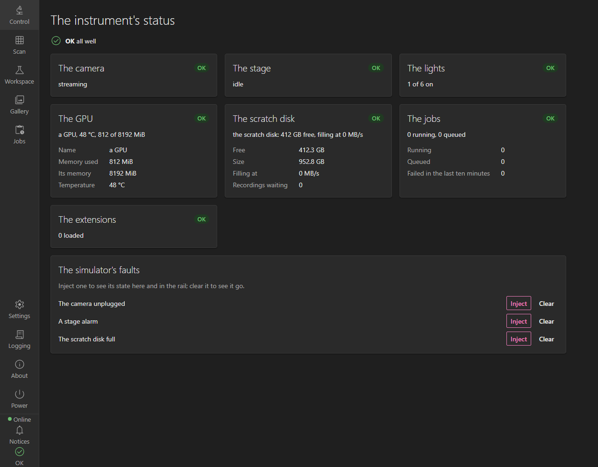

# W4.3: About, Power and the status in full

- Status: Done
- Branch / PR: `m2/w4.3-about-power` / [#103](https://github.com/lucaswewa/OScope/pull/103)
- Estimate: first 1,600, the spec's · second ~1,650 (code ~800, tests ~230, styles ~200, try-it ~390, glue ~30), in the plan's change log before the code, 3 % over the first · measured **1,901** hand-written lines changed (code 841, tests 425, styles 106, try-it 464, glue 65): 15 % over the second estimate, and 19 % over the first. The tests took most of it: the power tab's own test mounts it on a stand-in network, and the notices' Rust test tries each name it must refuse. The server's part, and the restart's harness, weren't in the spec.

## Summary

What the software is, how the instrument is, and the three power actions ([spec](../phases.md#w4-3)). It ends Stage W4 with Checkpoint H, below.

- **About:** the server's version and commit, the computer it runs on, and how long it has been up. The licences: the server's notices, which its package puts beside it, and the app's own, made from its packages at build.
- **Power:** the service restarted, and the computer rebooted or shut down. Each is confirmed by typing its name, and refused while a hardware job runs unless forced. A dry run says what it would have done. After a restart, the app has the server back by itself.
- **The status in full:** each subsystem's state, message and details, on a page of its own, from the rail's indicator. With the simulator, its faults, injected and taken away.
- **Server:** a restart done while rebooting and shutting down stay dry runs, for the tests (ADR-0060); and the server's notices, served for About.

W4.3 was begun in the sandbox while W4.2's gate ran.

## What was built

In `web/src/features/`:

- **`about/AboutTab.vue`:** the server's computer, from `system`; the server's notices, each read in a dialog, the HTML in a frame that runs nothing; the app's own, each package with its licence's text.
- **`about/about.ts`:** the time up, in its two largest units.
- **`power/PowerTab.vue`:** the three actions, each in a card with its dry run said; the question, which waits for the action's name; a refusal, and its *Force it…*; and, after a restart, waiting for a server up for less time than since it was asked.
- **`power/power.ts`:** the actions, a command as a line, and when the server is back.
- **`status/StatusPage.vue`:** the instrument's state and why, each subsystem's card, and the simulator's faults.
- **`status/details.ts`:** a subsystem's measures, named, each in the unit its name ends with.

And:

- **`api/notices.ts`:** the app's notices, `notices.json` beside the app.
- **`api/errors.ts`:** a Thing's own refusal, such as `conflict (409): …`, with its status.
- **The rail's indicator** leads to the status in full; the window is named for it.
- **`vite.config.ts`, `scripts/notices.mjs`:** the build writes `notices.json` beside the app, from the packages the bundle holds, as it lists them for the licence check.
- **Server:**
  - `[power] dry_run_restart`, the `power` Thing's property of that name, and `ApiBuilder::power_with` (ADR-0060);
  - the `system` Thing's `notices`, and `notices/{name}` to read one, from `[web] notices`, or where the packages put them: beside the server, or in `/usr/share/doc/oscope`.
- **The end-to-end tests' server** starts again on its exit code 75, on the same port, when a test lets it restart.

## How to try it

```sh
cargo build --release -p oscope-server
cd web && npm ci && npm run build && cd ..
mkdir -p .oscope && cp configs/oscope.toml .oscope/checkpoint-h.toml
printf '\n[power]\ndry_run = true\ndry_run_restart = false\n' >> .oscope/checkpoint-h.toml
while :; do
  target/release/oscope-server --config .oscope/checkpoint-h.toml --port 8211 --web web/dist
  [ $? -eq 75 ] || break
done
```

The loop starts the server again when it exits with 75, as its supervisor would. In PowerShell:

```powershell
do { & target\release\oscope-server.exe --config .oscope\checkpoint-h.toml --port 8211 --web web\dist } while ($LASTEXITCODE -eq 75)
```

Rebooting and shutting down only say what they would run; the service's restart is done. Then follow Checkpoint H's last two steps.

## Checkpoint H

The instrument run from the app: its jobs, its log, its faults and its service, on the simulator.

### The demo

1. **Open the app:** start the server as above, and open `http://127.0.0.1:8211/#/control`. The rail's foot says the server is online.
2. **Get ready:** home the stage, move it over the tissue (W3.3's notes say how), and press *Start*. In the capture pane, type a name under *New project*, and press *Make*.
3. **Queue jobs:** set *Frames* to 500 and press *Capture*; set it back to 1, and press *Capture* twice; then press *Focus* in the autofocus pane. Open the Jobs tab: the burst runs, and the rest wait in line. The rail's foot shows the burst's progress.
4. **Steer them:** drag the autofocus above the captures, or focus it and press Alt and the up arrow. Choose a waiting capture, and press *Cancel the job*. Cancel the burst too: it asks first. The next in line starts.
5. **Find a record in the log:** open the Logging tab. Choose *Error* under *At least*, and type `out of range` under *Text*. Move the stage past a limit, from another terminal:

   ```sh
   curl -s -X POST http://127.0.0.1:8211/api/v1/stage/move_to -H 'content-type: application/json' -d '{"x": 999999, "y": 0, "z": 0}'
   ```

   The refusal appears at the list's foot. Press it: its fields show beside the list.
6. **Follow the tail:** set the filters back to *Info*, and clear *Text*. Scroll the list up while the stage moves and the camera streams: the list stays, and a button says how many records came since. Press it: the list follows again.
7. **Inject and clear a fault:** press the instrument's status at the foot of the rail, then *The status in full*. Each subsystem shows its state, its message and what the server measured: the scratch disk's room, the jobs. Under *The simulator's faults*, press *Inject* by *The camera unplugged*: the camera's card says it, and the rail's indicator turns to *Fault*. Press *Clear*: the camera is well again.
8. **Restart the service:** open the Power tab. Press *Restart…*, type `restart`, and press *Restart*. The tab says it is restarting; the server stops, and the loop starts it again. The tab then says the service restarted, and About's *Up for* starts again from seconds.

### The checklist

- [ ] The app opens on Control, and says the server is online.
- [ ] Three captures and an autofocus queue: the burst runs, the rest wait, and the rail's foot shows its progress.
- [ ] Dragging, or Alt and an arrow, reorders the queue; a waiting job cancels; the burst cancels, after its question.
- [ ] The refused move appears at the log's tail under *Error* and `out of range`, and a record's fields show when it is pressed.
- [ ] Scrolled up, the tail holds and counts what came since; its button follows the tail again.
- [ ] The status in full shows each subsystem, and the scratch disk's room.
- [ ] *The camera unplugged* turns the camera's card and the rail's indicator to a fault; *Clear* takes it away.
- [ ] *Restart* waits for its name typed, then the tab says it is restarting, and then that the service restarted.
- [ ] *Reboot…* and *Shut down…* say, in this dry run, what they would have run, and nothing more.

## Screenshots

| | Light | Dark |
|---|---|---|
| About |  |  |
| Power, after a dry run's reboot |  |  |
| The status in full |  |  |

## Design notes and deviations from the plan

- **Server work the plan didn't name:**
  - **The restart, apart from the dry run** (ADR-0060): the restart's test needs a real restart, and a test must never reboot the computer it runs on. `[power] dry_run_restart` is `dry_run`'s when not given.
  - **The server's notices, served:** the packages put them beside the server, where the app can't read them. The `system` Thing lists the files whose names say they are notices, and serves each by its name alone: never a path, nor the server's other files beside them.
- **"In development builds"** is read as "with the simulator": the app is one build for every server, and only the simulator has faults to inject. The faults show when `simulation/loaded` answers.
- **The status in full is a page of its own,** `#/status`, not a tab: the rail's indicator leads to it, as its popover's last line.
- **After a restart, the tab waits for a new server:** one up for less time than since the restart was asked. The connection's own watch may not notice a quick restart, between its looks every 2 s.
- **The app's notices are the bundle's packages,** as the licence check lists them, each with its manifest's licence and the text of its licence files: `notices.json`, read when About opens.
- **A refusal is said on the tab,** with *Force it…* past a hardware job.
- **The power actions are followed by hand,** not as other actions are. After a restart, the new server doesn't know the old one's invocation: it answers 404, which the app's actions take for a refusal, and an answer may never come. A server gone, or new, is the restart under way.
- **A Thing's own refusal gives its status** (`api/errors.ts`): the power actions answer `conflict (409): …`, which the app took for a failure with no status. Now it has its status, and its words without the lead, as a device's refusal has. The shell's notices say those words alone.
- **An HTML notice is shown in a frame, in a box that takes the focus:** focused, the frame keeps the keys from the page, and Escape wouldn't close the dialog. WebKit's sandboxed frames keep them even from the page's listeners. The frame is as tall as its document, and the box scrolls.
- **The status page's baseline serves a steady status,** as W2.2's indicator's does: a computer's own GPU and disk would show in it.

## Tests

- **Unit, 10 new, 648 in all:** the question waiting for the action's name, asked confirmed, a dry run's command said, and a refusal forced with the name typed again; the server back after a restart only once it is a new one; a Thing's own refusal, with its status; the app's notices, in order, with their licences and texts; the time up; and a subsystem's measures, in their units.
- **Rust, 2 new:** a restart done while rebooting and shutting down stay dry runs, and the default restart a dry run with them; the notices listed and served by their names alone, nothing else and nothing out of their folder. The `system` Thing's ten properties, in its test, the command line's and `ex-server-hello`'s.
- **End to end, 9 new, run 18 times across the browsers, 255 in all:**
  - **reboot and shutdown only say what they would do,** each waiting for its name, in Chromium, Firefox and WebKit;
  - **a refusal while a hardware job runs,** then forced;
  - **a restart:** the test's own server stops and starts again, and the tab says it is back; a new server, up for less time than since the restart was asked;
  - **About:** the computer, its time up, the server's notices read, the HTML in its frame, Escape closing each, and Vue's runtime's licence among the app's own;
  - **the status's page** from the rail's indicator, the scratch disk's room and the jobs, and the camera unplugged and back, on the page and the indicator;
  - **axe,** in both themes: About, the status's page, Power and its question;
  - **the baselines:** About, Power and the status's page, on Windows and Linux; and W2.2's indicator's again, its popover ending with *The status in full*.
- **Mutation checks, 15, all caught, none hung:**
  - **the power tab, 5:** the question not waiting for the name; not confirmed; never forced; *Force it…* not offered; and the server taken for back at once;
  - **the sums, 4:** the notices out of order, and without their text; the gigabytes whole; and the days left out;
  - **in the browser, 2:** the question not waiting for the name, which the power test catches as the spec asks; and a fault cleared by injecting it;
  - **the server, 4:** the restart's own dry run ignored; any file served; a path out of the notices' folder; and every file listed.
- **Two cores, five times:** oscope-api's power and api, oscope-server's lib and cli, `ex-server-hello`, web:unit (99–106 s) and web:e2e (1,280–1,318 s): each 5 of 5, at the first try.
- **W4.1's reordering test presses its row until the job is chosen.** In the first gate's Windows replay, Firefox took the first press after the test's drag for the drag's end, and the job was never chosen. It failed so once before, in this phase's own first run of the suite.
- **The replays,** the merge gate (ADR-0038): both passed on `46e9148`, the Windows replay in 19 min, and the Linux one, on a fresh clone, in 18 min at its second run alone (79 steps, 640 Rust tests). The gate's two-core runs of web:e2e passed 5 of 5; the other suites passed on `d83bad5`, which `46e9148` changes only in a test.
  - **The Linux replay's first run** failed W1.5's *every frame the server sends is drawn*: one frame was replaced under its load, as at W2.2 and W3.5.
  - **The first gate, on `d83bad5`,** failed W4.1's reordering test in the Windows replay, fixed above.
- **Docs:** the relative links and anchors in the Markdown files resolve.

## Follow-ups and known gaps

- **The app's notices beside the server's in the installers:** W9.5's, as its spec says.
- **The restart's wait** gives up after two minutes, and says so: a server that takes longer to start isn't followed further.

## Clean room

- **Nothing was copied** from `microscope` or any other codebase.
- **No package was added.**
