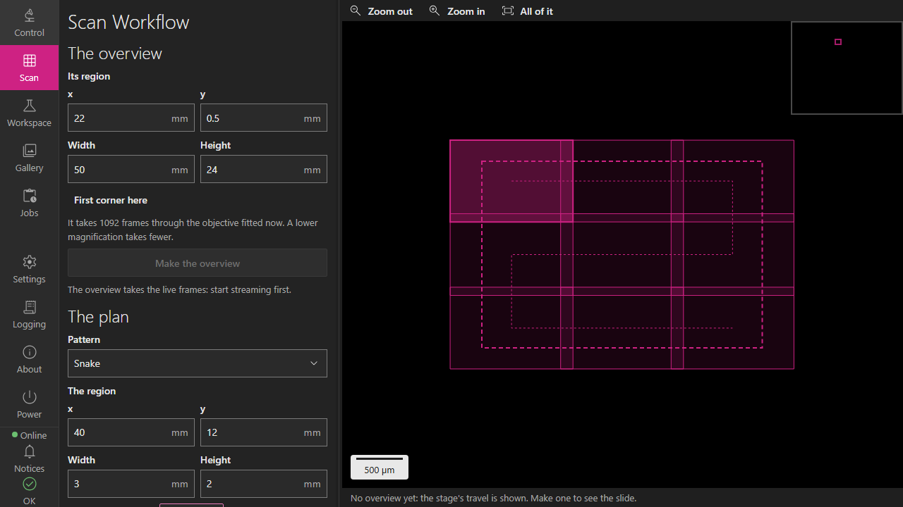

# W5.1: Scan plans

- Status: In review
- Branch / PR: `m2/w5.1-scan-plans` / PRNUMBER
- Estimate: first 1,800, the spec's · second ~1,830 (code ~950, tests ~250, styles ~120, try-it ~450, glue ~60), in the plan's change log before the code, 2 % over the first · measured MEASURED

## Summary

The scan tab, `#/scan`: a pattern and a region chosen, and the server's plan of them drawn over a picture of the slide, with what it would take, before anything moves ([spec](../phases.md#w5-1)).

- **The overview,** a picture of the slide at low magnification, frames a field apart, made as a job (P37). Its region is typed in mm or taken from the stage's corners, a standard slide's coverslip at first. The frames it takes are said before it starts.
- **The plan:**
  - **A pattern:** the built-in planners, and the extensions' workflows.
  - **What the pattern needs:** a region, drawn on the view, typed, or from the stage's corners; a z-stack; a place; positions; or a workflow's parameters, by its schema.
  - **The server's plan** follows each change: its tiles' frames are drawn over the overview in their order, with the path from each to the next. The rows, the columns, the overlap, the time and the data are said.
- **Its warnings:** tiles reaching past the stage's limits, a field spaced by the objective's nominal pixel for want of a calibration, and a recording larger than the scratch disk's room.

W5.1 was begun in the sandbox while the gate change's gate ran ([ADR-0061](../../adr/0061-gates-test-what-a-change-reaches.md)), and is the first phase gated by what its change reaches.

## What was built

In `web/src/features/scan/`:

- **`ScanTab.vue`:** the panes beside the view, the handle's place kept.
- **`OverviewPane.vue`:** the overview's region, the frames it takes, and the job followed.
- **`PlanPane.vue`:** the pattern, each pattern's form, the estimate and the warnings.
- **`RegionFields.vue`:** a rectangle typed in mm, or from two corners where the stage is.
- **`ScanView.vue`:** the tile viewer over the overview, or the stage's travel blank before one, the plan over it, and the field of view where the stage is.
- **`planning.ts`:** the tab's planning, which its panes and its view share, and the server's plan asked for again a moment after each change.
- **`plan.ts`:** the frames and the path, the warnings, the overview's frames, and each pattern's request.
- **`overview.ts`:** the overview, decoded from the server's RGB, as a one-tile image placed on the stage.

In `web/src/ui/tile-viewer/`:

- **`TileViewer.vue`:**
  - **Shapes** of the stage, drawn over the image in an SVG that zooms with it.
  - **A drawing mode,** in which a drag draws a rectangle instead of panning.
  - **`fit`,** where to look each time it changes.
- **`shapes.ts`:** the shapes, and a rectangle from two corners.

The scan tab replaces its placeholder in `app/tabs.ts`. The server's `scan` Thing (P36, P37) already had what the tab needs: `patterns`, `overview`, `last_overview` and `plan`. The warnings read `stage/capabilities`, `calibration/active` and `system/scratch_root`.

## How to try it

The try-its of W5 use the server built with CUDA, at the owner's choice: the simulated camera's frames on the GPU.

```sh
cargo build --release -p oscope-server --features cuda
npm --prefix web ci && npm --prefix web run build
target/release/oscope-server --config configs/oscope.toml --port 8211 --web web/dist
```

Open `http://127.0.0.1:8211/#/control`, press *Home*, and fit the 2× objective. Then open `#/scan`:

1. **The overview:** its region is a standard slide's coverslip. It says how many frames it takes; through the 2×, about fifty. Press *Start* on Control's view, then *Make the overview*: its progress, then the slide under the plan.
2. **A plan:** with *Snake* chosen, press *Draw it*, and drag a rectangle over the tissue. The tiles appear in order, with the time they will take.
3. **The overlap:** change it. The plan follows.
4. **The other patterns:** *Raster*, *Tiled z-stack* with its stack, *Z-scan* at *Here*, and *Positions* added where the stage is.
5. **The warnings:** type a region past the stage's travel, at x 95 mm and 10 mm wide: its tiles past the limits are counted.

## Screenshots

| | Light | Dark |
|---|---|---|
| A plan over the stage |  |  |

## Design notes and deviations from the plan

DESIGN

## Tests

TESTS

## Follow-ups and known gaps

- **Running the plan** is W5.2's, with the scan's focus.
- **The tissue's outline** on the overview, and its regions proposed, are W5.3's histo scan. The *tissue found* pattern plans over it already.
- **Positions named and reordered,** and a z-scan's planes and size, are W5.4's.

## Clean room

Nothing was copied from `microscope` or any other codebase. No package was added.
