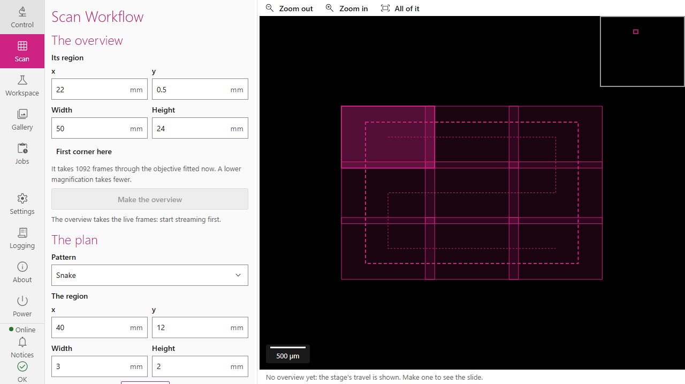

# W5.1: Scan plans

- Status: In review
- Branch / PR: `m2/w5.1-scan-plans` / [#107](https://github.com/lucaswewa/OScope/pull/107)
- Estimate: first 1,800, the spec's · second ~1,830 (code ~950, tests ~250, styles ~120, try-it ~450, glue ~60), in the plan's change log before the code, 2 % over the first · measured **1,916** hand-written lines changed (code 1,238, tests 229, styles 137, try-it 312, glue 0): 5 % over the second estimate, and 6 % over the first. 197 of the code's lines are the plan the unit tests draw, recorded from the server by a script (`recorded-plan.json`); without them, the code is 1,041.

## Summary

The scan tab, `#/scan`: a pattern and a region chosen, and the server's plan of them drawn over a picture of the slide, with what it would take, before anything moves ([spec](../phases.md#w5-1)).

- **The overview,** a picture of the slide at low magnification, frames a field apart, made as a job (P37). Its region is typed in mm or taken from the stage's corners, a standard slide's coverslip at first. The frames it takes are said before it starts.
- **The plan:**
  - **A pattern:** the built-in planners, and the extensions' workflows.
  - **What the pattern needs:** a region, drawn on the view, typed, or from the stage's corners; a z-stack; a place; positions; or a workflow's parameters, by its schema.
  - **The server's plan** follows each change: its tiles' frames are drawn over the overview in their order, with the path from each to the next. The rows, the columns, the overlap, the time and the data are said.
- **Its warnings:** tiles reaching past the stage's limits, a field spaced by the objective's nominal pixel for want of a calibration, and a recording larger than the scratch disk's room.

W5.1 was begun in the sandbox while the gate change's gate ran ([ADR-0061](../../adr/0061-gates-test-what-a-change-reaches.md)), and is the first phase gated by what its change reaches.

## What was built

In `web/src/features/scan/`:

- **`ScanTab.vue`:** the panes beside the view, the handle's place kept.
- **`OverviewPane.vue`:** the overview's region, the frames it takes, and the job followed.
- **`PlanPane.vue`:** the pattern, each pattern's form, the estimate and the warnings.
- **`RegionFields.vue`:** a rectangle typed in mm, or from two corners where the stage is.
- **`ScanView.vue`:** the tile viewer over the overview, or the stage's travel blank before one, the plan over it, and the field of view where the stage is.
- **`planning.ts`:** the tab's planning, which its panes and its view share, and the server's plan asked for again a moment after each change.
- **`plan.ts`:** the frames and the path, the warnings, the overview's frames, and each pattern's request.
- **`overview.ts`:** the overview, decoded from the server's RGB, as a one-tile image placed on the stage.

In `web/src/ui/tile-viewer/`:

- **`TileViewer.vue`:**
  - **Shapes** of the stage, drawn over the image in an SVG that zooms with it.
  - **A drawing mode,** in which a drag draws a rectangle instead of panning.
  - **`fit`,** where to look each time it changes.
- **`shapes.ts`:** the shapes, and a rectangle from two corners.

The scan tab replaces its placeholder in `app/tabs.ts`. The server's `scan` Thing (P36, P37) already had what the tab needs: `patterns`, `overview`, `last_overview` and `plan`. The warnings read `stage/capabilities`, `calibration/active` and `system/scratch_root`.

## How to try it

The try-its of W5 use the server built with CUDA, at the owner's choice: the simulated camera's frames on the GPU.

```sh
cargo build --release -p oscope-server --features cuda
npm --prefix web ci && npm --prefix web run build
target/release/oscope-server --config configs/oscope.toml --port 8211 --web web/dist
```

Open `http://127.0.0.1:8211/#/control` and take control. Press *Home*; then *Move to* x 40, y 12 and z 5 mm, over the tissue, press *Start*, and *Focus*. Fit the 5× under *The objective*. Then open `#/scan`:

1. **The overview:** its region is a standard slide's coverslip at first, 280 frames through the 5×. Type x 35, y 8.5, width 10.5 and height 7 mm instead: it takes 16 frames. Press *Make the overview*: its progress, then, in about a minute, the tissue's edge on the glass, under the plan.
2. **A plan:** with *Snake* chosen, press *Draw it*, and drag a rectangle over the tissue. The tiles appear in order, with the time they will take.
3. **The overlap:** change it. The plan follows.
4. **The other patterns:** *Raster*, *Tiled z-stack* with its stack, *Z-scan* at *Here*, and *Positions* added where the stage is. *The tissue found* plans over the overview's tissue: 18 tiles here.
5. **The warnings:** type a region past the stage's travel, at x 95 mm and 10 mm wide: its tiles past the limits are counted.

## Screenshots

| | Light | Dark |
|---|---|---|
| A plan over the stage |  |  |

## Design notes and deviations from the plan

- **Deviations from the spec:**
  - **The region is drawn on the overview,** or on the stage's travel before there is one, not on the live mosaic. The mosaic is the Control tab's, of the live view's frames. W5.2 brings it under the plan, as the scan grows it, and the same drawing serves there.
  - **A region may reach past the stage's limits:** the plan's tiles past them are counted in a warning, not cut off. The spec's warning needs such a region.
  - **The baseline is of a plan over the stage,** not over an overview: the tile viewer's baselines hide its image, whose noise differs each time (W3.8). An overview's showing is tested end to end.
- **The overview's region is a standard slide's coverslip at first,** 50 × 24 mm from (22, 0.5) mm, where the simulator's slide has it, and is kept in the browser once changed. Through the 10× that is 1,092 frames: past 300, the pane suggests a lower magnification.
- **Before an overview, the view is the stage's travel, blank,** at 100 µm a pixel: a plan has somewhere to be drawn, and a region somewhere to be drawn on.
- **The plan is the server's, asked again 300 ms after each change,** and the request before it given up. The app draws the planner's answer (P36), never a guess of its own: the tiles' order and spacing are the planner's alone.
- **The warnings are the app's,** from the plan and three reads: the stage's limits (`stage/capabilities`); whether the fitted objective has an active geometry (`calibration/active`); and the scratch disk's room (`system/scratch_root`). The server's preview has the plan and its estimate, and the three need nothing else. A read not yet answered warns of nothing.
- **The path joins the tiles in their index's order,** the order the scan visits them, whatever the order of the server's list.
- **The tile viewer draws the shapes in one SVG,** an OpenSeadragon overlay over the whole image, in the image's pixels: they pan and zoom with it, and their lines stay a pixel or two wide at any zoom.
- **The path is the accent, dashed,** as the live view's overlays are: the overview's glass is light and the blank stage dark, in either theme. The dark theme's inverse text, tried first, vanished on the blank stage.
- **Drawing is a mode of the tile viewer:** while on, its own panning is off, a drag draws a rectangle, and the rectangle is said when let go. The tab then leaves the mode, and the view fits the region, with as much again about it.
- **The planning is shared by the panes and the view** (`planning.ts`), for as long as the page is open: the tab can be left and come back to. Only the overview's region is kept in the browser.
- **A workflow's parameters** are its schema's form (W0.6), and the tissue's pattern without an overview says the server's refusal: *no overview yet*.
- **The unit tests draw the server's own plan,** recorded from the simulator's server by `scripts/record-plan.mjs`, to be recorded again should the planner change.
- **W5.1 is the first phase gated by what its change reaches** ([ADR-0061](../../adr/0061-gates-test-what-a-change-reaches.md)): no Rust suite, the unit tests related to its files, and every end-to-end spec, as it changes the shared tile viewer and the tabs.

## Tests

- **Unit, 18 new, 682 in all:**
  - **the plan's drawing,** from a plan recorded from the server: the frames in the index's order, given the tiles reversed; a snake's rows alternating; each frame's corners, and the overlap between neighbours;
  - **the warnings:** tiles past the limits, counted; no calibration, but not before it is read; too little room;
  - **the overview's frames,** 39 × 28 through the 10× over the coverslip; a region typed in mm; and each pattern's request, none until it has what it needs;
  - **the overview's picture,** from the server's RGB, and its place on the stage; the blank stage;
  - **the shapes:** a rectangle from two corners whichever way round, its corners in order, and its points in the image's pixels.
- **End to end, 5 new, run 9 times across the browsers, 264 in all:**
  - **a region drawn on the view** gives the server's plan of that region: its tiles, its rows and columns, and a frame for each tile; the overlap changed, the plan follows. In Chromium, Firefox and WebKit;
  - **each built-in pattern's form submits:** raster, snake and the tiled z-stack over a region; the z-scan here, of one tile; two positions where the stage is; and the tissue's, refused without an overview;
  - **an overview made,** of 0.3 × 0.2 mm through the camera's tiny region: 20 frames, said before it starts and after it ends, and shown under the plan. In the three browsers;
  - **axe,** in both themes;
  - **the baseline:** a plan over the stage, on Windows and Linux.
- **Mutation checks, 5, all caught, none hung:** tiles past the limits warned of only when every corner is; a calibration not yet read taken for none; the room never warned of; the tiles drawn in the list's order; and the tiled z-stack without its stack.
- **The try-it,** on the CUDA build: homed, then at the tissue in focus, the overview of 10.5 × 7 mm through the 5× took 16 frames in 61 s, and found the tissue; a snake over a quarter of it, 9 tiles; and the tissue found, 18.
- **Two cores, five times,** what the change reaches:
  - **the unit tests related to its files:** 5 of 5, 6 s each, at the second try. At the first, each run's log was named after its target, 18 files long: too long a name for a file, and every run failed before it began. `two-core.sh` now cuts a long target's label short, with a checksum to keep it its own.
  - **W5.1's own spec,** after its baseline's fix: 5 of 5.
  - **every end-to-end spec,** as the change reaches them all: 2 of 5, 1,403 to 1,473 s, on `540a322`, before those two fixes. Each of the other three failed one earlier phase's test, a different one each time. Firefox closed twice after a page's script outran its time, in *the saturated pixels are marked* and *an ROI drawn is the region the server measures*; and once the Control tab hadn't said where the stage was within 15 s, in *without a calibration, pointing says what it lacks*. None is the scan tab's, nor the tile viewer's.
- **The replays,** the merge gate (ADR-0038), only what the change reaches (ADR-0061):
  - **Windows** passed on `a63f5cf` in 10 min: 16 steps, the other 4 not reached. It passed on each earlier head too.
  - **Linux,** on a fresh clone with six workers (#108), failed 4 of its 265 end-to-end tests, each an earlier phase's: *at 1920 pixels wide, every frame the server sends is drawn*, *the layers are switched, and kept*, *the values panel looks as its baseline does* and *fitting an objective changes the scale, and offers its check*. W5.1 merges past them at the owner's word, for W5 and W6.
  - **Before, with twelve workers,** the Linux replay failed 2, 4 and 1 earlier phases' tests in three runs. A run outside the gate failed W5.1's own baseline: it had shot the rail's indicator before it said the stage was homed, and now waits for it, as W4.1's does. The owner chose six workers on Linux (#108).
- **Docs:** the relative links and anchors in the Markdown files resolve.

## Follow-ups and known gaps

- **Running the plan** is W5.2's, with the scan's focus.
- **The tissue's outline** on the overview, and its regions proposed, are W5.3's histo scan. The *tissue found* pattern plans over it already.
- **Positions named and reordered,** and a z-scan's planes and size, are W5.4's.
- **Lost clicks on Linux:** most of the Linux replay's end-to-end failures since #106 are a click whose action never reaches the server. The button is enabled and pressed, and its request never shows in the browser's trace: *Start* in Chromium, *Make the overview* in Firefox, W0.6's form's check. Windows never shows it. Either the server never answers the POST, or the app never sends it: not yet known.
- **A refused overview is said in the shell's notices, not in its pane;** and a quiet failure, the server unreachable, nowhere. The job actions drop their action's own failure (`useJobAction`, W3.2).
- **An overview straight after homing is refused:** *the z target in µm must be from 0 to 20000, and was 20001*. It is P37's, not W5.1's. The overview moves at the stage's z as the stage reads it, and the simulator's encoders read the true position, half the backlash past the home corner on each axis. A focused stage is within its limits, and an overview needs one: the try-it focuses first. Clamping the overview's z to the travel would mend it, and anything else that moves to where the stage reads itself, which W5.2's run should check.

## Clean room

Nothing was copied from `microscope` or any other codebase. No package was added.
