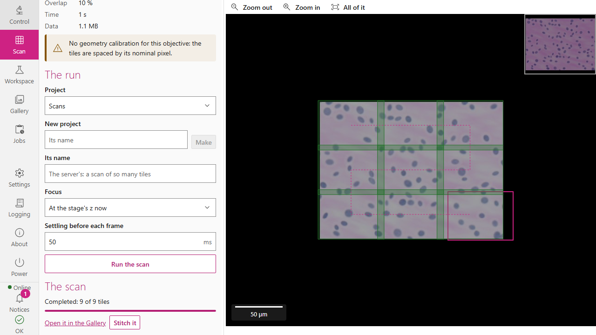
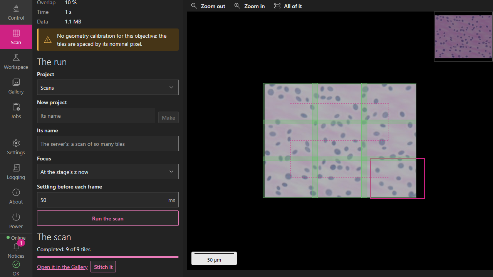

# W5.2: Running a scan

- Status: In review
- Branch / PR: `m2/w5.2-running-a-scan` / [#109](https://github.com/lucaswewa/OScope/pull/109)
- Estimate: first 1,500, the spec's · second ~1,800 (code ~880, tests ~330, styles ~100, try-it ~430, glue ~60), in the plan's change log before the code, 20 % over the first · measured **1,602** hand-written lines changed (code 882, tests 263, styles 68, try-it 387, glue 2): 11 % under the second estimate, and 7 % over the first. The scan's messages the unit tests read are recorded by a script, on one line (`recorded-scan.json`, 9 KB), as the API's recorded answers are.

## Summary

The plan run as a scan, and followed tile by tile on the scan tab ([spec](../phases.md#w5-2)).

- **The run:** into a project, chosen or made, and named; each tile's z found at the stage's z now, by autofocus every so many tiles, or by a focus map measured first; and the settling before each frame.
- **Its progress:** each tile marked on the plan as it is taken, over the live mosaic its frames draw, and when it should end. Pause, resume and cancel.
- **A fault** is shown with the tile it was at.
- **At its end:** the acquisition it made, opened in the Gallery, or stitched as a job (P39).
- **Server work the spec didn't name:**
  - **a scan pauses,** as each tile begins, the stage where the last tile left it;
  - **moves to where the stage reads itself stay within its limits.** W5.1 found an overview refused just after homing.

## What was built

In `web/src/features/scan/`:

- **`RunPane.vue`:** the run's project, name, focus and settling, and the run, the live mosaic begun first over the plan.
- **`RunningPane.vue`:** the latest scan, whoever started it: its tiles done, when it should end, pause, resume and cancel, its fault, what it kept, and what it made, opened or stitched.
- **`scanning.ts`:** the scan followed, its progress and its job, shared by the panes and the view; and whether the view shows it.
- **`running.ts`:** the scan drawn on its plan, where it stands, its fault and its tile, the run's input, and the mosaic's region.
- **`ScanView.vue`:** the live mosaic under the scan's plan, while the scan is shown.
- **`plan.ts`:** how each tile's z is found, in the plan's request, so that the estimate counts the autofocus runs.

Elsewhere in `web/src/`:

- **`features/projects/`:** a project chosen or made, which the capture pane (W3.7) and the run share.
- **`features/live/mosaic/mosaic.ts`:** the live mosaic as the tile viewer shows it, which W3.8's view and the scan's share.
- **`ui/tile-viewer/`:** the look of a scan's tiles: done, next, and at fault.

In the server:

- **`oscope-workflows`:** the scan job pausable, at each tile's start (`scan/engine.rs`); and `scan::within`, which brings a point within the stage's soft limits, used where an overview, a focus map or a scan starts from where the stage reads itself, and where a scan returns.
- **`oscope-api`:** a plan's z, the stage's now when none is asked, within the limits.

## How to try it

The try-its of W5 use the server built with CUDA, at the owner's choice: the simulated camera's frames on the GPU.

```sh
cargo build --release -p oscope-server --features cuda
npm --prefix web ci && npm --prefix web run build
target/release/oscope-server --config configs/oscope.toml --port 8211 --web web/dist
```

Open `http://127.0.0.1:8211/#/control` and take control. Press *Home*; then *Move to* x 40, y 12 and z 5 mm, over the tissue, press *Start*, and *Focus*. Then open `#/scan`:

1. **A plan:** with *Snake* chosen, type the region x 38.5, y 11, width 3 and height 2 mm: 9 tiles through the 10×.
2. **The run:** choose a project, or type *Scans* under *New project* and press *Make*. Leave *Focus* at the stage's z now, just focused, and press *Run the scan*. The live mosaic fills in under the plan, each tile turning green as it is taken, the next marked; the pane says how many are done and when it should end.
3. **Pause and resume:** press *Pause*. The tile under way ends, the stage holds, and the pane says *Paused*. Press *Resume*: it goes on from the next tile.
4. **Its end,** in about a minute: *Completed: 9 of 9 tiles*, the acquisition's *Open it in the Gallery*, which W6 fills, and *Stitch it*: a stitch job, its state said, then its result's link.
5. **A cancel:** run it again, and press *Cancel…*, then *Cancel the scan*. The stage goes back where it started, and the pane says where its frames so far were kept: in scratch, not in the project.
6. **Focus:** choose *By autofocus, every so many tiles*, or *By a focus map, measured first*: the plan's estimate counts the autofocus runs.

On the CUDA build, the 9 tiles took 58 s, a pause of 5 s among them; paused after 3 tiles, the stage moved 0.00 µm, and no tile was taken. The stitch kept 12 pairs of 12, in 4.2 s.

## Screenshots

| | Light | Dark |
|---|---|---|
| A scan's end |  |  |

## Design notes and deviations from the plan

- **Server work the spec didn't name:**
  - **A scan pauses,** which its spec's *pause* needs: the scan job was made not pausable (P36). It pauses as each tile begins, after the last tile's frames are recorded and before the next move: the stage holds where the last tile left it, and the scan, resumed, goes on from the next tile. A pause during a focus map's measuring waits for its first tile.
  - **Moves to where the stage reads itself stay within its limits.** The simulator's encoders read the true position, which may lie past a soft limit by half the backlash, as just after homing: (−1, −1, 20,001) µm. The overview, the focus map's first point, a plan's z when none is asked, a scan's first z and the place a scan returns to each took that reading as a target, and a move there was refused. `scan::within` brings each within the limits. W5.1 found it, its overview refused straight after homing.
- **The scan is the server's, not the page's:** the panes read `scan/progress`, which the scan's job keeps, and the job it names. A scan started elsewhere, or before the page was opened, is shown as one started here.
- **The view shows the scan while it goes,** and, after one run here, until the plan changes: then the plan again, over the overview.
- **The live mosaic is begun over the plan's frames as the scan starts,** drawing the scan's frames alone (`roam: false`), and shown under the plan. Begun, it replaces the mosaic before, as W3.8's *Begin* does.
- **When it should end** is the job's own time left (`eta_s`), from its share done and the time spent, read each second. A pause counts in the time spent: after one, the end said is later than it will be, until a few more tiles are done.
- **A fault's tile is the one its error names:** the engine names each step's tile, "the move to plane 1 of tile 3 of 9". A fault in a focus map, or after the tiles, is shown without one.
- **Focus is part of the plan's request,** not of the run alone, so that the estimate counts the autofocus runs. The tissue found has no z of its own: its run offers a focus map, the server's default, or autofocus.
- **A project is chosen or made as the capture pane's is:** that part of W3.7's pane is now `features/projects/`, which both use, its choice kept apart.
- **The run's options but the settling,** and the mosaic's but its region and roaming, are the server's defaults. The generated types ask for each part, as their defaults make them; the server takes any left out, and the app's two calls say so.
- **Opening the acquisition in the Gallery** leads to the Gallery's tab with the project and the record, as W4.1's job results do: the Gallery is W6's.

## Tests

- **Unit, 9 new, 691 in all,** from a scan's messages recorded on the simulator (`scripts/record-scan.mjs`):
  - **the progress on the plan:** each tile done marked, the next while it runs, the next still marked while paused and none once ended; a fault's tile, as its error names it, in the scan's order, and none for a fault in the focus map;
  - **where it stands:** its tiles, its end at the server's time left while it runs and none while paused, the acquisition it made, what a cancel kept in scratch, and the progress's own state until the job is read;
  - **the run:** its input, the name only if given; each focus as the server's z; and the live mosaic begun over every frame of the plan.
- **Rust, 3 new:** a paused scan holds the stage, and takes no frame, for three seconds of the simulator's time, then ends when resumed; a scan just after homing completes and returns within the limits; and, over HTTP, just after homing, a plan's z is the limit, and an overview of 2 × 2 frames is taken.
- **End to end, 5 new, run 7 times across the browsers, 271 in all:**
  - **a scan runs to its end,** each tile marked as taken, the estimate's data said, its acquisition offered in the Gallery, and its stitch job queued. In Chromium, Firefox and WebKit;
  - **a pause holds the stage:** paused after a tile, the stage stays put, and no tile is taken, for three seconds of the simulator's time, read from the stage's own samples; resumed, it ends;
  - **a cancel leaves what was taken:** its tiles so far, in scratch, and no acquisition;
  - **axe,** at a scan's end, in both themes;
  - **the baseline:** a scan's end, on Windows and Linux.
- **Mutation checks, 13, all caught, none hung:**
  - **the app, 8:** a fault's tile one after; the next marked after the end; no tile done; the end said while paused; a cancel's recording not found; the progress's state over the job's; a blank name sent; and a map's surface lost;
  - **the server, 5:** the scan not pausable; no pause at a tile's start; the return, a plan's z and an overview's z not brought within the limits.
  - **Not tested:** the focus map's and an autofocus scan's first z within the limits. An autofocus from the top of the travel fails on its own: see the follow-ups.
- TWOCORE
- REPLAYS
- **Docs:** the relative links and anchors in the Markdown files resolve.

## Follow-ups and known gaps

- **The Gallery** opens the acquisition, and the stitched image, from W6.2.
- **A pause's time inflates the end said** until more tiles are done; the scan's own estimate of its tiles' times would not.
- **Autofocus near a limit fails:** from the top of the travel, P34's autofocus sweeps past it, to 20,009 µm, and is refused three times; the scan then fails. Its sweep should keep within the limits.
- **The estimate's time is the instrument's:** at the camera's rated rate, 2.6 s for the try-it's 9 tiles, which the simulator, rendering each 20 MP frame, takes some 50 s to take.
- **Found and fixed on the way:**
  - **W5.1's estimate and its room warning** said `logging.size`, a key that isn't one: now the data's size. The scan's spec checks it.
  - **The view kept its place in the old image's coordinates** when another image came beneath, the overview after the blank stage, or the mosaic: it now looks at its `fit` again.
  - **The rail's notices button,** with a notice unread, failed axe: its count was text its name didn't hold. The count is drawn, not written, and the name says it.
- **A fault isn't tested end to end:** the unit tests show a failed scan's messages, but no spec injects a fault mid-scan.

## Clean room

Nothing was copied from `microscope` or any other codebase. No package was added.
