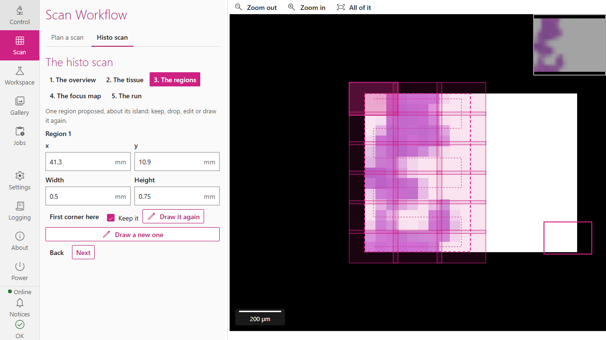
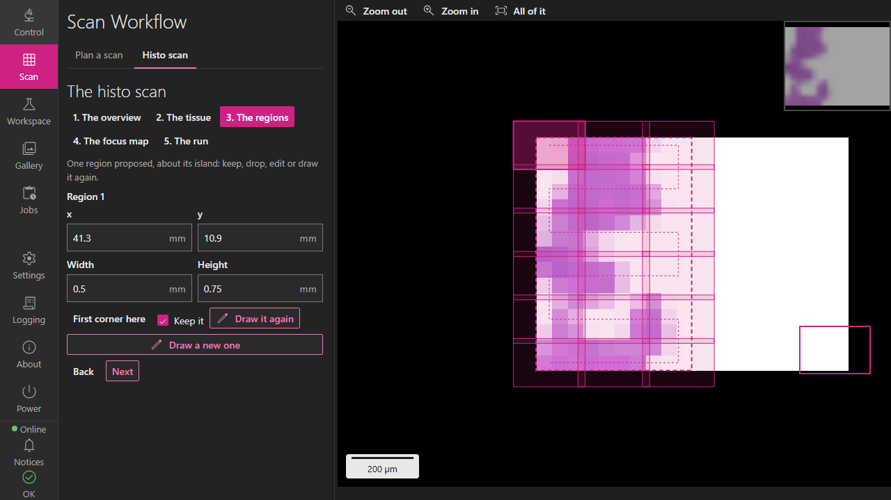

# W5.3: The histo scan

- Status: In review
- Branch / PR: `m2/w5.3-histo-scan` / [#110](https://github.com/lucaswewa/OScope/pull/110)
- Estimate: first 1,200, the spec's · second ~1,580 (code ~820, tests ~280, styles ~80, try-it ~360, glue ~40), in the plan's change log before the code, 32 % over the first · measured **1,200** hand-written lines changed (code 681, tests 133, styles 70, try-it 314, glue 2): 24 % under the second estimate, and the first's own. The histo session the unit tests read is recorded by a script, on one line (`recorded-histo.json`, 2 KB).

## Summary

A slide scanner's flow, step by step, on the scan tab's second tab, *Histo scan* ([spec](../phases.md#w5-3)):

1. **The overview,** W5.1's.
2. **The tissue** it found (P37): its islands, area and threshold.
3. **The regions:** one proposed about each island, then each kept, dropped, edited, or drawn again on the view; a new one drawn too.
4. **The focus map:** its grid, and its points on the overview, where the run will measure focus.
5. **The run,** W5.2's, of a snake over the regions kept. It measures the map before its first tile and shows it: each point's focus found, the surface fitted through them there, and how well it foretells focus.

Each step keeps what it had when going back, and a new overview proposes its own regions.

## What was built

In `web/src/features/scan/histo/`:

- **`HistoScan.vue`:** the steps, each step's pane, and the run's.
- **`flow.ts`:** the flow, which its pane and the scan's view share: the step, the regions, the map's grid.
- **`histo.ts`:** the steps' order and what each needs; the tissue's islands from the overview's runs; the regions kept as one mask; the map's points, as the scan engine chooses them; and the map's surface, evaluated as the server evaluates it.
- **`MapSaid.vue`:** the map the run measured.

Elsewhere:

- **`ScanTab.vue`:** two tabs, *Plan a scan* and *Histo scan*, the one open kept.
- **`ScanView.vue`:** in the histo scan, its regions, kept or dropped, and the map's points, planned or measured, over the overview; a drag draws a region again.
- **`planning.ts`, `plan.ts`:** a mask, which the plan's region then is.
- **`RunPane.vue`:** its focus left out where the flow chose it.
- **`ui/tile-viewer/`:** the look of a region dropped, and of a map's point.

The server already had all it needs: `scan/overview` and `last_overview`'s tissue (P37), a plan over a mask (P35), and a run that measures its map first (P37).

## How to try it

The try-its of W5 use the server built with CUDA, at the owner's choice: the simulated camera's frames on the GPU.

```sh
cargo build --release -p oscope-server --features cuda
npm --prefix web ci && npm --prefix web run build
target/release/oscope-server --config configs/oscope.toml --port 8211 --web web/dist
```

Open `http://127.0.0.1:8211/#/control` and take control. Press *Home*; then *Move to* x 40, y 12 and z 5 mm, over the tissue, press *Start*, and *Focus*. Fit the 5× under *The objective*. Then open `#/scan`, and its tab *Histo scan*:

1. **The overview:** type the region x 35, y 8.5, width 10.5 and height 7 mm, and press *Make the overview*: about a minute. *Next*.
2. **The tissue:** its islands, its area and its threshold. *Next*.
3. **The regions:** one about each island, outlined on the view. Untick *Keep it* on the small one: it is drawn fainter, and left out. Press *Draw it again* on the large one, and drag a rectangle of some 2 × 1.5 mm inside it. *Next*.
4. **The focus map:** 2 columns and 2 rows: its points, on the view, where the run will measure focus. On the Control tab, fit the 10× under *The objective*; back on the scan tab, the flow is where it was, its points closer. *Next*.
5. **The run:** choose a project, and press *Run the scan*. The run measures the map first, then takes the tiles. *The focus map* then says its surface, how well it fits, and each point's focus found beside the surface's there.

On the CUDA build, the overview took 63 s, 16 frames, and proposed two regions, 7.8 × 7.0 and 0.5 × 0.9 mm. The large one narrowed to 2 × 1.5 mm, the run of its 4 tiles took 12 min: the map's four autofocus runs, through the whole sensor, took most of it. Its plane missed its points by 0.02 µm rms. A camera region quickens the autofocus.

## Screenshots

| | Light | Dark |
|---|---|---|
| The regions proposed |  |  |

## Design notes and deviations from the plan

- **The focus map is measured by the run,** before its first tile, as P37's scan does, not by a step of its own. The focus step chooses the map's grid and shows where its points will be; the run's pane then shows each point's focus and the surface. A step measuring the map apart would need the server to measure and fit without scanning, and would measure it twice, or hand the app's map to the scan.
- **The tissue's islands are the app's,** from the overview's runs, joined where they touch, diagonally too: the server says where the tissue is, not its pieces.
- **The regions are rectangles,** one about each island, which a field or a drag edits. Kept, they become one mask in the overview's pixels over their bounds, which the snake plans over, as the *tissue found* pattern plans over the server's own mask.
- **The map's points are shown where the scan engine will measure:** the tile nearest each middle of the grid over the tiles' centres, as `scan/engine.rs` chooses them.
- **The surface is the server's, evaluated in the app:** its coefficients and kernel, as `focus_map.rs` evaluates them, to show the surface at each point beside its focus found.
- **The flow is a tab of the scan tab,** beside the plan: the view, the run and the scan's panes are the same.

## Tests

- **Unit, 8 new, 699 in all:**
  - **the steps:** each needs what the one before made;
  - **the tissue's islands:** runs joined where they touch, diagonally too, the largest first; kept apart where they only come near; proposed, each kept;
  - **the regions kept as one mask,** over their bounds, a cell in where its middle is, the glass between out;
  - **the focus map,** from a histo session recorded on the simulator: its points where the scan engine measured them; a plane at its centre and rising by its slopes along x and along y, near each point; a thin plate through each point.
- **End to end, 4 new, run 6 times across the browsers, 277 in all:**
  - **the regions proposed cover the tissue the overview found:** each of its pixels of tissue in one. In Chromium, Firefox and WebKit;
  - **an edited region is what is scanned:** the others dropped, the first narrowed, its map 2 × 2; each tile the run took is in it, and the map it measured is shown;
  - **axe,** at the regions, in both themes;
  - **the baseline:** the regions proposed, and the plan of them, on Windows and Linux. W5.1's and W5.2's baselines were made again, the tab bar new above them.
- **Mutation checks, 8, all caught, none hung:** islands not joined diagonally; the smallest first; a mask's cell by its corner; the regions' step without tissue; the map's grid by its corners; the thin plate's kernel doubled; the surface in µm; and the plane's slopes swapped. The last survived at first: the test now checks the slopes, as the server documents its coefficients.
- TWOCORE
- REPLAYS
- **Docs:** the relative links and anchors in the Markdown files resolve.

## Follow-ups and known gaps

- **A measured map's autofocus runs aren't in the plan's estimate:** P37's estimate counts an autofocus policy's, not a map's. The try-it's plan said none, and its four took most of its 12 min.
- **The regions are rectangles:** an island's outline, or a polygon drawn, would leave out less glass.
- **The map is measured by the run alone:** measuring it before, to look at, then scanning by it, would need the server to measure and fit without scanning.

## Clean room

Nothing was copied from `microscope` or any other codebase. The thin plate's kernel and solution are Bookstein's (1989), as P37's server has them. No package was added.
