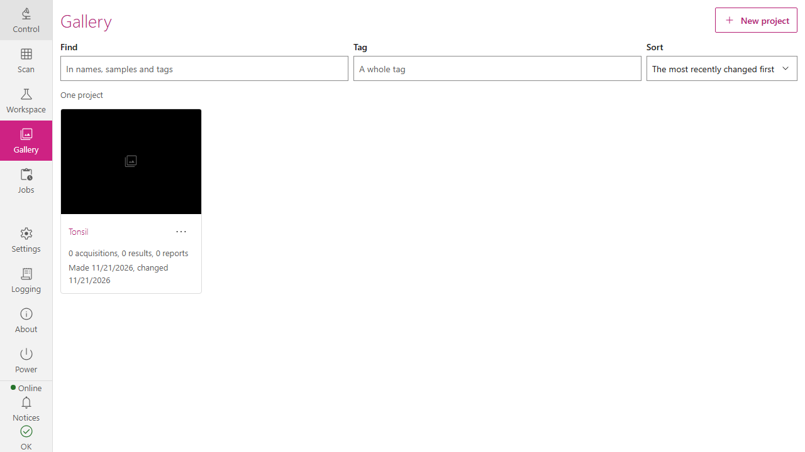
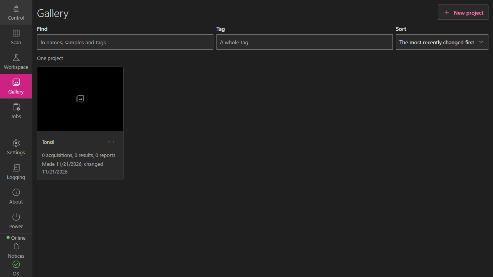

# W6.1: Projects

- Status: In review
- Branch / PR: `m2/w6.1-projects` / [#112](https://github.com/lucaswewa/OScope/pull/112)
- Estimate: first 1,500, the spec's · second ~1,740 (code ~850, tests ~300, styles ~150, try-it ~400, glue ~40), in the plan's change log before the code, 16 % over the first · measured **976** hand-written lines changed (code 537, tests 116, styles 131, try-it 192): 44 % under the second estimate, and 35 % under the first. The ui's cards, menus, dialogs, pages, skeletons and empty state were ready (W0.2–W0.5).

## Summary

The Gallery, `#/gallery`: every project as a card, found and kept in order (D16) ([spec](../phases.md#w6-1)).

- **Cards,** by pages: each project's newest image, its name, its sample, its description, its tags, when it was made and changed, and what it holds. They are kept live: a change from any client reads the page again.
- **Finding:** by text, in names, samples and tags; by a whole tag; sorted by the latest change, or by name.
- **Changing,** with the lease: made, renamed, tagged, described, given its sample, or deleted, a deletion asked first with what it takes.
- **The grid** is walked with the arrow keys, Home and End. It says so when it is empty, and shows skeletons while it loads.
- **Server work the spec didn't name:** the projects listed by name, as well as by date.

## What was built

In `web/src/features/gallery/`:

- **`GalleryTab.vue`:** the tab: finding, the grid, its pages, its live updates and the thumbnails; and the changes' dialog and question.
- **`ProjectCard.vue`:** a project's card, and the menu of its changes.
- **`gallery.ts`:** the pages, the grid's keys, the tags as typed, and what a deletion takes.

Elsewhere:

- **`api/projects.ts`:** the list's tag and order, and a project's thumbnail, none while it has no image.
- **`app/tabs.ts`:** the Gallery in its placeholder's place.
- **`oscope-store`:** the list's order, `sort=name`, by name in any case; the most recently changed first, as before, if not given.

## How to try it

On the CUDA build, as W5's notes say; the Gallery needs no camera, but a capture does:

```sh
cargo build --release -p oscope-server --features cuda
npm --prefix web ci && npm --prefix web run build
target/release/oscope-server --config configs/oscope.toml --port 8211 --web web/dist
```

1. **Open `http://127.0.0.1:8211/#/gallery`:** the projects made so far, as cards, the most recently changed first; with none, it says so, and offers *New project*.
2. **Make three:** *New project*, a name, *Save*.
3. **Tag two:** a card's menu, *Tags…*, `he, human` on one and `he` on another. Type `human` under *Tag*: one card. Clear it.
4. **Rename one:** its menu, *Rename…*. Choose *By name* under *Sort*.
5. **Walk the grid:** press Tab onto the first card, then the arrows, Home and End.
6. **Capture a frame in another window:** on its Control tab, home the stage, move over the tissue, *Start*, and *Capture* into one of the projects. Its card updates: its picture, and one acquisition.
7. **Delete one:** its menu, *Delete…*: the question says what goes with it.

On the CUDA build, by a script doing what the Gallery does: three projects listed by name, in any case, *Brain*, *kidney*, *Tonsil*; by their latest change; by a tag; and a project's thumbnail none until a frame was captured into it, then a JPEG, the project holding one acquisition.

## Screenshots

| | Light | Dark |
|---|---|---|
| The grid |  |  |

## Design notes and deviations from the plan

- **Sorting by name is the server's,** with paging: sorting a page in the app would order only what that page holds.
- **Kept live by reading the page again** at each `projects/changed`, a moment after the last: a change says which project, but a new one, a rename or a deletion can move every card of a page.
- **A thumbnail is read again only when its project changed,** and none is a placeholder: the server answers 404 for a project without images.
- **The changes share one dialog,** its one field named for the change; a description is the metadata's `description`.
- **The grid's focus is a roving one:** one card in the tab order, the arrows moving it, as the rail's tabs do.
- **The words are under `projects`:** `gallery` holds the development component gallery's.

## Tests

- **Unit, 9 new, 713 in all:** the grid's keys, by one along a row and by a row up and down, Home and End, none past an edge; a row's cards counted by how high they are; the pages, one at least, a page's start and the page an offset is on; the tags as typed; what a deletion takes; and a description.
- **Rust, 1 extended:** the projects listed by name, in any case, and paged so.
- **End to end, 6 new, run 8 times across the browsers, 290 in all:**
  - **a project made elsewhere appears,** the empty state before it. In Chromium, Firefox and WebKit;
  - **tags, a search by tag and a rename reach the server:** the server lists them so;
  - **a deletion asks first, saying what it takes;** cancelled, the card stays; confirmed, it goes;
  - **the grid is walked with the arrow keys,** Home and End;
  - **axe,** in both themes;
  - **the baselines:** the empty Gallery and a card, on Windows and Linux.
- **Mutation checks, 9, all caught, none hung:** no page for no projects; pages from 0; an offset a page late; up by one card; past the last; rows by exact heights; empty tags kept; kinds a project hasn't said; and, in the server, by name as by date.
- **Found by its own tests:** a card's name was a third-level heading under the page's first, which axe refused; and a deletion found no project, the question clearing it as it closed, before it said *confirm*.
- TWOCORE
- REPLAYS
- **Docs:** the relative links and anchors in the Markdown files resolve.

## Follow-ups and known gaps

- **A project's records** are W6.2's: the card opens nothing yet.
- **The tags typed are a field,** not chosen from those already used.

## Clean room

Nothing was copied from `microscope` or any other codebase. No package was added.
