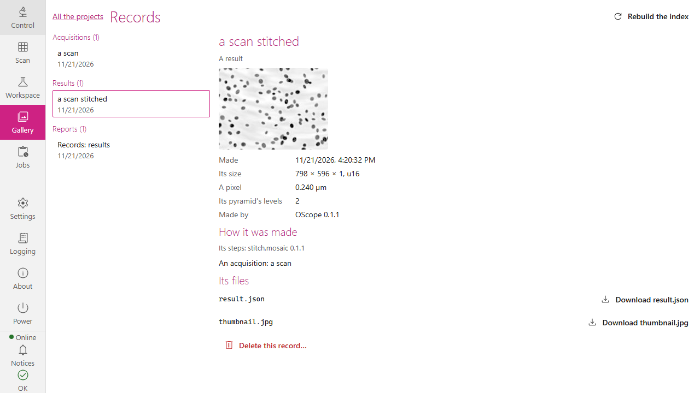
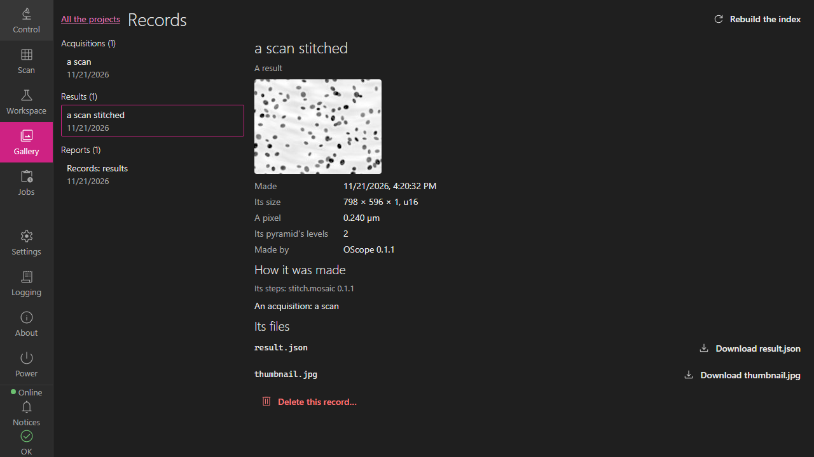

# W6.2: A project's records

- Status: In review
- Branch / PR: `m2/w6.2-records` / [#114](https://github.com/lucaswewa/OScope/pull/114)
- Estimate: first 1,400, the spec's · second ~1,630 (code ~800, tests ~250, styles ~120, try-it ~420, glue ~40), in the plan's change log before the code, 16 % over the first · measured 1,381: code 740, tests 164, styles 147, the try-it's 328, glue 2; 15 % under the second, 1 % under the first

## Summary

What a project holds, with each record's story, on its page in the Gallery, `#/gallery?project=…` ([spec](../phases.md#w6-2)):

- **The project's page:** its acquisitions, its results and its reports, each kind's newest first, opened from its card, and from a job's or a scan's result (W4.1, W5.2), which name the record too.
- **A record:** its thumbnail; when it was made, and the project's owner; its image's size and its pyramid's levels; an acquisition's camera, objective, calibration, and the stage's place at its first frame.
- **A result's provenance:** the recipe, its steps, and what it was made from, by name, with each input's hash (P48).
- **Downloads** of a record's files, its document, its thumbnail and a report's own, through the host adapter: each stopped, by its user or a lost connection, and resumed from where it was, by a range.
- **Deleting** a record, refused while a result was made from it; and rebuilding the index of every project.
- **Server work the spec didn't name:** any record deleted, as only results were (P48).

## What was built

In `web/src/features/gallery/project/`:

- **`ProjectPage.vue`:** the page: the records by kind, the chosen one's pane, kept live, and the index rebuilt.
- **`RecordDetail.vue`:** a record's pane: its picture, its details, a result's provenance, its files, and its deletion.
- **`DownloadRow.vue`, `download.ts`:** a file's download, its progress, stopped and resumed by a range, and saved through the host adapter.
- **`project.ts`:** the records by kind, each one's files, its details, and a result's provenance.

Elsewhere:

- **`features/gallery/`:** a card's name leads to its page; the Gallery opens a project's page when its address names one.
- **`api/projects.ts`:** a project's contents, and a record's thumbnail.
- **`oscope-store`, `oscope-api`:** `delete_record`, an acquisition, a result or a report, refused while a result was made from it; results' own deletion goes through it.

## How to try it

On the CUDA build, as W6.1's notes say:

```sh
cargo build --release -p oscope-server --features cuda
npm --prefix web ci && npm --prefix web run build
target/release/oscope-server --config configs/oscope.toml --port 8211 --web web/dist
```

1. **Scan into a project,** as W5.2's notes say: a small region over the tissue, run into a project. When it ends, *Stitch it*, then *Open it in the Gallery*: the project's page, its acquisition chosen.
2. **Make a report,** which no tab makes yet, with the project's ID from the page's address:

   ```sh
   curl -X POST http://127.0.0.1:8211/api/v1/jobs/submit -H 'content-type: application/json'      -d '{"kind":"report.make","params":{"project":"<its ID>"}}'
   ```

   It appears on the page, under *Reports*, kept live.
3. **Read the records:** the acquisition's picture, size, levels, frames, the camera's settings, the objective, its calibration and the stage's place; the result's *How it was made*, its steps, `stitch.mosaic`, and what it was made from, the scan by name; the report's files.
4. **Download a file:** *Download thumbnail.jpg*; it is saved whole. To see one stopped and resumed, slow the browser's network to a few kB/s in its developer tools, *Download*, *Stop*, then *Resume*: the file saved is the server's.
5. **Delete:** the acquisition, *Delete this record…*, *Delete the record*: refused, as the result was made from it. Delete the result, then the acquisition: both go, and the card's counts with them.
6. **Rebuild the index:** *Rebuild the index*: it says how many projects it found.

On the CUDA build, by a script doing what the page does: a scanned project's acquisition, the result stitched from it by `stitch.mosaic` 0.1.1, and a report; a thumbnail's second half read by a range, `206`, `bytes 5101-10202/10203`, the halves joined the whole; the acquisition's deletion refused, *… is what a scan stitched was made from: delete that first*; then the report, the result and the acquisition deleted, none left.

## Screenshots

| | Light | Dark |
|---|---|---|
| A result's page |  |  |

## Design notes and deviations from the plan

- **The project's page is the Gallery's, by its address,** `?project=` and `?record=`, the links W4.1 and W5.2 already made: no route of its own.
- **The account is the project's owner:** a record keeps no account of its own; what a job makes is its account's project's (P32).
- **A record's files are those that download whole:** its document, its thumbnail, and a report's own files. Its image is an OME-Zarr folder, which W6.3's exports make one file of.
- **A download keeps its bytes as they come:** stopped, by its user or by a connection lost part way, it asks for the rest by a range (RFC 9110 §14), which the data route answers (P30); a server that sent the whole file again starts it over.
- **The Gallery reads its page every ten seconds,** as well as at `projects/changed`: a change told before its socket listened is seen at its next look.
- **Deleting any record is the server's work this phase adds:** the store deleted only results. The same rule holds for each kind: refused while a result was made from it.

## Tests

- **Unit, 9 new, 722 in all,** from a project recorded on the simulator (`scripts/record-contents.mjs`): the records by kind; each one's files, a report's own among them; an acquisition's details, a scan's frames as its image's planes, its exposure and the stage's place; no owner said when there is none; a result's provenance, its steps and its input by name, an input's hash where one was read, and an input the project no longer holds by its ID; and a download's range, asked once some bytes came, the whole length read from a 206's range, and a 200 taken as the whole file whatever range it says.
- **Rust, 1 new:** any record deleted unless a result was made from it: an acquisition refused while its result is there; then a report, the result and the acquisition deleted, their folders gone; and a name not one of the project's, `..` among them, not found.
- **End to end, 5 new, run 7 times across the browsers; the full Windows run 297 passed, one skipped:**
  - **each kind of record is listed with its details,** a result's provenance and a report's files. In Chromium, Firefox and WebKit;
  - **a download's bytes are the server's file's;**
  - **a download cut short resumes by a range, whole:** its first answer cut at half its length, as a lost connection would; the next asks for the rest;
  - **axe,** in both themes;
  - **the baseline:** a result's page, on Windows and Linux. W6.1's baselines were made again, as a card's name is now a link.
- **Mutation checks, 9, all caught, none hung:** a download asked from the start; a whole file taken for the rest; reports left out; a report's thumbnail among its files; a scan's planes never said; inputs never named; hashes never said; and, in the server, a record a result was made from deleted, and any name deleted, not only the project's. The second survived at first: a test of a 200 that says a range catches it.
- **Found by its own tests:** a stitch's provenance hashes nothing, which the page took for granted; a scan's size left out its planes; and, in WebKit, a project made just before the Gallery's socket listened was missed: the Gallery now reads its page every ten seconds as well.
- **Two cores, five times:** TWOCORE
- **The replays:** REPLAYS
- **Docs:** the relative links and anchors in the Markdown files resolve.

## Follow-ups and known gaps

- **The record's image** opens in W6.4's deep-zoom viewer.
- **A record's own account** isn't kept: the project's owner is said.

## Clean room

Nothing was copied from `microscope` or any other codebase. No package was added.
