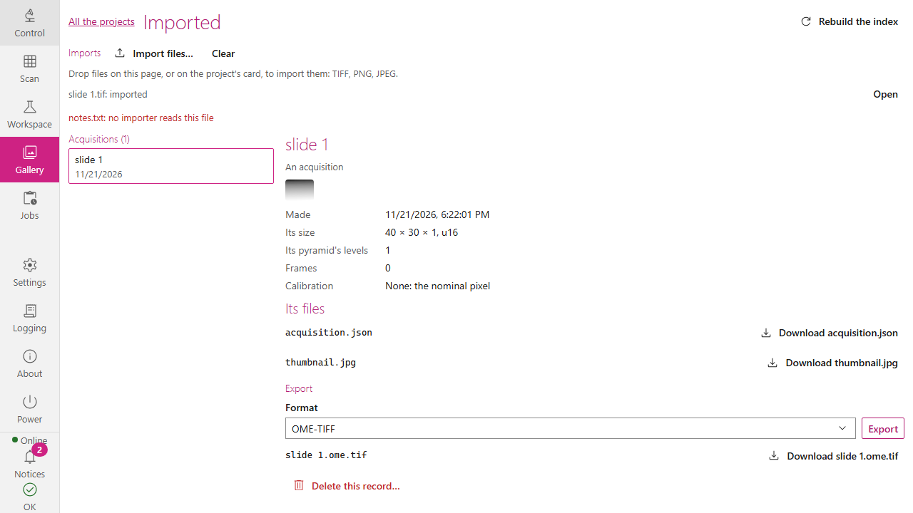
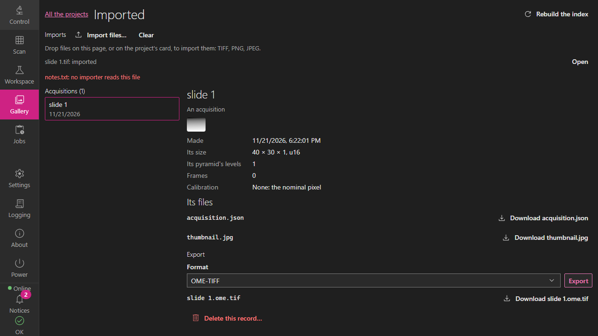
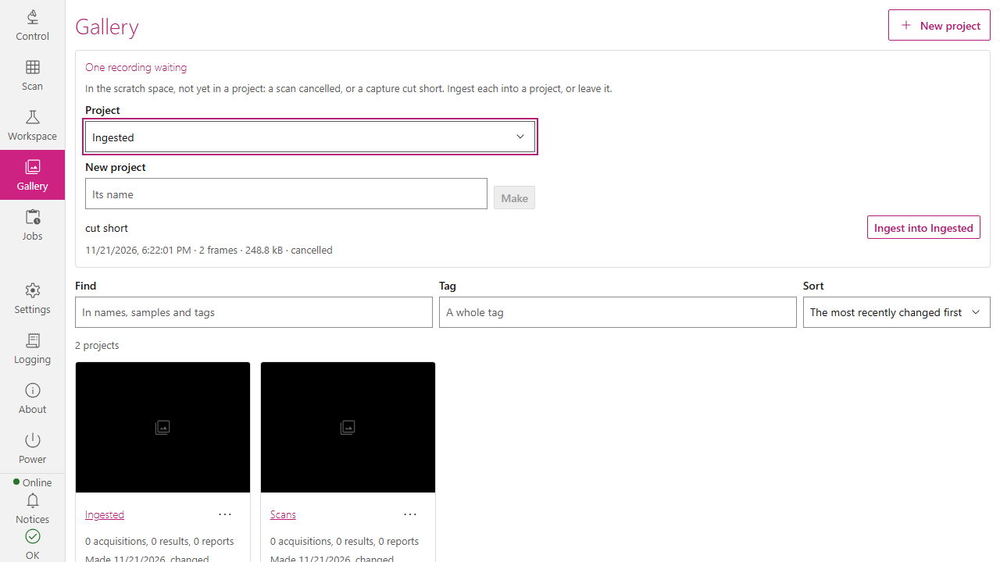
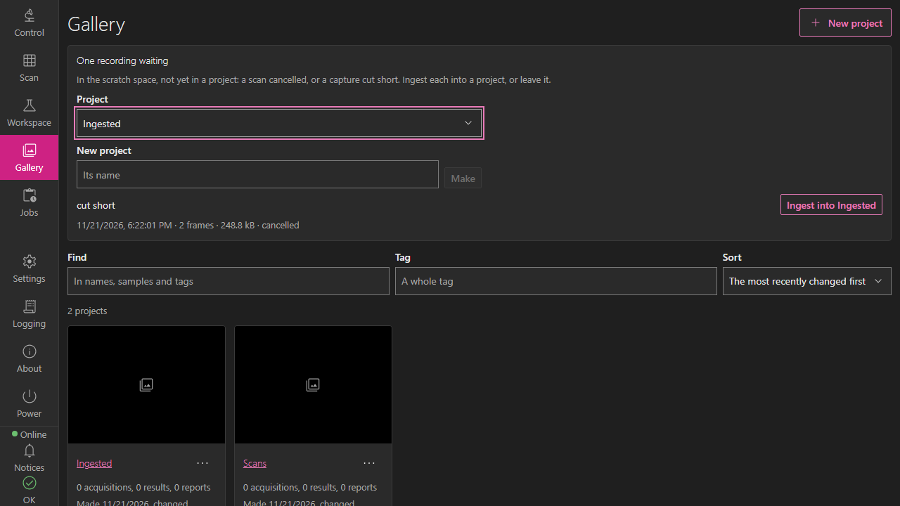

# W6.3: Imports, exports and uploads

- Status: In review
- Branch / PR: `m2/w6.3-files` / PRNUMBER
- Estimate: first 1,500, the spec's · second ~1,850 (code ~850, tests ~400, styles ~100, try-it ~450, glue ~50), in the plan's change log before the code, 23 % over the first · measured **1,980** hand-written lines changed (code 1,036, tests 523, styles 140, try-it 281), 7 % over the second, 32 % over the first: the route's module and its tests, 641 lines, are a third of it

## Summary

Files go into a project from its user's computer, and come out of it in the formats other software reads ([spec](../phases.md#w6-3)):

- **Uploads:** the server's upload route, which P30 left to Milestone 2 (ADR-0051). Files are staged in the scratch space, limited in size, need the lease, and are removed once used or after a day.
- **Imports:** a TIFF or its stack, a PNG or a JPEG, dropped on a project's card or its page, or chosen. Each is uploaded with its progress, then read into an acquisition by the `projects.import` job, followed to its end.
- **Exports:** a record's image as OME-TIFF, 16-bit TIFF or PNG, or in an extension's format, by the `projects.export` job, then downloaded.
- **Recordings waiting** in the scratch space: each ingested into a project chosen, by the `projects.ingest` job, or left.

## What was built

The server:

- **`oscope-api`'s `upload.rs`:** the route, `POST /api/v1/upload/{name}`, on the media plane: the name checked, the size limited, room kept on the scratch disk, the file written in `tmp/` and moved into `uploads/<id>/` once whole, and the staged files swept.
- **`files.rs`:** `projects.import` reads an `upload` as well as a `path`, and removes the upload once it has imported it.
- **The `system` Thing's `recordings`:** the recordings waiting, which `scratch` only counted.
- **`Api::uploads`:** the limit and the lifetime, 16 GiB and a day by default.

The app, in `web/src/features/gallery/`:

- **`imports.ts`:** the imports, kept while their user looks elsewhere, each uploaded, then imported; and an export's file, from its job's result.
- **`drop.ts`:** a drop target for files, on a project's card and on its page.
- **`project/ImportPane.vue`:** a project's imports, with their progress, stopped, and opened.
- **`project/ExportPane.vue`:** a record's export, its format, and its download.
- **`RecordingsWaiting.vue`:** the recordings waiting, at the top of the Gallery, each ingested into the project chosen.
- **`api/projects.ts`:** the formats, an upload, and the recordings waiting.

## How to try it

On the CUDA build, as W6.1's notes say:

```sh
cargo build --release -p oscope-server --features cuda
npm --prefix web ci && npm --prefix web run build
target/release/oscope-server --config configs/oscope.toml --port 8211 --web web/dist
```

1. **Open `http://127.0.0.1:8211/#/gallery`,** and make a project, *New project*.
2. **Drag a TIFF from the desktop onto its card:** the card says *Importing one file…*, then holds one acquisition. Any 8- or 16-bit TIFF, a stack among them, or a PNG or a JPEG.
3. **Open the project's page,** and drop another file on it: under *Imports*, it uploads with its progress, then imports. *Open* chooses the acquisition it made. A file no importer reads, a `.txt`, is refused there and then.
4. **Choose files instead,** with *Import files…*. A large one may be stopped while it uploads, with *Stop*.
5. **Export the acquisition:** under *Export*, choose *OME-TIFF*, then *Export*. When its job ends, *Download* saves the file: open it in Fiji or QuPath.
6. **Leave a recording waiting:** on the Scan tab, run a scan into a project and cancel it part way (W5.2's notes). Back in the Gallery, *One recording waiting* is at the top: choose a project, then *Ingest into …*. The section goes, and the project holds the recording's acquisition.

On the CUDA build, by a script doing what the app does: a 16-bit TIFF of 1200 × 900 uploaded, 201, and imported, an acquisition of 3 levels; the same upload imported again, refused, *no upload is …*, as it had gone once used; the acquisition exported as OME-TIFF, `slide 1.ome.tif`, read back from the data route, `II*`, its OME-XML in it; `..%2Fout.tif`, `.hidden` and `CON.tif` refused, 400 each; and a scan cancelled after its first tile, its recording waiting, *cut short, 2 frames*, then ingested: none waiting after, the project holding two acquisitions.

## Screenshots

| | Light | Dark |
|---|---|---|
| A project's imports and an export |  |  |
| A recording waiting |  |  |

## Design notes and deviations from the plan

- **The route is the plan's, on the media plane** (§5.4): `POST /api/v1/upload/{name}`, the file as the request's body, as W1.3's `send` sends it, with its progress. ADR-0051 says why not a form.
- **The lease comes with the media plane:** teta-wot's authoriser sees a merged route's `POST` as a change, so the route needs no check of its own.
- **An import goes on while its user looks elsewhere:** the imports are the app's, not a page's. The card and the page both say them.
- **A file no importer reads is refused before it is sent,** by how its name ends, as the server's importers choose.
- **An export's formats are those that write a file:** a deep zoom folder (`dzi`) is the viewer's, W6.4's.
- **A failed import leaves its upload** for another try within the day; a used one goes.
- **A project's page reads the project again as each of its imports ends:** a job's records aren't told as `projects/changed`.
- **A sweep judges a folder by its file's time,** or, before its file has come, by its own: one upload's sweep never takes another's folder as it is made. The hourly sweep's first is an hour after the start's.
- **Server work the spec named:** the route. **And one it didn't:** the recordings waiting listed, which `system/scratch` only counted.

## Tests

- **Unit, 10 new, 732 in all:** the files the importers read, by how a name ends, in any case, and the chooser's types, each once; the record a job made, of the kind asked; an export's file, in its project only; the exporters that write a file, a deep zoom folder not among them; and an import's way, on a stand-in server: uploaded with its progress then imported, its acquisition said; refused, never sent; stopped; failed, saying why; and cleared once it ended, not while it goes.
- **Rust, 6 new, 1 extended:**
  - **an upload is staged, imported into a project, then removed:** its bytes as sent, its name kept, a day to wait; the import's acquisition; and an import of an upload gone, of none, or of a path besides, refused;
  - **the route's refusals:** a file over the limit, as it came and as its length said, 413; a name that isn't one plain part, 400: `..%2Fout.tif`, `%2E%2E`, `a%5Cout.tif`, `.hidden`, `c%3Aout.tif`, `NUL.tif` and `%00`, nothing staged and nothing written outside; and no room on the scratch disk, 507;
  - **the lease:** without a session, 401; logged in without the lease, 403; with it, 201;
  - **the lifetime:** a day's leaves the last upload be; none's sweeps it at the next upload, and at the next start;
  - **the contract, an upload cut short leaves nothing staged:** over a socket of its own, eight MiB said, one sent, and the connection lost;
  - **a name's rule,** a unit test in the route's module;
  - **the `system` Thing's properties,** `recordings` among them.
- **Contract, 1 new:** the formats, a file staged and the recordings waiting, as the app's wrappers written by hand have them.
- **End to end, 8 new, run 9 times across the browsers; the full Windows run 307 passed, one skipped:**
  - **a TIFF dropped on a project's page is uploaded and imported,** its acquisition listed and opened, and a `.txt` refused. In Chromium, Firefox and WebKit;
  - **a TIFF dropped on a project's card is imported into it,** and not into another;
  - **an upload stopped is said so,** and imports nothing;
  - **an export's file downloads,** a PNG, the server's bytes;
  - **a recording waiting,** a scan cancelled, is ingested into the project chosen; axe on the Gallery with it, in both themes;
  - **axe** on a project's imports and an export, in both themes;
  - **the baselines:** a project's imports and an export, on Windows and Linux. W6.2's page's were made again, as the page has both now.
- **Mutation checks, 15, all caught, none hung:**
  - **in the server:** a cut-short upload's part kept; separators let through; hidden names let through; the limit kept only as said; the reserve ignored; the sweep taking nothing; a used upload kept; and an import of a path and an upload both;
  - **in the app:** any name holding an extension taken as readable; the chooser's types repeated; a job's record of any kind; an export of any project's; a folder among the exporters; a stop said as a failure; and imports cleared while they go.
  - **The cleanup broken on purpose** (CLAUDE.md): the cut-short upload's part kept, the contract test alone failed, *nothing is left of it*.
- **Found by its own tests:** a project's page didn't list what its import made, as a job's records aren't told as `projects/changed`: the page now reads the project again as each import ends. And on Windows, a folder's listing gives a file being written a size of 0: the contract test reads the file's own.
- **Two cores, five times:** TWOCORE
- **The replays:** REPLAYS
- **Docs:** the relative links and anchors in the Markdown files resolve.

## Follow-ups and known gaps

- **The desktop app's window** must let the page have its drops: Tauri's own file drop is turned off there (W9.1).
- **An upload isn't resumed:** one cut short is sent again. A resumable protocol can come behind the same IDs (ADR-0051).
- **Recordings waiting can't be deleted from the app:** they are raw data, and only ingest deletes them (ADR-0022).

## Clean room

Nothing was copied from `microscope` or any other codebase. The test's TIFF is written by hand from the TIFF 6.0 specification's baseline fields (Adobe, 1992). No package was added.
