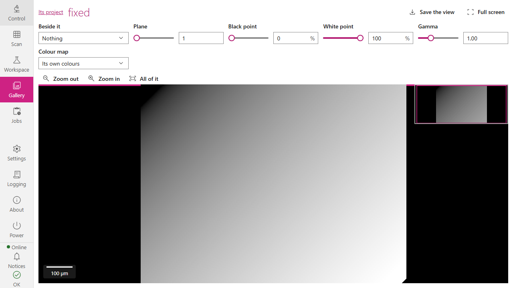
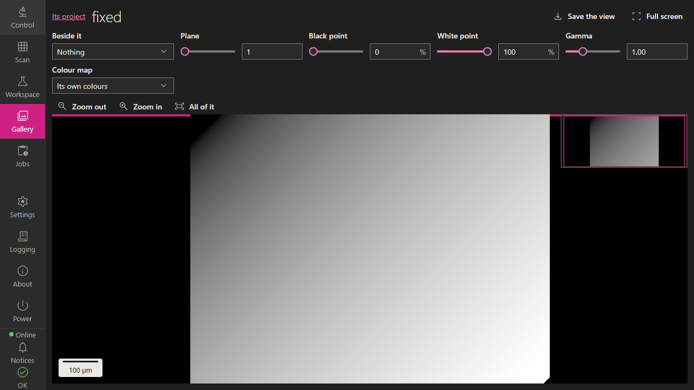
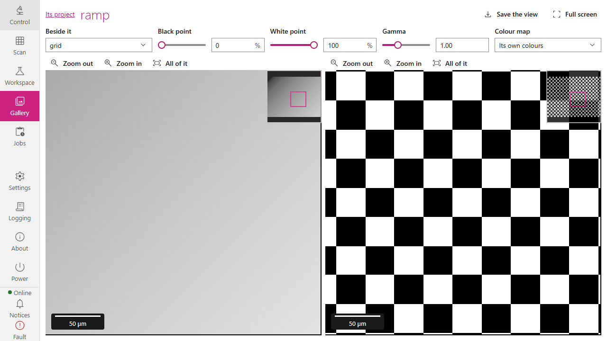
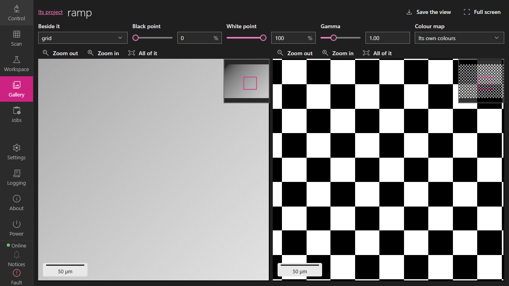

# W6.4: The deep-zoom viewer

- Status: In review
- Branch / PR: `m2/w6.4-deep-zoom` / PRNUMBER
- Estimate: first 1,600, the spec's · second ~2,000 (code ~950, tests ~300, styles ~150, try-it ~550, glue ~50), in the plan's change log before the code, 25 % over the first · measured **1,077** hand-written lines changed (code 488, tests 120, styles 57, try-it 412), 46 % under the second, 33 % under the first: the tile viewer had most of what the spec asks, and the server all of it

## Summary

Any image in a project, from the whole slide down to its pixels (D33; [spec](../phases.md#w6-4)):

- **The tile viewer on a record:** its tiles made on demand by the server (ADR-0028), with a navigator, the scale bar, the pointer's place in µm, and full screen.
- **Its look:** the black and white points and gamma, made by the server; and a colour map for one channel, applied in the app.
- **A stack's planes:** a slider through them.
- **Two records side by side,** their views linked on the stage.
- **A region not seen before** shows its coarse level at once, then sharpens. Its time to sharpen, full screen, is measured below.
- **A region exported:** the view, as it is drawn, saved as a PNG.

It ends Stage W6 with Checkpoint J.

## What was built

In `web/src/features/gallery/viewer/`:

- **`ViewerPage.vue`:** the viewer's page, the Gallery's at `?project=…&record=…&view=1`, with `&beside=…` for another record. It holds the look's controls, full screen, the view saved, and the views linked.
- **`RecordViewer.vue`:** a record's image in the tile viewer, its tiles in the look asked, a one-channel image's through its colour map.
- **`viewer.ts`:** the Deep Zoom levels, the look asked of the server, a colour map on a tile's pixels, the records with an image, a record's place on the stage, and two views near enough to be one.

Elsewhere:

- **`ui/tile-viewer/`:** the viewer says its view on the stage as its user moves it, and follows another's by its `fit`. It marks, `data-sharp`, whether the tiles in view have all come, and gives its view as a PNG.
- **`features/gallery/`:** a record's pane links to its viewer, and the Gallery opens the viewer when its address names a record to view.
- **`tests/e2e/tiff.ts`, `records.ts`:** TIFFs and stacks written for the tests, and records made by the API, shared with W6.3's spec.

## How to try it

On the CUDA build, as W6.1's notes say:

```sh
cargo build --release -p oscope-server --features cuda
npm --prefix web ci && npm --prefix web run build
target/release/oscope-server --config configs/oscope.toml --port 8211 --web web/dist
```

1. **A stitched slide:** scan a region into a project and stitch it, as W5.2's notes say, or use Checkpoint I's (W5.4).
2. **Open it:** on the project's page, choose the stitched result, then *View it, deep-zoomed*.
3. **Zoom from the whole mosaic to single nuclei:** *Zoom in*, or the wheel. The navigator says where the view is, the scale bar its scale, and the pointer's place is said in µm. *All of it* shows the whole again.
4. **Full screen:** a region never seen comes coarse at once, then sharp.
5. **Beside it:** choose the scan's acquisition. Pan either: the other follows, on the stage. *Plane* walks the acquisition's tiles.
6. **Its look:** *White point* and *Gamma*, let go, bring the tiles in the new look. On a one-channel image, choose a *Colour map*.
7. **Save the view:** a PNG of the region in view.

On the CUDA build, by a script doing what the app does: a scan of 9 tiles over the tissue through a 960 × 648 region, stitched into a mosaic of 2680 × 1806 pixels, in 4 s. The mosaic's middle tile came at each of its 13 Deep Zoom levels, cold, in 1–8 ms each. The acquisition's 9 planes each gave a tile of their own.

## Checkpoint J

A scanned slide, found in the Gallery, read, viewed at every zoom, a region of it exported, and a TIFF imported beside it: Milestone 1's Checkpoint E, in the app.

### The demo

On the CUDA build, as above, after Checkpoint I's demo (W5.4's notes), whose scan and stitch made the project.

1. **Find the project:** open `http://127.0.0.1:8211/#/gallery`. Type part of its name under *Find*: its card, its picture the mosaic's.
2. **Read its records:** open it. Choose the acquisition: its size, frames, camera, objective, calibration and the stage's place. Choose the stitched result: *How it was made*, from the acquisition, by `stitch.mosaic`.
3. **View the mosaic at every zoom:** on the result, *View it, deep-zoomed*. *Zoom in* to its pixels, a single nucleus filling the view; *Fit* for the whole mosaic again. *Full screen*, then Escape.
4. **Its look:** move *White point* to 60 % and *Gamma* to 0.7: the tiles come again in the look.
5. **Beside it:** under *Beside it*, choose the scan's acquisition. Pan the mosaic: the acquisition's tile follows, on the stage; move *Plane* through its tiles.
6. **Export a region:** pan to a region, and *Save the view*: a PNG of it, as drawn. Back on the project's page, export the whole mosaic too, as OME-TIFF, and download it (W6.3).
7. **Import a TIFF:** drag a TIFF from the desktop onto the project's page: it uploads, imports, and is listed. *View it, deep-zoomed*.

As run on the CUDA build, by a script doing what the app does, its project made as above: *Checkpoint J slide* found by *Checkpoint*, holding one acquisition and one result. The acquisition is 960 × 648 × 9 planes, a pixel 0.240 µm, its first frame at 39.794, 11.861 mm. The result, *the slide stitched*, is 2680 × 1806, by `stitch.mosaic` 0.1.1, its tiles served at every level. Its OME-TIFF export was 9.7 MB, and a TIFF of 2048 × 1536 imported beside it: the project then held two acquisitions and one result.

### The checklist

- [ ] The project is found by its name; its card shows the mosaic.
- [ ] The acquisition's details and the result's provenance are said.
- [ ] The mosaic zooms from all of it to its pixels, sharpening as it goes; *Fit* shows all of it.
- [ ] Full screen fills the screen, and Escape leaves it.
- [ ] The white point and gamma change the tiles; a colour map colours a one-channel image.
- [ ] Two records side by side move together; the plane slider walks a stack.
- [ ] *Save the view* saves a PNG of the region in view; the whole record exports and downloads.
- [ ] A TIFF dropped on the project imports, and is viewed.

## Screenshots

| | Light | Dark |
|---|---|---|
| A slide deep-zoomed |  |  |
| Two records side by side, linked |  |  |

## Performance

§5.20 asks that a full-screen view of a region never seen be sharp within 150 ms, on a LAN. P40 measured the server's part, 46–49 ms. W6.4 measures it in the app, on the owner's PC:

- **the CUDA release build,** over localhost, as P40's LAN was;
- **Chromium,** 1920 × 1080, full screen, with motion reduced, so that a jump has no animation;
- **an imported image of 8192 × 6144 16-bit pixels,** zoomed in five steps from all of it, about two screen pixels to one of the image;
- **20 jumps by the navigator,** each a fifth of the image from the last, more than a screen, to tiles never made: timed from the click until all the viewer's tiles in view have come (OpenSeadragon's fully loaded state, `data-sharp`).

| | Median | Slowest |
|---|---|---|
| Three runs | 88–89 ms | 106–108 ms |
| One tile a frame, OpenSeadragon's default | 622 ms | 754 ms |

- **One tile a frame was most of the time:** OpenSeadragon starts one tile's load each frame by default, so a full screen's twenty or so took twenty frames. The tile viewer now starts 8 a frame, and the browser queues them on its 6 connections. That helps the live mosaic and the scans' views too.
- **The measurement is `viewer.spec.ts`'s `@perf` test,** skipped unless `OSCOPE_PERF=1`: `OSCOPE_SERVER_BIN=target/release/oscope-server.exe OSCOPE_PERF=1 npx playwright test --project=chromium viewer.spec.ts -g "150 ms"`.

## Design notes and deviations from the plan

- **The viewer is the Gallery's, by its address,** `?project=…&record=…&view=1`, as W6.2's project page is: no route of its own.
- **A record is placed on the stage from what it says:** an acquisition's plane about its frame's place, a scan's planes being its tiles. A result is placed at the first frame of the acquisition it was made from, as a stitched mosaic starts at its first tile (P39). The registration's shift of that tile, a few pixels, isn't kept with the result. A record with neither is placed at the stage's origin, its pixels a µm each where it has no size.
- **Two views are linked on the stage:** each says its view as its user moves it, and the other looks there. The one followed doesn't say its own view, so they don't chase one another.
- **One look for both views:** the black and white points are fractions of each image's range, so one setting suits both. The plane is each one's own, up to its planes.
- **The colour map is the app's:** the server makes a look's tiles, and a one-channel image's are mapped through the live view's tables (W3.6) as they come. That needs no server work, and a change of map refetches nothing the server hasn't made.
- **A region is exported as the view:** a PNG of what is drawn, through the host adapter, as the live view saves its own. The whole record exports in its formats (W6.3).
- **The sliders ask the server on release,** not as they move: a look's tiles are made anew.
- **The tile viewer starts 8 tiles a frame,** not OpenSeadragon's one: the measurement above.
- **The navigator's own tiles aren't waited for:** the viewer's sharpness is its main view's.

## Tests

- **Unit, 10 new, 742 in all:** the Deep Zoom levels, as the server counts them; the look asked of the server, plain, its plane kept among the image's, and black below white; a look's tiles told from another's, a colour map's among them; a tile's grey through a colour map, its alpha its own; the records with an image; an acquisition's plane placed about its frame, a stitched result at its acquisition's first frame, and the stage's origin where nothing places a record; and a view's rectangle of the stage, back from the viewport's.
- **End to end, 7 new and the measurement, run 8 times across the browsers:**
  - **an image's tiles arrive for each level** as it is zoomed into, from the coarsest drawn to its pixels, each answered 200. In Chromium, Firefox and WebKit;
  - **a stack's slider changes the plane** its tiles are of;
  - **two records side by side move together:** zoomed on the first, the second's scale is the first's; dragged on the second, each view's middle is the same place;
  - **a colour map colours a one-channel image,** and the view is saved as a PNG;
  - **axe,** two records side by side, in both themes;
  - **the baseline:** a fixed slide, on Windows and Linux, its navigator masked. W6.2's and W6.3's were made again for a record's new link;
  - **the measurement,** above, with `OSCOPE_PERF=1`.
- **Mutation checks, 11, all caught, none hung:** the levels one short; the plane not kept among the image's; black above white let be; the look always plain; the map left out of the tiles' key; blue left grey; results without an image viewed; a frame's place taken for its corner; a result placed by its own size; every plane at the first frame; and a view's size left in the viewport's units.
- **Found by its own tests:**
  - *Nothing* beside it was an empty value, which reka-ui's lists refuse: the tab stopped. It has a value of its own now.
  - Linked views settled a fraction apart. A view near enough to the one last followed was left out, and a pan's last small steps with it. A view following says nothing back, so nothing is left out now.
  - An acquisition's frames were looked up by its ID in the project, not read from the record given.
  - The measurement found OpenSeadragon's one tile a frame.
  - The baseline showed the sliders' names said but not shown: each is now in a field with its label. It also showed the navigator's own tiles arriving a level more or less from run to run, so the navigator is masked.
- **Two cores, five times:** TWOCORE
- **The replays, in full, for Checkpoint J:** REPLAYS
- **Docs:** the relative links and anchors in the Markdown files resolve.

## Follow-ups and known gaps

- **A result's place on the stage** is its acquisition's first frame's: the stitch's own placement isn't kept with the result.
- **A region exported at full resolution** isn't offered: the view is saved as drawn, or the whole record exported.
- **The desktop app** reads tiles from the disk in W9.4.

## Clean room

Nothing was copied from `microscope` or any other codebase. The colour maps are W3.6's, from their published tables. No package was added.
