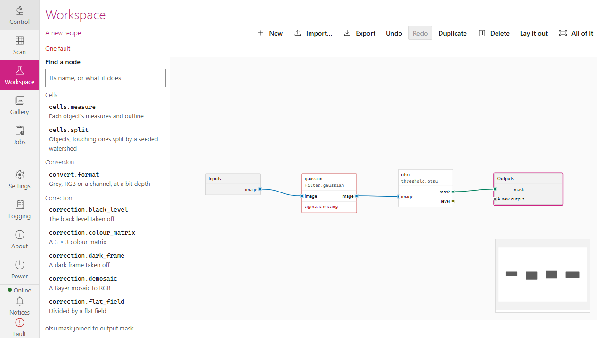
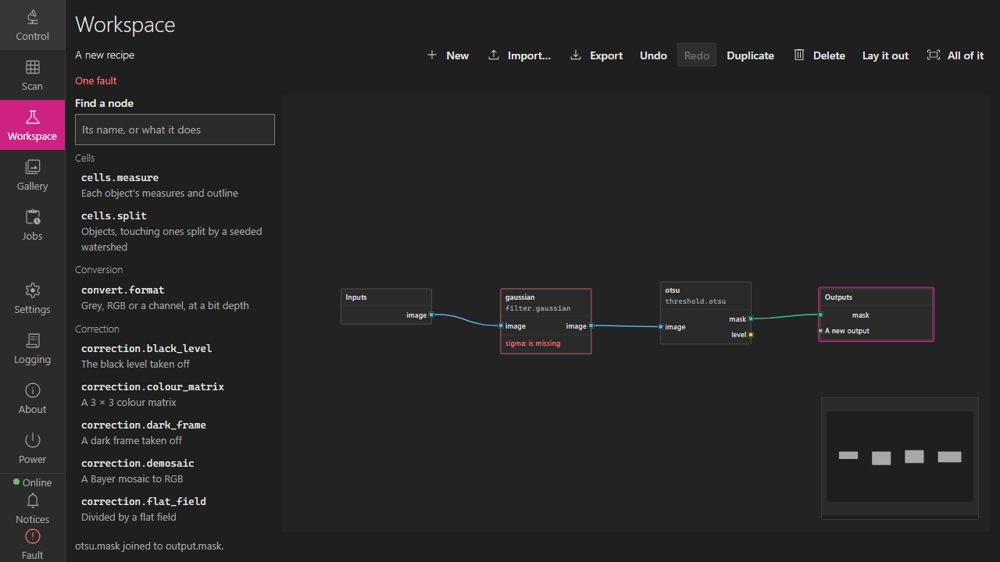

# W7.2: The graph editor: the canvas

- Status: In review
- Branch / PR: `m2/w7.2-graph-canvas` / [#120](https://github.com/lucaswewa/OScope/pull/120)
- Estimate: first 2,000, the spec's · second ~2,380 (code ~1,150, tests ~450, styles ~200, try-it ~500, glue ~80), in the plan's change log before the code, 19 % over the first · measured 2,170 (code 1,185, styles 336, tests 325, try-it 299, glue 25), 9 % under the second; 37 lines generated besides, the two snapshots and the recorded catalogue

## Summary

A recipe drawn and edited as a graph, in the Workspace (D12; [spec](../phases.md#w7-2); [ADR-0053](../../adr/0053-the-graph-editor-on-vue-flow.md)):

- **On Vue Flow:** nodes from the catalogue, through a palette that searches. Ports are coloured by their type, and a connection between unlike types is refused as it is dragged.
- **Edits:** delete, duplicate, copy and paste, undo and redo, an automatic layout, and a minimap.
- **From the keyboard:** the focus moves between the nodes and their ports, and a connection is made from an output's button to an input's.
- **The recipe and the graph are one:** each loads from the other without loss. A recipe's file is imported and exported.
- **`check` runs as the graph changes** (W7.1). Its faults show on the nodes and ports they name.
- **Server work the spec didn't name:** a recipe keeps its nodes' places, in an optional `layout`, which the engine ignores.

## What was built

In `web/src/features/workspace/`:

- **`WorkspaceTab.vue`:** the Workspace's page, the editor on it. The tab was a placeholder.
- **`editor/RecipeEditor.vue`:** the editor: its tools, its keys, the palette and the canvas, and `check`'s faults.
- **`editor/GraphCanvas.vue`:** the canvas on Vue Flow: the recipe drawn, and what is done to it given back as an edit.
- **`editor/GraphNode.vue`:** a node: its ports coloured by type, each a handle and a button, and its faults.
- **`editor/NodePalette.vue`, `palette.ts`:** the catalogue by category, searched.
- **`editor/graph.ts`:** the model: the recipe as a graph and back, the types' rule, every edit, and the keyboard's connection.
- **`editor/history.ts`, `layout.ts`, `editing.ts`, `recipeFile.ts`:** undo and redo; the automatic layout; `check` as the recipe changes; and a recipe's file read.

Elsewhere:

- **`oscope-pipeline`:** a recipe's `layout`.
- **The lint's rule:** Vue Flow and dagre only in the editor's folder (ADR-0053).
- **The packages:** Vue Flow 1.48.2, its minimap 1.5.4, and `@dagrejs/dagre` 3.1.3.

## How to try it

On the CUDA build, as W6's notes say:

```sh
cargo build --release -p oscope-server --features cuda
npm --prefix web ci && npm --prefix web run build
target/release/oscope-server --config configs/oscope.toml --port 8211 --web web/dist
```

1. **Open `http://127.0.0.1:8211/#/workspace`:** an empty recipe, *One fault*: it gives nothing.
2. **Add nodes:** under *Find a node*, type `gaussian`, and press *filter.gaussian*; then `otsu`, and *threshold.otsu*.
3. **Connect them by dragging:** from *Inputs*' `image` to the gaussian's `image`, from the gaussian's `image` to otsu's `image`, and from otsu's `mask` to *Outputs*' *A new output*. Each line takes its port's colour.
4. **Connect two unlike ports:** drag otsu's `mask` onto the gaussian's `image`: the line turns red, and it doesn't join.
5. **Break the graph:** the gaussian shows its fault where it is, its `sigma` not set; W7.3's form sets it. Delete the edge into otsu: otsu's `image` turns red, and the fault says so.
6. **From the keyboard:** Tab to an output's name, Enter; Tab to an input's, Enter. The line under the canvas says what was joined, or why not. A node, focused, Enter selects it, and Delete deletes it; Ctrl+Z brings it back, and Ctrl+Y takes it again. Ctrl+C, Ctrl+V and *Duplicate* copy.
7. **Lay it out, then Export:** a JSON file. *New*, then *Import…* the file: the same graph, where it was. A file without `layout`, written by hand, is laid out as it comes in.

## Screenshots

| | Light | Dark |
|---|---|---|
| A recipe as a graph |  |  |

## Design notes and deviations from the plan

- **The recipe is the graph** (ADR-0053): every edit is a function from a recipe to the next. Undo and redo keep recipes, and the canvas draws whatever recipe it is given.
- **A recipe keeps its nodes' places,** in `layout`: server work the spec didn't name, a small one. Without it, the graph and the recipe couldn't each load from the other without loss. A recipe without one, imported, is laid out automatically.
- **The recipe's inputs and outputs are nodes,** `input` and `output`. Joining an output to the outputs' *A new output* makes an output named after its port.
- **The keyboard's connection is two presses:** an output's button, then an input's. A live region says each step, and why a connection is refused.
- **Copy and paste stay in the app:** the host adapter can write the clipboard but not read it.
- **`check` runs 300 ms after the last edit:** each drag's end, or a key, doesn't ask the server at once.
- **W7.3 adds the library:** open, save and delete by name, and the node's parameters' form. Here a recipe is imported and exported as a file.

## Tests

- **Rust, `oscope-pipeline`, 1 new:** a recipe's `layout`, kept when it is read and written, left out when empty, and ignored by `check` and the plan.
- **Snapshots, 2 changed:** the `preview` and `workspace` Things' descriptions, whose recipes now have `layout`.
- **Unit, 20 new,** on the catalogue and stock recipes recorded from a real server (`web/scripts/record-pipeline.mjs`):
  - every stock recipe drawn and read back without loss; the two ends; each fault on its node and port, a parameter's named;
  - the types' rule, the ends' rules, and a new output of any type;
  - each edit: a node added, an input joined in place of what it took, nodes deleted with their edges, a move that isn't one, copy and paste;
  - the keyboard's path, joined and refused;
  - undo and redo, an edit cutting off what was undone, and the last hundred kept;
  - the palette's search; a recipe's file read, refused, and written in one order; and the automatic layout's order.
- **End to end, `editor.spec.ts`, 7 new,** in Chromium, two of them in Firefox and WebKit too:
  - a graph built by hand, from the keyboard, its parameter's fault shown;
  - a connection between unlike ports refused as it is dragged, and from the keyboard, saying why;
  - a broken graph's faults on its node and port, then gone;
  - the keyboard's path: a node reached, selected, deleted, brought back and deleted again;
  - a recipe exported, a new one started, and the file imported, then exported the same;
  - axe, in both themes; and a graph's baseline, on Windows and on Linux, each passing 3 of 3.
- **Found by its own tests:**
  - a node's input and output of one name, such as the blur's `image`, were one place to the tests: an input and an output are marked apart now;
  - Vue Flow gives a deletion as two changes, its edges' and its node's, each made to the same recipe: undo brought back the node without its edge. Each tick's changes are one edit now;
  - a file exported again after its import had its parts in another order: a file is written in one order now, the server's;
  - a parameter's fault said only *is missing*: it names its parameter now;
  - the palette's buttons were named *Add …* but showed the node's description too, which axe refused: the description is beside the button now, and describes it;
  - the baselines showed the canvas black in both themes, the ends see-through in the light one, a graph laid out but not shown whole, and a new output said as `output.+`;
  - the recipe's own faults, listed above the canvas, moved it as they came and went: a graph fitted while `check` was pending was off centre after. They are over the canvas's corner now;
  - a new recipe opened at twice its size, as Vue Flow's own first fit zooms as far as it may. Fitting stops at the graph's own size now, where a port's button is 24 px tall, as axe asks.
- **Mutation checks, 23, all caught, none hung:**
  - in the model: unlike types joined, an output kept taking any type, a second edge into an input, a deleted node's edges kept, a move that isn't one made an edit, redo kept after an edit, every edit kept, a parameter's fault unnamed, a layout's place unchecked, a file in the recipe's own order, the palette by any word, the keyboard joining unlike types, a paste on top of the copy, and the layout from right to left;
  - in the browser: a drag between unlike ports allowed, one deletion made two edits, an input's fault not shown, `check` run only once, an import's layout dropped, a new output said as `+`, a graph laid out and not shown whole, and a file with no places not laid out;
  - in Rust: a recipe's layout not kept.
  - **Two survived at first:** the drag's refusal, since the drop is checked again and makes no edge either way, so the test now checks the line during the drag; and the import's layout, since the file imported had dagre's own places, so the test now moves a node in it.
- **The try-it,** on the CUDA build's release server: its steps are the spec's, which passed 11 of 11 against it.
- **The whole suites of `oscope-pipeline`, `oscope-api`, `oscope-acquire` and `oscope-workflows`:** 57, before the PR.
- **Two cores, five times:** TWOCORE
- **The replays:** REPLAYS
- **Docs:** the relative links and anchors in the Markdown files resolve.

## Follow-ups and known gaps

- **A node's parameters** can't be set here yet: W7.3's form. A stock node whose parameter has no default, such as the blur's sigma, shows its fault until then.
- **A port can't take two edges:** joining a second replaces the first, as the recipe's rule has it.
- **The desktop app's clipboard** may be read, when its host adapter can (W9.1).
- **The Workspace's page is 269 kB,** 89 kB compressed, Vue Flow and dagre with it. It is loaded when the tab is first opened, as the gallery's viewer is.
- **Found on the way, an earlier phase's:** W6.4's `ViewerPage.vue` paints its viewers' gaps with `--surface`, a token that doesn't exist, so they show the page through. It looks right by chance; a later phase's styles can fix it.

## Clean room

Nothing was copied from `microscope` or any other codebase. The automatic layout is dagre's, a layered layout after Sugiyama, Tagawa and Toda, *Methods for visual understanding of hierarchical system structures*, IEEE Transactions on Systems, Man, and Cybernetics, 1981. Packages added, all MIT, each over two weeks old:

- **`@vue-flow/core` 1.48.2,** released 2026-01-28;
- **`@vue-flow/minimap` 1.5.4,** released 2025-08-15;
- **`@dagrejs/dagre` 3.1.3,** released 2026-10-24, with `@dagrejs/graphlib` 4.0.7.
