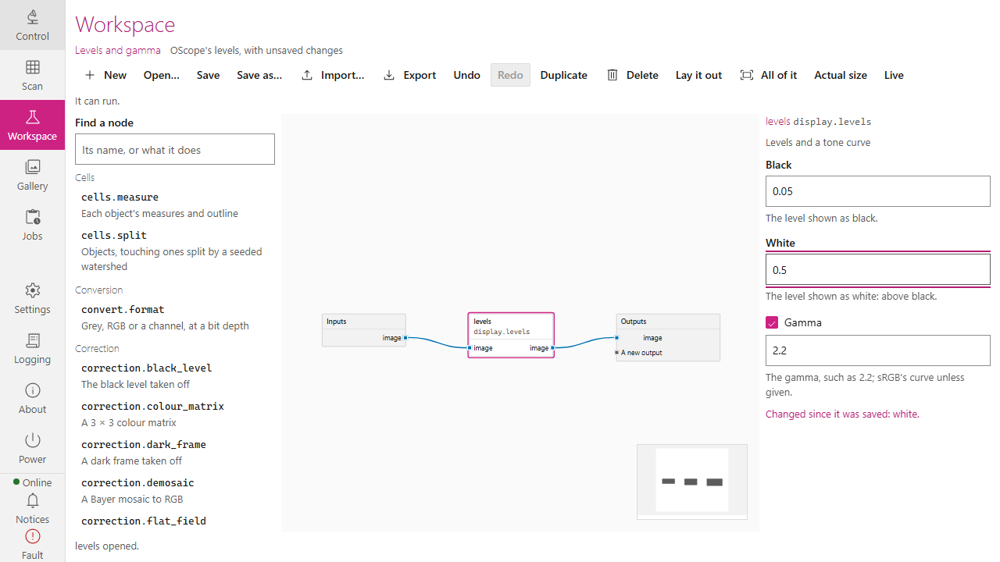
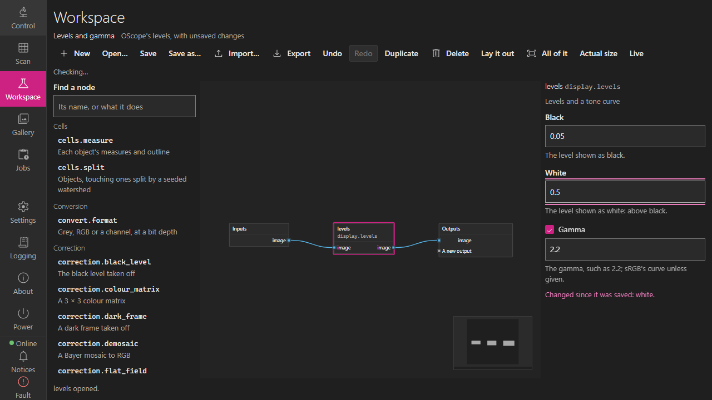
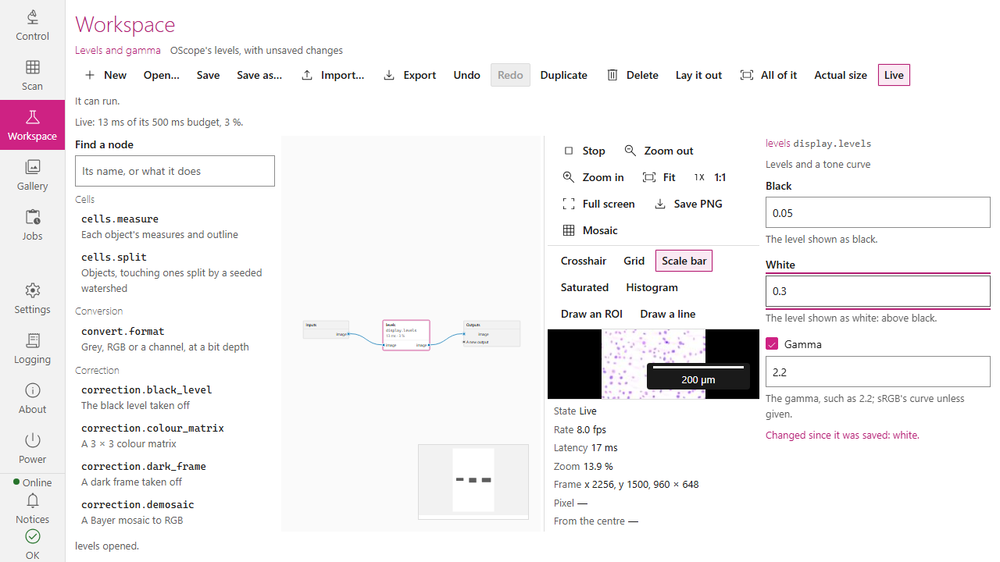
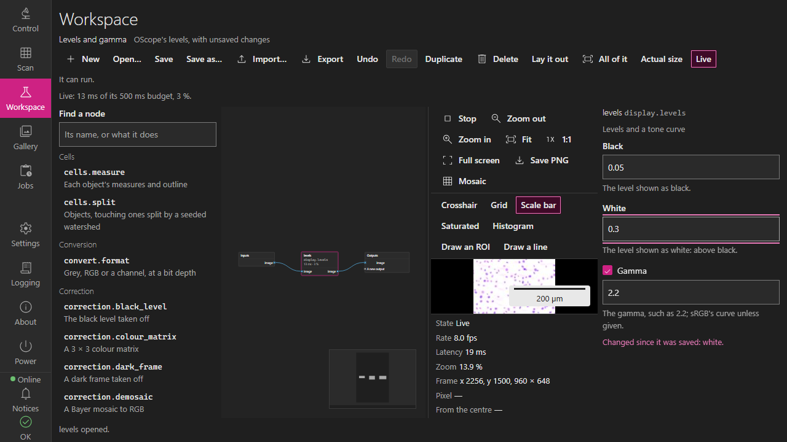

# W7.3: The graph editor: parameters and the library

- Status: In review
- Branch / PR: `m2/w7.3-parameters-library` / PRNUMBER
- Estimate: first 1,600, the spec's · second ~1,830 (code ~890, tests ~250, styles ~180, try-it ~450, glue ~60), in the plan's change log before the code, 14 % over the first · measured 1,200 (code 744, styles 61, tests 143, try-it 252), 34 % under the second: SchemaForm, the app's dialogs and the live viewer did more than was allowed for; 8 lines generated besides, a snapshot

## Summary

The graph editor sets each node's parameters, keeps recipes, and runs one live (D12; [spec](../phases.md#w7-3)):

- **A node's form,** drawn from its parameters' schema by SchemaForm (W0.6), in a control pane beside the canvas. It shows the defaults, and says which parameters differ from the recipe saved.
- **The library** (W7.1, [ADR-0052](../../adr/0052-recipes-over-the-api-the-pipeline-thing.md)): a recipe opened, saved, saved under another name, and deleted. OScope's own recipes are opened as copies, saved under a name of the user's.
- **Unsaved changes are asked about** before they are left: for another recipe, for an import, for another tab, and the browser's own question for a page closed.
- **Live:** the recipe set as the preview's each time it is checked and can run, the live image beside the graph. Each node shows its cost against the live budget, and the whole recipe's is said above the canvas. What was live before is set again when live stops, or the editor is left.
- **Server work the spec didn't name:** `set_live_recipe`'s check gives each step's time, `step_ms`, from the run it measures. It gave only the whole recipe's.

## What was built

In `web/src/features/workspace/editor/`:

- **`EditorPane.vue`:** the control pane: the node chosen, its form, and what differs from the recipe saved. With no node chosen, the recipe's own name.
- **`OpenDialog.vue`:** the library's recipes, OScope's own first, each opened, or one of the user's deleted once asked.
- **`SaveDialog.vue`:** a name for the library, checked as it is typed, saying when it replaces one of the user's.
- **`changes.ts`:** a node's parameters with its defaults, and what differs from the recipe saved.
- **`library.ts`:** the library's names, and one suggested from a recipe's own.
- **`costs.ts`:** each step's cost, and the whole's, as they are shown.
- **`RecipeEditor.vue`:** the library's tools, the unsaved changes' question, live, the pane, and *Actual size*.
- **`GraphNode.vue`, `GraphCanvas.vue`, `editing.ts`:** a node's cost on it; the selection kept by the editor; and `check`'s result kept with the recipe it is for, so only a recipe checked is set live.

Elsewhere:

- **`oscope-acquire`:** a live recipe's `time` gives each step's time from the middle run, with the whole's (`Timing`).
- **`oscope-api`:** the preview's `RecipeCheck` gains `step_ms`.
- **`web/src/api/pipeline.ts`:** `liveRecipe` and `setLiveRecipe`.

## How to try it

On the CUDA build, as W6's notes say:

```sh
cargo build --release -p oscope-server --features cuda
npm --prefix web ci && npm --prefix web run build
target/release/oscope-server --config configs/oscope.toml --port 8211 --web web/dist
```

1. **Open `http://127.0.0.1:8211/#/control`,** and press *Start*: the camera's frames.
2. **Open the Workspace, then *Open…*,** and press *Open* by `levels`: OScope's *Levels and gamma*, laid out.
3. **Press the `levels` node:** its form, *Black* 0.05, *White* 0.85, *Gamma* 2.2. *As it was saved.*
4. **Press *Live*:** the live image beside the graph, the recipe's cost above the canvas, and the node's on it.
5. **Set *White* to 0.3, and press Enter:** the image brightens. The pane says *Changed since it was saved: white.*
6. **Press *Save*:** OScope's own can't be changed, so a name is asked for. Type `my-levels`, and *Save*.
7. **Reload the page, *Open…*, and open `my-levels`:** the same recipe, *White* 0.3.
8. **Add a node, then press *Gallery* in the rail:** the editor asks before its changes are left. *Cancel* keeps them.

## Screenshots

| | Light | Dark |
|---|---|---|
| A node's form, a parameter changed |  |  |
| The recipe live, its costs |  |  |

## Design notes and deviations from the plan

- **A parameter set to its default is no change:** what differs is each parameter as it takes effect, its default under what the node sets. A node added has all its parameters changed.
- **Unsaved means anything saving would keep:** the nodes' places and the recipe's name too, not only parameters.
- **A number takes effect on Enter, or when its field is left,** as the app's number fields do: one edit for each value, not one for each key.
- **Live is set only for a recipe checked and found able to run,** and only once for each. A refusal, such as a recipe over its budget, is said, and what was live stays.
- **The step times are the middle run's,** of the three the server times. Steps on separate branches may run at once, so they can add up to more than the whole.
- **The live image is beside the graph,** not under it: under it, the viewer's tools leave the image a sliver.
- ***Actual size*, a tool the spec didn't name:** the canvas at its own size, where each port is 24 px tall, as WCAG 2.2's 2.5.8 asks. Fitted smaller, the ports are too, until it is zoomed.
- **The minimap is smaller,** 140 by 90: in the canvas beside the pane, the default covered nodes.

## Tests

- **Rust, `oscope-api`, 1 extended:** the live recipe set over HTTP gives each step's time, by its ID, each above zero, together no more than the whole.
- **Snapshot, 1 changed:** the `preview` Thing's description, whose check has `step_ms`.
- **Unit, 10 new,** on the catalogue and stock recipes recorded from a real server:
  - a node's parameters, its defaults under what it sets;
  - what differs from the recipe saved: nothing for the same recipe; each parameter changed, by node; not a parameter set to its default, nor the keys' order; every parameter of a node added; a node moved, or the name changed, unsaved;
  - the library's names: refused when empty, too long, of other characters, or a stock recipe's; one of the user's replaced, saying so; one suggested from a recipe's own name;
  - the costs: tenths below 10 ms and whole ms above, against the budget, and over it.
- **Contract, 1 new:** the live recipe set, read and cleared, and its check's fields, as the wrappers have them.
- **End to end, `recipes.spec.ts`, 6 new,** in Chromium, two in Firefox and WebKit too:
  - a parameter changed reaches the live image: *White* from 0.85 to 0.3, the image brighter, each node's cost on it;
  - a stock recipe changed, saved under a name of the user's, the page reloaded, and opened again: the same file, the same parameter, *As it was saved*;
  - unsaved changes asked about before another tab, kept on *Cancel*; left for a new recipe; not asked about when there are none;
  - the library's names refused as typed, one saved, then said to be replaced, and deleted once asked;
  - axe, the pane in both themes and the library's dialog; and the pane's baseline, on Windows and on Linux, each passing 3 of 3.
- **`editor.spec.ts`, 1 changed:** *New* after an export now asks first. Its baselines were made again, the page having the pane.
- **Found by its own tests:**
  - deleting from the library did nothing: the question's closing cleared the recipe asked about before the answer read it. They are kept apart now;
  - a number's field takes effect on Enter, or when it is left, so the tests press Enter;
  - the live test, beside others on the debug build, took 27 to 54 ms on a 1920 × 1080 image, over the 20 ms budget. It sets a budget of 500 ms first, as W3.7's tests do;
  - axe found the ports under 24 px in the narrower canvas, fitted: *Actual size* came of it;
  - the live image under the graph was a sliver: it is beside it.
- **Mutation checks, 16, all caught, none hung:**
  - in the model: the defaults left out, the keys' order a change, only parameters unsaved, a stock recipe's name taken, any characters in a name, a stock recipe replaced, whole ms below 10, and over only at twice the budget;
  - in the browser: the form's edit lost, live set only once, the tab left unasked, a stock recipe saved in place, no cost on the node, and the recipe asked about lost as the question closes;
  - in Rust: no step's time, and each step timed as the whole.
  - **One survived at first:** the keys' order, since a node's defaults come first in the schema's order whatever order it sets them in. The test now reverses the recipe's own keys.
- **The try-it,** on the CUDA build's release server: both editor specs, 21 of 21, the live recipe through the GPU's path.
- **The whole suites of `oscope-acquire`, `oscope-api` and `oscope-server`:** 42, before the PR; and Clippy with and without `cuda`.
- **Two cores, five times:** TWOCORE
- **The replays:** REPLAYS
- **Docs:** the relative links and anchors in the Markdown files resolve.

## Follow-ups and known gaps

- **A recipe's file and the library aren't one:** a file imported isn't in the library until it is saved there.
- **The costs are those of the last recipe set live,** until the next is: an edit waits for its check.
- **A user's recipe deleted while it is open** stays in the editor, no longer in the library.

## Clean room

Nothing was copied from `microscope` or any other codebase. No package was added.
