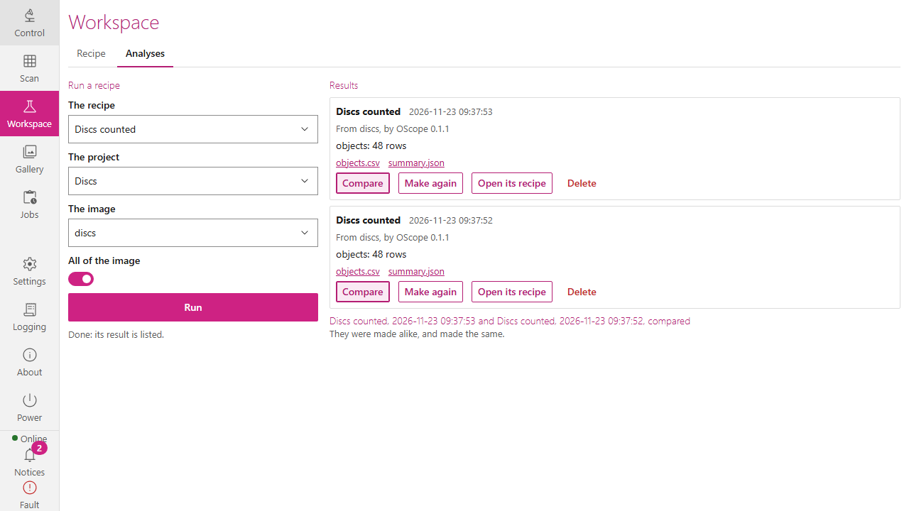
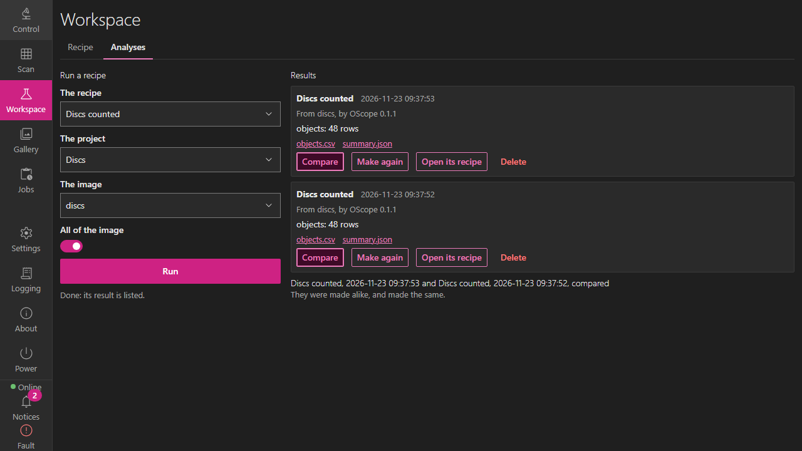

# W7.4: Analyses and results

- Status: In review
- Branch / PR: `m2/w7.4-analyses-results` / [#122](https://github.com/lucaswewa/OScope/pull/122)
- Estimate: first 1,500, the spec's · second ~1,700 (code ~820, tests ~250, styles ~150, try-it ~420, glue ~60), in the plan's change log before the code, 13 % over the first · measured 1,169 (code 645, styles 94, tests 111, try-it 318, glue 1), 31 % under the second: the Gallery's records and provenance, and the app's controls, did more than was allowed for; 1 line generated besides, the recorded answers

## Summary

A recipe run on a project's image, and its results kept with how they were made (P48; [spec](../phases.md#w7-4)), in the Workspace's *Analyses* tab:

- **Running** (`workspace/run`): the editor's recipe or one of the library's, an acquisition or a result of a project, and all of the image or a region in µm. A job, followed to its end.
- **Results** (`workspace/results/{id}`): the newest first, each with what it was made from, by what software, the rows of each table it made, and its files.
- **Made again** (`rerun`), and **compared** (`difference/{id}/{a}/{b}`): two results chosen, what differs in how they were made and in what they counted, as a table, each number's change by how much.
- **A result's recipe opened in the editor:** changed there, and run again.
- **Deleting** a result (`delete_result`), once asked.
- **No server work:** P48 had every affordance.

## What was built

In `web/src/features/workspace/`:

- **`WorkspaceTab.vue`:** the page's two tabs, *Recipe* and *Analyses*. Each keeps what it holds while the other is shown: the editor's history, live and selection.
- **`analyses/RunPane.vue`:** the run: the recipe, the project, the image, and a region; the job's progress said.
- **`analyses/ResultsPane.vue`:** the results, made again, opened, deleted, and two compared.
- **`analyses/compare.ts`:** the comparison's table: the server's difference, each place said by its node and parameter, and the two summaries' rows.
- **`editor/RecipeEditor.vue`:** says its recipe as it changes, and opens one given, asking first about unsaved changes.
- **`editor/changes.ts`:** a node's parameters from its form kept as the node had them: one at its default left out, unless it was set.

Elsewhere:

- **`web/src/api/workspace.ts`:** the Workspace's wrappers: `resultList`, `difference`, `summaryOf`, `analyse`, `rerun` and `deleteResult`.
- **`web/src/ui/Tabs.vue`:** `keep`, for each tab's content kept, hidden, while another is shown.
- **`web/scripts/record-analyses.mjs`:** the answers the unit tests read, recorded from a server of its own.
- **`web/tests/e2e/analyses.ts`:** an image to count, bright discs of six sizes, and a recipe that counts them.

## How to try it

On the CUDA build, as W6's notes say:

```sh
cargo build --release -p oscope-server --features cuda
npm --prefix web ci && npm --prefix web run build
target/release/oscope-server --config configs/oscope.toml --port 8211 --web web/dist
```

A project with a stitched mosaic is needed: [W5.2's try-it](W5.2-running-a-scan.md#how-to-try-it) makes one, a scan of the simulated slide, stitched.

1. **Open `http://127.0.0.1:8211/#/workspace`, and the *Analyses* tab.**
2. **Choose the recipe *Nuclei counted*, the project, and *Result:* its stitched mosaic.** Turn off *All of the image*, and give a region of 500 by 500 µm.
3. **Press *Run*:** its progress, then *Done*. The result is listed: from the mosaic, by OScope, `objects` and its rows, and its files.
4. **Press *Make again* on it,** then *Compare* on both: *They were made alike, and made the same.*
5. **Press *Open its recipe* on the first:** the editor, the recipe in it. Press the `measure` node, turn on *Min area*, set it to 30, and press Enter.
6. **Back in *Analyses*, choose *In the editor: Nuclei counted*,** and *Run*. Compare it with the first: the table names `measure: min_area`, none then 30, and `objects: rows`, fewer, by how many.
7. **Press *Delete* on a result:** asked first, then gone.

## Screenshots

| | Light | Dark |
|---|---|---|
| Results, two compared |  |  |

## Design notes and deviations from the plan

- **The comparison has two halves:** how the results were made, the server's difference of their provenance; and what they made, each table's rows from their summaries. The server compares only the first, and the try-it asks for the counts too.
- **A place is said by its node:** `measure: min_area`, not the pointer `/recipe/workspace.run/recipe/nodes/measure/params/min_area`.
- **A run leaves the recipe's places out:** they change nothing it makes, and would show as a difference.
- **The editor's form keeps a recipe as small as it was:** a parameter at its default is left out unless the node set it. Otherwise a result made from an opened recipe would differ by every default its form wrote.
- **The tabs keep their content:** the editor's history and live stay while the analyses are shown.
- **W7.3's live test changed:** with the tabs above it, the live image is smaller, its black margins a larger part of the mean. It now lowers *White* to 0.2, and asks for a quarter more brightness, not 20 levels.

## Tests

- **Unit, 5 new,** on answers recorded from a server (`web/scripts/record-analyses.mjs`): the discs counted from 10 µm², then from 300 µm², and the first made again:
  - the comparison's table: the parameter changed by its node, 10 to 300, +290, and the counts, 48 to 24, −24;
  - empty for a result made again;
  - a table one result has and the other hasn't; and a place, a value and a change said plainly;
  - and a node's parameters from its form kept as the node had them.
- **Contract, 1 new:** a run and a rerun with a parameter changed, the results listed with their fields and files, their difference, a summary, and a result deleted, as the wrappers have them.
- **End to end, `analyses.spec.ts`, 5 new,** in Chromium, two in Firefox and WebKit too:
  - a run on the left half of the discs: 24 of the 48, from the discs, by OScope, its summary to download;
  - a result made again: alike; its recipe opened in the editor, the least area raised to 300, and run: the table's `measure: min_area`, 10, 300, +290, and `objects: rows`, 48, 24, −24; and the editor kept as it was while the analyses were shown;
  - a result deleted: kept on *Cancel*, gone on *Delete*;
  - axe, in both themes, two results compared; and the results' baseline, the times masked, on Windows and on Linux, each passing 3 of 3.
- **Changed:** W7.3's live test (see the design notes), and W7.2's and W7.3's baselines, made again with the tabs above the editor.
- **Found by its own tests:**
  - a result's recipe is in its provenance under the job's kind, `workspace.run`, with the image and region: *Open its recipe* read the wrong place, and the table's places had that prefix;
  - the editor's places, and every default its form wrote, showed as differences: a run leaves the places out, and the form keeps a recipe as small as it was;
  - axe refused the names *Make Discs counted again* and *Open Discs counted's recipe*, which didn't hold the words shown: they are *Make again: …* and *Open its recipe: …*;
  - Node's own TypeScript reading refuses the client's parameter properties: the recording script runs with `--experimental-transform-types`.
  - **in the two-core runs,** once in five, in Firefox: *Make again* said so before the list was read again, so *Compare* pressed next could fall on the result that had moved, and let it go. The list is read first now, and the test waits for both results.
  - **in the Linux replay:** with the tabs above the editor, and the toolbar on two rows in Linux's fonts, the live image beside the graph was 0 px tall, its viewer's tools taking the height: W7.3's live test saw no frame. Live, the editor's body now asks for 38rem, and the page scrolls if it must: the image is 190 px tall there.
- **Mutation checks, 14, 13 caught, none hung:**
  - in the model: no node's parameter, the analysis's place said, the counts not compared, equal counts listed, a rise unsigned, and the defaults kept from the form;
  - in the browser: the region ignored, the places run, the results not read after a run, deleted unasked, its recipe not opened, compared the other way, and the editor not kept across the tabs.
  - **One survived:** *Make again* not waiting for its job. On the discs, the job ends before the list is read again, so the two can't be told apart; an image large enough to tell would make the test slow.
- **The try-it,** on the CUDA build's release server: `analyses.spec.ts` and `recipes.spec.ts`, 19 of 19. The stock counting recipe on a stitched mosaic, made again and compared, is P48's `ex-workspace`, which the replays' smoke runs run.
- **Two cores, five times:** the suites the change reaches:
  - **on `94b8a4b`:** every unit test, 5 of 5 (111.5–118.6 s); every end-to-end spec, 4 of 5 (1,985–2,049 s). The fifth failed this phase's own test, in Firefox: the race above;
  - **on `aa41423`, the race fixed:** every unit test, 5 of 5 (113.4–114.3 s), and the Workspace's three specs, 5 of 5 (94–121 s).
- **The replays:** REPLAYS
- **Docs:** the relative links and anchors in the Markdown files resolve.

## Follow-ups and known gaps

- **A rerun with parameters changed** (`rerun`'s `changes`) is reached by the API, not the page: the page changes a parameter through the editor.
- **A region is given as numbers:** drawing it on the image is W8's.
- **A run's job goes on if the page is left,** and its result is listed when the page is opened again. The job's notice says when it ends.

## Clean room

Nothing was copied from `microscope` or any other codebase. No package was added.
