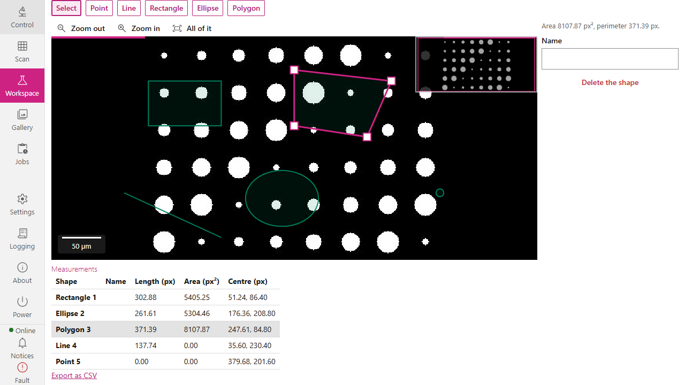
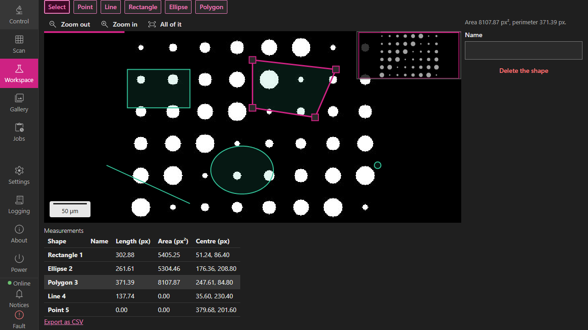

# W7.5: Annotations and measurements

- Status: In review
- Branch / PR: `m2/w7.5-annotations` / [#123](https://github.com/lucaswewa/OScope/pull/123)
- Estimate: first 1,800, the spec's · second ~2,150 (code ~1,080, tests ~380, styles ~150, try-it ~480, glue ~60), in the plan's change log before the code, 19 % over the first · measured 1,541 (code 984, styles 111, tests 190, try-it 256), 28 % under the second: the tile viewer's layer and P44's measurements did more than was allowed for

## Summary

A record's image marked and measured, in the sample's units (P44; [spec](../phases.md#w7-5)), in the Workspace's new *Annotations* tab:

- **On the TileViewer:** points, lines, rectangles, ellipses and polygons, drawn by the pointer or the keyboard. Each is selected, moved, reshaped by its handles, named, and deleted.
- **Measured as it is drawn:** a line's length, a closed shape's area and perimeter, in µm and µm², a polygon's by the shoelace formula.
- **A table** of the server's measurements, and their CSV.
- **Kept with the record** (`annotate`, `remove_annotation`, `annotations/…`, `measurements/…`): there after a reload.
- **No server work:** P44 keeps and measures annotations.

## Behaviour spec

Written before the code, as a spec-first phase's notes are ([spec](../phases.md#w7-5)).

**Where a shape is.** An annotation is kept as P44 keeps it: GeoJSON (RFC 7946) in µm from the image's top-left corner, x across and y down, in the layer `annotations` of an acquisition or a result. The record's pixel size, from its calibration, scales the image's pixels to µm; on an image of unknown pixel size, a µm is a pixel, and the unit is said as `px`. A shape is drawn and edited on the screen at any zoom, and kept in µm, so what it measures doesn't depend on the zoom it was drawn at.

**The shapes, and what each measures.** Lengths in µm, areas in µm²:

| Shape | Kept as | Length | Area |
|---|---|---|---|
| Point | `Point` | — | — |
| Line | `LineString`, two points or more | the sum of its segments' lengths | — |
| Rectangle | `Polygon`, its four corners, square with the image; `properties.shape` is `rectangle` | its perimeter, 2(w + h) | w × h |
| Ellipse | `Polygon` of 128 points on it, its axes square with the image; `properties.shape` is `ellipse`, and `properties.ellipse` its centre and two radii | the polygon's perimeter | the polygon's area |
| Polygon | `Polygon`, three points or more | its perimeter | by the shoelace formula |

- **A segment's length** is the Euclidean distance between its ends, in µm.
- **A polygon's area** is the shoelace formula's, Gauss's: half the absolute sum, over its edges, of x<sub>i</sub>y<sub>i+1</sub> − x<sub>i+1</sub>y<sub>i</sub> (Braden, *The surveyor's area formula*, The College Mathematics Journal 17(4), 326–337, 1986). Its perimeter is the sum of its edges, the closing one with them.
- **An ellipse is a polygon of 128 points,** so that P44 keeps it, and the server measures it as it measures any polygon. Points evenly spaced in angle about the centre give an area of π·a·b·(64/π)·sin(π/64), within 0.05 % of the ellipse's own π·a·b. The perimeter falls short of the ellipse's by less than 0.02 %, against Ramanujan's approximation (*Modular equations and approximations to π*, Quarterly Journal of Mathematics 45, 350–372, 1914). The page says this.
- **As a shape is drawn,** its length, or its area and perimeter, show beside it, by these formulas in the page. A polygon's area shows through the pointer, as if it closed there. Once kept, the table shows the server's measurements, which use the same formulas.

**Drawing.** A tool is chosen: *Point*, *Line*, *Rectangle*, *Ellipse* or *Polygon*.

- **A point** is placed by a press.
- **A line or a polygon** gets a point at each press. A double press, or a press on its first point for a polygon, ends it. Escape drops it.
- **A rectangle or an ellipse** is dragged, corner to corner: the ellipse fills the rectangle.
- **Each shape is kept as it is ended:** the server gives it its ID. The tool stays chosen, for the next.

**Editing.** With no tool chosen, a press on a shape selects it.

- **A selected shape shows its handles:**
  - a line's and a polygon's points;
  - a rectangle's four corners;
  - an ellipse's four ends of its axes.
- **Dragging the shape moves it.** Dragging a handle reshapes it:
  - a point of a line or polygon moves alone;
  - a rectangle's corner moves, the opposite one staying;
  - an ellipse's end moves, the opposite end staying.

  Rectangles and ellipses stay square with the image.
- **Its name** is typed beside the image, as `properties.name`.
- **Delete, or the *Delete* button,** deletes it.
- **Escape** lets it go.
- **Each change is kept once it is made:** at a drag's end, a key's last press, or the name's field left. It replaces the shape of its ID.

**From the keyboard.** The image takes the focus.

- **With a tool chosen,** a cross marks where a point would go, at first the view's middle.
  - The arrows move the cross, by a screen pixel, or ten with Shift.
  - Enter places a point there, as a press would. Enter twice at one place ends a line or a polygon.
  - A rectangle or an ellipse takes two: its first corner, then the opposite one.
- **With a shape selected,** the arrows move it, as the cross moves.
- **V chooses its handles in turn,** then the whole shape again; the arrows move what is chosen.
- **Tab goes to the table.** Its rows select their shapes.

**The table.** Each kept shape, in the order made:

- its name;
- its kind;
- its length;
- its area;
- its centre, in µm.

They are the server's measurements (`measurements/…`), each number shown to two decimals. *Export as CSV* downloads the server's own CSV of them, `?format=csv`, whose numbers, rounded to two decimals, are the table's.

**Kept with the record.**
- `workspace/annotate` keeps a shape, new or replaced by its ID.
- `remove_annotation` deletes one.
- `annotations/…` reads them, as the page opens, or is reloaded.

Rectangles and ellipses are read back as themselves, by `properties.shape`.

## What was built

In `web/src/features/workspace/annotate/`:

- **`AnnotatePage.vue`:** the page: a project's image chosen, the tools, the keyboard's path, the shape selected and its name, what is drawn measured, and the table with its CSV.
- **`AnnotationLayer.vue`:** the shapes over the image, in the tile viewer's own layer: the one selected with its handles, the one being drawn, and the keyboard's cross. A shape pressed is selected, dragged or reshaped, the pointer read through the layer's own transform.
- **`shapes.ts`:** the shapes: what each measures, each as P44's GeoJSON and back, and each edit.
- **`drawing.ts`:** presses made into a shape, the shape through the pointer, and the arrows' nudge.

Elsewhere:

- **`web/src/api/annotations.ts`:** `annotationsOf`, `measurementsOf`, `measurementsAddress`, `annotate` and `removeAnnotation`.
- **`web/src/ui/tile-viewer/TileViewer.vue`:** a press, the pointer and a drag said while drawing, and a slot over the image, in its pixels.
- **`web/src/features/gallery/viewer/RecordViewer.vue`:** the image at its own origin, the drawing passed through, and the slot.
- **`WorkspaceTab.vue`:** a third tab, *Annotations*.

## How to try it

On the CUDA build, as W6's notes say, with a project with a stitched mosaic, as [W5.2's try-it](W5.2-running-a-scan.md#how-to-try-it) makes:

```sh
cargo build --release -p oscope-server --features cuda
npm --prefix web ci && npm --prefix web run build
target/release/oscope-server --config configs/oscope.toml --port 8211 --web web/dist
```

1. **Open `http://127.0.0.1:8211/#/workspace`, and the *Annotations* tab.** Choose the project and its stitched mosaic.
2. **Outline an island of tissue:** press *Polygon*, then a point at a time round its edge. The area shows through the pointer as it would close. Press its first point: it closes, and the table lists it, in µm².
3. **Measure a nucleus across:** zoom in, press *Line*, press one side of a nucleus, then the other, and the other again: its length, in µm.
4. **Name and reshape:** press *Select*, then the polygon. Type a name; drag a handle; drag the shape. The table follows.
5. **From the keyboard:** press *Rectangle*, then the image, so it has the focus. Press Enter, the arrows, and Enter: a rectangle. With *Select*, Enter on its row, then the arrows move it, and V its corners.
6. **Reload the page:** both are still there. Press *Export as CSV*: its numbers are the table's.

## Screenshots

| | Light | Dark |
|---|---|---|
| Each shape, the polygon selected |  |  |

## Design notes and deviations from the plan

- **Measured in the page and on the server alike:** what is drawn is measured by the page as it is drawn, and, once kept, by the server; the table and the CSV are the server's. Both use the formulas of the behaviour spec, and the tests check that they agree.
- **The image at its own origin:** annotations are in µm from the image's top-left corner, so the page places the image there, not on the stage as the Gallery does.
- **A rectangle and an ellipse keep what they are,** in `properties.shape`: P44 keeps only points, lines and polygons, and the page reads them back as themselves.
- **The table's first column is each shape's kind and number:** its name is a column of its own, as a shape need not have one, and a row's header can't be empty.
- **On an image of unknown pixel size,** such as an imported TIFF, the unit is said as `px`, as P44 says it; the tile viewer's scale bar, W6.4's, still says µm.

## Tests

- **Unit, 7 new:** what a shape measures, the same at four zooms it is drawn at, a 3-4-5 triangle and a line of two segments; a rectangle's w × h and an L's area either way round; an ellipse within the spec's bounds, against π·a·b and Ramanujan's perimeter, at axis ratios of 1, 4 and 20; each kind kept and read back as itself; each edit, moved and reshaped, the opposite corner or end staying; drawn with two corners from the keyboard, and through the pointer; and the arrows' nudge.
- **Contract, 1 new:** a square kept, read, measured as 120 px round and 900 px² with its centre, its CSV, and removed, as the wrappers have them.
- **End to end, `annotate.spec.ts`, 5 new,** in Chromium, two in Firefox and WebKit too:
  - each of the five shapes drawn, a polygon's area shown through the pointer before it closes; three selected, the page's measure the server's; reloaded, all five still drawn and listed; and the CSV's numbers, to two decimals, the table's;
  - a rectangle selected, moved (its centre, not its area), reshaped by a corner (larger), named, and deleted;
  - from the keyboard: a rectangle of two corners 50 by 30 screen pixels apart, its area and perimeter in that ratio; selected from the table, moved and reshaped by the arrows and V; and deleted;
  - axe, in both themes, the five drawn and one selected;
  - each shape's baseline, the polygon selected, on Windows and on Linux, each passing 3 of 3.
- **Changed:** the Workspace's other baselines, W7.2's, W7.3's and W7.4's, made again with the third tab.
- **Found by its own tests:**
  - two canvases are OpenSeadragon's, the viewer's and its navigator's: the keyboard's test takes the one that takes the focus;
  - the CSV goes on with each polygon's pixels' statistics: the test reads its measures, the first columns;
  - axe refused the table's empty row headers, a shape having no name: the kind and number head the row.
- **Mutation checks, 15, all caught, none hung:**
  - in the shapes and their drawing: the shoelace not halved, a ring not closed, a coarser ellipse, the wrong corner kept, an ellipse's far end not kept, a rectangle read as a polygon, a line ended at any press, a polygon not closed on its first point, and Shift not ten;
  - in the browser: a drag not kept, the arrows not moving a shape, the arrows' move not kept, nothing read back, a name not kept, and another layer's CSV.
- **The try-it,** on the CUDA build's release server: `annotate.spec.ts`, 9 of 9.
- **Two cores, five times:** the suites the change reaches, each 5 of 5: every unit test (113.0–120.2 s), and every end-to-end spec (2,086–2,109 s), on `fd79b7c`.
- **The replays:** the merge gate (ADR-0038), only what the change reaches (ADR-0061): no Rust, every spec, and the unit tests the change reaches. On `fd79b7c`, which only the notes follow:
  - **the Windows replay** passed 16 steps in 12 min;
  - **the Linux one,** on a fresh clone, 16 steps in 7 min.
- **Docs:** the relative links and anchors in the Markdown files resolve.

## Follow-ups and known gaps

- **One layer, `annotations`:** P44 keeps many; choosing another is for later.
- **A shape's channel statistics,** which the server measures over a polygon's pixels, are in the CSV, not the table.
- **A volume's planes:** shapes are drawn on the first plane; a plane's own are for later.
- **The tile viewer's scale bar says µm** on an image of unknown pixel size, where the table says px: W6.4's, to be made one.

## Clean room

Nothing was copied from `microscope` or any other codebase. The shoelace formula, after Braden (1986), and the ellipse's bounds, against Ramanujan's approximation (1914), are cited above. No package was added.
