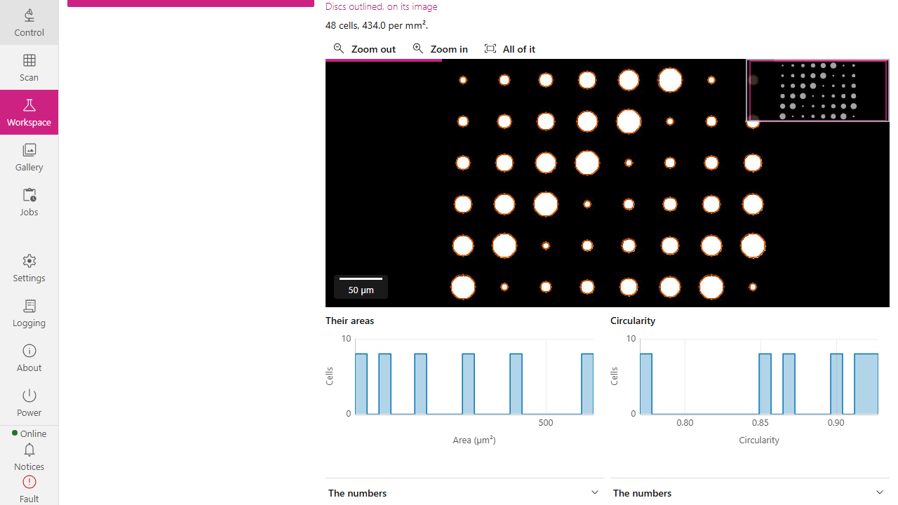
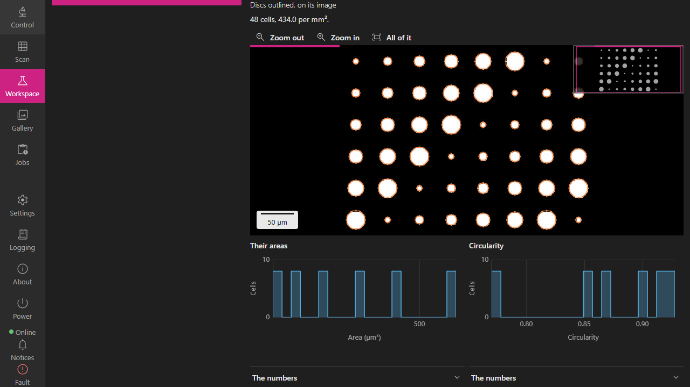
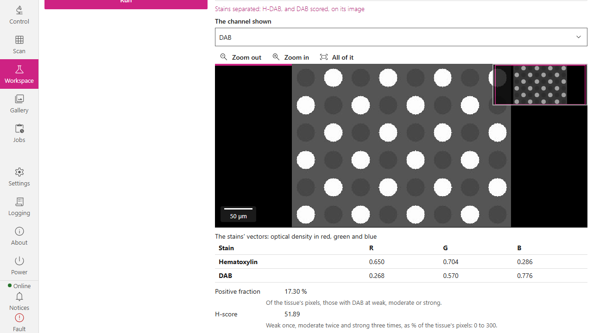
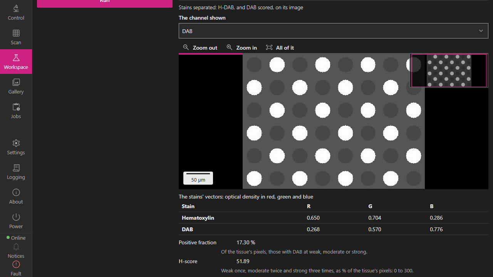

# W7.6: Cells and stains

- Status: In review
- Branch / PR: `m2/w7.6-cells-stains` / [#124](https://github.com/lucaswewa/OScope/pull/124)
- Estimate: first 1,600, the spec's · second ~1,950 (code ~950, tests ~320, styles ~150, try-it ~470, glue ~60), in the plan's change log before the code, 22 % over the first · measured 1,072 (code 582, styles 76, tests 171, try-it 215, glue 28), 45 % under the second: W6.4's viewer, W2.4's charts and W7.4's results did more than was allowed for; 2 lines generated besides, the editor's recorded catalogue

## Summary

The two stock analyses, seen on the image they were made from (D25; [spec](../phases.md#w7-6)), from a result's *Show it* in the Workspace's *Analyses* tab:

- **Cell counting:**
  - the cells' outlines over the image, at every zoom, drawn only where the view is;
  - the table of the cells, each one's area, circularity and place, a row leading the view to its cell;
  - histograms of their area and circularity;
  - their count, and their count per mm².
- **Stains:**
  - each separated channel shown alone, for H&E and H-DAB, with the stain vectors used;
  - DAB's positive fraction and H-score, each with what it measures.
- **Server work the spec didn't name, and the estimate didn't foresee:**
  - a tile of one channel alone, as grey (`?channel=`), for a stain's amount;
  - two stock recipes, *Stains separated: H&E* and *Stains separated: H-DAB, and DAB scored*, as the library had none for stains.

## What was built

In `web/src/features/workspace/analyses/`:

- **`ResultView.vue`:** a result on its image: a count's outlines, table, histograms and density; or the stains' channels, vectors and DAB's score.
- **`cells.ts`:** a table read from its CSV; the outlines placed on the image by the recipe's pixel, the region read and the image's pixel; a grid of them, and those a view needs; the histograms' bins; the count per mm².
- **`stains.ts`:** a deconvolution's stains and their vectors, by the recipe's choice; and DAB's score from its row.
- **`ResultsPane.vue`:** *Show it*, on each result.

Elsewhere:

- **`oscope-api`'s zoom:** a look's `channel`, one channel alone as grey, refused past the image's channels.
- **`oscope-pipeline`'s library:** `stains-he` and `stains-hdab`.
- **`TileViewer.vue`:** `tell`, for every view said, the page's own fits too. W6.4's viewers, which follow each other, say only their users' moves, as before.
- **`RecordViewer.vue`:** a channel, and `tell`, passed through.

## How to try it

On the CUDA build, as W6's notes say, with a project with a stitched mosaic of the simulated H&E slide, as [W5.2's try-it](W5.2-running-a-scan.md#how-to-try-it) makes, and an H-DAB slide's image imported, as [W6.3's](W6.3-files.md#how-to-try-it) imports one:

```sh
cargo build --release -p oscope-server --features cuda
npm --prefix web ci && npm --prefix web run build
target/release/oscope-server --config configs/oscope.toml --port 8211 --web web/dist
```

1. **Open `http://127.0.0.1:8211/#/workspace`, and the *Analyses* tab.** Run *Nuclei counted* on a region of the mosaic, as W7.4's notes do.
2. **Press *Show it* on its result:** the outlines follow the nuclei, touching ones split, with the count and the count per mm², and the histograms.
3. **Press a row of the table:** the view goes to that cell, its outline marked.
4. **Run *Stains separated: H-DAB, and DAB scored* on the H-DAB image,** and press *Show it*. Choose *DAB* as the channel shown: DAB alone, in grey.
5. **Read its positive fraction and H-score,** each with what it measures.

## Screenshots

| | Light | Dark |
|---|---|---|
| A count's outlines |  |  |
| Stains separated, DAB alone, and its score |  |  |

## Design notes and deviations from the plan

- **Outlines are placed by three things:** `cells.measure` gives them in its own µm, by its `pixel_um`, from the corner of the region it read. The page divides by that pixel, adds the region's corner from the result's summary, and multiplies by the image's own pixel.
- **Only the outlines a view needs are drawn:** a grid of 100 µm squares holds each outline's bounds, and a view's squares find them. A view wider than the grid's squares are many tests each outline instead. Past 3,000 in view, none are drawn, and the page says to zoom in.
- **The view is said to the page as it is set,** not only as its user moves it, with `tell`: a row's fit, too, draws only the outlines about its cell. W6.4's two viewers, which follow each other, keep to their users' moves, lest each fit set off the other.
- **A channel alone is the server's:** its tiles are rendered from that channel as grey, cached apart from the image's other looks. The page asks for a stain's amount by its channel.
- **The vectors shown are the server's,** Ruifrok and Johnston's (2001) for H&E and H-DAB, or the recipe's own.
- **DAB's score is the server's row,** from `stain.dab_score`; the page says what each number measures.

## Tests

- **Rust, `oscope-api`, 1 new:** one channel served alone as grey: a reddish image's first channel bright, its third dark, each grey; a fourth refused.
- **Rust, `oscope-pipeline`, 1 changed:** the stock recipes, eight now, each passing `check`.
- **Unit, 7 new:**
  - a table read, numbers as numbers;
  - outlines placed by the recipe's pixel, the region's corner and the image's pixel;
  - which outlines a view needs: each once, across the grid's squares, none in a square the view meets but not the outline, and every one for a view of everything;
  - the histograms' bins, the greatest in the last;
  - the count per mm²;
  - the stains named and given their vectors by the recipe's choice;
  - and DAB's score from its row.
- **End to end, `cells.spec.ts`, 4 new,** in Chromium, two in Firefox and WebKit too, on discs counted and a slide of hematoxylin and DAB discs, each run by the API:
  - a count's outlines, 48, its table's 48 rows and its count; a row pressed, its cell's outline marked, and fewer than 10 drawn about it;
  - a stain's channel: *DAB* chosen, its tiles asked for by `channel=1`; DAB's vector; and the positive fraction and H-score the server's `score.csv`;
  - axe, in both themes;
  - the outlines' baseline over the whole image, on Windows and on Linux, each passing 3 of 3.
- **Changed:** W7.4's results' baseline, with *Show it*, on both systems; the editor's recorded catalogue, with the two stock recipes.
- **Found by its own tests:**
  - the outlines weren't drawn: the viewer says its view only as its user moves it, so the page had none. Until it does, the page draws them all; and `tell` has it say every view;
  - a view of everything, before that, would have looped over endless grid squares: it tests each outline instead;
  - the histograms were drawn as peaks: a histogram's series needs its bins' width;
  - the tests' TypeScript doesn't read the app's `@/` paths: the spec reads the score's CSV itself.
- **Mutation checks, 14, all caught, none hung:**
  - in the cells and the stains: outlines not placed by the region, nor by the recipe's pixel; a grid square's outlines all drawn; the greatest past the last bin; per µm², not mm²; DAB named eosin; and the H-score the positive %;
  - in the browser: outlines not culled to the view; a row leading nowhere; the view not told; the channel not asked for; and the positive fraction the H-score;
  - in Rust: the first channel for every channel, and any channel asked for served.
- **The try-it,** on the CUDA build's release server: `cells.spec.ts` and `analyses.spec.ts`, 17 of 17.
- **The whole suites of `oscope-pipeline`, `oscope-api` and `oscope-server`:** 41, before the PR.
- **Two cores, five times:** TWOCORE
- **The replays:** REPLAYS
- **Docs:** the relative links and anchors in the Markdown files resolve.

## Follow-ups and known gaps

- **A count's histograms have 20 bins,** from the least to the greatest: a choice of bins is for later.
- **The cells' table isn't sorted:** a sort by a column is for later.
- **The simulated slide is H&E only:** the try-it's H-DAB image is imported. A simulated H-DAB slide is for later.

## Clean room

Nothing was copied from `microscope` or any other codebase. The stains' vectors are Ruifrok and Johnston's (*Quantification of histochemical staining by color deconvolution*, Analytical and Quantitative Cytology and Histology 23(4), 291–299, 2001), as P46's are. No package was added.
