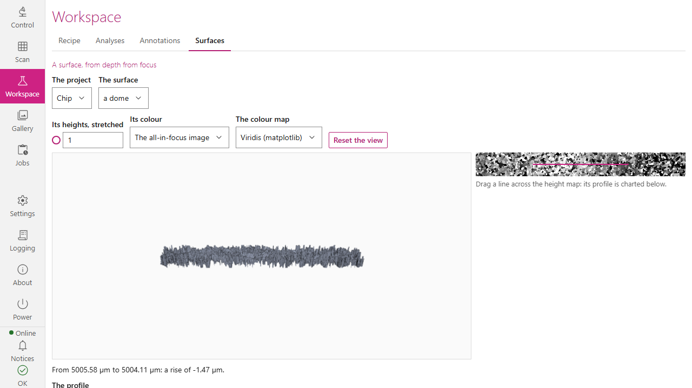
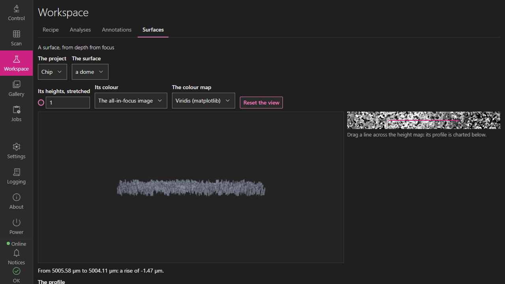

# W7.7: 3D: surfaces

- Status: In review
- Branch / PR: `m2/w7.7-surfaces` / [#125](https://github.com/lucaswewa/OScope/pull/125)
- Estimate: first 1,600, the spec's · second ~1,950 (code ~1,000, tests ~300, styles ~120, try-it ~450, glue ~80), in the plan's change log before the code, 22 % over the first · measured 958 (code 546, styles 72, tests 69, try-it 251, glue 20), 51 % under the second: VTK.js's camera controls and colour maps, and the volume routes' bricks, did more than was allowed for

## Summary

A depth-from-focus result as a surface to turn and measure (P42; [spec](../phases.md#w7-7); [ADR-0054](../../adr/0054-3d-in-the-app-on-vtk-js.md)), in the Workspace's new *Surfaces* tab:

- **VTK.js,** `@kitware/vtk.js` 38.0.5, BSD-3-Clause, in a chunk of its own, loaded when a surface is first shown.
- **The surface:** the heights as a mesh, lit, its texture the all-in-focus image, or coloured by height through a colour map.
- **Its controls:** turn and zoom, VTK.js's own; the vertical exaggeration, up to 40 times; the colour map; and a reset.
- **A profile** along a line dragged on the height map, beside the surface, charted in µm. A band 2 µm wide is averaged across it, and its two ends' heights and rise are said.
- **The data** is the media plane's volume routes' bricks, at the finest level whose part holds no more than 512 × 512 heights: coarser from afar.
- **Without WebGL2,** the tab says so, and shows the height map, on which a profile still works.

## What was built

In `web/src/features/workspace/three-d/`:

- **`SurfacePage.vue`:** the tab: a project's depth from focus chosen, the surface, its controls, the height map, its profile and its chart, and the fallback.
- **`scene.ts`:** VTK.js's scene, the one module that imports it, by a dynamic import: the mesh, its texture or colour map, the camera and its reset. It draws on nothing, so the page's own background shows in either theme.
- **`surface.ts`:** the mesh from a height map, two triangles a square, none for a square with a height that isn't a number; a height between the four nearest; a profile along a line, in a band; and its ends.

Elsewhere:

- **`WorkspaceTab.vue`:** a fourth tab, *Surfaces*.
- **The lint's rule:** VTK.js only in `three-d/` (ADR-0054). Vite's chunk-size warning raised past VTK.js's chunk.
- **ADR-0054,** *Accepted* with this PR.

## How to try it

On the CUDA build, as W6's notes say, with depth from focus run on a z-scan of the simulated reflective chip, as [P42's example](../../../examples/ex-depth-from-focus/README.md) does:

```sh
cargo build --release -p oscope-server --features cuda
npm --prefix web ci && npm --prefix web run build
target/release/oscope-server --config configs/oscope.toml --port 8211 --web web/dist
```

1. **Open `http://127.0.0.1:8211/#/workspace`, and the *Surfaces* tab.** Choose the project and its surface.
2. **Turn it and zoom it** with the pointer; raise *Its heights, stretched*; choose *Its height* and a colour map; *Reset the view*.
3. **Drag a line across the height map,** over the dome: its profile is charted, and the heights at its ends and its rise are said. The simulator's own heights are `simulation/in_focus`'s.

## Screenshots

| | Light | Dark |
|---|---|---|
| The simulator's dome, as depth from focus finds it, and a profile |  |  |

## Design notes and deviations from the plan

- **The profile is drawn on the height map, beside the surface,** not on the surface itself: a line on a turned surface is a pick in 3D; on the map, it is the same line, and it works without WebGL2.
- **A profile is a band's mean, 2 µm across:** depth from focus's heights are noisy one by one, and a single row of them more so.
- **The mesh is the page's,** from the bricks, not P42's PLY export: its stride is the brick's level, coarser from afar, and it has its texture's coordinates.
- **The spec's test of a step's height** couldn't be met on the simulator: its polished silicon has nothing to focus on. At the terraces' edge, depth from focus was unsure of every height (a confidence of 0.25 at most), and on the dome only a little surer. A profile over the dome's 1.7 µm fall came within 0.7 to 0.9 µm of the simulator's, differing from run to run. So the end-to-end test checks the page's own work: its profile is the heights the server gives, sampled alike, and falls as the cap does. Depth from focus's error stays P42's, which its example measures on the cells it is sure of. This is for the owner to judge, below.
- **The baseline is of a fixed surface:** a smooth dome imported as an image and run into a result named as depth from focus names its heights. The simulator's heights differ from run to run.

## Tests

- **Unit, 5 new:**
  - the mesh from a 3 × 2 height map: its points, its first row at the top, stretched up; its texture's coordinates; its range;
  - two triangles a square, and none for a square with a height that isn't a number;
  - a profile on a ramp, sampled between the heights, none off the map;
  - a band's mean across the line, its heights off the map left out;
  - and a profile's ends.
- **End to end, `surface.spec.ts`, 4 new, and 1 for the notes' screenshots,** in Chromium, the fallback in Firefox and WebKit too:
  - the simulator's dome, z-scanned at 50× and depth from focus run, drawn by VTK.js. A profile from its top to 30 µm out is the server's heights, sampled alike, to 0.2 µm, and falls as the simulator's cap does. The controls work: stretched, coloured by height, reset;
  - without WebGL2, the tab says so, shows no surface, and the height map's profile works;
  - axe, in both themes;
  - a fixed surface's baseline, from a fixed camera, on Windows and on Linux, each passing 3 of 3.
- **Changed:** the Workspace's other baselines, with the fourth tab, on both systems.
- **Found by its own tests:**
  - depth from focus is unsure of the simulator's polished silicon: the design notes say how the test was changed;
  - the baseline of the simulator's surface differed every run: it is of a fixed surface now;
  - the surface's background stayed light in the dark theme: it is drawn on nothing, the page's own showing through;
  - the view's box grew past VTK.js's canvas, which left a band: its height is fixed.
  - **in the Windows replay,** three earlier phases' tests timed out beside six of this phase's z-scans of the simulator: only the profile's test z-scans now, the fallback and axe the fixed surface.
- **Mutation checks, 9, all caught, none hung:**
  - in the surface's model: the rows not turned up, not stretched, a square with no height kept, the nearest height and not between, no band, and halves for tenths;
  - in the browser: WebGL2 always taken to be there, the page's profile without its band, and never drawn.
- **The try-it,** on the CUDA build's release server: `surface.spec.ts`, 6 of 6.
- **Two cores, five times:** the suites the change reaches, each 5 of 5 but where said: every unit test (115.9–118.6 s), and every end-to-end spec (2,786–2,828 s, the surface's z-scans among them), on `1fb2ad5`.
  - **One of the five end-to-end runs failed** an earlier phase's test, W1.4's host page's baselines in `host.spec.ts`: its styles weren't yet applied. That spec, run five times again alone on two CPUs, passed 5 of 5 (21–23 s).
- **Two cores, five times, again on `4f68997`,** one z-scan in the tests: the surface's spec and the three that had timed out beside it, W2.1's `shell.spec.ts`, W7.5's `annotate.spec.ts` and W1.1's `api.spec.ts`, 5 of 5 (306–339 s).
- **The replays:** the merge gate (ADR-0038), only what the change reaches (ADR-0061): no Rust, every spec, every unit test, as the packages changed.
  - **On `1fb2ad5`:** Windows failed three earlier phases' tests beside six of this phase's z-scans, all three timing out, W2.1's with `ERR_NO_BUFFER_SPACE`; found above, and the z-scans cut to one.
  - **On `4f68997`,** which only the notes follow: Windows passed 16 steps in 13 min. Linux, on a fresh clone, passed 15 of 16 in 7 min. Its one failure was an earlier phase's flake already known from W5's gates: W2's every-frame preview test in `preview.spec.ts`, one frame dropped under the load. As the owner chose for W7, a flake in an earlier phase's test is named and merged past.
- **Docs:** the relative links and anchors in the Markdown files resolve.

## Follow-ups and known gaps

- **Depth from focus on the simulator's chip is unsure** in a strip of 9 or 21 planes: P42's example reached 73 % sure cells on the full frame. A simulated surface with texture, or a z-scan of more of the frame in the tests, would let a test hold a step's height to the method's error. For the owner.
- **The confidence result isn't used:** heights depth from focus is unsure of could be left out, as P42's example page can.
- **A profile on the turned surface itself** is for later.

## Clean room

Nothing was copied from `microscope` or any other codebase. P42's example draws with VTK.js vendored; the app's scene is its own, on the package. VTK.js, `@kitware/vtk.js` 38.0.5, BSD-3-Clause, released 2026-11-05, was added; its dependencies in the bundle pass the licences' check.
