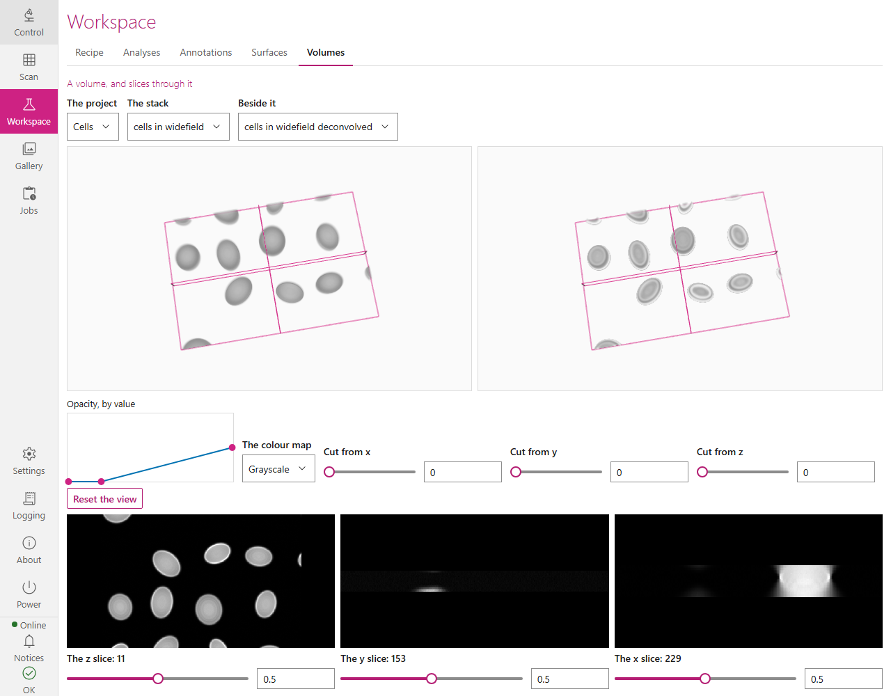
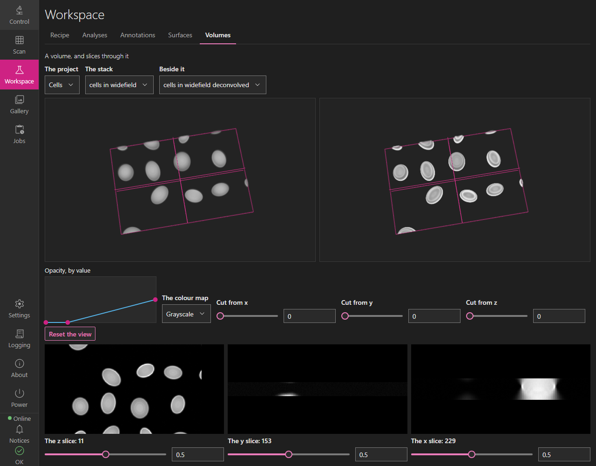

# W7.8: 3D: volumes and slices

- Status: In review
- Branch / PR: `m2/w7.8-volumes` / [#126](https://github.com/lucaswewa/OScope/pull/126)
- Estimate: first 1,700, the spec's · second ~1,900 (code ~960, tests ~300, styles ~120, try-it ~460, glue ~60), in the plan's change log before the code, 12 % over the first · measured 1,332 (code 679, styles 107, tests 111, try-it 430, glue 5), 30 % under the second: VTK.js's volume mapper and the volume routes' bricks and slices did more than was allowed for, and the slices are drawn on plain canvases

## Summary

A z-stack as a volume, and as slices through it (D8; [spec](../phases.md#w7-8); [ADR-0054](../../adr/0054-3d-in-the-app-on-vtk-js.md)), in the Workspace's new *Volumes* tab:

- **The volume:** a stack's brick, from the media plane's volume routes, at the finest level whose part holds no more than 128³ voxels, as floats; ray cast by VTK.js, one channel at a time.
- **Its transfer function:** the opacity by value, a line through three points on a chart, each dragged, the ends only up and down; the colour through a colour map, grey, Viridis or cool to warm.
- **Clipping:** the volume cut from each axis's start, up to nine tenths of it.
- **The slices:** the three orthogonal planes, from the slice route at the finest level it serves, a raw mosaic's cells, each grey over its own range, shaped as the plane is in µm, with a slider through each. Their planes are outlined in the volume, and move with the sliders.
- **Another volume beside it,** such as its deconvolution (P43), the two views linked: turning or zooming either turns the other.
- **Memory is bounded:** the bricks and slices fetched are kept to 256 MB, the least recently used let go first. The page says what it holds.
- **Without WebGL2,** the tab says so, and shows the slices.

## What was built

In `web/src/features/workspace/three-d/`:

- **`VolumePage.vue`:** the tab: a project's stacks, any acquisition or result of more than one plane; the one beside it; the channel; the volumes, their transfer function, colour map, cuts and reset; the slices and their sliders; and the fallback.
- **`volumeScene.ts`:** VTK.js's volume, imported only by a dynamic import, as `scene.ts` is: ray cast through the transfer function and colour map, clipped by six planes, the slices' outlines, and a camera that tells of its moves and follows another's. It draws on nothing, so the page's own background shows in either theme.
- **`bricks.ts`:** the bricks kept, up to a budget of bytes, the least recently used let go; one larger than the budget isn't kept.
- **`transfer.ts`:** the transfer function's points, kept in order within 0 to 1, moved with their ends held, and mapped over a volume's range; and the range of the samples that are numbers.

Elsewhere:

- **`WorkspaceTab.vue`:** a fifth tab, *Volumes*.
- **`SurfacePage.vue`:** its slider's field is given room for its scale. In W7.7 the scale had no width in its row of controls, and only the thumb and the number showed.

## How to try it

On the CUDA build, as W6's notes say. With the server running, `deconvolved()`, the tests' own helper, makes the stack and its deconvolution through the API, as [P43's example](../../../examples/ex-deconvolve/README.md) does: the simulated fluorescent cells in widefield at 50×, lit by the blue line at full intensity, the camera binned by three, 21 planes 0.5 µm apart through the sensor's middle quarter, then `volume.deconvolve` by Richardson–Lucy at the objective's NA. It takes about half a minute:

```sh
cargo build --release -p oscope-server --features cuda
npm --prefix web ci && npm --prefix web run build
target/release/oscope-server --config configs/oscope.toml --port 8211 --web web/dist
# In another shell:
node --experimental-transform-types -e 'import("./web/tests/e2e/volumes.ts").then((m) => m.deconvolved("http://127.0.0.1:8211"))'
```

1. **Open `http://127.0.0.1:8211/#/workspace`, and the *Volumes* tab.** Choose the project *Cells*: its stack, *cells in widefield*, is drawn.
2. **Turn it and zoom it** with the pointer. Drag the transfer function's points; choose a colour map; cut into it from x, y or z; *Reset the view*.
3. **Move the slices' sliders:** each slice is the stack's plane there, and its outline moves in the volume.
4. **Choose its deconvolution, *cells in widefield deconvolved*, *Beside it*:** the two turn together, and the cells' membranes are tighter in the deconvolution.

## Screenshots

| | Light | Dark |
|---|---|---|
| The cells' stack, and its deconvolution beside it, turned together |  |  |

## Design notes and deviations from the plan

- **One brick a volume, at the finest level that fits 128³ voxels,** not bricks streamed by the camera's distance: the volume routes give a level whole, and a z-stack of the instrument's is a few planes deep. The budget bounds what is kept as stacks and slices are looked at.
- **The slices are the server's, at the finest level it serves,** not cut from the volume's brick: the brick is coarser for a large stack, and a slice is a plane's own pixels. For a camera's raw stack that is level 1, its mosaic's cells: level 0 is the Bayer pattern (ADR-0029). The volume's meta route says which, and each slider's index is in that level's voxels.
- **A slice is shaped as its plane is in µm:** a voxel is one pixel of its canvas, which the tests read, and the canvas is stretched as the voxels are; the cells' stack's are 0.288 µm across and 0.5 µm deep.
- **A slice is grey over its own range,** as a single plane is best seen; the volume's transfer function spans the whole volume's.
- **The views are linked by their cameras:** each tells of its moves, and the other follows without telling back.
- **The page's drawing runs again** as the stack, the one beside it or the views change; a run overtaken by a later one, still fetching, draws nothing, and a slice that comes after a later one was asked for isn't drawn. Both were found in this phase: the first left a second canvas under the view, and the second is tested by holding a slice's answer back.
- **The visual test holds `Math.random` at one number:** VTK.js jitters its rays by it, drawing the numbers again for each scene the page makes, and the cut's edge differed by 13–28 pixels from run to run.

## Tests

- **Unit, 8 new:**
  - the bricks: the least recently used let go when the budget is passed, exactly the budget kept, never more than it however many; one larger than the budget not kept, and none let go for it; a brick put again counted once; and one fetched once while kept, and again once let go;
  - the transfer function: its points within 0 to 1 and in order; mapped over a range; a point moved, the ends only up and down; and the range of the samples that are numbers, and of a flat volume.
- **End to end, `volume.spec.ts`, 8 new, and 1 for the notes' screenshots,** in Chromium, the fallback in Firefox and WebKit too. A sphere is written as a 48 × 40 × 24 TIFF stack and imported, with a sharper one to set beside it:
  - the volume draws in one canvas; each slice, in the middle of its axis and at the z slider's ends, is the stack's own plane there, as written, grey over its range; the five slices and the brick are kept; and the transfer function's point is dragged;
  - a second volume beside it turns as the first does, either one turned, and *Reset the view* puts both back;
  - a slice that comes late isn't drawn over the one asked for since: its answer is held until the later one is drawn;
  - a z-scan's raw stack, the simulated cells over three planes: each slice is in the middle of its axis at level 1, the mosaic's cells, and is the server's slice there;
  - a stack a little larger than the volume's brick holds, 1,100 × 100 × 20 voxels: its brick is coarser, and each slice is in the middle of its axis at full size, the plane as written;
  - without WebGL2, the tab says so, shows no volume, and the slices are the stack's;
  - axe, in both themes;
  - a fixed volume, cut from x to its middle, from a fixed camera, on Windows and on Linux, each passing 5 of 5.
- **Changed:** the Workspace's other baselines, with the fifth tab, on both systems; and `surface.spec.ts`'s fallback, which found the *Volumes* tab's note as well as its own.
- **Found by its own tests:**
  - without WebGL2, the slices weren't drawn: they were asked for before the page had their canvases;
  - the views' drawing ran more than once at a time, and left a second canvas under the view;
  - **in the try-it,** a camera's raw stack had no slices: the page asked for level 0, which the server doesn't slice for a mosaic, and took the slices' indices from the volume's brick, coarser for a large stack. Tests of a raw stack and of a stack larger than the brick were added, and the slices were shaped in µm, as the cells' showed them too flat;
  - the visual test differed from run to run by VTK.js's random jitter;
  - W7.7's *Surfaces* tab's slider had no scale; and giving every slider a least width moved the deep-zoom viewer's toolbar, so only the two tabs' slider fields have one.
- **Mutation checks, 23, 22 caught, none hung:**
  - in the bricks: a brick read not made the most recently used, the budget not reached, one larger than it kept, one put again counted twice, and one fetched not kept;
  - in the transfer function: its points not sorted, its ends moved along, not mapped over the range, a range of samples that aren't numbers, and a flat range of nothing;
  - in the browser: a slice grey over the samples' range, a slice's index along another axis, a late slice drawn, the views not linked, the slices drawn before the page, WebGL2 always taken to be there, the transfer function not dragged, an earlier drawing's scenes kept, a slice at level 0, a slice's index by the brick's size, the volume not cut, and a reset to where it is;
  - **one survived:** a followed camera that tells of its move. VTK.js's camera doesn't tell of a move to where it already is, so the two views stop after one round of following each other even without the guard. The guard spares each move that second round of drawing, which no test measures.
- **The try-it,** on the CUDA build's release server: `volume.spec.ts`, 10 of 10, its screenshots of the cells' stack and its deconvolution among them.
- **Two cores, five times, on `f67c5b6`:** every unit test, 5 of 5 (124.2–131.9 s); every end-to-end spec, 380 of 381 passing in each run (2,597–2,675 s), but this phase's raw stack's test failed all five. It z-scanned the whole binned frame over five planes, to make its brick coarser than its slices, and on two CPUs the debug server's simulator took more than its three minutes. It is two tests now: the raw stack over three planes of the middle quarter, and an imported stack larger than the brick.
- **Two cores, five times, again on `COMMIT`:** TWOCORE
- **The replays:** REPLAYS
- **Docs:** the relative links and anchors in the Markdown files resolve.

## Follow-ups and known gaps

- **Bricks by the camera's distance,** finer near and coarser far, for stacks larger than 128³ voxels a level: one level now.
- **A slice picked in the volume,** by clicking a plane, is for later: the sliders move them.
- **More than three transfer function points,** added and removed, are for later.

## Clean room

Nothing was copied from `microscope` or any other codebase. P43's example draws with VTK.js vendored; the app's volume is its own, on the package W7.7 added. No dependency was added.
