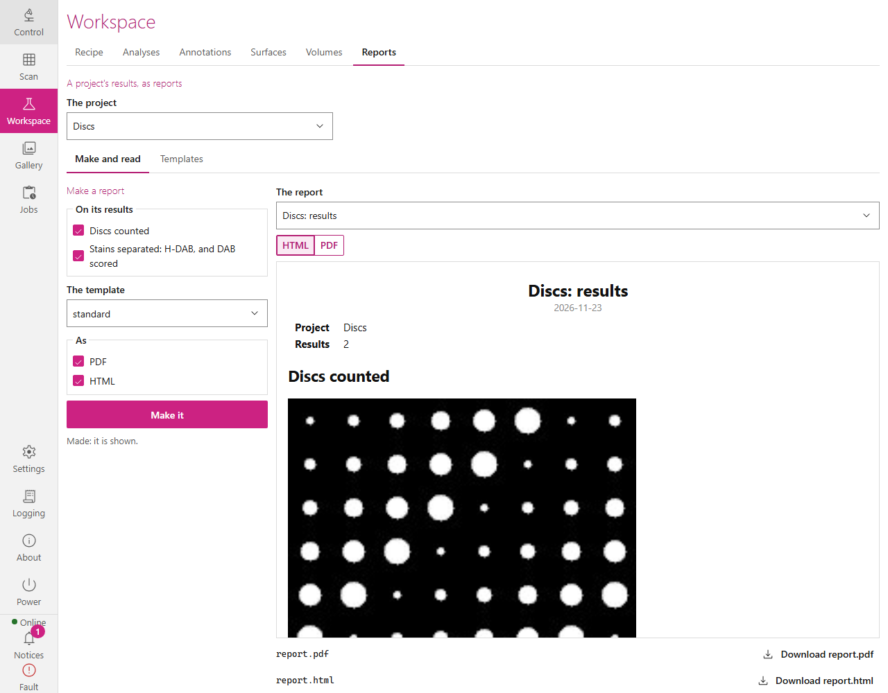
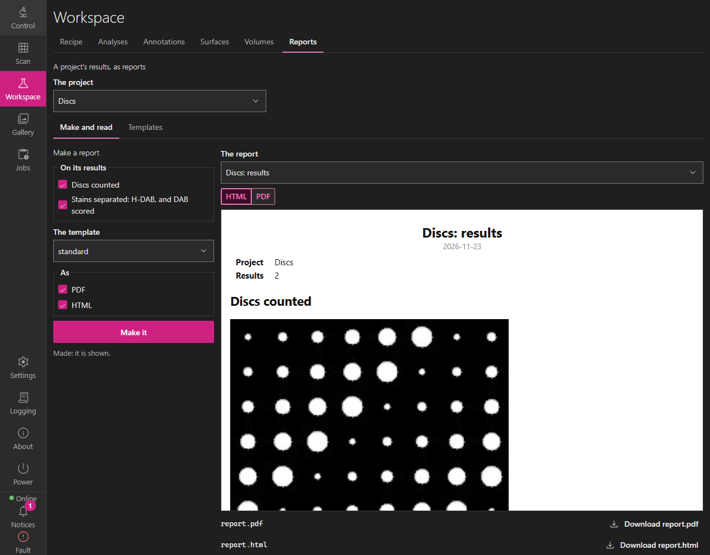
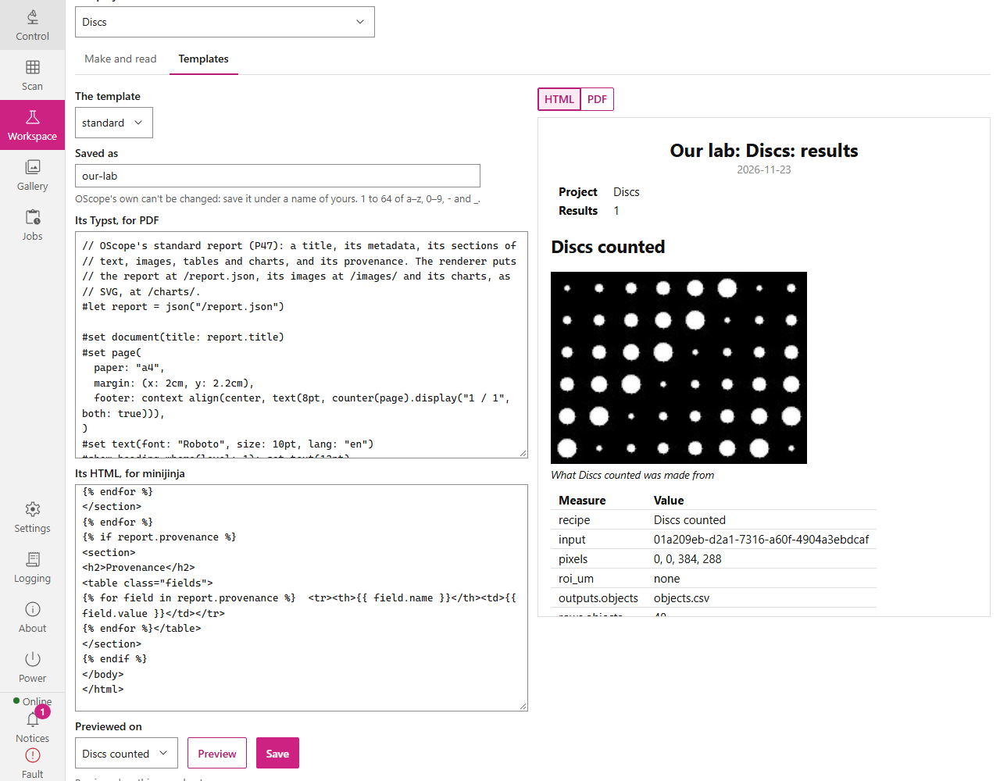
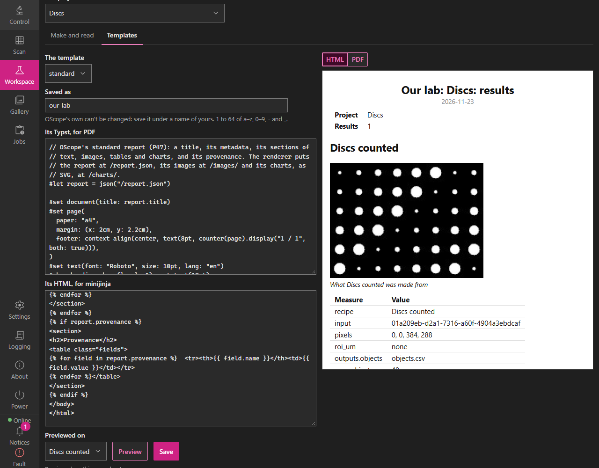

# W7.9: Reports

- Status: In review
- Branch / PR: `m2/w7.9-reports` / [#127](https://github.com/lucaswewa/OScope/pull/127)
- Estimate: first 1,300, the spec's · second ~1,690 (code ~830, tests ~240, styles ~120, try-it ~440, glue ~60), in the plan's change log before the code, 30 % over the first · measured 1,378 (code 692, styles 123, tests 259, try-it 297, glue 7), 18 % under the second; the projects Thing's description's snapshot, 86 lines, generated, left out

## Summary

A project's results as a report, made, read and restyled in the app (P47; [spec](../phases.md#w7-9); [ADR-0030](../../adr/0030-reports.md)), in the Workspace's new *Reports* tab:

- **Making one:** the project's results to report on, every one ticked at first; a template; PDF, HTML or both. The job `report.make` is followed to its end, and the report made is shown.
- **Reading one:** the project's reports, the newest first. Each is shown as HTML, in a frame sandboxed with nothing allowed, or as PDF, in the browser's own viewer where it has one. Its files, the PDF, the HTML and its model, are each downloaded.
- **Templates:** one's Typst, for PDF, and its HTML, for minijinja, edited beside a preview. The preview is a report on a result of the project's, or P47's sample report, through the sources as they stand, kept nowhere. A template is saved under a name of the user's, once the server has rendered the sample through it, and is otherwise refused, saying where it is wrong. A user's template is deleted, after asking.
- **The server's one change:** the projects Thing's action `preview_template`.

Checkpoint K is below.

## What was built

In `web/src/features/workspace/reports/`:

- **`ReportsPage.vue`:** the tab: the project, and two views, *Make and read* and *Templates*, kept as they are while the other is shown. It holds the templates' names, listed again when one is saved or deleted.
- **`ReportsPane.vue`:** a report made, and the project's reports read and downloaded.
- **`TemplatesPane.vue`:** a template's sources edited, previewed, saved and deleted.
- **`choice.ts`:** the results ticked: every one at first; as the project's change, one gone unticked, and a new one ticked only when every one was; what is asked of the server, in the project's order, or why it can't be; and the report a job made, from its paths.

Elsewhere:

- **`web/src/api/reports.ts`:** the templates read, kept, deleted and previewed, and a report's job.
- **`WorkspaceTab.vue`:** a sixth tab, *Reports*.
- **The server:**
  - `oscope-workflows::report::preview`: OScope's report on one result, or the sample report, through a template's sources: the PDF and the HTML, kept nowhere;
  - the projects Thing's action `preview_template`: those, the PDF in base64; refused, saying where, as `save_template` is, and for a project without its result;
  - `oscope-report::to_base64`, which the HTML's pictures were already encoded by.
- **The end-to-end tests' axe** leaves out a frame sandboxed with nothing allowed: no script runs in it, axe's own among them, and its document is a report through a user's template, not the app.

## How to try it

On the CUDA build, as W6's notes say:

```sh
cargo build --release -p oscope-server --features cuda
npm --prefix web ci && npm --prefix web run build
target/release/oscope-server --config configs/oscope.toml --port 8211 --web web/dist
```

The slide's cell count and DAB measure are Checkpoint K's, below: its steps 1 to 3 make them. Then:

1. **Open `http://127.0.0.1:8211/#/workspace`, and the *Reports* tab.** Choose the project: its results are ticked.
2. **Make it:** the report is made through *standard*, as PDF and HTML, and shown as HTML. Choose *PDF*: it opens in the browser's viewer. Download its files below it.
3. **Change the template's heading:** under *Templates*, *standard*, type a name, `our-lab`, and in the HTML change `<h1>{{ report.title }}</h1>` to `<h1>Our lab: {{ report.title }}</h1>`, and the Typst's title as you like. Choose the count under *Previewed on*, and *Preview*: the report as it would be, in both forms. *Save*.
4. **Make it again,** through `our-lab`: *Discs: results (our-lab)*, its heading the new one.

## Screenshots

| | Light | Dark |
|---|---|---|
| A report on the count and the DAB measure, as HTML |  |  |
| A template's heading changed, previewed on the count |  |  |

The report is light in either theme: P47's standard HTML is a document, its charts' colours fixed.

## Design notes and deviations from the plan

- **The PDF isn't in a sandboxed frame,** where the spec puts it: a browser's PDF viewer won't run in one, as P47 found for the data route. It is in an `<object>`, the browser's own viewer showing it where there is one; where there isn't, as in WebKitGTK, which Tauri uses on Ubuntu, and headless Chromium, the page says so, and it is downloaded below. A PDF runs no script of the template's.
- **The HTML is sandboxed twice:** by its frame, `sandbox=""`, nothing allowed, and by the data route's `Content-Security-Policy: sandbox`. The preview, which has no address, is the frame's `srcdoc`, sandboxed alike.
- **The preview is the server's,** not a template rendered in the browser: Typst and minijinja are the server's, and a preview through them is what the report will be. It keeps nothing, so a preview leaves no report or template behind.
- **A template's name** is the server's rule, 1 to 64 of a–z, 0–9, `-` and `_`, said under its field. OScope's own is saved under a name of the user's.
- **The results are chosen by ticking,** every one at first, as P47's job reports on all of them unless told.

## Tests

- **Unit, 9 new:**
  - the choice of results: every one ticked at first; one gone unticked, a new one ticked only when every one was; asked for in the project's order, PDF before HTML; why nothing can be asked; and the report a job made;
  - the wrappers: a report's job asked for as the server takes it; a template listed, read by its name, kept with its sources alone, deleted, and previewed on a result or the sample, its PDF from base64.
- **The server, 2 new:**
  - `oscope-workflows`: a template previewed on one result, its unsaved heading shown, its other result left out, nothing kept; on the sample without one; a template that doesn't render, and a result that isn't there, refused;
  - `oscope-api`, over HTTP: the sample previewed through unsaved sources, its PDF in base64; a template that doesn't render refused, saying the line; a project without its result refused; nothing kept. The projects Thing's description's snapshot has the action.
- **End to end, `report.spec.ts`, 4 new, and 1 for the notes' screenshots,** in Chromium, two in Firefox and WebKit too. A project holds W7.4's discs counted and W7.6's slide's stains measured:
  - a report made on the count alone, the stains unticked: shown as HTML, sandboxed, its heading and only the count's section; as PDF, the server's; its three files to download; and none made with no result ticked;
  - a template's heading changed, previewed on the count, nothing kept, saved, and the next report made through it shown in place of the one before, its heading the new one; a wrong template refused, saying the line; and the template deleted, after asking;
  - a template's script, in the preview and in the report, doesn't run: each frame is sandboxed with nothing allowed, and the server sandboxes the report's page;
  - axe, in both themes, the report and the preview shown.
- **Changed:** the Workspace's other baselines, with the sixth tab, on both systems, each passing 3 of 3.
- **Found by its own tests:**
  - a template's name with a space was refused by the server: its field now says the rule;
  - axe waited on a frame with nothing allowed until the test's end;
  - a second report made in a project wasn't shown in place of the first without choosing it: a test makes two now.
- **Mutation checks, 19, all caught, none hung:**
  - in the choice of results: none ticked at first, a new one always ticked, the ticks' order and not the project's, made with no result, the forms in the order ticked, and the job's first path taken;
  - in the wrappers: the results not asked for, a template's name not encoded, and the PDF's base64 not decoded. The name's survived at first: `fetch` encodes a space itself, and a slash in the name tells them apart now;
  - in the server: a preview on every result, and a project previewed without its result;
  - in the browser: the report's HTML and the preview not sandboxed, made on every result whatever is ticked, the report made not shown, the names not listed again after a save, previewed on the sample whatever is chosen, a refusal not said, and deleted without asking.
- **The try-it,** on the CUDA build's release server: `report.spec.ts`, 9 of 9, its screenshots among them.
- **Two cores, five times:** TWOCORE
- **The replays,** in full, as Checkpoint K's phase: REPLAYS
- **Docs:** the relative links and anchors in the Markdown files resolve.

## Checkpoint K

A recipe drawn and run live; the stitched slide's cells counted and its DAB measured; annotated and measured; a surface and a volume turned; and the PDF made: Milestone 1's Checkpoints E and F, in the app.

### The demo

On the CUDA build, as above.

1. **The slide, scanned and stitched:** in Settings, load the simulated *H-DAB tissue* and fit 20×. On Scan, a snake over 1 × 0.75 mm at its first island's edge, into a new project, *Checkpoint K*: it is stitched when it ends (W5).
2. **A recipe drawn, and run live:** Workspace, *Recipe*, *New*. From *Find a node*, drag in `filter.gaussian`, `threshold.otsu`, `cells.split` and `cells.measure`, and join them from the input to the outputs: *It can run.* Turn on *Live*: the recipe runs on Control's camera, its outlines over the live image (W7.2, W7.3).
3. **Count the cells and measure DAB on the stitched slide:** *Analyses*, the project, the mosaic. Run the library's `count-nuclei`, then `stains-hdab`. *Show it* on each: the nuclei outlined on the mosaic, each row of the table leading to its cell; the DAB channel alone, and its score (W7.4, W7.6).
4. **Annotate and measure:** *Annotations*, the mosaic. Draw a rectangle, an ellipse and a polygon over the tissue: each is measured, its area and its channels' means. Export the table (W7.5).
5. **Turn a surface and a volume:** *Surfaces*, a depth-from-focus result of the reflective chip, as W7.7's try-it makes; turn it, and drag a profile across it. *Volumes*, the cells' stack and its deconvolution beside it, as W7.8's try-it makes; turn them together, cut into them, and move the slices.
6. **Make the PDF:** *Reports*, *Checkpoint K*: its results ticked, *Make it*. Choose *PDF*: the count's section, its chart of the nuclei's areas, the DAB's summary, and their provenance.

As run on the CUDA build's release server, by a script doing through the API what the app does, in 85 s at real time:

- **The slide:** the simulated H-DAB tissue, a snake over 1 × 0.75 mm at the first island's edge at 20×: 4 frames of 5472 × 3648, stitched into a mosaic of 10,380 × 6,914 pixels, 0.12 µm each.
- **The count:** the library's `count-nuclei` on the mosaic: 5,105 nuclei, read at the mosaic's level of 5,190 × 3,457 pixels.
- **The DAB:** `stains-hdab` on the mosaic: of the tissue's 17.9 million pixels, 722,728 weak, 464,680 moderate and 281,734 strong: 8.2 % positive, an H-score of 13.9. Milestone 1's Checkpoint F found 6.7 % and 12 on its own scan.
- **Annotated:** a 100 µm square and a triangle on the mosaic, measured: 10,000 and 2,800 µm², with their channels' means.
- **The PDF:** a report on the count and the DAB: 119 kB as PDF, 111 kB as HTML, its two sections the two results'; read in the app's *Reports* tab.
- **A surface:** W7.7's try-it, depth from focus on the reflective chip: heights, confidence and all-in-focus of 684 × 78.
- **A volume:** W7.8's try-it, the cells' stack and its deconvolution.

The script didn't draw a recipe and run it live, step 2: W7.2's and W7.3's end-to-end tests do, drawing a graph from the palette and running it live on the camera, and W7's checklist has it.

### The checklist

- [ ] The H-DAB slide is scanned and stitched into the project.
- [ ] A recipe drawn from the palette checks, and runs live on the camera, its outlines over the live image.
- [ ] The library's count on the mosaic outlines its nuclei; a row of the table leads to its cell.
- [ ] `stains-hdab` shows the DAB channel alone, and its score.
- [ ] Shapes drawn on the mosaic are measured, and their table exports.
- [ ] A surface turns, and a profile across it is charted.
- [ ] A volume and its deconvolution turn together; a cut and the slices move.
- [ ] A report on the project's results opens as PDF and as HTML, and its files download.
- [ ] A template's heading changed and saved changes the next report.

## Follow-ups and known gaps

- **A report's pictures and charts in the app's own viewer,** zoomed and turned, as the Gallery's: the report shows them as its template lays them out.
- **A template's errors marked on its source,** at their line and column: they are said under it now.
- **Deleting a report** is the Gallery's, as for any record (W6.2).

## Clean room

Nothing was copied from `microscope` or any other codebase. The templates and the renderers are P47's. No dependency was added.
