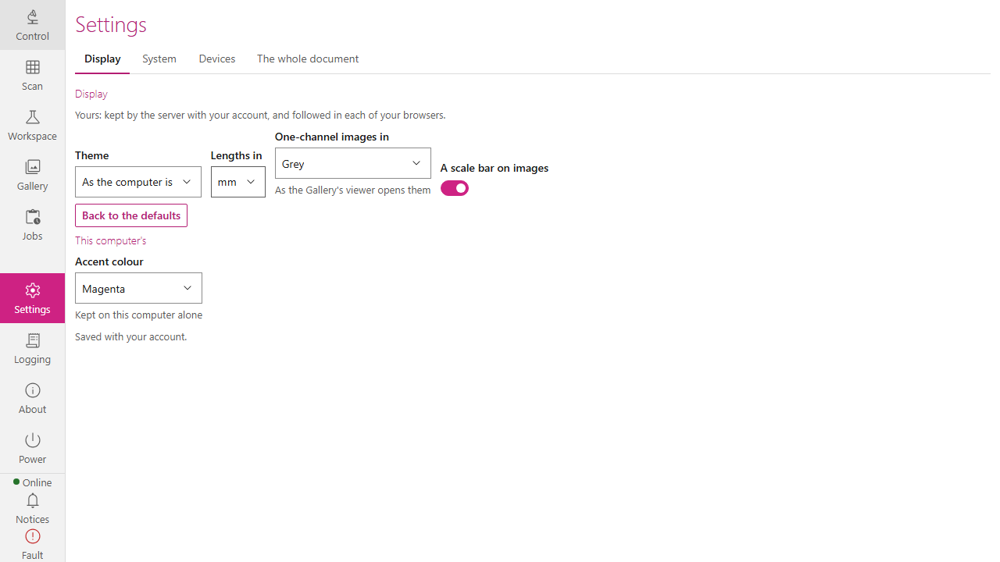
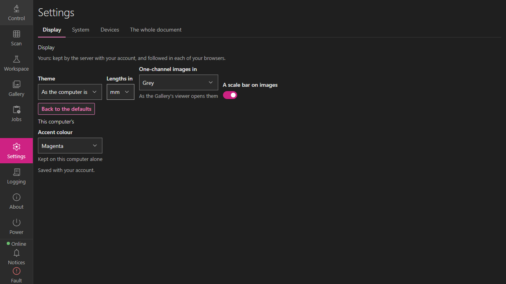
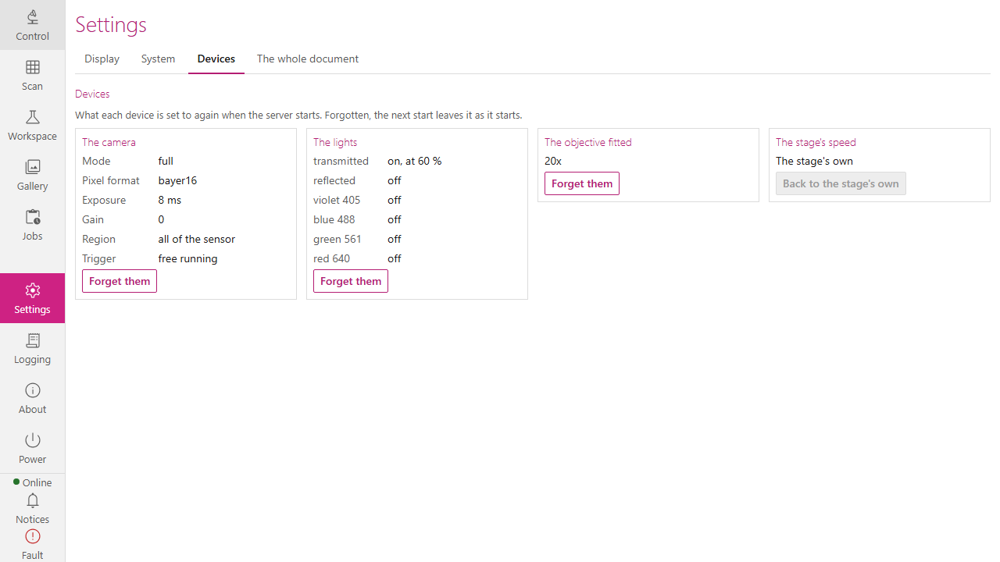
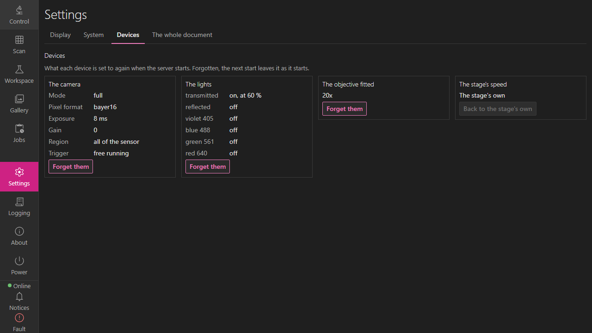

# W8.1: System, display and devices

- Status: In review
- Branch / PR: `m2/w8.1-settings` / [#130](https://github.com/lucaswewa/OScope/pull/130)
- Estimate: first 1,800, the spec's · second ~1,650 (code ~790, tests ~240, styles ~120, try-it ~460, glue ~40), in the plan's change log before the code, 8 % under the first · measured 1,317 (code 681, styles 164, tests 146, try-it 316, glue 10), 20 % under the second; the Things' description snapshots, 138 lines, generated, left out

## Summary

The settings that P52 keeps, shown and changed ([spec](../phases.md#w8-1)), in the Settings tab, in four views:

- **Display:** the theme, the units, the scale bar and the colour map, the account's own, which the server keeps and each of its browsers follows. No control lease is needed for one's own. *Back to the defaults* forgets them. The accent stays this computer's: the server keeps none.
- **System:** the data and scratch roots, the address and the port, as the configuration file holds them for the next start. The server checks each as that start would, and refuses, saying why. A change waits for a restart: the page says so, and offers it on Power.
- **Devices:** what each device is set to again when the server starts, the camera's settings, the lights', the objective fitted, and the stage's speed. Each is forgotten, or the speed put back to the stage's own.
- **The whole document:** all the settings exported to a file, and imported from one. The page checks that a file is a settings document; the server checks each part before it changes any, and says what it imported.

**The app follows the account's preferences:**
- **the theme,** through W0.2's theme store, which now has two sources;
- **the units,** in the stage's readout;
- **the scale bar,** in the Gallery's viewer, and as the live view's default in a browser that hasn't chosen its own;
- **the colour map,** in which the Gallery's viewer opens a one-channel image.

## What was built

In `web/src/features/settings/`:

- **`SettingsTab.vue`:** the tab, its four views kept while another is shown. Display is free of the control lease; the rest need it.
- **`DisplayPane.vue`, `SystemPane.vue`, `DevicesPane.vue`, `DocumentPane.vue`:** the four views.
- **`settings.ts`:** the parts of a draft that changed; the document's file, named by its day, and what a file read back holds; and the camera's saved settings in words.

Elsewhere:

- **`features/display/account.ts`:** the account's display preferences, read every 5 s by a request of its own, so that another browser's change reaches this one, and written.
- **`features/display/display.ts`:** the theme store's two sources. This computer's theme paints first. The account's is followed whenever it says something this computer hasn't followed yet, and the one it last followed is kept between visits. So a change made in another browser is taken up, even one made while this browser was closed, and a choice made here alone stands until then. `AppShell.vue` follows it.
- **The account's preferences in use:** the stage's readout takes its units from the account's store (W3.3); the tile viewer has a `scaleBar` switch, which the Gallery's viewer sets from the account; the live view's overlays take the account's scale bar as their default; and the Gallery's viewer opens a one-channel image in the account's colour map, unless it is grey, which is its own colours.
- **The server:** an action on each of the `camera`, `illumination` and `objective` Things, `forget_saved`, which forgets the settings saved, so that the next start leaves the device as it starts. What the device has now stays. The Things' description snapshots have them.

## How to try it

On the CUDA build, as W6's notes say:

```sh
cargo build --release -p oscope-server --features cuda
npm --prefix web ci && npm --prefix web run build
target/release/oscope-server --config configs/oscope.toml --port 8211 --web web/dist
```

1. **Open `http://127.0.0.1:8211/#/settings`.** Under *Display*, set *Lengths in* to mm. Open Control in another browser, as the same account: the stage's readout is in mm. Back in the first, choose *Dark*: the other turns dark within a few seconds.
2. **Under *System*, change the port** and *Save*: *Saved: port.*, and the page says the server takes it up when it restarts, with *Restart it on Power*. Type `0.0.0.0` as the address without accounts: refused, saying why.
3. **Under *Devices*:** with a light on and an objective fitted on Control, their saved settings. *Forget them*: nothing saved, and what the devices have now stays.
4. **Under *The whole document*:** *Export to a file*, change something, then *Import from a file…* the file: what it imported is listed, and the settings are as exported.

## Screenshots

| | Light | Dark |
|---|---|---|
| The display's settings, the account's own |  |  |
| The devices' saved settings |  |  |

## Design notes and deviations from the plan

- **Putting a device back to its default is forgetting what is saved,** not setting the device to a default now. The camera, the lights and the objective save what was last applied, and set it again at the next start; forgotten, that start leaves each as it starts. The server had no reset for them, so this phase adds `forget_saved`: P52's settings save what is applied, and the defaults are the device's own, which only its driver knows.
- **The restart is offered on Power,** which W4.3 built to restart the service and wait for it to come back, rather than a second restart here.
- **The theme's two sources:** the account's is followed only when it says something this computer hasn't followed yet. Followed every time it was read, it would undo a choice made a moment before the server had it. Followed only on a change seen in this visit, a browser closed while another changed it would miss the change.
- **An import puts back the accounts in its file,** and keeps any added since, as P52's import does.
- **The account's colour map applies to one-channel images,** as the server's preference says. The live view's colour map is for a colour camera's frames too, and stays the live view's own choice.
- **A display preference reaches another open browser within 5 s:** the server can't tell one account's change to another's open page, as `display` is a property of whoever reads it. Each browser reads it again every 5 s, by a request of its own, not through the `settings` Thing's socket, which would be one more on every page with nothing to say.

## Tests

- **Unit, 8 new:**
  - the theme store's two sources: this computer's painted first, then the account's followed and kept for the next visit; a choice made here kept across a visit until the account says something new; the account's followed where it is the theme already; and the accent left to this computer;
  - the settings: the parts of a draft that changed; the file's name by its day; a settings document read back, and why a file isn't one; and a camera's saved settings in words.
- **The server, 1 new:** settings set, then forgotten: the saved properties empty, what the devices have now kept, and the next server on the same folder not setting them again.
- **End to end, `settings.spec.ts`, 6 new, 1 visual and 1 for the notes' screenshots,** in Chromium, the first in Firefox and WebKit too:
  - the units and the theme changed in one browser, followed in another open on Control, and *Back to the defaults*;
  - a port changed, saved, and the restart said and offered on Power; an address on the network without accounts refused, and nothing written;
  - the whole document exported, changed, imported back as it was; and a file that isn't one refused before it reaches the server;
  - the camera's, lights', objective's and stage's saved settings shown, each forgotten, the camera keeping its exposure;
  - the account's scale bar and colour map in the Gallery's viewer;
  - axe on each view, in both themes;
  - the display's baseline, on Windows and on Linux, each passing 3 of 3.
- **Found by its own tests:**
  - *Saved: —*: the parts changed were worked out after the write had changed the saved values;
  - every tile viewer lost its scale bar: Vue gives a boolean prop left out `false`, so the switch defaults to `true` now;
  - the Gallery's viewer called a one-channel image's own colours *Grey*: grey is left as its own;
  - **in the gate's two-core runs,** W1.2's `things.spec.ts` failed in WebKit in 2 of 5 full runs, its Thing's socket not opening in time. The account's preferences were followed through the `settings` Thing, whose socket every page then opened, one more under the load. They are read by a request of their own now; alone, that spec passed 5 of 5 before and after;
  - W0.2's and W1.4's specs choose a theme on a page that keeps it on this computer alone, and reload at once. The theme store's first design, which followed the account's every answer, would have undone them, and led to keeping the account's last theme followed.
- **Mutation checks, 20, all caught, none hung:**
  - in the theme store: the account followed once and never again, its same answer undoing a choice, the account followed not kept between visits, and an account's theme already shown not recorded;
  - in the settings' arithmetic: every part said changed, the month off by one, any object taken for settings, and the region never said;
  - in the browser: the account's preferences read once, the shell not following the account's theme, the units not written to the account, the stage's units not the account's, the restart never said, the parts said after the write, a file sent unchecked, nothing forgotten, the scale bar always shown, and the account's colour map not taken;
  - in the server: the camera's settings, and the objective, not forgotten.
- **The try-it,** on the debug server: `settings.spec.ts`, 10 of 10, its screenshots among them. The release server's binary was in use by a server running from the checkout on 8211, the owner's own, which was left alone; W8.1 touches no CUDA path.
- **Two cores, five times:** TWOCORE
- **The replays:** REPLAYS
- **Docs:** the relative links and anchors in the Markdown files resolve.

## Follow-ups and known gaps

- **A device's settings put to its defaults now,** not only at the next start, would need each driver to say what its defaults are.
- **The display's preferences pushed** to the other browsers, not read every 5 s, would need the server to tell a property's change to each of an account's pages.
- **The simulator's settings** in the document are shown and imported whole; W8.4 edits them.

## Clean room

Nothing was copied from `microscope` or any other codebase. No dependency was added.
