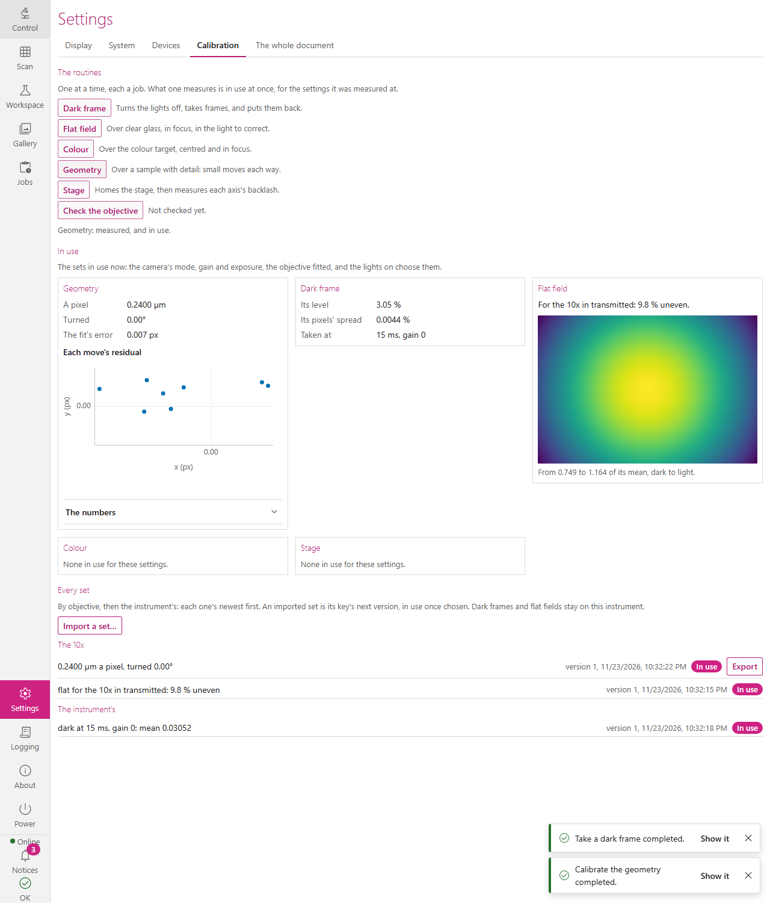
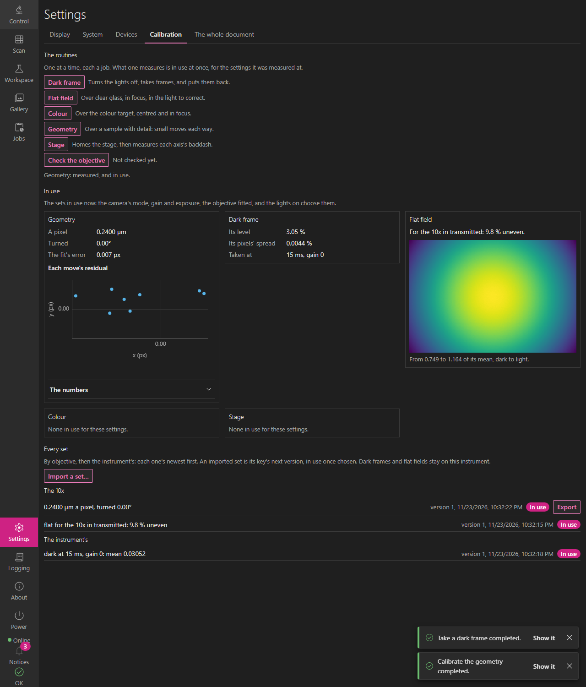
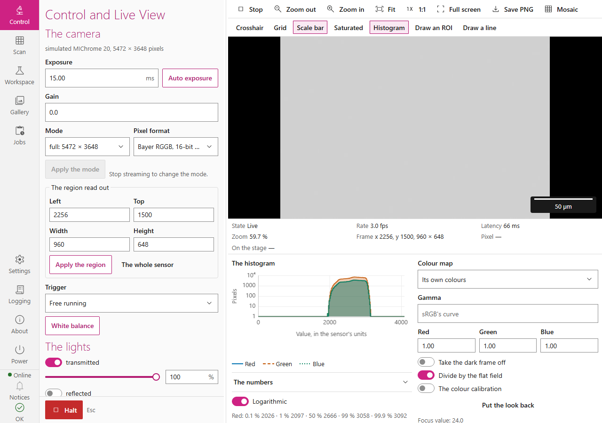
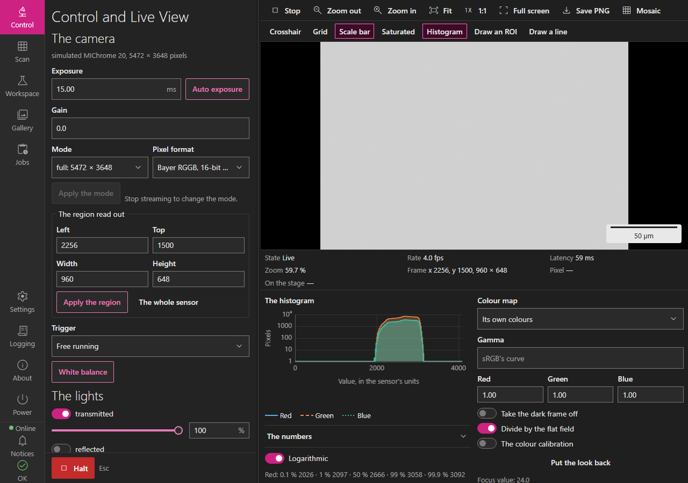

# W8.2: Calibration sets

- Status: In review
- Branch / PR: `m2/w8.2-calibration` / [#131](https://github.com/lucaswewa/OScope/pull/131)
- Estimate: first 1,600, the spec's · second ~2,180 (code ~1,120, tests ~360, styles ~150, try-it ~490, glue ~60), in the plan's change log before the code, 36 % over the first, one pull request at the owner's choice · measured 2,293 (code 1,126, styles 143, tests 688, try-it 336), 5 % over the second, its tests twice the estimate's and its try-it two thirds; the preview Thing's description snapshot, 20 lines, and the API's generated types, left out

## Summary

Each objective's calibration, seen, run and chosen ([spec](../phases.md#w8-2), D18, ADR-0023), in a fifth view of the Settings tab, *Calibration*:

- **The routines,** one at a time, each a job: the dark frame, the flat field, the colour, the geometry and the stage, each with what it needs said beside it; and the objective's check, with what it last found. What a routine measures is in use at once.
- **In use:** what the sets in use measured, for the camera's mode, gain and exposure, the objective fitted and the lights on. The geometry's pixel, turn and fit error, and each move's residual charted; the dark frame's level and spread; the flat field as a map; the colour matrix; and the stage's backlash.
- **Every set,** by the objective it is for, then the instrument's, each key's newest first: one chosen to be in use, exported to a file, and imported back as its key's next version.

**The preview applies the calibration,** which P33 kept and nothing applied: the look takes the active dark frame, flat field and colour calibration when it asks for them, three switches in the live view's values panel. **The live view's scale bar and its µm at the sample** follow the active geometry, in place of the catalogue's pixel.

## What was built

In `web/src/features/settings/calibration/`:

- **`CalibrationPane.vue`:** the view. The five routines and the objective's check, run one at a time through W3.2's job actions, the job's progress shown, and how it ended said.
- **`ResultsPane.vue`:** the sets in use, from `calibration/active`. The flat field's map is read once for each set, from the new route, and drawn through viridis (W3.6's table).
- **`SetsPane.vue`:** every set, from `calibration/sets`, by objective. *Use this one* activates one; *Export* saves a set as JSON; *Import a set…* sends a file's set to `calibration/import`.
- **`calibration.ts`:** the objective a set's key names; the sets by objective; a set's image as a map's pixels, from its lowest block to its highest; the residuals as a chart's points, with their RMS; and an export's file name.

Elsewhere in the app:

- **`api/calibration.ts`:** each kind of set's values, which the OpenAPI document leaves open, typed from P33's; and the route for a set's image.
- **`features/live/ValuesPanel.vue`:** *Take the dark frame off*, *Divide by the flat field* and *The colour calibration*, each written to the look.
- **`features/live/LiveViewer.vue` and `features/control/stage/stage.ts`:** with an active geometry, a sensor pixel's side at the sample is the geometry's, √|det M| over its binning, for the scale bar and the µm from the centre.
- **`settings/SettingsTab.vue`:** the *Calibration* view.

The server:

- **`oscope-acquire`, `preview/calibrate.rs`:** the dark frame taken off the raw frame in place of the black level, and the result divided by the flat field, as P33 measured the flat field: `(raw − dark) / flat`. An image that doesn't cover the frame, or has other channels, isn't used. The look's `wanted` says which of them to take; the preview finds them through `Calibrating`, which the server installs. A frame that takes a dark frame or a flat field goes through the CPU's chain, which works on the raw mosaic; the colour calibration is the look's correction.
- **`oscope-api`, `calibration.rs`:** how the preview finds a frame's sets: the dark frame keyed by its mode, gain and exposure, the flat field by its objective, lights and binning, and the colour calibration by its lights, as the routines keyed them. Each image is read once, by its set's ID: a set never changes. And `GET /api/v1/calibration/image/{id}`, a dark frame's or a flat field's image in blocks no more than 256 across, for the map: 404 for a set without an image, 400 for what isn't an ID.
- **`oscope-api`, `preview.rs`:** the look's `dark`, `flat` and `colour`, off by default.
- **`oscope-workflows`:** each geometry move's residual, kept in the set beside the fit's RMS. A set made before them has none.

The end-to-end tests' servers take lines of simulator TOML, for a spec's own vignetting (`fixtures.ts`, `server.ts`).

## How to try it

On the CUDA build, as W6's notes say, with vignetting to see:

```sh
cargo build --release -p oscope-server --features cuda
npm --prefix web ci && npm --prefix web run build
```

Add to a copy of `configs/oscope.toml`:

```toml
[simulator]
vignetting = 8.0
```

and start the server on it, on port 8211.

1. **On Control,** home the stage, move it to clear glass beside the coverslip (x 10,000 µm, y 12,500 µm), and start streaming.
2. **Open Settings, then *Calibration*.** Press *Flat field*: *Flat field: measured, and in use.* Under *In use*, its map shows the vignetting, bright in the middle, falling off to the corners.
3. **Back on Control,** open *Histogram* over the image and turn on *Divide by the flat field*: the live image evens out.
4. **Move over the tissue** (x 40,000 µm, y 12,000 µm) and press *Geometry* in the Calibration view: its pixel, its turn and each move's residual. Under *Every set*, *Export* it, and *Import a set…* the file: version 2, not in use until *Use this one*.

## Screenshots

| | Light | Dark |
|---|---|---|
| The calibration: a flat field, a dark frame and a geometry in use |  |  |
| The live image over glass, the flat field divided out |  |  |

## Design notes and deviations from the plan

- **The flat field is applied as P33 measured it:** the dark frame off, or else the black level, then divided by the flat field, normalised to a mean of 1: flat fielding as Janesick (2007) describes it, which [P33's notes](../../milestone-1/notes/P33-calibration-ii.md#flat-fields) cite. Then, as the black level's own subtraction does, full scale less the black level is stretched to 1. A site the flat field saw dark, below 0.001, is left alone, not blown up.
- **A dark frame or a flat field moves the frame to the CPU's chain:** the GPU's starts from the frame as the camera gave it. On the debug server, with the small region, the live view kept its rate.
- **The places are counted in the frame's pixels.** A set's region is the sensor's corner at full resolution, and its image the frame's own pixels. So for a binned frame both are the sensor's corner over the binning, which the keys make the same for the set and the frame.
- **The scale bar follows the active geometry.** The spec's *activating a set changes the scale* needed it: the live view drew the catalogue's pixel, and only pointing used the geometry. The server's `pixel_at_sample` is still the catalogue's, which the scans plan with.
- **Dark frames and flat fields aren't exported:** their images stay on the instrument, and the import refuses them (P33). *Export* is offered for the others.
- **The routines run with their defaults.** Each says what it needs beside its button; their parameters stay the API's.
- **The residuals' chart spans the residuals along x,** as the shared chart does; its y axis is the same either side of 0.

## Tests

- **Rust:**
  - `oscope-acquire`, `tests/calibrate.rs`, 4 new, on frames with a black level: the correction against `(raw − dark) / flat`, with both, either, and from a wider image; an image that doesn't cover the frame not used; the look taking each correction only when it asks, the colour calibration the same as the look's own correction, and nothing without a way to find them; and a binned frame matched in its own pixels;
  - `oscope-api`, 2 new unit tests: the sets a frame's mode, gain, exposure, objective and lights name, nothing for another gain, exposure or light, only what is asked, and a binned frame's place; and a set's image in blocks;
  - `oscope-api`'s calibration tests over HTTP: each geometry move's residual a fraction of a pixel; the flat field's image in blocks, its middle brighter than its corner; 404 for a set without an image, 400 for what isn't an ID;
  - `oscope-workflows`: each move's residual, none for an exact fit, and their RMS the fit's.
- **Unit, 8 new:** the sets by objective; the map's levels; the residuals' points and RMS; an export's file name; and a sensor pixel from a geometry, turned, mirrored or binned.
- **End to end, `calibration.spec.ts`, 3 new, 1 visual and 1 for the notes' screenshots,** in Chromium, the first in Firefox and WebKit too:
  - the flat field run over glass, its map brighter in the middle than at the corner, and the live image's middle over its edges from about 1.07 to 1.00 with *Divide by the flat field* on, and back;
  - the geometry run over the tissue, its residuals charted; exported, made twice as coarse, imported as version 2, chosen, and the live view's scale bar spanning twice the µm a pixel;
  - axe, in both themes;
  - the view's baseline, and the Settings and values panel's again, on Windows and Linux, each passing 3 of 3.
- **Found by its own tests:**
  - a binned frame would have been matched to its sets at the wrong place: offsets on the sensor and in the frame were added;
  - taking the dark frame off left the picture darker, by the black level's share: the plain chain stretches full scale less the black level to 1, and the correction does too now, none below 0 as there;
  - the scale bar never followed a calibration;
  - Playwright's WebKit on Windows draws a resized WebGL canvas black (W3.6): the spec opens the values panel and loads the page again, which keeps it open, before the frames;
  - WebKit's screenshots are at twice the CSS pixels: the spec reads them at CSS scale.
- **Mutation checks, 26, all caught, none hung:**
  - in the correction: the flat field multiplied in, an image of other channels used, the black level kept under the dark frame, and the correction not on the black level's scale;
  - in the preview: the calibration asked when the look doesn't, the black level taken off twice, a binned view's place in the sensor's pixels, and the colour calibration not the correction;
  - in the server: a light off taken for lit, the dark frame's gain not the frame's, a binned image's place in the sensor's pixels, an edge block divided by a whole block, a set without an image a server error, the residual the fit's sum, and no residuals kept;
  - in the app's arithmetic: a flat field the instrument's, the objectives in the words' order, the map from 0, the RMS over n twice, a key's slashes in a file's name, a flat field exportable, and a binned pixel the sensor's;
  - in the browser: the scale bar the catalogue's, the look's switch not written, the flat field's map never drawn, and a set chosen, not activated.
  - The black level taken off twice survived the first run: the test frames had none. With one, it was caught, and the next item was found.
- **The try-it,** on the debug server: `calibration.spec.ts`, its screenshots among it. The release server's binary is in use by the server running on 8211, which was left alone.
- **Two cores, five times:** TWOCORE
- **The replays:** REPLAYS
- **Docs:** the relative links and anchors in the Markdown files resolve.

## Follow-ups and known gaps

- **The routines' parameters,** frames, settling and steps, aren't offered: their defaults are P32's and P33's.
- **The GPU's chain** could take the dark frame and the flat field too, on the raw mosaic before it is demosaiced.
- **The scans** plan with the catalogue's pixel; the geometry's would be truer.

## Clean room

Nothing was copied from `microscope` or any other codebase. The correction is P33's own arithmetic, `(raw − dark) / flat`, flat fielding as Janesick (2007), *Photon Transfer*, describes it, which P33's notes cite. No dependency was added.
