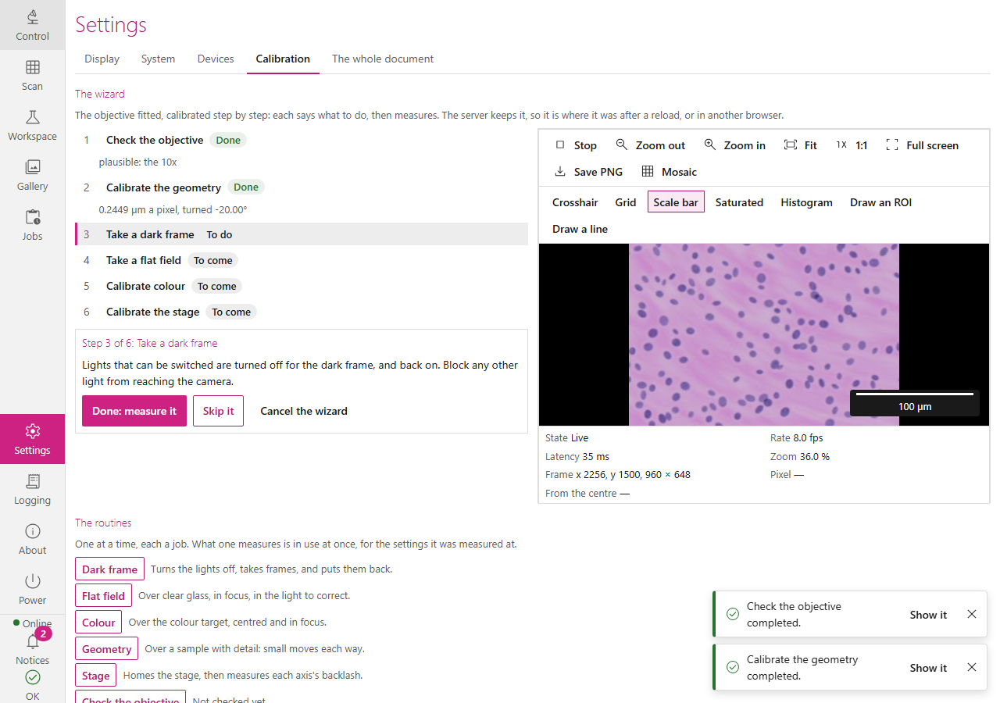
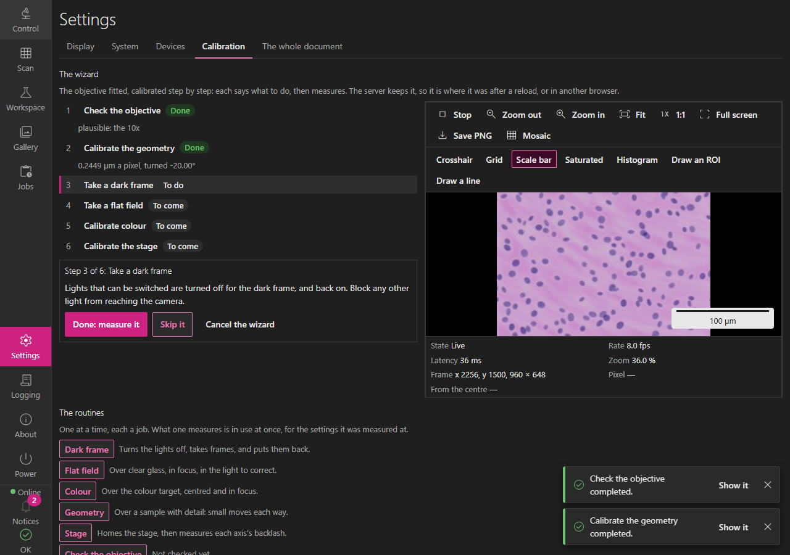

# W8.3: The calibration wizard

- Status: In review
- Branch / PR: `m2/w8.3-wizard` / [#132](https://github.com/lucaswewa/OScope/pull/132)
- Estimate: first 1,500, the spec's · second ~1,400 (code ~560, tests ~200, styles ~130, try-it ~450, glue ~60), in the plan's change log before the code · measured 735 (code 278, styles 96, tests 84, try-it 175, glue 102, the script that records the wizard's states), 48 % under the second; the recorded states, 493 lines, generated, left out

## Summary

A new objective calibrated by following steps ([spec](../phases.md#w8-3), P33), at the head of the Settings tab's *Calibration* view:

- **The wizard's steps:** checking the objective, then the geometry, a dark frame, a flat field, colour and the stage. Each step shows:
  - where it stands;
  - what it found: a set's headline, or the objective check's verdict;
  - while it is the step in hand, what to do, its job's progress, and why it failed.

  The step in hand is measured (*Done: measure it*), tried again once failed, or skipped; and the wizard can be cancelled. The live image is beside it while the wizard is under way, and the objective's pane at the objective's step.
- **It resumes:** the wizard is the server's, kept across a restart (P33), so a reload, or another browser with the lease, finds it where it was. The page reads it every second.
- **At its end:** each step's set, said in use, or offered to be chosen; and how many steps were done or skipped. *Start it again* starts a new one.

## What was built

In `web/src/features/settings/calibration/wizard/`:

- **`WizardPane.vue`:** the wizard, through `calibration/wizard` and its five actions. A running step's job is read twice a second for its progress; when it ends, the wizard and the sets are read at once.
- **`wizard.ts`:** the wizard's display: each step where it stands, the set or verdict it found, or why it failed; the step in hand, and what can be done with it; and how the wizard ended.
- **`recorded-wizards.json`:** states a server gave, prompting, running, done, failed, retried, skipped, cancelled and finished, for the unit tests. `web/scripts/record-wizards.mjs` records them again, on a server of its own.

`CalibrationPane.vue` puts the wizard first. No server work: the wizard's state, its steps and their jobs are P33's.

## How to try it

On the CUDA build, as W6's notes say:

```sh
cargo build --release -p oscope-server --features cuda
npm --prefix web ci && npm --prefix web run build
target/release/oscope-server --config configs/oscope.toml --port 8211 --web web/dist
```

1. **On Control,** fit the 20× in *The objective*, home the stage, move over the tissue (x 40,000 µm, y 12,000 µm), and start streaming.
2. **Open Settings, then *Calibration*,** and press *Start the wizard*. Step 1 checks the objective: *Done: measure it*. It says *plausible: the 20x*.
3. **Step 2, the geometry:** *Done: measure it*, and watch the stage step in the live image beside it. It says the pixel it found.
4. **Reload the page,** and open *Calibration* again: the wizard is at step 3, its first two steps done.
5. **Step 3, the dark frame:** the lights go off and back on. **Step 4, the flat field,** over the tissue, fails: *it isn't blank*. Move to clear glass beside the coverslip (x 10,000 µm, y 12,500 µm), *Try it again*, and measure it.
6. **Skip** the colour without its target, and the stage, or measure it. At the end, each set is in use.

## Screenshots

| | Light | Dark |
|---|---|---|
| The wizard at its third step, the live image beside it |  |  |

## Design notes and deviations from the plan

- **The wizard is read every second,** by a request of its own through the property's polling: reading it is what settles a step whose job has ended (P33). Its job is read twice a second for its progress while it runs.
- **The live image is shown only while the wizard is under way,** beside its steps, and not at its end: the Settings tab doesn't stream otherwise.
- **The objective is fitted at the objective's step** through Control's own pane, which W3.4 built, beside the step's prompt.
- **The routines stay below the wizard,** for one measurement without it.
- **The end-to-end tests' reach:** W8.1's `settings.spec.ts` and W8.2's `calibration.spec.ts` named their folders with spaces where `changed.mjs` takes commas, so a change to Settings didn't reach them. Both use commas now.

## Tests

- **Unit, 6 new,** from the recorded states:
  - the first step in hand, to confirm or skip;
  - a running step's job, which can't be confirmed again or skipped;
  - what each step found, a verdict or a set;
  - a failed step tried again or skipped, saying why;
  - the wizard ended, cancelled or finished, with nothing to do;
  - a set taken from a result only as the server names one.
- **End to end, `wizard.spec.ts`, 3 new and 1 for the notes' screenshots,** in Chromium, the first in Firefox and WebKit too:
  - the wizard run through on a simulator whose camera is turned by −20°, its objectives magnifying 2 % less than the catalogue says. The geometry it found is within 0.2 % of that pixel and 0.1° of that turn. Halfway, a reload finds it at its third step. The flat field fails over the tissue, saying why, and passes tried again over glass. Colour and the stage are skipped. At its end, each set is in use, and the live image is gone;
  - a second browser finds the wizard at the same step, skips it, and the first follows within its second's reading; cancelled in the second, it ends in both;
  - axe, in both themes.
- **The Calibration view's baseline again,** on Windows and on Linux, each passing 3 of 3.
- **Found by its own screenshots:** a step's set was said only at the sets' next reading, up to 5 s on. They are read as its job ends.
- **Mutation checks, 13, all caught, none hung:**
  - in the display: a running step confirmed again, a failed step never retried or skipped, an ended wizard cancelled again, a step in hand after the end, a failure not said, a cancelled wizard said finished, a skipped step not settled, and any result's second part taken for a set;
  - in the browser: no live image beside it, no objective pane at its step, a failure not shown, and the wizard read once a minute.
- **The try-it,** on the debug server: `wizard.spec.ts`, its screenshots among it.
- **Two cores, five times:** TWOCORE
- **The replays:** REPLAYS
- **Docs:** the relative links and anchors in the Markdown files resolve.

## Follow-ups and known gaps

- **A wizard for some steps only** is the server's (`wizard_start`'s `steps`), and not offered here: the page starts every step, any of which can be skipped.
- **The colour step** needs the colour target, which the simulator has (P33) and the app loads from W8.4 on: until then, through the API.

## Clean room

Nothing was copied from `microscope` or any other codebase. No dependency was added.
