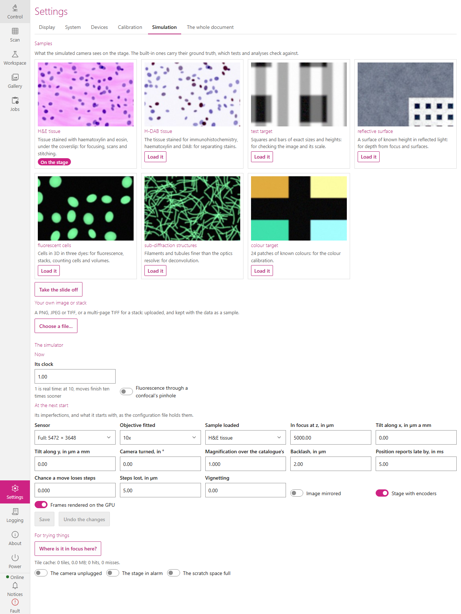
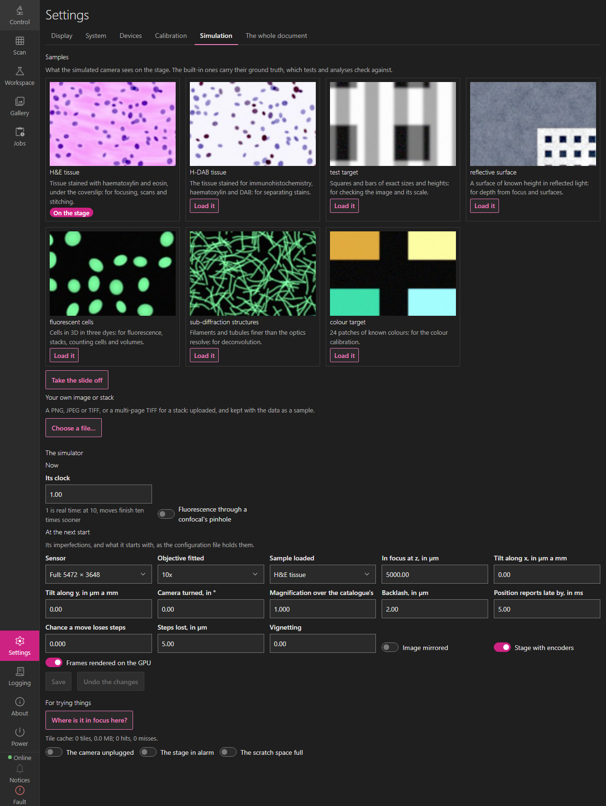

# W8.4: Simulated samples

- Status: In review
- Branch / PR: `m2/w8.4-samples` / [#133](https://github.com/lucaswewa/OScope/pull/133)
- Estimate: first 1,400, the spec's · second ~1,700 (code ~750, tests ~280, styles ~130, try-it ~420, glue ~120), in the plan's change log before the code, 21 % over the first · measured 1,289 (code 633: the server's 71, the app's 562; styles 110; tests 132; try-it 299; glue 115, the scripts that record the samples' pictures), 24 % under the second; the simulation Thing's description snapshot, 23 lines, and the pictures, generated, left out

## Summary

Choosing what the simulator shows, and bringing one's own images to it ([spec](../phases.md#w8-4), D23), in a sixth view of the Settings tab, *Simulation*:

- **Samples:** the simulator's seven built-in samples, each with its picture and what it is for, and one's own, said as one's own. One is loaded onto the stage, or the slide taken off.
- **One's own:** a PNG, JPEG or TIFF, or a multi-page TIFF for a stack, uploaded (W6.3) and imported as a sample. The import takes its name, its pixel's size, a stack's step, and the light it is seen in: transmitted, reflected, or fluorescence in one of four dyes.
- **The simulator, now:** its clock's rate, and fluorescence through a confocal's pinhole.
- **The simulator, at the next start:** its sensor, objective and sample, where the slide is in focus, its tilt, and its imperfections, as the configuration file holds them: the camera's turn and mirror, the magnification's error, backlash, late position reports, encoders, lost steps, vignetting, and rendering on the GPU. A value that can't be is said at its field, and nothing is saved; a change waits for a restart, which the page says, and offers on Power.
- **For trying things:** where the slide is in focus under the stage, the truth autofocus is held to; how the tile cache has done; and three faults to inject and clear, for the status: the camera unplugged, the stage in alarm, the scratch space full.

## What was built

In `web/src/features/settings/simulation/`:

- **`SimulationPane.vue`:** the view, of two panes.
- **`SamplesPane.vue`:** the samples, from `simulation/samples` and `loaded`, through `load` and `unload`; and one's own, uploaded through W6.3's route with its progress, then `simulation/import`.
- **`SimulatorPane.vue`:** `simulation/rate` and `confocal`; the next start's settings, from `settings/simulator`; `in_focus` under the stage's position; `tile_cache`; and `inject_fault`.
- **`simulation.ts`:** the settings as a form, a pair's halves apart, checked, and written back over the document they came from, which keeps what the form doesn't show: the rate, the sensor's colour response and one's own samples. Also each built-in sample's picture, by its name.
- **`pictures/`:** the seven built-in samples as the simulated camera sees each through the 10×, 240 × 160. `web/scripts/record-samples.mjs` records them again: each sample loaded, lit as it is meant to be seen, in focus at the simulator's truth, exposed by auto exposure, and captured with its display rendition.

The server's one change, which the spec didn't name: **`simulation.import` takes an `upload`** as well as a `path`. The simulator reads a sample's file each time it is loaded, so an upload is copied into the data's `simulation` folder, as `<upload>-<its name>`. The staged file is removed once the sample is added. A file that isn't a sample leaves nothing behind, and a path besides an upload, or neither, is refused.

## How to try it

On the CUDA build, as W6's notes say:

```sh
cargo build --release -p oscope-server --features cuda
npm --prefix web ci && npm --prefix web run build
target/release/oscope-server --config configs/oscope.toml --port 8211 --web web/dist
```

1. **On Control,** home the stage, and start streaming over the tissue (x 40,000 µm, y 12,000 µm).
2. **Open Settings, then *Simulation*.** Load the *fluorescent cells*. Back on Control, turn on *blue 488* and off *transmitted*: the live view shows the cells.
3. **Upload a photograph:** *Choose a file…*, a JPEG, its pixel 10 µm, *Import it*, then *Load it*. Move to the coverslip's middle (x 47,000 µm, y 12,500 µm): the live view shows it.
4. **Set *Its clock* to 10:** a stage move of 2 mm at 1 mm/s finishes in a fifth of a second.
5. **At the next start:** change the backlash and *Save*: the page says the restart it waits for.

## Screenshots

| | Light | Dark |
|---|---|---|
| The samples, one's own, and the simulator |  |  |

## Design notes and deviations from the plan

- **The samples' pictures are recorded once and bundled.** The server says a sample's name, kind and whether it carries ground truth, and renders a sample only through its camera. A picture taken through it is what the sample looks like, which is what the view needs. One's own samples show no picture: they are the user's own files.
- **What each is for** is the app's words, keyed by the built-in sample's name, as the simulator's own descriptions say it.
- **The import of an upload is server work** the spec didn't name: `simulation.import` read only a path on the server's disk, and W6.3's uploads are staged and removed once used.
- **Noise isn't a setting:** the spec names it among the imperfections, but the simulator's camera noise follows its sensor's model, with no setting. The form has every imperfection the simulator has.
- **The next start's settings are the whole `[simulator]` section,** written back with what the form doesn't show kept, so a change here never loses the colour response or one's own samples.
- **A select's value can't be empty** in the app's lists, so *None* for the sample at the start stands for the empty name.

## Tests

- **The server, 1 new:** an upload imported as the simulator's sample, listed without ground truth, kept beside the data, no longer staged, and loaded; then refused: the upload again, a path besides it, and neither.
- **Unit, 4 new:**
  - the form shows each pair's halves apart, and writes them back as pairs;
  - it keeps what it doesn't show;
  - it refuses what can't be;
  - each built-in sample has its picture, one's own none.
- **End to end, `simulation.spec.ts`, 5 new, 1 visual and 1 for the notes' screenshots,** in Chromium, the first in Firefox and WebKit too:
  - a sample loaded from Settings changes the live frames: the stained tissue's colour gone with the test target loaded;
  - one's own red image, uploaded, imported at 10 µm a pixel, said as one's own, loaded, and the live image red over the coverslip's middle;
  - the clock at 10 takes a 2 mm move from 2 s to under 0.6 s;
  - the next start's settings saved, the colour response kept, the restart said; a magnification of 0 said at its field, and *Save* refused; and the camera unplugged from the page turning the shell's indicator from OK to Fault, and back;
  - axe, in both themes;
  - the view's baseline, and the Settings and Calibration views' again, as the tab list grew, on Windows and Linux, each passing 3 of 3.
- **Found by its own tests:**
  - every number in the settings' form was left out of the draft: a handler written as a call, `number(field)`, which a Vue template runs as a statement. It is called with the value now;
  - the fault's test passed without the fault: the shell said Fault for the unhomed stage already. It homes the stage first;
  - the camera's thumbnail of a raw frame is grey: the pictures are the capture's display rendition, in colour.
- **Mutation checks, 13, all caught, none hung:**
  - in the server: the upload left staged, a path besides an upload taken, and the staged file read, not a copy;
  - in the form: the tilt's halves swapped, what the form doesn't show lost, a magnification of 0, a chance past 1, and a picture looked for by another name;
  - in the browser: a sample never loaded, the upload named by its file, the clock not written, a wrong field not said, and a fault never injected.
- **The try-it,** on the debug server: `simulation.spec.ts`, its screenshots among it.
- **W8.1's display baseline** differed once in 18 runs on Windows, its layout taken mid-change; 10 of 10 then.
- **Two cores, five times:** TWOCORE
- **The replays:** REPLAYS
- **Docs:** the relative links and anchors in the Markdown files resolve.

## Follow-ups and known gaps

- **On the real instrument,** the `simulation` Thing isn't served, and the view finds no samples. It could be left out of the tab list there.
- **A picture of one's own sample** would need the server to render it, as the camera does, or the file kept for the view.

## Clean room

Nothing was copied from `microscope` or any other codebase. The pictures are the simulator's own, through its camera. No dependency was added.
